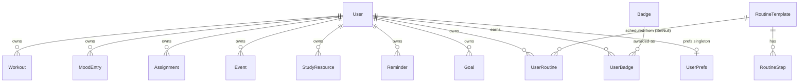

# Wellness Hub — Master Project Architecture Document (PAD) v1.0

**Classification:** Internal Engineering Reference
**Status:** DEFINITIVE, PRODUCTION-LOCKED BLUEPRINT
**Companion Document:** `README.md` (onboarding), `AGENTS.md` (agent contract), `CLAUDE.md` (workflow reference), `docs/plans/2026-10-29-wellness-hub-build.md` (the build plan)
**Last Updated:** 2026-10-29
**Audience:** Senior Engineers, Tech Leads, DevOps, Onboarding Engineers, and AI coding agents
**Rule:** Every architectural decision in this document traces to a specific rationale.
Nothing is here "because it's popular."

---

## Table of Contents

1. [System Overview & Decisions](#1-system-overview--decisions)
2. [High-Level System Topology](#2-high-level-system-topology)
3. [Application Architecture](#3-application-architecture)
4. [Data Architecture](#4-data-architecture)
5. [Design System Reference](#5-design-system-reference)
6. [Security Architecture](#6-security-architecture)
7. [Background & Utility Services](#7-background--utility-services)
8. [Testing Strategy](#8-testing-strategy)
9. [Build & Deployment](#9-build--deployment)
10. [Developer Handbook](#10-developer-handbook)
11. [Known Issues & Outstanding Tasks](#11-known-issues--outstanding-tasks)
12. [Key Files Reference](#12-key-files-reference)
13. [Glossary](#13-glossary)

---

## 1. System Overview & Decisions

### 1.1 Document Metadata & Purpose

Wellness Hub is a production-grade clone of the reference student-wellness
app **EvolveWell** (`https://evolve-well-d6cec85d.base44.app/`): a personal
companion for students covering exercise tracking, a mood journal,
assignments, events, study resources, reminders, routine templates, a
learning center and a gamified goals/achievements engine — rebuilt as one
Next.js application with an intentional functional superset over the
reference (real auth ladder, live theming, SEO, tests).

Use this PAD when onboarding, debugging, reviewing tech choices, or
extending a module. The reference-parity contract (visual) and the
superset contract (functional) are both documented here so a change can be
evaluated against both.

### 1.2 Technology Stack Summary

| Layer | Technology | Version | Key Rationale |
|-------|-----------|---------|---------------|
| Web framework | Next.js (App Router) | 16.4 | RSC pages + route handlers in one artifact; the reference is a self-contained app — one deployable keeps parity |
| UI runtime | React | 19.3 | Server components by default; `forwardRef`-free function components |
| Language | TypeScript | 5.9 | Full strict; the build is the type gate (no `ignoreBuildErrors` escape) |
| Styling | Tailwind CSS | 4.3 | CSS-first `@theme` — matches the reference's computed token system; no config JS |
| Primitives | Radix UI | 1.3–2.4 | Dialog/Sheet drawer, dropdown, select, popover, tabs — the reference's own component genus (shadcn-style) |
| State | Zustand | 5.15 | One store, no React Query/SWR — the app's read pattern is "hydrate once, mutate, refresh slice" |
| ORM | Prisma | 6.19 | Typed SQLite access; schema-as-code for the 14-model domain |
| Database | SQLite | — | Zero-config local parity with the reference; absolute-path swap for production |
| Validation | Zod | 4.6 | One seam (`parseBody`) for every body boundary — the reference's inline validation replaced with a pinned contract |
| Icons | lucide-react | 0.525 | The reference's own icon set (bundle-decoded pin) |
| Unit tests | Vitest | 5.0 | Node-fast, alias-aware (`@/`), matches `*.test.ts` only |
| E2E tests | Playwright | 1.64 | Drives the PRODUCTION standalone build — validate what ships |
| Runtime | Bun | 1.3 | Install + script runner; the reference's toolchain genus |

### 1.3 Architecture Decision Records (ADRs)

**ADR-001: One Next.js App Router application, self-hostable standalone**

- **Context:** The reference is a single-tenant personal app on a hosted
  platform (base44). The clone must run anywhere with zero external
  services.
- **Decision:** A single Next.js App Router app; `next build` with
  `output: "standalone"`; SQLite at the repo root; no external cache,
  queue or auth service.
- **Rationale:** Parity with the reference's all-in-one shape; the
  smallest self-hosting surface (one process + one db file).
- **Consequences:** + simplest deploy; − no horizontal scale story (fine
  for a personal wellness app).
- **Alternatives Rejected:** Separate API + SPA (two deployables, CORS,
  duplicated auth); keep the CRM's multi-surface shape (wrong domain).

**ADR-002: Hand-rolled scrypt + HMAC cookie auth (no NextAuth)**

- **Context:** The reference uses platform-managed auth; a clone needs an
  equivalent without a vendor.
- **Decision:** `src/lib/auth.ts` + the pure `password.ts` seam: scrypt
  password hashes, HMAC-SHA256 signed stateless `wellness_session` cookie
  (7-day TTL) with a `tokenVersion` revocation dimension, hashed-at-rest
  OTP and reset tokens, per-IP rate limits on every public auth route.
- **Rationale:** Zero auth dependencies; every property (TTL, revocation,
  timing equalization, lockout ladder) is testable and pinned.
- **Consequences:** + full control, fully tested; − no OAuth out of the
  box (the Google button honestly reports "not configured").
- **Alternatives Rejected:** NextAuth (vendor-shaped, heavy for one
  user-session model); JWTs in localStorage (XSS-exposed); session table
  (state to manage for no gain at this scale).

**ADR-003: SQLite at the repo root via a relative `DATABASE_URL`**

- **Context:** The operator's contract pins
  `DATABASE_URL="file:../db/custom.db"` with `db/` at the repo root.
- **Decision:** `src/lib/db-path.ts` resolves the relative `file:` URL
  against `prisma/schema.prisma` — exactly like the Prisma CLI — so CLI,
  `next build` and the runtime all land on `<repo>/db/custom.db`
  regardless of the process working directory. Pinned by
  `tests/db-path.test.ts`.
- **Rationale:** `process.cwd()` differs between the CLI, dev and the
  standalone server; anchoring on the schema file is the only invariant.
- **Consequences:** + one predictable db location; − relative URLs are
  unusual (documented + pinned instead of "fixed").
- **Alternatives Rejected:** Absolute paths in `.env` (machine-specific);
  `process.cwd()` resolution (the standalone server runs from
  `.next/standalone/` — silently wrong).

**ADR-004: One Zustand store; the API envelope is the only client contract**

- **Context:** Eleven modules × CRUD + an aggregate dashboard; RSC pages
  with client islands for interactions.
- **Decision:** `src/stores/wellness-store.ts` holds all server state; the
  store's `call()` helper is the only sanctioned `fetch` path; handlers
  answer `{ ok, data } | { ok, error: { code, message } }` via
  `ok()/fail()/ERR.*` (`src/lib/api.ts`).
- **Rationale:** One error/typing story; components stay thin; the
  envelope is greppable and pinned.
- **Consequences:** + predictable data flow; − the store is a single large
  file (sliced internally by module).
- **Alternatives Rejected:** React Query (cache complexity the app does
  not need); SWR (same); context-based state (re-render storms).

**ADR-005: Dual-case route aliases — canonical lowercase + capitalized re-export folders**

- **Context:** The reference's own hrefs are `/Dashboard`, `/Routines`,
  `/Exercise` … (capitalized).
- **Decision:** Every module ships both folders under `src/app/(app)/`:
  the lowercase canonical implementation and a capitalized alias that
  re-exports it. Both families are e2e-pinned.
- **Rationale:** The reference's hrefs must work verbatim (parity), while
  the Next.js convention stays lowercase (tooling, predictability).
- **Consequences:** + every reference URL works; − doubled folders
  (documented as intentional; grep before "fixing").
- **Alternatives Rejected:** Redirects from capitalized to lowercase
  (changes the URL bar — a visible parity break); lowercase-only (the
  reference's hrefs 404).

**ADR-006: Theme engine as CSS custom properties written by a Zustand store**

- **Context:** The superset includes Light/Dark/Auto + 8 color presets
  applied live, persisted locally AND synced across devices.
- **Decision:** `src/stores/theme-store.ts` writes `--primary`,
  `--secondary`, derived hovers, radius and animation tokens on `<html>`;
  persists to localStorage; syncs the `UserPrefs` row via `/api/prefs`.
  All component classes reference tokens, so presets re-skin everything.
- **Rationale:** Changing tokens re-skins without re-render logic; the
  localStorage copy renders instantly pre-hydration and the server row
  carries cross-device state.
- **Consequences:** + live theming with no component changes; − a brief
  local-first flash on a brand-new device (accepted).
- **Alternatives Rejected:** Tailwind config JS theming (v4 has no config
  JS); per-component variant maps (massive duplication).

**ADR-007: The badge/points engine awards server-side at the CRUD seams**

- **Context:** Achievements must be tamper-proof (points feed the
  leaderboard-style stat).
- **Decision:** `src/lib/badges-server.ts` evaluates the 8-badge catalog
  inside the mutation handlers (workout create, goal completion, journal
  streaks …); `src/lib/wellness.ts` holds the pure math (streaks, points),
  Vitest-pinned.
- **Rationale:** Client-side awarding is spoofable and untestable; the
  seams are already guarded by auth + ownership checks.
- **Consequences:** + tamper-proof, unit-testable; − awarding logic is
  spread across handlers (each pin documented in the catalog).
- **Alternatives Rejected:** A cron sweep (delayed awarding); client-side
  awarding (spoofable).

**ADR-008: Tailwind v4 with pinned bug-fix rewrites**

- **Context:** Tailwind v4 renamed the shadow/blur scales and changed
  hover-variant compilation; the chassis hit all three live.
- **Decision:** `@custom-variant hover (&:hover)` unwrap + `--shadow-sm`
  and `--blur-sm` re-pins, all in `src/app/globals.css`, with comments
  carrying the history. LITERAL hex values inside `@theme` (no `var()`
  chains — v4 resolves the block once).
- **Rationale:** Each pin is a real bug fixed once; removing it regresses
  parity with the reference's computed styles.
- **Consequences:** + parity; − the pins look redundant to a fresh agent
  (documented in three docs).
- **Alternatives Rejected:** v4 defaults (visibly heavier shadows, dead
  hover states); v3 (the stack moves forward; the chassis is v4-native).

---

## 2. High-Level System Topology

```mermaid
flowchart TB
    subgraph Client
        B[Browser — desktop / mobile]
    end
    subgraph App["Next.js 16 standalone (one process)"]
        RSC[RSC pages: (app) group — 11 modules + login/signup/reset]
        RH[Route handlers /api/* — 15 families]
        MWL[Layout guards: (app) redirect → login wall]
        INST[Boot gate: instrumentation → boot-env AUTH_SECRET check]
    end
    subgraph Data
        DB[("SQLite — db/custom.db\n(repo root, git-ignored)")]
    end

    B -->|HTTPS| RSC
    B -->|JSON envelope| RH
    RSC --> RH
    RH -->|Prisma 6.19 via db-path| DB
    INST -.refuses to boot without AUTH_SECRET.-> App
```

- **Client layer:** any modern browser; the mobile shell is the same app
  with a `md:hidden` glass header + Radix Sheet drawer (e2e-pinned).
- **App layer:** ONE Node process, no external queue/cache/workers. The
  `(app)` route-group layout is the page-level auth guard; every handler
  re-checks the session (`requireSession`) — defense in depth.
- **Data layer:** SQLite file at the repo root (the WH-4 round retired
  the dead upload route family + its `uploads/` FS surface — zero
  consumers; the reference carries no upload surface).
- **External services:** none at runtime. Unsplash thumbnail URLs and the
  reference's placeholder video URLs are static content links, not
  dependencies.

---

## 3. Application Architecture

### 3.1 The Layer Model

```
Layer 0: Content data — prisma/seed.ts + the Badge/RoutineTemplate/Tutorial
         catalog tables. Rule: seeded content is DATA, never components.
Layer 1: Pure seams — src/lib/{wellness,password,verification,format,...}.ts
         Rule: node-safe, no store/prisma imports; Vitest-pinned.
Layer 2: Server surface — src/app/api/* handlers + src/lib/{auth,api,...}.ts
         Rule: requireSession → parseBody(zod) → ownership check → prisma →
         ok()/fail(); badges award HERE, never in components.
Layer 3: Client stores — src/stores/{wellness-store,theme-store}.ts
         Rule: the ONLY fetch path (the call() helper); no bare fetch in
         components; actions refresh affected slices.
Layer 4: Components — src/components/{layout,shared,ui} + page shells
         Rule: thin; pass plain data to Layer 1 helpers; no local server
         state; dialogs remount forms via key.
Layer 5: Routes — src/app/(app)/* dual-case pages + auth pages
         Rule: the (app) layout redirects unauthenticated visits; the
         capitalized aliases only re-export — no logic in them.
```

**The Golden Rule:** data flows DOWN from the API through the store into
components; events flow UP through store actions back to the API. Nothing
skips a layer: components never touch prisma, fetch, or badge logic.

### 3.2 Annotated Directory Structure

```
wellness-hub/
├── prisma/
│   ├── schema.prisma        # 15 models: User + 10 owned entities (incl. the prefs singleton) + 4 seeded content models
│   └── seed.ts              # idempotent: content wipe+reseed; demo user by UPSERT-BY-EMAIL
├── src/
│   ├── app/
│   │   ├── (app)/           # auth-guarded route group
│   │   │   ├── layout.tsx   # the guard: unauthenticated → /login with from_url
│   │   │   ├── dashboard/   # canonical lowercase implementations ×11
│   │   │   ├── Dashboard/   # capitalized re-export aliases ×11 (reference hrefs)
│   │   │   └── …            # routines, exercise, mentalhealth, assignments, events,
│   │   │                    # studyresources, reminders, learning, goals, profile
│   │   ├── api/             # route-handler families (see §3.3)
│   │   ├── login/           # the EvolveWell auth card (sign-in / forgot / signup / verify)
│   │   ├── signup/  reset-password/
│   │   ├── layout.tsx       # root layout: metadataBase, fonts, theme boot, Toaster
│   │   ├── globals.css      # @theme tokens, dark overrides, the Tailwind v4 pins
│   │   ├── error.tsx  global-error.tsx  not-found.tsx
│   │   ├── sitemap.xml  robots.txt  manifest.json   # SEO family (build-time)
│   │   └── instrumentation.ts  # the boot gate (AUTH_SECRET fail-fast)
│   ├── components/
│   │   ├── layout/          # app-shell, sidebar, mobile-nav (Sheet drawer), login-card,
│   │   │                    # nav-config, guest-login-redirect, reset-password-screen
│   │   ├── shared/          # cross-module parts: stat cards, dialogs, calendar, star rating
│   │   └── ui/              # the six live primitives: dialog, input, label,
│   │                        # select, tabs, toast (Radix rides dialog/select/label)
│   ├── lib/
│   │   ├── wellness.ts      # streaks, points, badge eval, reminder status, tag codec
│   │   ├── badges-server.ts # server-side awarding at the CRUD seams
│   │   ├── auth.ts          # session mint/verify, requireSession, tokenVersion
│   │   ├── password.ts      # pure scrypt hash/verify + the timing equalizer
│   │   ├── api.ts           # ok()/fail()/ERR.*, parseBody(), requireSession()
│   │   ├── schemas.ts       # zod ^4 contract for every body boundary
│   │   ├── db-path.ts       # relative DATABASE_URL resolution (pinned)
│   │   ├── rate-limit.ts    # per-IP sliding windows on public auth routes
│   │   ├── constants.ts     # APP_* identity + every OptionMeta vocab + presets
│   │   ├── theme tokens in globals.css / theme-store.ts
│   │   ├── login-reset.ts   # the auth card's view-machine (pinned)
│   │   ├── page-layout.ts   # per-page layout contracts
│   │   ├── format.ts  chunk-recovery.ts
│   │   ├── boot-env.ts      # the production AUTH_SECRET gate
│   │   └── site.ts          # canonical origin for SEO metadata
│   ├── stores/
│   │   ├── wellness-store.ts # ALL server state; call() envelope client
│   │   └── theme-store.ts    # CSS-variable writer + UserPrefs sync
│   └── types/               # shared domain types
├── tests/                   # Vitest *.test.ts (21 suites, 331 checks)
│   └── e2e/                 # Playwright *.spec.ts (42 checks) + setups
├── scripts/
│   ├── smoke-test.sh        # 14-check ladder against the standalone artifact
│   └── prisma-env.ts  census.ts
├── db/                      # SQLite files (git-ignored): custom.db, e2e.db, smoke.db
├── docs/
│   ├── plans/               # the build plan (implementation reference)
│   ├── screenshots/          # every page, desktop + mobile captures
│   ├── DEPLOYMENT.md
│   ├── Tailwind-V4-Validation-Report.md
│   └── how-to-git-push-using-ssh-wrapper_SKILL.md  + ssh_git_wrapper_v3.py
├── skills/                  # the operator's skill catalog (ESLint-ignored)
├── AGENTS.md  CLAUDE.md  README.md  Project_Architecture_Document.md
├── worklog.md               # the session-by-session engineering log
└── package.json             # bun scripts; the dead-dep census pin guards the dep tree
```

### 3.3 Critical Code Patterns

**Pattern 1 — the guarded mutation handler (every body route):**

```typescript
// The single shape EVERY mutating handler follows. Why: one place for
// auth, validation, ownership and the envelope — a new route copies this
// and cannot forget a layer.
export async function POST(req: Request) {
  const user = await requireSession(req);          // 401 via fail(ERR.UNAUTHENTICATED)
  const body = await parseBody(req, workoutCreate); // 400 with field message
  const created = await db.workout.create({
    data: { ...body, userId: user.id },            // ownership = scoping, never a param
  });
  await awardBadges(user.id);                      // the engine rides the seam
  return ok(created);                              // { ok: true, data }
}
```

*Why this pattern:* the mutation seams are where security and gamification
both live; centralizing them in the handler shape means the e2e CRUD cycle
plus the ownership pins cover every route family at once.

**Pattern 2 — the store's `call()` envelope client:**

```typescript
// The ONLY sanctioned fetch path. Why: the envelope, auth cookie, error
// toast and slice-refresh are ONE implementation — components cannot
// diverge.
const res = await fetch(input, { credentials: "include", ...init });
const json = await res.json();
if (!json.ok) throw new EnvelopeError(json.error);
return json.data;
```

*Why this pattern:* an eleven-module app with per-route `fetch` calls
drifts on error handling within a week; one `call()` keeps the envelope
greppable and the toasts uniform.

**Pattern 3 — pure domain seams:**

```typescript
// From src/lib/wellness.ts — the streak is a pure function over dates.
export function currentStreak(dates: (Date | string)[], now = new Date()): number {
  // forgiving convention: an entry today OR yesterday keeps the streak live
}
```

*Why this pattern:* streak math, points and tag codecs are exactly the
kind of logic that rots inside components; extracted, they are
property-testable and reused by the dashboard, the journal and the badge
engine without server round-trips.

**Pattern 4 — dual-case route alias:**

```typescript
// src/app/(app)/Dashboard/page.tsx — the alias carries NO logic.
export { default, metadata } from "../dashboard/page";
```

*Why this pattern:* the reference's hrefs are capitalized; redirects would
change the URL bar (a visible parity break), so an empty re-export keeps
both families native.

**Pattern 5 — the theme engine's token write:**

```typescript
// theme-store.ts applies a preset by writing CSS custom properties on <html>.
document.documentElement.style.setProperty("--primary", preset.primary);
// every component class references var(--primary) — the whole app re-skins
// with zero component changes.
```

*Why this pattern:* variant maps per preset would duplicate every
component; tokens keep theming a data problem.

---

## 4. Data Architecture

### 4.1 Database Schema

SQLite via Prisma. Fifteen models in three genera:

1. **The auth user** — `User`: email, name, scrypt `passwordHash`, hashed
   OTP + attempts + expiry, `tokenVersion`, hashed-at-rest single-use
   `resetToken` (60-min TTL), role (`"user"` — display-only, the
   reference's own account-tab value; the WH-4 round retired the dead
   CRM-era `avatarColor`/`photoUrl` columns — never rendered).
2. **Owned entities** (all `userId` + `onDelete: Cascade`): `Workout`,
   `MoodEntry`, `Assignment`, `Event`, `StudyResource`, `Reminder`, `Goal`,
   `UserRoutine`, `UserBadge` (unique `[userId, badgeId]`), `UserPrefs`
   (unique `userId` — the theme singleton).
3. **Seeded content** (no ownership): `Badge` (catalog, unique key),
   `RoutineTemplate` (unique key) + `RoutineStep` (cascade under its
   template), `Tutorial` (unique key).



### 4.2 Data Models (key field contracts)

- `Workout`: type (8-value vocab), `durationMinutes`, intensity
  (light/moderate/intense), optional calories/notes, indexed `[userId, date]`.
- `MoodEntry`: mood (amazing/good/okay/low/struggling), `energy` 0–10,
  `activities` as a JSON string array (the tag codec), gratitude/reflection.
- `Assignment`: priority (low/medium/high/urgent), `status`
  (pending/completed) + `completedAt`, optional due date and estimated hours.
- `Event`: date + `"HH:mm"` time (display formats to 12h), category vocab,
  optional location — indexed `[userId, date]` for the calendar.
- `StudyResource`: subject, type (8-value vocab), 1–5 `rating`, `tags` JSON
  array, optional URL/exam date.
- `Reminder`: `remindAt`, type (custom/assignment/event/goal/routine),
  priority, repeat (none/daily/weekly/monthly), `completed` + `completedAt`.
- `Goal`: category + frequency vocab, `targetValue`/`currentValue`/`unit`,
  deadline, `points` (frequency-derived at creation), status — completion
  moves the points onto the account.
- `RoutineTemplate`: name, category, timeOfDay, display duration,
  difficulty (easy/moderate), `benefits` JSON array, tips, video/thumbnail
  URLs — the seed carries the reference's own content byte-exact.
- `UserPrefs`: themeMode (light/dark/auto), primary/secondary colors,
  fontFamily, sidebar/card styles, animationLevel, notification toggles.

**JSON columns rule:** Prisma SQLite has no list primitives — arrays
(steps, benefits, tags, activities) are JSON string columns with a codec in
`src/lib/wellness.ts` and zod schemas at the boundary.

### 4.3 Persistence Strategy

- No connection pooling (SQLite); the Prisma client is a module singleton
  (`src/lib/db.ts`) — one client per process, dev-hot-reload-safe.
- The seed is idempotent by design: content tables are wiped and re-seeded;
  the demo user lands via UPSERT-BY-EMAIL so session cookies survive a
  reseed.
- Read bounding: list endpoints cap page sizes; the dashboard aggregate
  computes from bounded sub-queries, not full-table reads.
- The e2e and smoke suites each run on their OWN scratch database
  (`db/e2e.db`, `db/smoke.db`) — the dev database is never a test fixture.

---

## 5. Design System Reference

### 5.1 Typographic System

- `--font-sans`: the system stack `ui-sans-serif, system-ui, sans-serif,
  "Apple Color Emoji", "Segoe UI Emoji", "Segoe UI Symbol", "Noto Color
  Emoji"` — identical to the reference's computed font (live-probed); the
  emoji fonts in the stack render the mood/resource glyphs on every OS.
- Display: system stack via `@theme`; no external webfonts (zero layout
  shift, matches the reference).

### 5.2 Color Tokens

| Token | Light | Dark | Usage |
|-------|-------|------|-------|
| `--primary` | `#6366f1` indigo-500 | kept | Buttons, active nav, links, chips |
| `--secondary` | `#a855f7` purple-500 | kept | Gradient partner |
| Brand gradient | `linear-gradient(135deg, #6366f1, #a855f7)` | kept | Page headings (gradient text), hero tiles, drawer active pill |
| `--color-sidebar` | `rgb(250 250 250)` | `#111113` | The light sidebar face |
| `--color-sidebar-hover` | `#f4f4f5` | `#1c1c1f` | Nav hover |
| `--shadow-sm` | `0 1px 2px 0 rgb(0 0 0 / 0.05)` | same | The v4 re-pin — the reference's computed outline |

Contrast: body text `#171717` on white; secondary `#71717a`; both clear
WCAG AA in light mode; dark mode inverts via the `.dark` overrides in
`globals.css`.

### 5.3 Component Primitives

- The six live primitives in `src/components/ui/`: dialog, input, label,
  select, tabs, toast (the z-[100] portal) — Radix rides
  dialog/select/label; input/tabs/toast are hand-rolled. The mobile
  drawer is a Radix Sheet built on the dialog primitive
  (`src/components/layout/mobile-nav.tsx`); the seven CRM-era modules
  (avatar/badge/button/card/dropdown/icons/table) retired at WH-4 and
  the ui-module census pin (`tests/route-census.test.ts`) locks the set.
- Stat tiles: pastel backgrounds + saturated chip text + solid glyphs —
  the reference's computed style, captured in `docs/screenshots/02-dashboard.png`.
- Sidebar: `rounded-xl` menu buttons with the gradient active pill;
  mobile is a Radix Sheet drawer behind the glass `md:hidden` header
  (`backdrop-blur-xl` — the reference's own blur(24px); the 4px
  `--blur-sm` re-pin serves the login card's glass).

### 5.4 Motion / Animation

- `tw-animate-css` for enter/exit pairs (dialog, drawer, toast).
- The `animationLevel` pref (full/subtle/none) gates animation classes —
  the "none" level is the reduced-motion story; the store also respects
  `prefers-reduced-motion` at boot.

---

## 6. Security Architecture

### 6.1 Security Rules

| Rule | Enforcement |
|------|-------------|
| Every API route requires a valid session | `requireSession(req)` — HMAC-verified `wellness_session` cookie, 401 otherwise |
| Every body validated | `parseBody(zod)` — 400 with a field message; no ad-hoc parsing |
| Every mutation ownership-checked | The record's `userId` must equal the session's — mismatch answers 404 (no enumeration) |
| Passwords never stored raw | scrypt `scrypt:salt:hash` (`password.ts`); login miss burns a timing-equalizer scrypt |
| Session cookies revocable | `tokenVersion` embedded at mint; a password reset increments it and kills all pre-reset cookies |
| OTP and reset tokens hashed at rest | scrypt (OTP) / SHA-256 (reset); plaintext lives only in the delivery surface |
| Reset tokens single-use + TTL | 60-min TTL; consumed atomically via a conditional updateMany |
| Public auth routes rate-limited | per-IP/15-min sliding windows — login 10, signup 10, resend 5, verify 20, forgot 10, reset 10 (`rate-limit.ts`) |
| Proxy IP keying is explicit | `WELLNESS_PROXY_HOPS` declares trusted depth; unparsable fails closed to 1 |
| Production boots refuse weak secrets | `instrumentation.ts` → `boot-env.ts`: missing/short `AUTH_SECRET` = no serve |
| Dead attack surface retired | The upload/users route families (zero consumers, no reference surface) retired at WH-4 — the route-census pin (`tests/route-census.test.ts`) locks the 15-family API set against re-introduction |
| CSRF posture | Cookie is SameSite=Lax; mutating routes are POST-only JSON with the content-type gate (the e2e CSRF probe pins it) |
| Dependency advisories triaged | Re-triaged each ship round (2026-10-29, WH-4): all remaining advisories dev-toolchain transitive, zero runtime request-path exposure; the never-imported jspdf (and its dompurify chain) retired at WH-3, four more orphaned packages at WH-4 — the dead-dep census pin (`tests/dead-deps.test.ts`) keeps the tree free of zero-import packages |

### 6.2 Security Utilities

`src/lib/password.ts` (pure scrypt seam) · `src/lib/auth.ts` (mint/verify/
revoke) · `src/lib/rate-limit.ts` · `src/lib/verification.ts` +
`verification-server.ts` (hashed OTP ladder with lockout) ·
`src/lib/boot-env.ts`.

### 6.3 Authentication & Authorization

- Single role (`user`); authorization = ownership. There is no admin
  surface by design (a personal wellness app).
- Session: stateless HMAC cookie — verifying it is one comparison plus the
  `tokenVersion` check; revocation is a column bump, not a session-store
  sweep.
- Login wall: the `(app)` layout redirects unauthenticated page visits to
  `/login` with a `from_url`; handlers enforce independently (defense in
  depth).

### 6.4 Threat Model

| Vector | Mitigation |
|--------|-----------|
| Credential stuffing | Per-IP login rate limit + the timing equalizer |
| Session theft | 7-day TTL + `tokenVersion` revocation on reset; HttpOnly cookie |
| User enumeration | No-enumeration forgot-password 200; ownership mismatch = 404 |
| OTP brute force | Hashed code + attempt counter with lockout ladder |
| Spoofed gamification | Badges/points award only server-side |

---

## 7. Background & Utility Services

No queues, workers or cron. Utility services worth naming:

- **The seed** (`prisma/seed.ts`): content reseed + demo-user UPSERT — run
  on demand, never scheduled.
- **The smoke ladder** (`scripts/smoke-test.sh`): 14 assertions against the
  standalone artifact on `db/smoke.db`, including the boot-gate probe and
  artifact-hygiene checks.
- **`scripts/census.ts`**: db path + row-count census for drift detection.

---

## 8. Testing Strategy

### 8.1 Test Distribution

| Category | Files | Checks | Location | Framework |
|----------|-------|--------|----------|-----------|
| Unit — auth seams (password, verification, reset, contract, rate limit, boot-env) | 6 | 109 | `tests/auth*.test.ts`, `password-seam`, `rate-limit`, `boot-env` | Vitest |
| Unit — wellness domain (streaks, points, badges, codecs, schemas, stats, helpers, theme) | 5 | 89 | `tests/wellness-*.test.ts` | Vitest |
| Unit — infra (db-path, format, login views, login-reset, chunk-recovery, dead-dep census, route/ui census, signup role, docs-counts lockstep, src-surface census) | 10 | 133 | `tests/*.test.ts` | Vitest |
| E2E — auth ladder (login wall, lockout, reset funnel, revocation) | 1 spec | 11 | `tests/e2e/auth.spec.ts` | Playwright |
| E2E — mobile drawer battery | 1 spec | 6 | `tests/e2e/mobile-navigation.spec.ts` | Playwright |
| E2E — shell (nav, dual-case routes, quick actions) | 1 spec | 6 | `tests/e2e/shell.spec.ts` | Playwright |
| E2E — auth setup project (one-time demo login; shares the cookie via storageState) | 1 setup | 1 | `tests/e2e/auth.setup.ts` | Playwright |
| E2E — CRUD cycles + reset-password funnel | 2 specs | 18 | `tests/e2e/wellness-crud.spec.ts`, `reset-password.spec.ts` | Playwright |

Totals: **331 unit checks / 21 Vitest suites + 42 e2e checks / 5 specs + 1 setup project**.

### 8.2 Test Patterns

- The unit layer tests SEAMS, not components: a pure function's contract,
- a codec's round-trip, a schema's rejection edge.
- The e2e layer tests JOURNEYS against the production standalone server on
  an isolated port + its own scratch db — validate what ships.
- Storage-state auth: sign in once in the `setup` project; every spec
  reuses the cookie (the per-IP limiter makes per-test logins flaky by
  design — the suite structure is the mitigation).
- fast-check property testing is NOT used — the devDep was retired at WH-3
  as a zero-import CRM residue (the census pin guards the tree); the unit
  layer pins seams with plain deterministic cases instead.

### 8.3 Coverage Thresholds

No numeric coverage gate; the doctrine is **contract pinning**: every
documented behavior in AGENTS/CLAUDE/PAD that is testable has a test that
fails if it regresses (db-path, boot gate, envelope, rate limits, the
mobile drawer, the route aliases). A behavior without a pin is a bug in the
docs, not just the code.

### 8.4 Pre-PR / Pre-Deploy Checklist

- `bun run lint` → 0 warnings
- `bun run typecheck` → clean
- `bun run test` → 331/331
- `bun run build` → succeeds (the type gate)
- `bun run smoke` → 14/14
- `CI=1 bun run test:e2e` → 42/42
- `bun audit` (periodic, outside the gate) → re-triaged in §11
- Screenshot/parity pass if ANY visual surface changed

---

## 9. Build & Deployment

### 9.1 Production Build

```bash
bun install
cp .env.example .env         # set AUTH_SECRET (openssl rand -hex 32)
bun run db:push && bun run db:seed
bun run build                # standalone artifact at .next/standalone/
bun run start                # NODE_ENV=production bun .next/standalone/server.js
```

The build copies `static` + `public` into the artifact and REMOVES
`.next/standalone/.env` (env comes from the process environment — the
artifact must be environment-agnostic; the smoke ladder asserts this
hygiene).

### 9.2 Environment Variables

| Name | Required | Description | Default |
|------|----------|-------------|---------|
| `DATABASE_URL` | yes | SQLite path, relative resolved against `prisma/schema.prisma` | `file:../db/custom.db` |
| `AUTH_SECRET` | prod | HMAC session secret, ≥16 chars — boot fails hard without it | dev-only constant (warning) |
| `NEXT_PUBLIC_SITE_URL` | prod | Canonical origin for SEO metadata (build-time inlined) | `http://localhost:3000` |
| `WELLNESS_PROXY_HOPS` | no | Trusted proxy depth for rate-limit IP keying | unset = 1 |
| `WELLNESS_DISABLE_IN_APP_OTP` | no | `1` hides the signup OTP from responses (real mail transport) | `""` |
| `WELLNESS_DISABLE_IN_APP_RESET` | no | `1` hides the reset link from responses | `""` |

### 9.3 Container Configuration

No Dockerfile ships (a single-process Node app; `docs/DEPLOYMENT.md` covers
the VPS/Docker paths). If containerizing: `oven/bun` base, copy the
standalone artifact, mount `db/` as a volume, pass env at
runtime.

### 9.4 CI/CD Pipeline

**There is no hosted CI — the local gate is the only gate.** `bun run
gate` chains: lint → typecheck → test → build → smoke → `CI=1` e2e. Ship
through: commit to main → push via `docs/ssh_git_wrapper_v3.py` (runbook:
`docs/how-to-git-push-using-ssh-wrapper_SKILL.md`; sandboxes without an
`ssh` binary deploy the Appendix A paramiko shim on PATH first).

---

## 10. Developer Handbook

### 10.1 Local Setup

```bash
bun install
cp .env.example .env    # AUTH_SECRET: openssl rand -hex 32
bun run db:push
bun run db:seed
bun run dev             # http://localhost:3000 — demo: sepnetflix2023@outlook.com / $Abcd1234
```

### 10.2 Common Commands

See the table in `AGENTS.md` §Commands (the canonical copy; identical in
`CLAUDE.md`). Highlights: `bun run gate` (everything), `bun run
db:census` (db drift), single suite `bunx vitest run tests/<file>`, single
spec `CI=1 bunx playwright test tests/e2e/<file>`.

### 10.3 Code Style Rules

- ESLint (`--max-warnings 0`) + `tsc --noEmit` + the build's type gate —
  all three must stay clean; there is no formatter config (ESLint owns
  style).
- Enforced habits: early returns, no sync `setState` in `useEffect`
  (ERROR), `key`-remount for dialog forms, tokens over hex literals in
  components, `OptionMeta` vocab constants over hardcoded emoji.

### 10.4 Git Workflow

- `main` ONLY — no feature branches, ever.
- Conventional Commits with emoji prefixes (`:tada: feat:`, `:bug: fix:`,
  `:memo: docs:`).
- Never commit `.env`, `*.key`, `db/*.db`, `node_modules/`.
- Push via the SSH wrapper (see §9.4). No new remotes, no force pushes.

---

## 11. Known Issues & Outstanding Tasks

| Priority | Issue | Impact | Status |
|----------|-------|--------|--------|
| — | ~~jspdf → dompurify advisory chain~~ | RETIRED at WH-3 — jspdf was a zero-import CRM residue (no PDF export ever shipped in the wellness tree; the reference carries no export UI either — live-probed); removing it removed the chain entirely, and `tests/dead-deps.test.ts` pins the dep tree | Closed (retired) |
| LOW | Remaining `bun audit` advisories | 9 (4 high / 4 moderate / 1 low — re-triaged 2026-10-29, the WH-6 round), ALL dev-toolchain transitive (prisma CLI, vitest/vite, eslint plugins — the nested zod@4.6.5 copy, postcss); zero runtime request-path exposure (our runtime zod is 4.6.7); re-triage each ship round (no mid-rotation bumps posture) | Accepted posture |
| LOW | The lockfile's stale `"activity-map"` workspace name (`bun.lock:6` vs package.json `"wellness-hub"`) | Inert carried metadata from a pre-history workspace; probed at WH-4 — `bun install` (including the post-`bun remove` clean reinstall) does NOT sync the name, and a full lockfile regen risks semver drift for zero functional gain | Accepted posture (inert metadata) |
| LOW | Google OAuth button | Visible for parity but reports "not configured on this deployment" — no OAuth credentials ship by design | Intentional |
| LOW | "Watch Video" links open placeholder URLs | The reference's own tutorial/video URLs are placeholders (`example-*`); we open them in a new tab with identical behavior | Intentional parity |
| LOW | Reference's empty-state data | The demo account ships empty lists (the reference's fresh account is also empty); `db:seed --demo` can populate sample rows for exploration | Intentional |

No CRITICAL or HIGH issues are open.

---

## 12. Key Files Reference

| File | Lines | Purpose |
|------|-------|---------|
| `src/lib/wellness.ts` | ~300 | The pure domain seam: streaks, points, badge eval, reminder status, tag codec |
| `src/lib/auth.ts` | ~200 | Session mint/verify/revoke; `requireSession` |
| `src/lib/api.ts` | ~150 | The envelope (`ok`/`fail`/`ERR.*`) + `parseBody` + ownership helpers |
| `src/lib/schemas.ts` | ~250 | Every zod body contract |
| `src/lib/db-path.ts` | ~40 | Relative DATABASE_URL resolution (the pinned contract) |
| `src/lib/constants.ts` | ~300 | App identity + every OptionMeta vocab + theme presets |
| `src/stores/wellness-store.ts` | ~600 | All server state; the `call()` envelope client |
| `src/stores/theme-store.ts` | ~200 | CSS-variable theming + UserPrefs sync |
| `src/components/layout/mobile-nav.tsx` | ~200 | The Sheet drawer (e2e-pinned battery) |
| `src/app/globals.css` | ~400 | @theme tokens, dark overrides, the Tailwind v4 pins |
| `prisma/schema.prisma` | ~300 | The 14-model domain |
| `prisma/seed.ts` | ~500 | Idempotent content + demo-user seed |
| `scripts/smoke-test.sh` | ~200 | The 14-check standalone-artifact ladder |
| `tests/wellness-theme.test.ts` | ~120 | Theme/rebrand pins — incl. the WH-2 src/app NEO-CRM-free scan |
| `tests/e2e/mobile-navigation.spec.ts` | ~150 | The drawer battery |
| `docs/plans/2026-10-29-wellness-hub-build.md` | — | The build plan (reference intelligence + decisions) |
| `worklog.md` | — | The session-by-session engineering log |

(Line counts are approximate.)

---

## 13. Glossary

- **EvolveWell / Wellness Hub** — the reference app's external name / this
  clone's sidebar brand ("Your personal companion").
- **Chassis** — the battle-tested engineering (auth ladder, envelope,
  db-path, shell, tooling) kept from the NEO CRM scaffold while its domain
  was replaced.
- **Dual-case routes** — the intentional pair of lowercase canonical and
  capitalized alias folders mirroring the reference's hrefs.
- **OptionMeta** — the `{value, label, emoji?}` constant type behind every
  dropdown vocab in `src/lib/constants.ts`.
- **Seam** — a pure, node-safe, unit-pinned module boundary (password,
  wellness math, codecs).
- **tokenVersion** — the revocation dimension in the session payload; a
  password reset bumps it and invalidates all prior cookies.
- **The envelope** — `{ ok, data } | { ok, error: { code, message } }`, the
  only API response shape.
- **The gate** — the local pre-ship chain: lint → typecheck → test →
  build → smoke → e2e.
