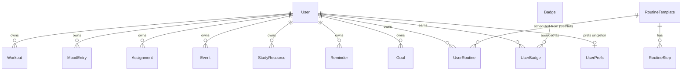

# Wellness Hub — Master Project Architecture Document (PAD) v1.0

**Classification:** Internal Engineering Reference
**Status:** DEFINITIVE, PRODUCTION-LOCKED BLUEPRINT
**Companion Document:** `README.md` (onboarding), `AGENTS.md` (agent contract), `CLAUDE.md` (workflow reference), `docs/plans/2026-10-29-wellness-hub-build.md` (the build plan)
**Last Updated:** 2026-10-29
**Audience:** Senior Engineers, Tech Leads, DevOps, Onboarding Engineers, and AI coding agents
**Rule:** Every architectural decision in this document traces to a specific rationale.
Nothing is here "because it's popular."

---

## Table of Contents

1. [System Overview & Decisions](#1-system-overview--decisions)
2. [High-Level System Topology](#2-high-level-system-topology)
3. [Application Architecture](#3-application-architecture)
4. [Data Architecture](#4-data-architecture)
5. [Design System Reference](#5-design-system-reference)
6. [Security Architecture](#6-security-architecture)
7. [Background & Utility Services](#7-background--utility-services)
8. [Testing Strategy](#8-testing-strategy)
9. [Build & Deployment](#9-build--deployment)
10. [Developer Handbook](#10-developer-handbook)
11. [Known Issues & Outstanding Tasks](#11-known-issues--outstanding-tasks)
12. [Key Files Reference](#12-key-files-reference)
13. [Glossary](#13-glossary)

---

## 1. System Overview & Decisions

### 1.1 Document Metadata & Purpose

Wellness Hub is a production-grade clone of the reference student-wellness
app **EvolveWell** (`https://evolve-well-d6cec85d.base44.app/`): a personal
companion for students covering exercise tracking, a mood journal,
assignments, events, study resources, reminders, routine templates, a
learning center and a gamified goals/achievements engine — rebuilt as one
Next.js application with an intentional functional superset over the
reference (real auth ladder, live theming, SEO, tests).

Use this PAD when onboarding, debugging, reviewing tech choices, or
extending a module. The reference-parity contract (visual) and the
superset contract (functional) are both documented here so a change can be
evaluated against both.

### 1.2 Technology Stack Summary

| Layer | Technology | Version | Key Rationale |
|-------|-----------|---------|---------------|
| Web framework | Next.js (App Router) | 16.4 | RSC pages + route handlers in one artifact; the reference is a self-contained app — one deployable keeps parity |
| UI runtime | React | 19.3 | Server components by default; `forwardRef`-free function components |
| Language | TypeScript | 5.9 | Full strict; the build is the type gate (no `ignoreBuildErrors` escape) |
| Styling | Tailwind CSS | 4.3 | CSS-first `@theme` — matches the reference's computed token system; no config JS |
| Primitives | Radix UI | 1.3–2.4 | Dialog/Sheet drawer, dropdown, select, popover, tabs — the reference's own component genus (shadcn-style) |
| State | Zustand | 5.15 | One store, no React Query/SWR — the app's read pattern is "hydrate once, mutate, refresh slice" |
| ORM | Prisma | 6.19 | Typed SQLite access; schema-as-code for the 15-model domain |
| Database | SQLite | — | Zero-config local parity with the reference; absolute-path swap for production |
| Validation | Zod | 4.6 | One seam (`parseBody`) for every body boundary — the reference's inline validation replaced with a pinned contract |
| Icons | lucide-react | 0.525 | The reference's own icon set (bundle-decoded pin) |
| Unit tests | Vitest | 5.0 | Node-fast, alias-aware (`@/`), matches `*.test.ts` only |
| E2E tests | Playwright | 1.64 | Drives the PRODUCTION standalone build — validate what ships |
| Runtime | Bun | 1.3 | Install + script runner; the reference's toolchain genus |

### 1.3 Architecture Decision Records (ADRs)

**ADR-001: One Next.js App Router application, self-hostable standalone**

- **Context:** The reference is a single-tenant personal app on a hosted
  platform (base44). The clone must run anywhere with zero external
  services.
- **Decision:** A single Next.js App Router app; `next build` with
  `output: "standalone"`; SQLite at the repo root; no external cache,
  queue or auth service.
- **Rationale:** Parity with the reference's all-in-one shape; the
  smallest self-hosting surface (one process + one db file).
- **Consequences:** + simplest deploy; − no horizontal scale story (fine
  for a personal wellness app).
- **Alternatives Rejected:** Separate API + SPA (two deployables, CORS,
  duplicated auth); keep the CRM's multi-surface shape (wrong domain).

**ADR-002: Hand-rolled scrypt + HMAC cookie auth (no NextAuth)**

- **Context:** The reference uses platform-managed auth; a clone needs an
  equivalent without a vendor.
- **Decision:** `src/lib/auth.ts` + the pure `password.ts` seam: scrypt
  password hashes, HMAC-SHA256 signed stateless `wellness_session` cookie
  (7-day TTL) with a `tokenVersion` revocation dimension, hashed-at-rest
  OTP and reset tokens, per-IP rate limits on every public auth route.
- **Rationale:** Zero auth dependencies; every property (TTL, revocation,
  timing equalization, lockout ladder) is testable and pinned.
- **Consequences:** + full control, fully tested; − no OAuth out of the
  box (the Google button honestly reports "not configured").
- **Alternatives Rejected:** NextAuth (vendor-shaped, heavy for one
  user-session model); JWTs in localStorage (XSS-exposed); session table
  (state to manage for no gain at this scale).

**ADR-003: SQLite at the repo root via a relative `DATABASE_URL`**

- **Context:** The operator's contract pins
  `DATABASE_URL="file:../db/custom.db"` with `db/` at the repo root.
- **Decision:** `src/lib/db-path.ts` resolves the relative `file:` URL
  against `prisma/schema.prisma` — exactly like the Prisma CLI — so CLI,
  `next build` and the runtime all land on `<repo>/db/custom.db`
  regardless of the process working directory. Pinned by
  `tests/db-path.test.ts`.
- **Rationale:** `process.cwd()` differs between the CLI, dev and the
  standalone server; anchoring on the schema file is the only invariant.
- **Consequences:** + one predictable db location; − relative URLs are
  unusual (documented + pinned instead of "fixed").
- **Alternatives Rejected:** Absolute paths in `.env` (machine-specific);
  `process.cwd()` resolution (the standalone server runs from
  `.next/standalone/` — silently wrong).

**ADR-004: One Zustand store; the API envelope is the only client contract**

- **Context:** Eleven modules × CRUD + an aggregate dashboard; RSC pages
  with client islands for interactions.
- **Decision:** `src/stores/wellness-store.ts` holds all server state; the
  store's `call()` helper is the only sanctioned `fetch` path; handlers
  answer `{ ok, data } | { ok, error: { code, message } }` via
  `ok()/fail()/ERR.*` (`src/lib/api.ts`).
- **Rationale:** One error/typing story; components stay thin; the
  envelope is greppable and pinned.
- **Consequences:** + predictable data flow; − the store is a single large
  file (sliced internally by module).
- **Alternatives Rejected:** React Query (cache complexity the app does
  not need); SWR (same); context-based state (re-render storms).

**ADR-005: Dual-case route aliases — canonical lowercase + capitalized re-export folders**

- **Context:** The reference's own hrefs are `/Dashboard`, `/Routines`,
  `/Exercise` … (capitalized).
- **Decision:** Every module ships both folders under `src/app/(app)/`:
  the lowercase canonical implementation and a capitalized alias that
  re-exports it. Both families are e2e-pinned.
- **Rationale:** The reference's hrefs must work verbatim (parity), while
  the Next.js convention stays lowercase (tooling, predictability).
- **Consequences:** + every reference URL works; − doubled folders
  (documented as intentional; grep before "fixing").
- **Alternatives Rejected:** Redirects from capitalized to lowercase
  (changes the URL bar — a visible parity break); lowercase-only (the
  reference's hrefs 404).

**ADR-006: Theme engine as CSS custom properties written by a Zustand store**

- **Context:** The superset includes Light/Dark/Auto + 8 color presets
  applied live, persisted locally AND synced across devices.
- **Decision:** `src/stores/theme-store.ts` writes `--primary`,
  `--secondary`, derived hovers, radius and animation tokens on `<html>`;
  persists to localStorage; syncs the `UserPrefs` row via `/api/prefs`.
  All component classes reference tokens, so presets re-skin everything.
- **Rationale:** Changing tokens re-skins without re-render logic; the
  localStorage copy renders instantly pre-hydration and the server row
  carries cross-device state.
- **Consequences:** + live theming with no component changes; − a brief
  local-first flash on a brand-new device (accepted).
- **Alternatives Rejected:** Tailwind config JS theming (v4 has no config
  JS); per-component variant maps (massive duplication).

**ADR-007: The badge/points engine awards server-side at the CRUD seams**

- **Context:** Achievements must be tamper-proof (points feed the
  leaderboard-style stat).
- **Decision:** `src/lib/badges-server.ts` evaluates the 8-badge catalog
  inside the mutation handlers (workout create, goal completion, journal
  streaks …); `src/lib/wellness.ts` holds the pure math (streaks, points),
  Vitest-pinned.
- **Rationale:** Client-side awarding is spoofable and untestable; the
  seams are already guarded by auth + ownership checks.
- **Consequences:** + tamper-proof, unit-testable; − awarding logic is
  spread across handlers (each pin documented in the catalog).
- **Alternatives Rejected:** A cron sweep (delayed awarding); client-side
  awarding (spoofable).

**ADR-008: Tailwind v4 with pinned bug-fix rewrites**

- **Context:** Tailwind v4 renamed the shadow/blur scales and changed
  hover-variant compilation; the chassis hit all three live.
- **Decision:** `@custom-variant hover (&:hover)` unwrap + `--shadow-sm`
  and `--blur-sm` re-pins, all in `src/app/globals.css`, with comments
  carrying the history. LITERAL hex values inside `@theme` (no `var()`
  chains — v4 resolves the block once).
- **Rationale:** Each pin is a real bug fixed once; removing it regresses
  parity with the reference's computed styles.
- **Consequences:** + parity; − the pins look redundant to a fresh agent
  (documented in three docs).
- **Alternatives Rejected:** v4 defaults (visibly heavier shadows, dead
  hover states); v3 (the stack moves forward; the chassis is v4-native).

---

## 2. High-Level System Topology

```mermaid
flowchart TB
    subgraph Client
        B[Browser — desktop / mobile]
    end
    subgraph App["Next.js 16 standalone (one process)"]
        RSC[RSC pages: (app) group — 11 modules + login/signup/reset]
        RH[Route handlers /api/* — 15 families]
        MWL[Layout guards: (app) redirect → login wall]
        INST[Boot gate: instrumentation → boot-env AUTH_SECRET check]
    end
    subgraph Data
        DB[("SQLite — db/custom.db\n(repo root, git-ignored)")]
    end

    B -->|HTTPS| RSC
    B -->|JSON envelope| RH
    RSC --> RH
    RH -->|Prisma 6.19 via db-path| DB
    INST -.refuses to boot without AUTH_SECRET.-> App
```

- **Client layer:** any modern browser; the mobile shell is the same app
  with a `md:hidden` glass header + Radix Sheet drawer (e2e-pinned).
- **App layer:** ONE Node process, no external queue/cache/workers. The
  `(app)` route-group layout is the page-level auth guard; every handler
  re-checks the session (`requireSession`) — defense in depth.
- **Data layer:** SQLite file at the repo root (the WH-4 round retired
  the dead upload route family + its `uploads/` FS surface — zero
  consumers; the reference carries no upload surface).
- **External services:** none at runtime. Unsplash thumbnail URLs and the
  reference's placeholder video URLs are static content links, not
  dependencies.

---

## 3. Application Architecture

### 3.1 The Layer Model

```
Layer 0: Content data — prisma/seed.ts + the Badge/RoutineTemplate/Tutorial
         catalog tables. Rule: seeded content is DATA, never components.
Layer 1: Pure seams — src/lib/{wellness,password,verification,format,...}.ts
         Rule: node-safe, no store/prisma imports; Vitest-pinned.
Layer 2: Server surface — src/app/api/* handlers + src/lib/{auth,api,...}.ts
         Rule: requireSession → parseBody(zod) → ownership check → prisma →
         ok()/fail(); badges award HERE, never in components.
Layer 3: Client stores — src/stores/{wellness-store,theme-store}.ts
         Rule: the ONLY fetch path (the call() helper); no bare fetch in
         components; actions refresh affected slices.
Layer 4: Components — src/components/{layout,shared,ui} + page shells
         Rule: thin; pass plain data to Layer 1 helpers; no local server
         state; dialogs remount forms via key.
Layer 5: Routes — src/app/(app)/* dual-case pages + auth pages
         Rule: the (app) layout redirects unauthenticated visits; the
         capitalized aliases only re-export — no logic in them.
```

**The Golden Rule:** data flows DOWN from the API through the store into
components; events flow UP through store actions back to the API. Nothing
skips a layer: components never touch prisma, fetch, or badge logic.

### 3.2 Annotated Directory Structure

```
wellness-hub/
├── prisma/
│   ├── schema.prisma        # 15 models: User + 10 owned entities (incl. the prefs singleton) + 4 seeded content models
│   └── seed.ts              # idempotent: content wipe+reseed; demo user by UPSERT-BY-EMAIL
├── src/
│   ├── app/
│   │   ├── (app)/           # auth-guarded route group
│   │   │   ├── layout.tsx   # the guard: unauthenticated → /login with from_url
│   │   │   ├── dashboard/   # canonical lowercase implementations ×11
│   │   │   ├── Dashboard/   # capitalized re-export aliases ×11 (reference hrefs)
│   │   │   └── …            # routines, exercise, mentalhealth, assignments, events,
│   │   │                    # studyresources, reminders, learning, goals, profile
│   │   ├── api/             # route-handler families (see §3.3)
│   │   ├── login/           # the EvolveWell auth card (sign-in / forgot / signup / verify)
│   │   ├── signup/  reset-password/
│   │   ├── layout.tsx       # root layout: metadataBase, fonts, theme boot, Toaster
│   │   ├── globals.css      # @theme tokens, dark overrides, the Tailwind v4 pins
│   │   ├── error.tsx  global-error.tsx  not-found.tsx
│   │   ├── sitemap.xml  robots.txt  manifest.json   # SEO family (build-time)
│   │   └── instrumentation.ts  # the boot gate (AUTH_SECRET fail-fast)
│   ├── components/
│   │   ├── layout/          # app-shell, sidebar, mobile-nav (Sheet drawer), login-card,
                          # theme-boot (the root-layout mount that carries the chosen
                          # mode onto the login family — WH-18),
│   │   │                    # nav-config, guest-login-redirect, reset-password-screen
│   │   ├── shared/          # cross-module parts: stat cards, dialogs, calendar, star rating
│   │   └── ui/              # the six live primitives: dialog, input, label,
│   │                        # select, tabs, toast (Radix rides dialog/select/label)
│   ├── lib/
│   │   ├── wellness.ts      # streaks, points, badge eval, reminder status, tag codec
│   │   ├── badges-server.ts # server-side awarding at the CRUD seams
│   │   ├── auth.ts          # session mint/verify, requireSession, tokenVersion
│   │   ├── password.ts      # pure scrypt hash/verify + the timing equalizer
│   │   ├── api.ts           # ok()/fail()/ERR.*, parseBody(), requireSession()
│   │   ├── schemas.ts       # zod ^4 contract for every body boundary
│   │   ├── db-path.ts       # relative DATABASE_URL resolution (pinned)
│   │   ├── rate-limit.ts    # per-IP sliding windows on public auth routes
│   │   ├── constants.ts     # APP_* identity + every OptionMeta vocab + presets
│   │   ├── theme tokens in globals.css / theme-store.ts
│   │   ├── login-reset.ts   # the auth card's view-machine (pinned)
│   │   ├── page-layout.ts   # per-page layout contracts
│   │   ├── format.ts  chunk-recovery.ts
│   │   ├── boot-env.ts      # the production AUTH_SECRET gate
│   │   └── site.ts          # canonical origin for SEO metadata
│   ├── stores/
│   │   ├── wellness-store.ts # ALL server state; call() envelope client
│   │   └── theme-store.ts    # CSS-variable writer + UserPrefs sync
│   └── types/               # shared domain types
├── tests/                   # Vitest *.test.ts (25 suites, 364 checks)
│   └── e2e/                 # Playwright *.spec.ts (68 checks) + setups
├── scripts/
│   ├── smoke-test.sh        # 14-check ladder against the standalone artifact
│   └── prisma-env.ts  census.ts
├── db/                      # SQLite files (git-ignored): custom.db, e2e.db, smoke.db
├── docs/
│   ├── plans/               # the build plan (implementation reference)
│   ├── screenshots/          # every page, desktop + mobile captures
│   ├── DEPLOYMENT.md
│   ├── Tailwind-V4-Validation-Report.md
│   └── how-to-git-push-using-ssh-wrapper_SKILL.md  + ssh_git_wrapper_v3.py
├── skills/                  # the operator's skill catalog (ESLint-ignored)
├── AGENTS.md  CLAUDE.md  README.md  Project_Architecture_Document.md
├── worklog.md               # the session-by-session engineering log
└── package.json             # bun scripts; the dead-dep census pin guards the dep tree
```

### 3.3 Critical Code Patterns

**Pattern 1 — the guarded mutation handler (every body route):**

```typescript
// The single shape EVERY mutating handler follows. Why: one place for
// auth, validation, ownership and the envelope — a new route copies this
// and cannot forget a layer.
export async function POST(req: Request) {
  const user = await requireSession(req);          // 401 via fail(ERR.UNAUTHENTICATED)
  const body = await parseBody(req, workoutCreate); // 400 with field message
  const created = await db.workout.create({
    data: { ...body, userId: user.id },            // ownership = scoping, never a param
  });
  await awardBadges(user.id);                      // the engine rides the seam
  return ok(created);                              // { ok: true, data }
}
```

*Why this pattern:* the mutation seams are where security and gamification
both live; centralizing them in the handler shape means the e2e CRUD cycle
plus the ownership pins cover every route family at once.

**Pattern 2 — the store's `call()` envelope client:**

```typescript
// The ONLY sanctioned fetch path. Why: the envelope, auth cookie, error
// toast and slice-refresh are ONE implementation — components cannot
// diverge.
const res = await fetch(input, { credentials: "include", ...init });
const json = await res.json();
if (!json.ok) throw new EnvelopeError(json.error);
return json.data;
```

*Why this pattern:* an eleven-module app with per-route `fetch` calls
drifts on error handling within a week; one `call()` keeps the envelope
greppable and the toasts uniform.

**Pattern 3 — pure domain seams:**

```typescript
// From src/lib/wellness.ts — the streak is a pure function over dates.
export function currentStreak(dates: (Date | string)[], now = new Date()): number {
  // forgiving convention: an entry today OR yesterday keeps the streak live
}
```

*Why this pattern:* streak math, points and tag codecs are exactly the
kind of logic that rots inside components; extracted, they are
property-testable and reused by the dashboard, the journal and the badge
engine without server round-trips.

**Pattern 4 — dual-case route alias:**

```typescript
// src/app/(app)/Dashboard/page.tsx — the alias carries NO logic.
export { default, metadata } from "../dashboard/page";
```

*Why this pattern:* the reference's hrefs are capitalized; redirects would
change the URL bar (a visible parity break), so an empty re-export keeps
both families native.

**Pattern 5 — the theme engine's token write:**

```typescript
// theme-store.ts applies a preset by writing CSS custom properties on <html>.
document.documentElement.style.setProperty("--primary", preset.primary);
// every component class references var(--primary) — the whole app re-skins
// with zero component changes.
```

*Why this pattern:* variant maps per preset would duplicate every
component; tokens keep theming a data problem.

---

## 4. Data Architecture

### 4.1 Database Schema

SQLite via Prisma. Fifteen models in three genera:

1. **The auth user** — `User`: email, name, scrypt `passwordHash`, hashed
   OTP + attempts + expiry, `tokenVersion`, hashed-at-rest single-use
   `resetToken` (60-min TTL), role (`"user"` — display-only, the
   reference's own account-tab value; the WH-4 round retired the dead
   CRM-era `avatarColor`/`photoUrl` columns — never rendered).
2. **Owned entities** (all `userId` + `onDelete: Cascade`): `Workout`,
   `MoodEntry`, `Assignment`, `Event`, `StudyResource`, `Reminder`, `Goal`,
   `UserRoutine`, `UserBadge` (unique `[userId, badgeId]`), `UserPrefs`
   (unique `userId` — the theme singleton).
3. **Seeded content** (no ownership): `Badge` (catalog, unique key),
   `RoutineTemplate` (unique key) + `RoutineStep` (cascade under its
   template), `Tutorial` (unique key).



### 4.2 Data Models (key field contracts)

- `Workout`: type (8-value vocab), `durationMinutes`, intensity
  (light/moderate/intense), optional calories/notes, indexed `[userId, date]`.
- `MoodEntry`: mood (amazing/good/okay/low/struggling), `energy` 0–10,
  `activities` as a JSON string array (the tag codec), gratitude/reflection.
- `Assignment`: priority (low/medium/high/urgent), `status`
  (pending/completed), optional due date and estimated hours (WH-13: the
  write-only `completedAt` column retired with its seam writes + wire
  members — read by nobody, no reference counterpart).
- `Event`: date + `"HH:mm"` time (display formats to 12h), category vocab,
  optional location — indexed `[userId, date]` for the calendar.
- `StudyResource`: subject, type (8-value vocab), 1–5 `rating`, `tags` JSON
  array, optional URL/exam date.
- `Reminder`: `remindAt`, type (custom/assignment/event/goal/routine),
  priority, repeat (none/daily/weekly/monthly), `completed` (the
  `completedAt` twin retired at WH-13 with the rest of the quartet).
- `Goal`: category + frequency vocab, `targetValue`/`currentValue`/`unit`,
  deadline, `points` (frequency-derived at creation), status — completion
  moves the points onto the account.
- `RoutineTemplate`: name, category, timeOfDay, display duration,
  difficulty (easy/moderate), `benefits` JSON array, tips, video/thumbnail
  URLs — the seed carries the reference's own content byte-exact.
- `UserPrefs`: themeMode (light/dark/auto), primary/secondary colors,
  fontFamily, sidebar/card styles, animationLevel, notification toggles.

**JSON columns rule:** Prisma SQLite has no list primitives — arrays
(steps, benefits, tags, activities) are JSON string columns with a codec in
`src/lib/wellness.ts` and zod schemas at the boundary.

### 4.3 Persistence Strategy

- No connection pooling (SQLite); the Prisma client is a module singleton
  (`src/lib/db.ts`) — one client per process, dev-hot-reload-safe.
- The seed is idempotent by design: content tables are wiped and re-seeded;
  the demo user lands via UPSERT-BY-EMAIL so session cookies survive a
  reseed.
- Read bounding: list endpoints cap page sizes; the dashboard aggregate
  computes from bounded sub-queries, not full-table reads.
- The e2e and smoke suites each run on their OWN scratch database
  (`db/e2e.db`, `db/smoke.db`) — the dev database is never a test fixture.

---

## 5. Design System Reference

### 5.1 Typographic System

- `--font-sans`: the system stack `ui-sans-serif, system-ui, sans-serif,
  "Apple Color Emoji", "Segoe UI Emoji", "Segoe UI Symbol", "Noto Color
  Emoji"` — identical to the reference's computed font (live-probed); the
  emoji fonts in the stack render the mood/resource glyphs on every OS.
- Display: system stack via `@theme`; no external webfonts (zero layout
  shift, matches the reference).

### 5.2 Color Tokens

| Token | Light | Dark | Usage |
|-------|-------|------|-------|
| `--primary` | `#6366f1` indigo-500 | kept | The BRAND family: wordmark, badge, gradient active pills, drawer/mobile titles (135deg to-br gradients) — the preset-re-skinnable surfaces |
| `--secondary` | `#a855f7` purple-500 | kept | Gradient partner |
| Brand gradient | `bg-gradient-to-br from-primary to-secondary` | kept | Sidebar/mobile/drawer brand + the desktop + drawer active pills (WH-15: the desktop active item is the gradient pill, white text) |
| Module gradients | `PAGE_THEMES` (fixed v3 pairs) | same | The per-module H1s, buttons, washes + the routines category map — NOT preset-themeable (verified live: the reference's Ocean Blue re-skinned its brand while the Exercise button stayed orange→red) |
| Page wash | `bg-gradient-to-br from-<m1>-50 via-white to-<m2>-50/30` | `dark:from-neutral-900 via-neutral-950` | Every page root (the reference's 2026-10-30 redesign; our dark variants are the documented superset) |
| Shell washes | root `from-slate-50 via-white to-slate-50` · sidebar `from-white via-gray-50 to-white` | neutral family | WH-15 — the shell's two washes (ours shipped solid tokens) |
| `--color-surface` | `#ffffff` | `#18181b` | The white list/panel cards (the redesign's borderless `border-none shadow-lg` form) |
| `--shadow-sm` | `0 1px 2px 0 rgb(0 0 0 / 0.05)` | same | The v4 re-pin — the reference's computed outline |
| Source scan | three `@source not` directives (skills/docs/*.md) | same | WH-14 — v4's auto-detection scanned every tracked file; the markdown corpus compiled 71% of the stylesheet as dead weight (160,639 → ~74 KB) |

**The per-module identity map** (WH-15, probed live on the redeployed
reference — every page's H1 stops / button pair / wash pair / container):

| Module | H1 gradient | Button pair | Page wash | Container |
|--------|-------------|-------------|-----------|-----------|
| Dashboard | indigo-600→purple-600→pink-600 | — | slate-50→indigo-50/30 | max-w-7xl |
| Routines | purple-600→pink-600→rose-600 | per-category | purple-50→pink-50/30 | max-w-7xl |
| Exercise | orange-600→red-600 | orange-500→red-500 | orange-50→red-50/30 | max-w-6xl |
| Mental Health | emerald-600→teal-600 | emerald-500→teal-500 | emerald-50→teal-50/30 | max-w-6xl |
| Assignments | blue-600→cyan-600 | blue-500→cyan-500 | blue-50→cyan-50/30 | max-w-6xl |
| Events | violet-600→purple-600 | violet-500→purple-500 | violet-50→purple-50/30 | max-w-7xl |
| Study Resources | blue-600→indigo-600 | blue-500→indigo-500 | blue-50→indigo-50/30 | max-w-7xl |
| Reminders | rose-600→purple-600 | rose-500→purple-500 | rose-50→purple-50/30 | max-w-6xl |
| Learning | amber-600→orange-600 | — | amber-50→orange-50/30 | max-w-7xl |
| Goals | yellow-600→amber-600→orange-600 | yellow-500→amber-600 | yellow-50→amber-50/30 | max-w-7xl |
| Profile | indigo-600→purple-600 | indigo-500→purple-500 | slate-50→indigo-50/30 | max-w-5xl |

The routines category map (the card top bars + buttons): morning
amber-500→orange-500 · exercise red-500→pink-500 · study
blue-500→cyan-500 · evening indigo-500→purple-500 · self_care
emerald-500→teal-500 · creative pink-500→rose-500 · productivity
violet-500→purple-500.

Contrast: body text `#171717` on white; secondary `#71717a`; both clear
WCAG AA in light mode; dark mode inverts via the `.dark` overrides in
`globals.css`.

### 5.3 Component Primitives

- The six live primitives in `src/components/ui/`: dialog, input, label,
  select, tabs, toast (the z-[100] portal) — Radix rides
  dialog/select/label; input/tabs/toast are hand-rolled. The mobile
  drawer is a Radix Sheet built on the dialog primitive
  (`src/components/layout/mobile-nav.tsx`); the seven CRM-era modules
  (avatar/badge/button/card/dropdown/icons/table) retired at WH-4 and
  the ui-module census pin (`tests/route-census.test.ts`) locks the set.
- Stat tiles (WH-15): the white `border-none shadow-lg` card + the
  5%-opacity module wash (10% on hover) + the `rounded-2xl` gradient icon
  tile — Dashboard's four; the module pages carry ONE solid-gradient hero
  tile (white text, the module's -100 label tint) + two white tiles
  (Reminders: three white, no hero); captured in
  `docs/screenshots/02-dashboard.png`.
- Sidebar: `rounded-xl` menu buttons with the gradient active pill;
  mobile is a Radix Sheet drawer behind the glass `md:hidden` header
  (`backdrop-blur-xl` — the reference's own blur(24px); the 4px
  `--blur-sm` re-pin serves the login card's glass).

### 5.4 Motion / Animation

- `tw-animate-css` for enter/exit pairs (dialog, drawer, toast).
- The `animationLevel` pref (full/subtle/none) gates animation classes —
  the "none" level is the reduced-motion story; the store also respects
  `prefers-reduced-motion` at boot.

---

## 6. Security Architecture

### 6.1 Security Rules

| Rule | Enforcement |
|------|-------------|
| Every API route requires a valid session | `requireSession(req)` — HMAC-verified `wellness_session` cookie, 401 otherwise |
| Every body validated | `parseBody(zod)` — 400 with a field message; no ad-hoc parsing |
| Every mutation ownership-checked | The record's `userId` must equal the session's — mismatch answers 404 (no enumeration) |
| Passwords never stored raw | scrypt `scrypt:salt:hash` (`password.ts`); login miss burns a timing-equalizer scrypt |
| Session cookies revocable | `tokenVersion` embedded at mint; a password reset increments it and kills all pre-reset cookies |
| OTP and reset tokens hashed at rest | scrypt (OTP) / SHA-256 (reset); plaintext lives only in the delivery surface |
| Reset tokens single-use + TTL | 60-min TTL; consumed atomically via a conditional updateMany |
| Public auth routes rate-limited | per-IP/15-min sliding windows — login 10, signup 10, resend 5, verify 20, forgot 10, reset 10 (`rate-limit.ts`) |
| Proxy IP keying is explicit | `WELLNESS_PROXY_HOPS` declares trusted depth; unparsable fails closed to 1 |
| Production boots refuse weak secrets | `instrumentation.ts` → `boot-env.ts`: missing/short `AUTH_SECRET` = no serve |
| Dead attack surface retired | The upload/users route families (zero consumers, no reference surface) retired at WH-4 — the route-census pin (`tests/route-census.test.ts`) locks the 15-family API set against re-introduction |
| CSRF posture | Cookie is SameSite=Lax; mutating routes are POST-only JSON with the content-type gate (the e2e CSRF probe pins it) |
| Dependency advisories triaged | ZERO since WH-29 (2026-10-31): the FIVE package.json `overrides` (vite 8.3.5, deepmerge-ts 8.0.2, source-map-js 1.2.2, zod 4.6.7, minimatch 11.0.3 — the WH-29 minimatch cure re-cleared the posture after GHSA-g3hv-75wg-m249 drifted in under the WH-8 locks); the lockfile-resolution pin (`tests/dead-deps.test.ts`) carries the posture inside the offline gate; `bun audit` re-triages at its periodic cadence outside the gate |

### 6.2 Security Utilities

`src/lib/password.ts` (pure scrypt seam) · `src/lib/auth.ts` (mint/verify/
revoke) · `src/lib/rate-limit.ts` · `src/lib/verification.ts` +
`verification-server.ts` (hashed OTP ladder with lockout) ·
`src/lib/boot-env.ts`.

### 6.3 Authentication & Authorization

- Single role (`user`); authorization = ownership. There is no admin
  surface by design (a personal wellness app).
- Session: stateless HMAC cookie — verifying it is one comparison plus the
  `tokenVersion` check; revocation is a column bump, not a session-store
  sweep.
- Login wall: the `(app)` layout redirects unauthenticated page visits to
  `/login` with a `from_url`; handlers enforce independently (defense in
  depth).

### 6.4 Threat Model

| Vector | Mitigation |
|--------|-----------|
| Credential stuffing | Per-IP login rate limit + the timing equalizer |
| Session theft | 7-day TTL + `tokenVersion` revocation on reset; HttpOnly cookie |
| User enumeration | No-enumeration forgot-password 200; ownership mismatch = 404 |
| OTP brute force | Hashed code + attempt counter with lockout ladder |
| Spoofed gamification | Badges/points award only server-side |

---

## 7. Background & Utility Services

No queues, workers or cron. Utility services worth naming:

- **The seed** (`prisma/seed.ts`): content reseed + demo-user UPSERT — run
  on demand, never scheduled.
- **The smoke ladder** (`scripts/smoke-test.sh`): 14 assertions against the
  standalone artifact on `db/smoke.db`, including the boot-gate probe and
  artifact-hygiene checks.
- **`scripts/census.ts`**: db path + row-count census for drift detection.

---

## 8. Testing Strategy

### 8.1 Test Distribution

| Category | Files | Checks | Location | Framework |
|----------|-------|--------|----------|-----------|
| Unit — auth seams (password, verification, reset, contract, rate limit, boot-env) | 6 | 109 | `tests/auth*.test.ts`, `password-seam`, `rate-limit`, `boot-env` | Vitest |
| Unit — wellness domain (streaks, points, badges, codecs, schemas, stats, helpers, theme, the preset-axis contrast arithmetic, the displayStreak tile-stat pin, the activity-feed seam) | 7 | 93 | `tests/wellness-*.test.ts`, `tests/activity-feed.test.ts`, `preset-contrast` | Vitest |
| Unit — infra (db-path, format, login views, login-reset, chunk-recovery, interaction-contrast (the WH-30 footer-part retirement), dead-dep census + lockfile pin (the WH-29 minimatch resolution pin), route/ui census, signup role, docs-counts lockstep + §8.1 row arithmetic, wellness-domain (the WH-30 ProfileCard share), src-surface census + store/ui-export + component-prop/theme-member/type-export/pass-site/schema-field/design-token/source-scan/palette-pin/page-theme/hydration-suppression/chip-vocabulary/dark-variant + ThemeBoot-mount + dark-pair-completeness + interaction-arm dark-pair + form-modality + schedule-modal + card-geometry + empty-form/omission + card-family-geometry(WH-24) + module-toolbar/chip-form(WH-24) + routines-template-card(WH-24) + profile-geometry(WH-25) + checkbox-retirement(WH-25) + form-grid-family(WH-26) + form-interior(WH-26) + sr-chip-family(WH-27) + rating-glyph(WH-27) + mood-entry-list(WH-28) + activity-feed(WH-28) + shell-tag(WH-28) + chip-family/achievements-section/routines-card(WH-29) censuses + shell-chrome-geometry/footer-retirement(WH-30), the interaction-contrast arithmetic pin + its WH-21 tile extension [the F-1 checkbox pin retired at WH-25 with the false premise; its F-3 footer part retired at WH-30 with the footer], the gradient-ink white-ink arithmetic pin + its WH-22 step-circle + WH-23 hero-label extensions) | 12 | 162 | `tests/*.test.ts` | Vitest |
| E2E — auth ladder (login wall, lockout, reset funnel, revocation) | 1 spec | 11 | `tests/e2e/auth.spec.ts` | Playwright |
| E2E — mobile drawer battery + the WH-30 (m) header-interior leg (the px-6 bar, the 28×28 rounded-lg trigger with the 16px ink icon, the title's left-cluster x=68, the hidden close X, the border-r, the 32px rows, the bottom-pinned footer) | 1 spec | 7 | `tests/e2e/mobile-navigation.spec.ts` | Playwright |
| E2E — shell (nav, dual-case routes, quick actions, console-hygiene net + the WH-30 (n) shell-chrome leg: the 32px rows, the 16px icons, the 40px avatar, the ZERO-footer absence, the header divider) | 1 spec | 8 | `tests/e2e/shell.spec.ts` | Playwright |
| E2E — a11y net (axe-core, WCAG 2.1+2.2 A+AA: the module routes, the open drawer, the login page — plus the WH-18 dark-state walks: the dark module routes + drawer, the OS-dark corner, the dark login, the dark select/toast interactions — plus the WH-19 widenings: the dark corners (signup/reset/404), the light computed-contrast leg (the alpha-card family) and the auto-mode listener — plus the WH-20 interaction-states legs: the data-bearing dark row walk, the dark login focus ring, the dark footer and the toast-hover probe — plus the WH-21 legs: the dark checkbox walk (the checked fill, the unchecked border, the glyph on the Preferences wash) and the dark mood-tile walk (the active tile's scale property + gradient, the inactive border's pinned neutral-700) — plus the WH-23 leg: the scroll-capped Schedule modal's keyboard walk (the initial focus, the trap, the below-fold primary's scroll-into-view, the unlock) — plus the WH-24 legs: the tutorial card's hover-reveal family (the resting opacity-0 button + the transparent scrim, the hovered reveal + the img's scale property) and the calendar's computed anatomy (the outline nav trio, the today-cell gradient, the day-cell geometry) — plus the WH-25 swap: the (e) dark-checkbox leg RETIRED with its false premise (the reference's Preferences controls are NATIVE bare checkboxes — the WH-21 claim it pinned was written without opening the tab) and the (j) Profile tab-region computed-geometry leg replaced it (the full-width tablist, the mt-2 panels, the native 20px checkboxes, the sticky save bar) — plus the WH-26 (k) leg: the mood form's computed interior (the space-y-6 group ladder, the mb-4 mood label, the 8px gray-200 track at min 1, the h-24 reflection, the stock footer buttons, the emerald chip client-state, and the ACTIVE TILE'S LABEL COLOR — the rendered-leaf doctrine) — plus the WH-27 (l) leg: the login family's computed interior (the five views' h1/h2/back geometry, the 44px signup inputs, the 64px sent icon + the 368px callout, the 6×40×44 code inputs in the gap-6px wrap, the resend ink — the standing drift pin for the NEXT redeployment) — plus the WH-30 retirement: the (c) dark-footer leg retired with the footer itself (the reference renders no footer; the (n) leg owns the absence)) | 1 spec | 20 | `tests/e2e/a11y.spec.ts` | Playwright |
| E2E — auth setup project (one-time demo login; shares the cookie via storageState) | 1 setup | 1 | `tests/e2e/auth.setup.ts` | Playwright |
| E2E — CRUD cycles + reset-password funnel (the WH-21 modality leg rides the CRUD battery: the create-form must open as an inline expanding card — no dialog role, no scrim, in-flow, no scroll lock; the WH-22 leg extension reads the Schedule modal's content anatomy live: the 672px width, no Cancel, the module-pair stops, the solid circle; the WH-23 retargets: the assignments empty-state leg asserts the section's ABSENCE and the events leg the row's disappearance — the reference's zero-row forms; the WH-28 feed leg: a PAST-dated workout through the real form → the Recent Activity row asserts the 🏃 glyph, "cardio workout", "30 minutes" and the PAST short date — the entity-date pin, never createdAt; the WH-29 achievements leg: the earned-only vertical tiles render for the earlier legs' badges — the h5 name + the amber +N pts — and the 8-tile catalog grid NEVER renders) | 2 specs | 21 | `tests/e2e/wellness-crud.spec.ts`, `reset-password.spec.ts` | Playwright |

Totals: **364 unit checks / 25 Vitest suites + 68 e2e checks / 6 specs + 1 setup project**.

### 8.2 Test Patterns

- The unit layer tests SEAMS, not components: a pure function's contract,
- a codec's round-trip, a schema's rejection edge.
- The e2e layer tests JOURNEYS against the production standalone server on
  an isolated port + its own scratch db — validate what ships.
- Storage-state auth: sign in once in the `setup` project; every spec
  reuses the cookie (the per-IP limiter makes per-test logins flaky by
  design — the suite structure is the mitigation).
- fast-check property testing is NOT used — the devDep was retired at WH-3
  as a zero-import CRM residue (the census pin guards the tree); the unit
  layer pins seams with plain deterministic cases instead.

### 8.3 Coverage Thresholds

No numeric coverage gate; the doctrine is **contract pinning**: every
documented behavior in AGENTS/CLAUDE/PAD that is testable has a test that
fails if it regresses (db-path, boot gate, envelope, rate limits, the
mobile drawer, the route aliases). A behavior without a pin is a bug in the
docs, not just the code.

### 8.4 Pre-PR / Pre-Deploy Checklist

- `bun run lint` → 0 warnings
- `bun run typecheck` → clean
- `bun run test` → 364/364
- `bun run build` → succeeds (the type gate)
- `bun run smoke` → 14/14
- `CI=1 bun run test:e2e` → 68/68
- `bun audit` (periodic, outside the gate) → ZERO since WH-29 (§10)
- Screenshot/parity pass if ANY visual surface changed

---

## 9. Build & Deployment

### 9.1 Production Build

```bash
bun install
cp .env.example .env         # set AUTH_SECRET (openssl rand -hex 32)
bun run db:push && bun run db:seed
bun run build                # standalone artifact at .next/standalone/
bun run start                # NODE_ENV=production bun .next/standalone/server.js
```

The build copies `static` + `public` into the artifact and REMOVES
`.next/standalone/.env` (env comes from the process environment — the
artifact must be environment-agnostic; the smoke ladder asserts this
hygiene).

### 9.2 Environment Variables

| Name | Required | Description | Default |
|------|----------|-------------|---------|
| `DATABASE_URL` | yes | SQLite path, relative resolved against `prisma/schema.prisma` | `file:../db/custom.db` |
| `AUTH_SECRET` | prod | HMAC session secret, ≥16 chars — boot fails hard without it | dev-only constant (warning) |
| `NEXT_PUBLIC_SITE_URL` | prod | Canonical origin for SEO metadata (build-time inlined) | `http://localhost:3000` |
| `WELLNESS_PROXY_HOPS` | no | Trusted proxy depth for rate-limit IP keying | unset = 1 |
| `WELLNESS_DISABLE_IN_APP_OTP` | no | `1` hides the signup OTP from responses (real mail transport) | `""` |
| `WELLNESS_DISABLE_IN_APP_RESET` | no | `1` hides the reset link from responses | `""` |

### 9.3 Container Configuration

No Dockerfile ships (a single-process Node app; `docs/DEPLOYMENT.md` covers
the VPS/Docker paths). If containerizing: `oven/bun` base, copy the
standalone artifact, mount `db/` as a volume, pass env at
runtime.

### 9.4 CI/CD Pipeline

**There is no hosted CI — the local gate is the only gate.** `bun run
gate` chains: lint → typecheck → test → build → smoke → `CI=1` e2e. Ship
through: commit to main → push via `docs/ssh_git_wrapper_v3.py` (runbook:
`docs/how-to-git-push-using-ssh-wrapper_SKILL.md`; sandboxes without an
`ssh` binary deploy the Appendix A paramiko shim on PATH first).

---

## 10. Developer Handbook

### 10.1 Local Setup

```bash
bun install
cp .env.example .env    # AUTH_SECRET: openssl rand -hex 32
bun run db:push
bun run db:seed
bun run dev             # http://localhost:3000 — demo: sepnetflix2023@outlook.com / $Abcd1234
```

### 10.2 Common Commands

See the table in `AGENTS.md` §Commands (the canonical copy; identical in
`CLAUDE.md`). Highlights: `bun run gate` (everything), `bun run
db:census` (db drift), single suite `bunx vitest run tests/<file>`, single
spec `CI=1 bunx playwright test tests/e2e/<file>`.

### 10.3 Code Style Rules

- ESLint (`--max-warnings 0`) + `tsc --noEmit` + the build's type gate —
  all three must stay clean; there is no formatter config (ESLint owns
  style).
- Enforced habits: early returns, no sync `setState` in `useEffect`
  (ERROR), `key`-remount for dialog forms, tokens over hex literals in
  components, `OptionMeta` vocab constants over hardcoded emoji.

### 10.4 Git Workflow

- `main` ONLY — no feature branches, ever.
- Conventional Commits with emoji prefixes (`:tada: feat:`, `:bug: fix:`,
  `:memo: docs:`).
- Never commit `.env`, `*.key`, `db/*.db`, `node_modules/`.
- Push via the SSH wrapper (see §9.4). No new remotes, no force pushes.

---

## 11. Known Issues & Outstanding Tasks

| Priority | Issue | Impact | Status |
|----------|-------|--------|--------|
| — | ~~jspdf → dompurify advisory chain~~ | RETIRED at WH-3 — jspdf was a zero-import CRM residue (no PDF export ever shipped in the wellness tree; the reference carries no export UI either — live-probed); removing it removed the chain entirely, and `tests/dead-deps.test.ts` pins the dep tree | Closed (retired) |
| LOW | ~~Remaining `bun audit` advisories~~ | ZERO since WH-29 (2026-10-31): the FIVE package.json `overrides` — vite 8.3.5 (the 6-advisory vite/launch-editor family), deepmerge-ts 8.0.2 (the prisma CLI chain, verified live through db:generate/push/seed/census), source-map-js 1.2.2 (postcss, in-range), zod 4.6.7 (the eslint-plugin peer copy joins the direct dep — one zod, 4.6.7), minimatch 11.0.3 (the WH-29 cure: GHSA-g3hv-75wg-m249, ReDoS via globparts amplification, reached through the eslint chains — the root 3.1.5 [eslint/@eslint/eslintrc/@eslint/config-array/eslint-plugin-import/jsx-a11y/react, all ^3.x ranges] + a NESTED @typescript-eslint/typescript-estree/minimatch@10.2.6; the override is RANGE-BREAKING but API-compatible at every call site the lint gate exercises — eslint 9.39.5 runs clean on 11.0.3, and `bun audit` reads "No vulnerabilities found"; the every-resolution scan pins that no nested copy survives). The posture's history: zero at WH-8 (the four overrides) → drifted at WH-29 (a new advisory landed under the locked versions between the periodic re-triages) → re-cleared the same round; the lockfile-resolution pin in `tests/dead-deps.test.ts` holds the five resolutions offline; the next advisory flips the pin literals + the overrides in the same commit | Closed (zero via overrides, re-anchored WH-29) |
| LOW | The lockfile's stale `"activity-map"` workspace name (`bun.lock:6` vs package.json `"wellness-hub"`) | Inert carried metadata from a pre-history workspace; probed at WH-4 — `bun install` (including the post-`bun remove` clean reinstall) does NOT sync the name, and a full lockfile regen risks semver drift for zero functional gain | Accepted posture (inert metadata) |
| LOW | Google OAuth button | Visible for parity but reports "not configured on this deployment" — no OAuth credentials ship by design | Intentional |
| LOW | "Watch Video" links open placeholder URLs | The reference's own tutorial/video URLs are placeholders (`example-*`); we open them in a new tab with identical behavior | Intentional parity |
| LOW | Reference's empty-state data | The demo account ships empty lists (the reference's fresh account is also empty); `db:seed --demo` can populate sample rows for exploration | Intentional |
| LOW | Profile tab-strip inactive contrast | The reference's own inactive tabs fail WCAG AA (#737373 on the muted strip, 4.35:1 — axe-verified on the reference itself at WH-17); we supersede with `text-neutral-600` (6.4:1) — the same class as our roving-tabindex keyboard superset over the reference's `tabIndex=-1` defect (documented in `tabs.tsx`'s header) | Accessible superset (documented deviation) |
| LOW | The 404 display heading's ink | The reference's own 404 ships slate-300 on slate-50 at 1.42:1 (72px font-light, live-probed on the reference: rgb(203,213,225) on rgb(248,250,252)) — an axe-resolvable AA failure (large text needs 3:1) no walk ever read. We supersede with slate-500 in light (4.54:1) and neutral-500 in dark (4.18:1) — the WH-17 superset doctrine (the tab-strip precedent) | Accessible superset (documented deviation) |
| LOW | Preset white-on-gradient contrast (ALL 8 presets, measured) | The reference's own preset engine ships the identical 8-preset catalog (byte-verified live at WH-18: Indigo Dream/Ocean Blue/Forest Green/Sunset Orange/Rose Pink/Royal Purple/Crimson Red/Golden Yellow) with the same white-text-on-gradient brand family. Measured at WH-19 (worst stop governs — the probe walks each preset through the real Profile UI, then computes WCAG relative luminance on the computed gradient stops): Indigo Dream 3.96, Ocean Blue 2.77, Forest Green 1.98, Sunset Orange 2.80, Rose Pink 3.53, Royal Purple 4.23, Crimson Red 2.80, Golden Yellow 1.92 — ALL 8 fail WCAG AA 4.5:1 (the WH-18 entry understated the class as "Golden Yellow ≈1.8:1" only; Forest Green is worse at 1.98). Reference-shared and axe-incomplete (gradients) on both apps; the arithmetic is pinned (tests/preset-contrast.test.ts computes the table from COLOR_PRESETS — a value change forces this ledger + the pin to move together). Deviating would fork our preset engine from the reference's own | Reference-shared (documented, pinned) |
| LOW | Reference's z-100 toast viewport intercepts clicks | Its empty toast portal container is `pointer-events: auto` across the full top strip (live-caught: the drawer trigger's upper click point covered — "Element is covered by <div.fixed.top-0 …z-[100]>"); ours is the shadcn `pointer-events-none` form and never intercepts. **WORSE at WH-26 (the 2026-10-31 redeployment): the reference's viewport LOST its `pointer-events-none` + `gap-2` arms entirely** — its own mobile hamburger is now UNCLICKABLE by real pointers (the elementFromPoint proof: a pointer at the trigger's center hits the overlay, not the button; the WH-26 probe battery had to open the drawer via a JS click). Deliberately NOT mirrored — the parity doctrine does not extend to reproducing a broken control | Our superset (not mirrored) |
| — | ~~Dark mode broken (the variant strategy mismatch)~~ | RETIRED at WH-18: every `dark:*` utility compiled to the `prefers-color-scheme` media query (v4's default) while the theme engine flips a `.dark` class — 138 axe violation nodes in dark, gray-400-on-white for every OS-dark user in light. The `@custom-variant dark` pin + the missing dark pairs (toast, select focus, tab track, calendar cells, the login family) + ThemeBoot (the login-surface mount) + the auto-mode listener cured it; the dark-state a11y walks pin it forever | Closed (the WH-18 cure) |
| — | ~~The dark corners: the surfaces outside the WH-18 walk set~~ | RETIRED at WH-19: the signup/verify/reset/sent views and the whole 404 shipped with the same broken class (LOGIN_SIGNUP_LAYOUT's title computed 1.0:1 on the dark card — an invisible "Create your account"; LOGIN_LAYOUT.subtitle 3.77:1 on /login with axe FALSE-PASSING it — the alpha card over the page gradient returns color-contrast incomplete; the 404 a full light island). Cured by the dark-pair completeness census (every chromatic arm of the five login-family records carries its dark twin) + the computed-contrast e2e leg (the axe-ambiguous alpha-card family, both modes) | Closed (the WH-19 cure) |
| — | ~~The interaction states: focus rings, hover arms, the row surfaces~~ | RETIRED at WH-20: the WH-19 round paired the login family's ARMS (census-complete) but the chosen ring COLOR shipped sub-contrast (dark:focus:ring-neutral-600 — 2.29:1 vs the dark card, below the 3:1 non-text bar of 1.4.11); the toast's HOVERED dismiss glyph rendered 1.05:1 on the dark card (invisible exactly when the user aims at it); APP_FOOTER shipped ZERO dark pairs (a white strip on every dark page); nine module action buttons painted light-island flashes in dark. The class: axe never hovers and never focuses — the state walks render resting pages only. Cured by the arm-level dark-pair census (every palette hover:/focus: arm carries its dark twin) + the interaction-contrast arithmetic pin (pairing is not contrast — the pin computes the VALUE) + the four e2e legs (the data-bearing dark row, the dark login ring, the dark footer, the toast hover). **WH-30 note:** the dark-footer leg + the F-3 pin-part retired with the footer itself — the reference renders no footer anywhere (the F-4 retirement row above); the arm census + the toast legs stand | Closed (the WH-20 cure; the footer leg retired at WH-30) |
| LOW | Light login focus ring (reference-shared) | The light login input's ring (white 2px offset + slate-400 2px) computes 2.56:1 (ring vs its white offset) / 2.45:1 (vs the slate-50 page) — below 3:1 but byte-identical to the reference's own computed ring (probed on both apps: `rgb(255,255,255) 0 0 0 2px, rgb(148,163,184) 0 0 0 4px` — the reference's one working focus surface, mirrored exactly). Per the parity doctrine (the preset-axis precedent): documented, NOT cured — deviating would fork our login focus identity from the reference's own. The arithmetic is pinned (tests/interaction-contrast.test.ts asserts the documented ratios; a change to the light arms forces this ledger + the pin to move together) | Reference-shared (documented, pinned) |
| LOW | The reference's keyboard focus is INVISIBLE | Live-probed at WH-20: its nav links carry `outline: 2px rgba(0,0,0,0)` transparent with no ring classes, and its primary submit focuses to a 3px WHITE outline invisible on the white card. Our focus-visible superset (token rings 12–20:1, measured both modes) exists to beat this defect class | Our superset (not mirrored) |
| LOW | The 1px ring family vs WCAG 2.4.13 Focus Appearance | The ui primitives' `ring-1 ring-ring` arms pass the claimed WCAG 2.1+2.2 A+AA set everywhere (measured 11.99–19.8:1, both modes); 2.4.13 Focus Appearance is Level AAA in WCAG 2.2 (verified against the W3C Understanding doc) — outside the claimed conformance. The 2px surfaces (sidebar links, the login family, the tabs) already exceed it. **DECIDED at WH-24 (2026-10-31): NOT ADOPTING** — the claimed conformance is A+AA; the 1px family passes 1.4.11 non-text contrast in both modes; the 2px surfaces already exceed 2.4.13's geometry metrics where they exist. Revisit ONLY if the conformance claim moves to AAA — the decision is written down, not to be re-litigated | Decided (WH-24): not adopting — out of the claimed A+AA conformance |
| — | ~~The module create-forms shipped as modal dialogs~~ | RETIRED at WH-21: the reference's seven module create-forms are INLINE EXPANDING CARDS in the page flow (probed live 2026-10-31 on its Events page — the form opens with zero overlay layers, every ancestor `position: static`, no scroll lock, the card at top=136 directly below the page header; verified inline on all seven modules) while ours shipped 512px Radix modal overlays through twenty rounds — the forms' CONTENT was parity all along (every probe read the fields inside the opened overlay; the DELIVERY MECHANISM never was). Only the reference's Routines "Schedule" flow is a modal (and ours already mirrors it). Cured by the FORM_CARD record (the probed anatomy: `rounded-xl border bg-surface text-ink border-none shadow-xl`, the `p-6` header, the `p-6 pt-0` body, the `flex justify-end gap-3` footer inside the `space-y-4`) + the form-modality census (no dialog import, the record consumed — 7 pages) + the e2e modality leg (no dialog role, no scrim, in-flow, no scroll lock, Cancel closes) | Closed (the WH-21 cure) |
| — | ~~The card family's GEOMETRY (the surfaces the WH-15 identity probe mapped by color)~~ | RETIRED at WH-23: the identity probe read COLOR, never GEOMETRY — and every later round trusted the map. Walked field-by-field (computed styles + DOM, real pointer for the hover families): the Quick Actions grid ships 12px GAPS on the reference (not our border dividers) with fixed h-24 cells whose hover is an ICON SCALE (group-hover:scale-110) + a label lighten (NEVER our bg wash + indigo icon — probed: the cell bg stays transparent, the icon stays gray-700, and the reference's `[&_svg]:size-4` WINS over the svg's own w-6 h-6 — the icon computes 16px); every list card rides the CardHeader/CardContent anatomy (`flex flex-col space-y-1.5 p-6`, NO border-b, the title `font-semibold leading-none tracking-tight`, the icon INSIDE the title row at inherited ink — with per-card presence: Exercise/MentalHealth/Events ship the bare title); the dashboard stat tiles carry a `relative p-6` content wrapper + the justify-between icon row + the mb-1 rhythm + default-stroke w-6 h-6 icons; the module KPI tiles carry BIG `w-12 h-12` module-tinted right icons ours never shipped; the empty states are BARE centered paragraphs (no icon chip) with the StudyResources special card; and the Recent Activity items are 2xl-emoji rows (the reference's 💚 = a fixed per-kind glyph — its mood vocabulary is byte-identical to ours, probed: 😄😊😐😔😢) with the mood VALUE as its own detail line + the short "Oct 29" date. PLUS the zero-row forms: the reference OMITS the Assignments + Routines list sections at zero rows, and the events page's empty body is the BARE empty list (no message). Cured by the QUICK_ACTIONS + MODULE_KPI records + the SECTION_CARD/STAT_CARD/EMPTY_STATE re-membering + the 8 page conversions + the API title/detail split + the two omission conditionals, behind the card-geometry + empty-form/omission censuses + the retargeted CRUD legs | Closed (the WH-23 cure) |
| — | ~~The sibling card families + the module toolbar (the surfaces WH-23's geometry walk did not reach)~~ | RETIRED at WH-24: the Learning tutorial cards shipped a permanent-scrim + always-visible-pill cover where the reference is a GROUP-HOVER REVEAL family (the img `group-hover:scale-105`, the scrim `bg-black/0 → group-hover:bg-black/20`, the Watch Now button `opacity-0 → group-hover:opacity-100` — a rounded-md rectangle, never our rounded-full pill) with a p-4 body where the reference rides the CardHeader/CardContent split (the `text-lg line-clamp-2` title, the gap-2 chips row, the `line-clamp-3` description, the `md:grid-cols-2 lg:grid-cols-3 gap-6` grid); the Events calendar card escaped the WH-23 cure through a hand-built `px-5 py-4` header (the reference: the CardHeader/CardContent forms, the title classes ON the justify-between row, the stock OUTLINE nav trio with TEXT arrows ←/→ at `flex gap-2` — computed: the border rgb(229,229,229), the hover wash rgb(245,245,245) = our line-soft — the bare gap-2 grid, the `mb-1` day numbers, the `space-y-1` events container); the module toolbars (Learning + StudyResources) shipped hand-rolled `py-2 text-sm shadow-xs pl-9` search strings + `w-full sm:w-*` triggers where the reference rides the stock Input + `pl-10` + a Filter-icon `flex items-center gap-2` select wrapper at FIXED w-48/w-40 in a `flex flex-col md:flex-row gap-4` container; the shared OptionChip lacked the stock Badge arms (`transition-colors focus:ring-2 … shadow hover:bg-primary/80`); the form TEXTAREAS shipped `min-h-16/min-h-20 (64/80px) + text-sm + shadow-xs` where every reference textarea (probed on all eight, across six forms) is byte-identical `min-h-[60px] + text-base md:text-sm + shadow-sm`; and the routines template cards rendered a thumbnail + Watch Video face the reference never renders (probed: imgCount 0 — its own data carries the fields its UI omits; parity is a property of the RENDERED FACE) plus the 3-col grid, the w-4 h-4 clock/calendar meta icons, the ✓-glyph Benefits rows, the text-2xl font-bold section heading and the `w-full mt-auto` category-pair button with `hover:opacity-90` + ArrowRight (the ROUTINE_CATEGORY_GRADIENTS map's 600 hover arms retire with it — the MODULE primaries that darken their stops on hover are PAGE_THEMES' family, probed live on New Event + Log Workout). Cured behind the TUTORIAL_CARD + CALENDAR + TOOLBAR + TEXTAREA_FIELD records + the OptionChip re-arm + the five page conversions, behind the card-family-geometry + module-toolbar/chip-form + routines-template-card censuses + the two a11y legs (the hover-reveal family + the calendar's computed anatomy) | Closed (the WH-24 cure) |
| — | ~~The Profile tab panels' interior geometry + the custom Checkbox (the surfaces the color walks never field-verified)~~ | RETIRED at WH-25: the WH-17/18 rounds walked the panels' COLORS + dark pairs — the field-by-field geometry was never walked. Probed live: the Tabs wrapper is `w-full` (the tablist computes 960px — ours shipped max-w-xl) with the panel shells at `mt-2` (ours mt-6); the Colors card rides the stock Label + `mb-3 block` with the `md:grid-cols-4` preset grid of TWO-CIRCULAR-SWATCH cards (ours: one gradient bar), the `md:grid-cols-2 gap-6` picker rows with the `w-20 h-12` color input (ours: sm:grid-cols-2 gap-4 + h-9 w-14) and the 135deg (to-br) preview tile (ours: to-right); the Typography select is `w-full` (ours: sm:w-64) with the `mt-4 p-4 border rounded-lg` preview block at `text-lg font-sans` (ours: a bg-line-soft p-3 single-p); the Visual Style selects are STACKED full-width in the space-y-6 body (ours: a 3-col grid); the Account inputs carry the `bg-gray-50` disabled wash + the circle-user glyph (ours: UserRound, no wash); the Preferences rows are `flex items-center justify-between p-4 rounded-lg border` (ours: items-start gap-4 px-4 py-3 bg-line-soft/40) with the title at unsized `font-medium` (ours: text-sm); and the save bar is `flex justify-end gap-3 sticky bottom-4` (ours: a bare div). **PLUS the round's second core finding: the WH-21 premise "the reference ships ZERO checkboxes" was FALSE** — that probe never opened the Preferences tab; the live read shows NATIVE bare `input[type=checkbox] w-5 h-5` controls there. The CRM-chassis custom Checkbox (the Session-17 button-role form), its WH-21 dark-state cure, its interaction-contrast F-1 pin and its a11y (e) leg all shipped on the untested premise — the component, the CHECKBOX record, the pin and the leg retired with the premise, the Preferences pair renders the native form (our `<label>` wrapper association stays the a11y superset), and the new (j) leg pins the tab region's computed geometry. Our Session card (the logout) stays the functional superset — the reference's Account tab carries no logout surface | Closed (the WH-25 cure) |
| — | ~~The create-forms' INTERIOR field geometry (the surfaces the modality/card rounds never field-walked)~~ | RETIRED at WH-26: the WH-21 round pinned the CARD, the footer and the modality; the field interiors — the grids, the sliders, the chips, the pickers — shipped unwalked through five green rounds, and the F-1 bug rode the gap: **the active mood tile's label rendered GRAY on the blue gradient** (the WH-21 F-3 pin asserted the active BUTTON's `text-white` arm while the label span's constant `text-gray-700` overrode it — the lesson-29/30 class: a pin must assert the RENDERED LEAF, not the parent's arm). Probed field-by-field on the REDEPLOYED reference: the trailing dense fields pair two-wide at md on all six sibling forms (`grid md:grid-cols-2 gap-4` — ours stacked single-column; reminders a `sm:grid-cols-3`; goals two `sm:grid-cols-2` grids; sr an [Exam, URL] pair); the mood form is the ONE form whose wrapper deviates (`space-y-6` vs the siblings' `space-y-4`) with the mood label `mb-4 block` and the grid BARE; the energy slider is an 8px gray-200 track at **min=1** (`w-full h-2 bg-gray-200 rounded-lg appearance-none cursor-pointer` — Chrome keeps the native blue thumb under `appearance:none`, pixel-verified; ours was the accent-color native slider at min=0); the Low/High row `text-gray-500 mt-1`; the reflection textarea `h-24` (96px); the form Cancel is the stock outline `h-9 px-4` (ours h-10 px-8); the form Add the SOLID stock primary at the reference's own `--primary` value rgb(23,23,23) (its `--primary` is the shadcn stock zinc, NOT its brand pair — ours was the outline form); the tag chips the EMERALD family (`px-3 py-1 bg-emerald-100 text-emerald-700 rounded-full text-sm`, the × BARE — ours was the primary/10 text-xs family); the sr rating picker five bare `text-2xl` ☆ buttons (ours: lucide Star icons; the WH-26 "inert click state" reading was the probe-regex trap — the reference's fill IS interactive, rendering the ⭐ EMOJI U+2B50, cured at WH-27); the sr tags row `flex gap-2 mb-2`. Cured behind the FORM_GRID + MOOD_FORM + FORM_BUTTONS + TAG_CHIP + RATING_PICKER + UPLOAD_FIELD records + the seven page conversions, behind the form-grid + form-interior censuses + the (k) e2e leg (the computed interior pinned live). The sr LIST card's read-only Star display is a separate surface never re-probed this round — the WH-27 ledger | Closed (the WH-26 cure) |
| — | ~~The sr form's tags chip family + the rating fill glyph (the WH-26 conversion's two over-generalizations)~~ | RETIRED at WH-27: (1) the WH-26 conversion applied the MOOD form's emerald TAG_CHIP to the sr site — the WH-27 full-HTML decode (the chips render as a DIV the WH-26 span-search could never see) shows the reference's sr chip is the **stock shadcn Badge DEFAULT variant** `inline-flex items-center rounded-md border px-2.5 py-0.5 text-xs font-semibold transition-colors focus:outline-none focus:ring-2 focus:ring-ring focus:ring-offset-2 text-foreground gap-2` (computed 22px, transparent bg, border rgb(229,229,229), ink rgb(10,10,10)) + the bare × button + the BARE chips row `flex flex-wrap gap-2` (the mood site keeps the emerald family + mt-3 — the TWO-SITE SPLIT); cured behind the SR_CHIP record (our computed-equal tokens: border-line/text-ink + our dark twins) + the sr page conversion (span→div, TAG_CHIP retired from the sr site), pinned by the sr-chip-family census; (2) the rating fill — the reference's click state renders `⭐⭐⭐☆☆` (the ⭐ EMOJI U+2B50 for selected, ☆ for the rest — the WH-26 probe's ☆/★ regex could never match the emoji codepoint, and this round's first three passes hit the same trap before the full-HTML dump resolved it); our ★ (U+2605) fill cured to ⭐, pinned by the rating-glyph census (the radiogroup semantics + the click-toggle stay the functional superset). LIVE-VERIFIED on the dev server at the reference's computed values (the chip 22px/transparent/1px rgb(229,229,229)/rgb(10,10,10)/12px/600/radius 6 + the row bare gap-8 + the chip↔chip gap 8 + the bare × + the ⭐⭐⭐☆☆ click state; the chip's `inline-flex` class blockifying to computed `flex` inside the flex row — spec behavior, identical on both apps) | Closed (the WH-27 cure) |
| LOW | The reference's OTP delivery is EMAIL-ONLY — the (b) data surfaces stay BLOCKED | Probed live at WH-27: the reference's register response is 200 `{"message":"Registration successful. Please check your email for the verification code.","otp_expires_in_minutes":10}` — NO in-app code; the unverified account cannot log in ("Please verify your email before logging in"). The throwaway-account data-unblock path is closed AT THE PLATFORM LEVEL. **WH-28's partial lift**: the shared demo account's own data (1 mood row, read-only) opened the mood list "Your Journey" interior + the Recent Activity feed + the stat-tile formulas (all three now parity-cured, see the WH-28 row below); the sr LIST-side chip format stays blocked (no study-resource rows exist on the demo account). OUR in-app OTP demo mode (the `WELLNESS_DISABLE_IN_APP_OTP`/`_RESET` kill-switch family, off by default for self-hosting) stays the documented functional superset. The lesson: a data-blocked surface is not a closed surface — the block can lift without a redeployment; re-check every standing block each round | Partially lifted (WH-28); the sr list-side chip re-tries on a future round |
| — | ~~The data-bearing surfaces: the mood list interior + the Recent Activity feed + the stat-tile formulas~~ | RETIRED at WH-28: unobservable through WH-27 (zero rows on the reference) — the demo account's existing mood row opened all three read-only, and the reference's own compiled bundle (`/assets/index-*.js`, greppable through the minifier) decoded the formulas the DOM can only show the results of. (1) **The mood list interior**: the label row is `flex items-center justify-between mb-2` carrying the label as an H4 at `text-lg` gray-900 (18px/600 — ours shipped a 14px p) with the date as its OWN right-side span at `text-sm text-gray-500` (ours folded it inline `ml-2` after the label); the list container a `div.space-y-4` (16px — ours ul/space-y-3 12px); the tile `transition-all`. Cured behind the `MOOD_ENTRY_LIST` record + the page conversion (our delete superset rides in the right-side group beside the date — the reference's spread preserved). (2) **The feed builder** (decoded from the bundle): THREE kinds only — exercise `` `${type} workout` `` + `` `${duration} minutes` `` (🏃, the ENTITY date), mood `"Mood check-in"` + the raw mood value (💚, the ENTITY date), COMPLETED assignments only `` `${title}` `` + `"Completed"` (✅, `updated_date`), merged + sorted by date DESC + capped at 8 — ours shipped FIVE kinds with invented titles ("Logged a N-minute workout"), glyphs 💪/📚, per-kind pre-caps of 5, a final cap of 5, and rows keyed off **createdAt** (rendering "Oct 31" where the reference renders "Oct 29" on identical data). Cured behind the pure seam `src/lib/activity-feed.ts` + the route conversion (the moods read take 5→50) + the page's glyph map (🏃/💚/✅) + the div containers (the feed + the upcoming lists) + the wire type's kind-union narrowing, the entity-date pin standing in the e2e feed leg. (3) **The stat tiles**: Avg Energy renders `(sum/length).toFixed(1)` → "5.0/10" (ours "5/10"); Current Streak renders `min(7, entry count)` — NOT a consecutive-day streak (an entry 2 days ago reads 1 there, 0 on ours). Cured: the tile formats mirror the reference; the BADGE ENGINE keeps the real consecutive-day math (the "7-Day Streak" badge's own description "7 days in a row" demands it — the two-consumer split; `displayStreak` is the tile's seam, `currentStreak` the engine's). PLUS the shell's element-tag drift cured in the same round: the reference's sidebar wordmark is an `<h2>` and its mobile glass-header title an `<h1>` (hidden at desktop, two visible h1s at mobile — its own semantics); ours rendered both as `<span>`s — the span→h2/h1 conversions keep the classes untouched | Closed (the WH-28 cure) |
| LOW | The reference's Avg Energy renders "NaN/10" at zero entries (our deliberate deviation) | The reference's formula `(e.reduce((s,j)=>s+j.energy_level,0)/e.length).toFixed(1)` computes 0/0 = NaN at zero entries — its own bug. Ours deliberately renders "0.0/10" (`averageEnergy([])` returns 0, formatted `.toFixed(1)`): the parity doctrine matches the FORMULA, and fixing the reference's NaN bug is the documented "fix its bugs" clause | Deliberate fix (documented deviation) |
| LOW | The compiled-CSS watch moved to `/assets/` (the round-16 redeployment) | The reference's compiled stylesheet flipped `/static/index-s8d1FO8M.css` → `/assets/index-heGLHP2e.css` (2026-10-31, the first move since WH-15): the PATH SHAPE changed with the hash. Every standing parity map re-verified live through the redeployment (the login family, the seed, the drawer, the preset hygiene, the module H1s, the typography) — all held; the standing pins did their job. The watch doctrine now matches BOTH path shapes | Watch doctrine updated (WH-28) |
| LOW | The reference's Study Resources upload surface (the WH-4 absence claim corrected) | The WH-4 claim "the reference carries no upload surface anywhere (live-probed)" was TRUE of the pre-redeployment reference but FALSE of the redeployed one: its Study Resources form now carries a bare "Upload File (optional)" field — a stock `<input type="file">` at `flex-1` inside a `flex items-center gap-2` row. Mirrored at the RENDER-ONLY face level (`UPLOAD_FIELD`: the native picker opens, nothing persists, no `/api/upload` route — the WH-4 route-retirement pin stays; the reference's own field wires to nothing observable either) | Face-level mirror (render-only) |
| LOW | The reference's `/signup` route changed shape | The pre-redeployment reference returned 404 at `/signup`; the redeployed one returns 200 with an auth-wall bounce to `/login?from_url=…`. Our WORKING `/signup` page (the real create-account flow, the e2e ladder) stays the documented functional superset — the reference still has no public signup page (it bounces to login) | Functional superset (documented) |
| LOW | Our tags-input Enter-to-add (the reference's Enter does nothing) | The reference's mood-activities + sr-tags inputs add a chip ONLY via the Add button (Enter is inert, probed); ours adds on Enter too. Kept as the functional superset (documented here at WH-26) | Functional superset (documented) |
| LOW | Fixed-gradient white-ink contrast (the whole module-button family + the KPI hero labels, measured) | The module pages' primary buttons, the routine-category buttons, the brand pair, the mood tile's active state, the Schedule modal's step circles and the module KPI hero labels all ride white or -100-tint ink on their FIXED v3 pairs (the pairs the preset engine does NOT re-skin — verified live at WH-15: the reference's Ocean Blue preset re-skinned its brand surfaces while its Exercise button stayed orange→red). Measured at WH-21/WH-22/WH-23 (the worst stop governs, the preset-contrast doctrine): exercise 2.80 · mentalhealth 2.49 · assignments 2.43 · events 3.96 · studyresources 3.68 · reminders 3.67 · goals 1.92 (the family's worst) · brand 3.96 · the routines module pair (the Schedule primary, purple→pink) 3.53 · the routine-category pairs morning 2.15 / exercise 3.53 / study 2.43 / evening 3.96 / self_care 2.49 / creative 3.53 / productivity 3.96 · the mood tile's blue→cyan 2.43 · the Schedule step circle (solid purple-500 + white) 3.96 · the KPI hero labels (the -100 tints, measured at WH-23) exercise 2.45 / mentalhealth 2.19 / assignments 2.07 / goals 1.79 — ALL fail WCAG AA 4.5:1, and every value is byte-identical to the reference's own surfaces (its module-pair family). Reference-shared and axe-incomplete (gradients) on both apps; the arithmetic is pinned (tests/gradient-ink.test.ts computes the table from the live records + the v3 pins — a pair or value change forces this ledger + the pin to move together). Deviating would fork our module identity from the reference's own | Reference-shared (documented, pinned) |

| MEDIUM | ~~The Goals Achievements section: our always-on 8-badge catalog grid~~ | RETIRED at WH-29 (F-G — the round's core, decoded from the reference's own bundle): the reference's `GU()` goals component fills the section from `Achievement.list("-earned_date")` — a PER-USER row table (its demo account carries ZERO rows) — and renders `n.length === 0 ?` the bare empty-state paragraph `:` a vertical `div.space-y-3` of `p-4 rounded-xl border transition-all` tiles (earned: `bg-gradient-to-r from-yellow-50 to-amber-50 border-yellow-200`; the `text-3xl` icon; the H5 name `font-semibold text-gray-900 mb-1`; the `text-xs text-gray-600 mb-2` description; the bottom row's outline category Badge + the earned-only `text-xs text-amber-600 font-semibold` "+N pts"). OURS shipped an always-on 2×4 catalog grid whose empty state was UNREACHABLE dead face (the API returns the full catalog so the length condition never zeroed) — known-different since WH-17 and survived twelve green rounds because the deviation lived in a code comment, not this ledger. Cured: earned-only rows through the `ACHIEVEMENT_TILE` record, the (now reachable) empty state on the EARNED count, the "0/8 earned" action chip retired (the reference's header is title-only). The 8-badge ENGINE (server-side awarding, the toasts, the points) is unchanged | Closed (the WH-29 cure) |
| LOW | The achievements tile's category chip + the "Badges Earned" subtitle scope | TWO deliberate deviations, documented here per the superset doctrine: (1) the reference's tile carries an outline category Badge whose VALUES are unobservable at its zero rows (its platform's badge catalog lives server-side — the bundle greps clean of any badge definitions); our Badge model carries no category column and inventing one is not decode — the chip omits, the +N pts span rides `justify-end` to keep the reference's right-side placement. (2) The "Badges Earned" KPI subtitle reads "of 8 total" on our side (the seeded catalog's true length) where the reference reads "of {n.length} total" — vacuous on its own data ("0 of 0" at zero rows, "N of N" at N earned); our catalog-scoped subtitle is strictly more informative and the deviation is deliberate | Open (documented deviations) |
| MEDIUM | ~~The shell-chrome geometry: the mobile header's interior, the nav row family, the Profile card, the drawer sheet's face~~ | RETIRED at WH-30 (F-1/F-2/F-3 — the round's core): the shell chrome's computed BOXES were never probed (the WH-15 identity round mapped the chrome's COLORS, the e2e battery pinned its BEHAVIOR — the interior geometry shipped unmeasured through twenty-nine rounds). Live-decoded at 390px/1280px on BOTH apps: (1) the mobile glass header — the reference's bar computes 24px padding (`px-6`; ours `px-4`), wraps (trigger + title) in a `flex items-center gap-4` LEFT CLUSTER (the title at x=68; ours shipped `justify-between` + a `w-10` spacer, the title at x=126 — a 58px drift on every mobile page), and its trigger is `h-7 w-7 p-2 rounded-lg hover:bg-gray-100` (28×28 at 8px) with a 16px INK icon (ours `h-10 w-10 rounded-md` at 40×40 with a 20px gray icon + a redundant sr-only "Open navigation" span under the aria-label). (2) The nav rows (desktop + drawer) — the reference computes 32px (`h-8` capping `py-3`) with 16px icons (`[&>svg]:size-4`) and `hover:bg-gray-50` + `transition-all duration-300`; ours 40px desktop (`py-2.5` uncapped) / 44px drawer with 20px icons and the zinc `sidebar-hover` wash; the active pill's gradient/text/shadow were already computed-equal (the WH-15 pins hold) — its `hover:opacity-95` arm retired (the reference's active carries no hover arm). (3) The Profile card — the reference renders the AVATAR-CARD anatomy at BOTH footer sites (`p-3 rounded-xl hover:bg-gray-50` + the 40px gradient-circle avatar with the white lucide User at 20px + the truncate title pair, inside the `border-t border-gray-100 p-4` zone); ours shipped a bare lucide icon on desktop and a 36px-circle row in the drawer — three faces across two apps and two sites, now the one shared `PROFILE_CARD`. (4) The drawer sheet — `border-r border-line` (1px rgb(229,229,229); ours `border-0`) + the reference's authored `[&>button]:hidden` (its close X is display:none — ours rendered it visible; the a11y walks now close via Escape, the reference's own path) + the `flex h-full w-full flex-col` inner column (the footer zone PINS to the sheet bottom; ours floated mid-sheet) + the header zone's `border-b` divider (ours none). OUR kept supersets: the aria-* attrs, the focus-visible rings, the pointer-events-none toast viewport (the reference's own hamburger is unclickable on its redeployed build). Pinned by the WH-30 shell-chrome-geometry census + the (m)/(n) e2e legs | Closed (the WH-30 cure) |
| MEDIUM | ~~The APP_FOOTER existence~~ | RETIRED at WH-30 (F-4 — the lesson-33 class): our `© 2026 Wellness Hub · Made with 💜` strip rendered inside MAIN on every module page; the reference carries ZERO footer elements on every page probed (Goals/Dashboard/StudyResources — the body ends at the content, `document.querySelectorAll("footer")` === 0). A CRM-chassis inheritance that NO round ever wrote a PAD §11 row for — it survived twenty-nine rounds because the WH-20 round CURED its dark pairs (treating it as a keeper surface) instead of asking whether it should exist. The retirement is the parity cure: the record + the app-shell block + the dark-footer e2e leg + the `--color-sidebar-hover`/`--color-gray-800` tokens (its last consumers) retired with it; the footer-retirement census + the (n) leg own the absence | Closed (the WH-30 retirement) |
| LOW | The toast card's anatomy (our superset over the reference's DOM-dead stock toast) | The reference's own compiled bundle carries the stock shadcn Radix toast (`rounded-md border p-6 pr-8 shadow-lg`, the title `text-sm font-semibold`, the description `text-sm opacity-90`, the stock `h-8 px-3` bordered close) — decoded at WH-30 from `/assets/index-Bn9GF0-W.js` — but ZERO toasts were ever observed rendering on any trigger path (the Session-131 DOM-dead doctrine, re-checked: only the empty viewport renders). OUR toast stays the documented functional superset (the hand-rolled `rounded-xl p-3.5` card, the variant icons, the WH-20 contrast pins, the hover-pause) — with no live reference face to parity, the Session-131 retirement doctrine stands | Open (documented deviation) |
| LOW | The root-route URL surface | Live-probed both ways on both apps at WH-30: the reference serves the DASHBOARD AT `/` when authenticated (the path stays `/`) and bounces guests to `/login?from_url=<absolute-root-url>` (its client guard); OURS 307s `/` → `/Dashboard` (authed) and `/` → bare `/login` (guest — the (app) group's GuestLoginRedirect carries from_url; the root page's server redirect cannot know its own URL). The rendered faces are identical in all four cases; only the post-login address bar differs (`/` vs `/Dashboard`). The WH-1 "a server redirect models both" comment documented the MODELING, never the deviation — this row is that ledger entry. No restructure: rendering the dashboard at `/` would add a third dashboard route surface with SEO/canonicalization costs the reference's SPA does not carry | Open (documented deviation) |
| MEDIUM | ~~The seeded-card element vocabulary + the routines strip's clipped corners~~ | RETIRED at WH-29 (F-B..F-F): (1) the Learning difficulty chips rode the SECONDARY Badge family where the reference renders the OUTLINE family (a plain VISIBLE border — computed rgb(229,229,229) — no shadow, no hover arm; our chips computed shadow + transparent border) — cured behind the two-variant `OptionChip` (`variant="outline"`), byte-parity verified live on both apps. (2) The chips are the stock shadcn DIV (ours were spans — the sr-chip lesson on every chip surface; 12+ instances across 8 pages). (3) The tutorial + routines card titles are bare DIVs at `font-semibold tracking-tight text-lg [line-clamp-2]` (ours h3s + a computed-equal `text-foreground`). (4) The routines card computes overflow VISIBLE on the reference — its h-2 category strip paints SQUARE corners past the 12px radius (pixel-verified: amber `f59e0b` at the corner where our `overflow-hidden` clipped to the rounded silhouette — our clip was an undocumented deviation; the reference's own face is the target and now renders byte-identically on both apps). (5) The routines benefits list is a `div.space-y-1` of `<p>` rows (ours ul/li). All five pinned by the WH-29 chip-family + routines-card censuses | Closed (the WH-29 cure) |
| LOW | ~~Dead unreachable returns in the workouts + mood-entries POST routes~~ | RETIRED at WH-29 (F-A): the WH-era `awardBadges` insertion landed its new return BEFORE the old `return ok(row);` and the old line survived seventeen rounds — the WH-6 census matched only EXACT duplicated adjacent lines (`prev === curr`) and these two returns DIFFER in content. The widened rule (any `return…;` directly followed by a `return`-starting line is unreachable) owns the class | Closed (the WH-29 cure) |

No CRITICAL or HIGH issues are open.

---

## 12. Key Files Reference

| File | Lines | Purpose |
|------|-------|---------|
| `src/lib/wellness.ts` | ~300 | The pure domain seam: streaks, points, badge eval, reminder status, tag codec |
| `src/lib/auth.ts` | ~200 | Session mint/verify/revoke; `requireSession` |
| `src/lib/api.ts` | ~150 | The envelope (`ok`/`fail`/`ERR.*`) + `parseBody` + ownership helpers |
| `src/lib/schemas.ts` | ~250 | Every zod body contract |
| `src/lib/db-path.ts` | ~40 | Relative DATABASE_URL resolution (the pinned contract) |
| `src/lib/constants.ts` | ~300 | App identity + every OptionMeta vocab + theme presets |
| `src/stores/wellness-store.ts` | ~600 | All server state; the `call()` envelope client |
| `src/stores/theme-store.ts` | ~200 | CSS-variable theming + UserPrefs sync |
| `src/components/layout/mobile-nav.tsx` | ~200 | The Sheet drawer (e2e-pinned battery) |
| `src/app/globals.css` | ~400 | @theme tokens, dark overrides, the Tailwind v4 pins |
| `prisma/schema.prisma` | ~300 | The 15-model domain |
| `prisma/seed.ts` | ~500 | Idempotent content + demo-user seed |
| `scripts/smoke-test.sh` | ~200 | The 14-check standalone-artifact ladder |
| `tests/wellness-theme.test.ts` | ~120 | Theme/rebrand pins — incl. the WH-2 src/app NEO-CRM-free scan |
| `tests/e2e/mobile-navigation.spec.ts` | ~150 | The drawer battery |
| `docs/plans/2026-10-29-wellness-hub-build.md` | — | The build plan (reference intelligence + decisions) |
| `worklog.md` | — | The session-by-session engineering log |

(Line counts are approximate.)

---

## 13. Glossary

- **EvolveWell / Wellness Hub** — the reference app's external name / this
  clone's sidebar brand ("Your personal companion").
- **Chassis** — the battle-tested engineering (auth ladder, envelope,
  db-path, shell, tooling) kept from the NEO CRM scaffold while its domain
  was replaced.
- **Dual-case routes** — the intentional pair of lowercase canonical and
  capitalized alias folders mirroring the reference's hrefs.
- **OptionMeta** — the `{value, label, emoji?}` constant type behind every
  dropdown vocab in `src/lib/constants.ts`.
- **Seam** — a pure, node-safe, unit-pinned module boundary (password,
  wellness math, codecs).
- **tokenVersion** — the revocation dimension in the session payload; a
  password reset bumps it and invalidates all prior cookies.
- **The envelope** — `{ ok, data } | { ok, error: { code, message } }`, the
  only API response shape.
- **The gate** — the local pre-ship chain: lint → typecheck → test →
  build → smoke → e2e.
