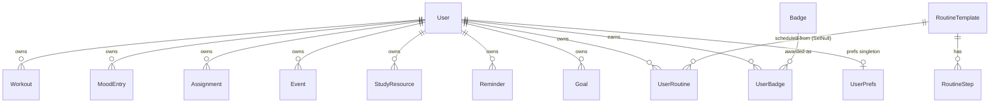

# Wellness Hub — Master Project Architecture Document (PAD) v1.0

**Classification:** Internal Engineering Reference
**Status:** DEFINITIVE, PRODUCTION-LOCKED BLUEPRINT
**Companion Document:** `README.md` (onboarding), `AGENTS.md` (agent contract), `CLAUDE.md` (workflow reference), `docs/plans/2026-10-29-wellness-hub-build.md` (the build plan)
**Last Updated:** 2026-10-29
**Audience:** Senior Engineers, Tech Leads, DevOps, Onboarding Engineers, and AI coding agents
**Rule:** Every architectural decision in this document traces to a specific rationale.
Nothing is here "because it's popular."

---

## Table of Contents

1. [System Overview & Decisions](#1-system-overview--decisions)
2. [High-Level System Topology](#2-high-level-system-topology)
3. [Application Architecture](#3-application-architecture)
4. [Data Architecture](#4-data-architecture)
5. [Design System Reference](#5-design-system-reference)
6. [Security Architecture](#6-security-architecture)
7. [Background & Utility Services](#7-background--utility-services)
8. [Testing Strategy](#8-testing-strategy)
9. [Build & Deployment](#9-build--deployment)
10. [Developer Handbook](#10-developer-handbook)
11. [Known Issues & Outstanding Tasks](#11-known-issues--outstanding-tasks)
12. [Key Files Reference](#12-key-files-reference)
13. [Glossary](#13-glossary)

---

## 1. System Overview & Decisions

### 1.1 Document Metadata & Purpose

Wellness Hub is a production-grade clone of the reference student-wellness
app **EvolveWell** (`https://evolve-well-d6cec85d.base44.app/`): a personal
companion for students covering exercise tracking, a mood journal,
assignments, events, study resources, reminders, routine templates, a
learning center and a gamified goals/achievements engine — rebuilt as one
Next.js application with an intentional functional superset over the
reference (real auth ladder, live theming, SEO, tests).

Use this PAD when onboarding, debugging, reviewing tech choices, or
extending a module. The reference-parity contract (visual) and the
superset contract (functional) are both documented here so a change can be
evaluated against both.

### 1.2 Technology Stack Summary

| Layer | Technology | Version | Key Rationale |
|-------|-----------|---------|---------------|
| Web framework | Next.js (App Router) | 16.4 | RSC pages + route handlers in one artifact; the reference is a self-contained app — one deployable keeps parity |
| UI runtime | React | 19.3 | Server components by default; `forwardRef`-free function components |
| Language | TypeScript | 5.9 | Full strict; the build is the type gate (no `ignoreBuildErrors` escape) |
| Styling | Tailwind CSS | 4.3 | CSS-first `@theme` — matches the reference's computed token system; no config JS |
| Primitives | Radix UI | 1.3–2.4 | Dialog/Sheet drawer, dropdown, select, popover, tabs — the reference's own component genus (shadcn-style) |
| State | Zustand | 5.15 | One store, no React Query/SWR — the app's read pattern is "hydrate once, mutate, refresh slice" |
| ORM | Prisma | 6.19 | Typed SQLite access; schema-as-code for the 15-model domain |
| Database | SQLite | — | Zero-config local parity with the reference; absolute-path swap for production |
| Validation | Zod | 4.6 | One seam (`parseBody`) for every body boundary — the reference's inline validation replaced with a pinned contract |
| Icons | lucide-react | 0.525 | The reference's own icon set (bundle-decoded pin) |
| Unit tests | Vitest | 5.0 | Node-fast, alias-aware (`@/`), matches `*.test.ts` only |
| E2E tests | Playwright | 1.64 | Drives the PRODUCTION standalone build — validate what ships |
| Runtime | Bun | 1.3 | Install + script runner; the reference's toolchain genus |

### 1.3 Architecture Decision Records (ADRs)

**ADR-001: One Next.js App Router application, self-hostable standalone**

- **Context:** The reference is a single-tenant personal app on a hosted
  platform (base44). The clone must run anywhere with zero external
  services.
- **Decision:** A single Next.js App Router app; `next build` with
  `output: "standalone"`; SQLite at the repo root; no external cache,
  queue or auth service.
- **Rationale:** Parity with the reference's all-in-one shape; the
  smallest self-hosting surface (one process + one db file).
- **Consequences:** + simplest deploy; − no horizontal scale story (fine
  for a personal wellness app).
- **Alternatives Rejected:** Separate API + SPA (two deployables, CORS,
  duplicated auth); keep the CRM's multi-surface shape (wrong domain).

**ADR-002: Hand-rolled scrypt + HMAC cookie auth (no NextAuth)**

- **Context:** The reference uses platform-managed auth; a clone needs an
  equivalent without a vendor.
- **Decision:** `src/lib/auth.ts` + the pure `password.ts` seam: scrypt
  password hashes, HMAC-SHA256 signed stateless `wellness_session` cookie
  (7-day TTL) with a `tokenVersion` revocation dimension, hashed-at-rest
  OTP and reset tokens, per-IP rate limits on every public auth route.
- **Rationale:** Zero auth dependencies; every property (TTL, revocation,
  timing equalization, lockout ladder) is testable and pinned.
- **Consequences:** + full control, fully tested; − no OAuth out of the
  box (the Google button honestly reports "not configured").
- **Alternatives Rejected:** NextAuth (vendor-shaped, heavy for one
  user-session model); JWTs in localStorage (XSS-exposed); session table
  (state to manage for no gain at this scale).

**ADR-003: SQLite at the repo root via a relative `DATABASE_URL`**

- **Context:** The operator's contract pins
  `DATABASE_URL="file:../db/custom.db"` with `db/` at the repo root.
- **Decision:** `src/lib/db-path.ts` resolves the relative `file:` URL
  against `prisma/schema.prisma` — exactly like the Prisma CLI — so CLI,
  `next build` and the runtime all land on `<repo>/db/custom.db`
  regardless of the process working directory. Pinned by
  `tests/db-path.test.ts`.
- **Rationale:** `process.cwd()` differs between the CLI, dev and the
  standalone server; anchoring on the schema file is the only invariant.
- **Consequences:** + one predictable db location; − relative URLs are
  unusual (documented + pinned instead of "fixed").
- **Alternatives Rejected:** Absolute paths in `.env` (machine-specific);
  `process.cwd()` resolution (the standalone server runs from
  `.next/standalone/` — silently wrong).

**ADR-004: One Zustand store; the API envelope is the only client contract**

- **Context:** Eleven modules × CRUD + an aggregate dashboard; RSC pages
  with client islands for interactions.
- **Decision:** `src/stores/wellness-store.ts` holds all server state; the
  store's `call()` helper is the only sanctioned `fetch` path; handlers
  answer `{ ok, data } | { ok, error: { code, message } }` via
  `ok()/fail()/ERR.*` (`src/lib/api.ts`).
- **Rationale:** One error/typing story; components stay thin; the
  envelope is greppable and pinned.
- **Consequences:** + predictable data flow; − the store is a single large
  file (sliced internally by module).
- **Alternatives Rejected:** React Query (cache complexity the app does
  not need); SWR (same); context-based state (re-render storms).

**ADR-005: Dual-case route aliases — canonical lowercase + capitalized re-export folders**

- **Context:** The reference's own hrefs are `/Dashboard`, `/Routines`,
  `/Exercise` … (capitalized).
- **Decision:** Every module ships both folders under `src/app/(app)/`:
  the lowercase canonical implementation and a capitalized alias that
  re-exports it. Both families are e2e-pinned.
- **Rationale:** The reference's hrefs must work verbatim (parity), while
  the Next.js convention stays lowercase (tooling, predictability).
- **Consequences:** + every reference URL works; − doubled folders
  (documented as intentional; grep before "fixing").
- **Alternatives Rejected:** Redirects from capitalized to lowercase
  (changes the URL bar — a visible parity break); lowercase-only (the
  reference's hrefs 404).

**ADR-006: Theme engine as CSS custom properties written by a Zustand store**

- **Context:** The superset includes Light/Dark/Auto + 8 color presets
  applied live, persisted locally AND synced across devices.
- **Decision:** `src/stores/theme-store.ts` writes `--primary`,
  `--secondary`, derived hovers, radius and animation tokens on `<html>`;
  persists to localStorage; syncs the `UserPrefs` row via `/api/prefs`.
  All component classes reference tokens, so presets re-skin everything.
- **Rationale:** Changing tokens re-skins without re-render logic; the
  localStorage copy renders instantly pre-hydration and the server row
  carries cross-device state.
- **Consequences:** + live theming with no component changes; − a brief
  local-first flash on a brand-new device (accepted).
- **Alternatives Rejected:** Tailwind config JS theming (v4 has no config
  JS); per-component variant maps (massive duplication).

**ADR-007: The badge/points engine awards server-side at the CRUD seams**

- **Context:** Achievements must be tamper-proof (points feed the
  leaderboard-style stat).
- **Decision:** `src/lib/badges-server.ts` evaluates the 8-badge catalog
  inside the mutation handlers (workout create, goal completion, journal
  streaks …); `src/lib/wellness.ts` holds the pure math (streaks, points),
  Vitest-pinned.
- **Rationale:** Client-side awarding is spoofable and untestable; the
  seams are already guarded by auth + ownership checks.
- **Consequences:** + tamper-proof, unit-testable; − awarding logic is
  spread across handlers (each pin documented in the catalog).
- **Alternatives Rejected:** A cron sweep (delayed awarding); client-side
  awarding (spoofable).

**ADR-008: Tailwind v4 with pinned bug-fix rewrites**

- **Context:** Tailwind v4 renamed the shadow/blur scales and changed
  hover-variant compilation; the chassis hit all three live.
- **Decision:** `@custom-variant hover (&:hover)` unwrap + `--shadow-sm`
  and `--blur-sm` re-pins, all in `src/app/globals.css`, with comments
  carrying the history. LITERAL hex values inside `@theme` (no `var()`
  chains — v4 resolves the block once).
- **Rationale:** Each pin is a real bug fixed once; removing it regresses
  parity with the reference's computed styles.
- **Consequences:** + parity; − the pins look redundant to a fresh agent
  (documented in three docs).
- **Alternatives Rejected:** v4 defaults (visibly heavier shadows, dead
  hover states); v3 (the stack moves forward; the chassis is v4-native).

---

## 2. High-Level System Topology

```mermaid
flowchart TB
    subgraph Client
        B[Browser — desktop / mobile]
    end
    subgraph App["Next.js 16 standalone (one process)"]
        RSC[RSC pages: (app) group — 11 modules + login/signup/reset]
        RH[Route handlers /api/* — 15 families]
        MWL[Layout guards: (app) redirect → login wall]
        INST[Boot gate: instrumentation → boot-env AUTH_SECRET check]
    end
    subgraph Data
        DB[("SQLite — db/custom.db\n(repo root, git-ignored)")]
    end

    B -->|HTTPS| RSC
    B -->|JSON envelope| RH
    RSC --> RH
    RH -->|Prisma 6.19 via db-path| DB
    INST -.refuses to boot without AUTH_SECRET.-> App
```

- **Client layer:** any modern browser; the mobile shell is the same app
  with a `md:hidden` glass header + Radix Sheet drawer (e2e-pinned).
- **App layer:** ONE Node process, no external queue/cache/workers. The
  `(app)` route-group layout is the page-level auth guard; every handler
  re-checks the session (`requireSession`) — defense in depth.
- **Data layer:** SQLite file at the repo root (the WH-4 round retired
  the dead upload route family + its `uploads/` FS surface — zero
  consumers; the reference carries no upload surface).
- **External services:** none at runtime. Unsplash thumbnail URLs and the
  reference's placeholder video URLs are static content links, not
  dependencies.

---

## 3. Application Architecture

### 3.1 The Layer Model

```
Layer 0: Content data — prisma/seed.ts + the Badge/RoutineTemplate/Tutorial
         catalog tables. Rule: seeded content is DATA, never components.
Layer 1: Pure seams — src/lib/{wellness,password,verification,format,...}.ts
         Rule: node-safe, no store/prisma imports; Vitest-pinned.
Layer 2: Server surface — src/app/api/* handlers + src/lib/{auth,api,...}.ts
         Rule: requireSession → parseBody(zod) → ownership check → prisma →
         ok()/fail(); badges award HERE, never in components.
Layer 3: Client stores — src/stores/{wellness-store,theme-store}.ts
         Rule: the ONLY fetch path (the call() helper); no bare fetch in
         components; actions refresh affected slices.
Layer 4: Components — src/components/{layout,shared,ui} + page shells
         Rule: thin; pass plain data to Layer 1 helpers; no local server
         state; dialogs remount forms via key.
Layer 5: Routes — src/app/(app)/* dual-case pages + auth pages
         Rule: the (app) layout redirects unauthenticated visits; the
         capitalized aliases only re-export — no logic in them.
```

**The Golden Rule:** data flows DOWN from the API through the store into
components; events flow UP through store actions back to the API. Nothing
skips a layer: components never touch prisma, fetch, or badge logic.

### 3.2 Annotated Directory Structure

```
wellness-hub/
├── prisma/
│   ├── schema.prisma        # 15 models: User + 10 owned entities (incl. the prefs singleton) + 4 seeded content models
│   └── seed.ts              # idempotent: content wipe+reseed; demo user by UPSERT-BY-EMAIL
├── src/
│   ├── app/
│   │   ├── (app)/           # auth-guarded route group
│   │   │   ├── layout.tsx   # the guard: unauthenticated → /login with from_url
│   │   │   ├── dashboard/   # canonical lowercase implementations ×11
│   │   │   ├── Dashboard/   # capitalized re-export aliases ×11 (reference hrefs)
│   │   │   └── …            # routines, exercise, mentalhealth, assignments, events,
│   │   │                    # studyresources, reminders, learning, goals, profile
│   │   ├── api/             # route-handler families (see §3.3)
│   │   ├── login/           # the EvolveWell auth card (sign-in / forgot / signup / verify)
│   │   ├── signup/  reset-password/
│   │   ├── layout.tsx       # root layout: metadataBase, fonts, theme boot, Toaster
│   │   ├── globals.css      # @theme tokens, dark overrides, the Tailwind v4 pins
│   │   ├── error.tsx  global-error.tsx  not-found.tsx
│   │   ├── sitemap.xml  robots.txt  manifest.json   # SEO family (build-time)
│   │   └── instrumentation.ts  # the boot gate (AUTH_SECRET fail-fast)
│   ├── components/
│   │   ├── layout/          # app-shell, sidebar, mobile-nav (Sheet drawer), login-card,
                          # theme-boot (the root-layout mount that carries the chosen
                          # mode onto the login family — WH-18),
│   │   │                    # nav-config, guest-login-redirect, reset-password-screen
│   │   ├── shared/          # cross-module parts: stat cards, dialogs, calendar, star rating
│   │   └── ui/              # the six live primitives: dialog, input, label,
│   │                        # select, tabs, toast (Radix rides dialog/select/label)
│   ├── lib/
│   │   ├── wellness.ts      # streaks, points, badge eval, reminder status, tag codec
│   │   ├── badges-server.ts # server-side awarding at the CRUD seams
│   │   ├── auth.ts          # session mint/verify, requireSession, tokenVersion
│   │   ├── password.ts      # pure scrypt hash/verify + the timing equalizer
│   │   ├── api.ts           # ok()/fail()/ERR.*, parseBody(), requireSession()
│   │   ├── schemas.ts       # zod ^4 contract for every body boundary
│   │   ├── db-path.ts       # relative DATABASE_URL resolution (pinned)
│   │   ├── rate-limit.ts    # per-IP sliding windows on public auth routes
│   │   ├── constants.ts     # APP_* identity + every OptionMeta vocab + presets
│   │   ├── theme tokens in globals.css / theme-store.ts
│   │   ├── login-reset.ts   # the auth card's view-machine (pinned)
│   │   ├── page-layout.ts   # per-page layout contracts
│   │   ├── format.ts  chunk-recovery.ts
│   │   ├── boot-env.ts      # the production AUTH_SECRET gate
│   │   └── site.ts          # canonical origin for SEO metadata
│   ├── stores/
│   │   ├── wellness-store.ts # ALL server state; call() envelope client
│   │   └── theme-store.ts    # CSS-variable writer + UserPrefs sync
│   └── types/               # shared domain types
├── tests/                   # Vitest *.test.ts (27 suites, 383 checks)
│   └── e2e/                 # Playwright *.spec.ts (72 checks) + setups
├── scripts/
│   ├── smoke-test.sh        # 14-check ladder against the standalone artifact
│   └── prisma-env.ts  census.ts
├── db/                      # SQLite files (git-ignored): custom.db, e2e.db, smoke.db
├── docs/
│   ├── plans/               # the build plan (implementation reference)
│   ├── screenshots/          # every page, desktop + mobile captures
│   ├── DEPLOYMENT.md
│   ├── Tailwind-V4-Validation-Report.md
│   └── how-to-git-push-using-ssh-wrapper_SKILL.md  + ssh_git_wrapper_v3.py
├── skills/                  # the operator's skill catalog (ESLint-ignored)
├── AGENTS.md  CLAUDE.md  README.md  Project_Architecture_Document.md
├── worklog.md               # the session-by-session engineering log
└── package.json             # bun scripts; the dead-dep census pin guards the dep tree
```

### 3.3 Critical Code Patterns

**Pattern 1 — the guarded mutation handler (every body route):**

```typescript
// The single shape EVERY mutating handler follows. Why: one place for
// auth, validation, ownership and the envelope — a new route copies this
// and cannot forget a layer.
export async function POST(req: Request) {
  const user = await requireSession(req);          // 401 via fail(ERR.UNAUTHENTICATED)
  const body = await parseBody(req, workoutCreate); // 400 with field message
  const created = await db.workout.create({
    data: { ...body, userId: user.id },            // ownership = scoping, never a param
  });
  await awardBadges(user.id);                      // the engine rides the seam
  return ok(created);                              // { ok: true, data }
}
```

*Why this pattern:* the mutation seams are where security and gamification
both live; centralizing them in the handler shape means the e2e CRUD cycle
plus the ownership pins cover every route family at once.

**Pattern 2 — the store's `call()` envelope client:**

```typescript
// The ONLY sanctioned fetch path. Why: the envelope, auth cookie, error
// toast and slice-refresh are ONE implementation — components cannot
// diverge.
const res = await fetch(input, { credentials: "include", ...init });
const json = await res.json();
if (!json.ok) throw new EnvelopeError(json.error);
return json.data;
```

*Why this pattern:* an eleven-module app with per-route `fetch` calls
drifts on error handling within a week; one `call()` keeps the envelope
greppable and the toasts uniform.

**Pattern 3 — pure domain seams:**

```typescript
// From src/lib/wellness.ts — the streak is a pure function over dates.
export function currentStreak(dates: (Date | string)[], now = new Date()): number {
  // forgiving convention: an entry today OR yesterday keeps the streak live
}
```

*Why this pattern:* streak math, points and tag codecs are exactly the
kind of logic that rots inside components; extracted, they are
property-testable and reused by the dashboard, the journal and the badge
engine without server round-trips.

**Pattern 4 — dual-case route alias:**

```typescript
// src/app/(app)/Dashboard/page.tsx — the alias carries NO logic.
export { default, metadata } from "../dashboard/page";
```

*Why this pattern:* the reference's hrefs are capitalized; redirects would
change the URL bar (a visible parity break), so an empty re-export keeps
both families native.

**Pattern 5 — the theme engine's token write:**

```typescript
// theme-store.ts applies a preset by writing CSS custom properties on <html>.
document.documentElement.style.setProperty("--primary", preset.primary);
// every component class references var(--primary) — the whole app re-skins
// with zero component changes.
```

*Why this pattern:* variant maps per preset would duplicate every
component; tokens keep theming a data problem.

---

## 4. Data Architecture

### 4.1 Database Schema

SQLite via Prisma. Fifteen models in three genera:

1. **The auth user** — `User`: email, name, scrypt `passwordHash`, hashed
   OTP + attempts + expiry, `tokenVersion`, hashed-at-rest single-use
   `resetToken` (60-min TTL), role (`"user"` — display-only, the
   reference's own account-tab value; the WH-4 round retired the dead
   CRM-era `avatarColor`/`photoUrl` columns — never rendered).
2. **Owned entities** (all `userId` + `onDelete: Cascade`): `Workout`,
   `MoodEntry`, `Assignment`, `Event`, `StudyResource`, `Reminder`, `Goal`,
   `UserRoutine`, `UserBadge` (unique `[userId, badgeId]`), `UserPrefs`
   (unique `userId` — the theme singleton).
3. **Seeded content** (no ownership): `Badge` (catalog, unique key),
   `RoutineTemplate` (unique key) + `RoutineStep` (cascade under its
   template), `Tutorial` (unique key).



### 4.2 Data Models (key field contracts)

- `Workout`: type (8-value vocab), `durationMinutes`, intensity
  (light/moderate/intense), optional calories/notes, indexed `[userId, date]`.
- `MoodEntry`: mood (amazing/good/okay/low/struggling), `energy` 0–10,
  `activities` as a JSON string array (the tag codec), gratitude/reflection.
- `Assignment`: priority (low/medium/high/urgent), `status`
  (pending/completed), optional due date and estimated hours (WH-13: the
  write-only `completedAt` column retired with its seam writes + wire
  members — read by nobody, no reference counterpart).
- `Event`: date + `"HH:mm"` time (display formats to 12h), category vocab,
  optional location — indexed `[userId, date]` for the calendar.
- `StudyResource`: subject, type (8-value vocab), 1–5 `rating`, `tags` JSON
  array, optional URL/exam date.
- `Reminder`: `remindAt`, type (custom/assignment/event/goal/routine),
  priority, repeat (none/daily/weekly/monthly), `completed` (the
  `completedAt` twin retired at WH-13 with the rest of the quartet).
- `Goal`: category + frequency vocab, `targetValue`/`currentValue`/`unit`,
  deadline, `points` (frequency-derived at creation), status — completion
  moves the points onto the account.
- `RoutineTemplate`: name, category, timeOfDay, display duration,
  difficulty (easy/moderate), `benefits` JSON array, tips, video/thumbnail
  URLs — the seed carries the reference's own content byte-exact.
- `UserPrefs`: themeMode (light/dark/auto), primary/secondary colors,
  fontFamily, sidebar/card styles, animationLevel, notification toggles.

**JSON columns rule:** Prisma SQLite has no list primitives — arrays
(steps, benefits, tags, activities) are JSON string columns with a codec in
`src/lib/wellness.ts` and zod schemas at the boundary.

### 4.3 Persistence Strategy

- No connection pooling (SQLite); the Prisma client is a module singleton
  (`src/lib/db.ts`) — one client per process, dev-hot-reload-safe.
- The seed is idempotent by design: content tables are wiped and re-seeded;
  the demo user lands via UPSERT-BY-EMAIL so session cookies survive a
  reseed.
- Read bounding: list endpoints cap page sizes; the dashboard aggregate
  computes from bounded sub-queries, not full-table reads.
- The e2e and smoke suites each run on their OWN scratch database
  (`db/e2e.db`, `db/smoke.db`) — the dev database is never a test fixture.

---

## 5. Design System Reference

### 5.1 Typographic System

- `--font-sans`: the system stack `ui-sans-serif, system-ui, sans-serif,
  "Apple Color Emoji", "Segoe UI Emoji", "Segoe UI Symbol", "Noto Color
  Emoji"` — identical to the reference's computed font (live-probed); the
  emoji fonts in the stack render the mood/resource glyphs on every OS.
- Display: system stack via `@theme`; no external webfonts (zero layout
  shift, matches the reference).

### 5.2 Color Tokens

| Token | Light | Dark | Usage |
|-------|-------|------|-------|
| `--primary` | `#6366f1` indigo-500 | kept | The BRAND family: wordmark, badge, gradient active pills, drawer/mobile titles (135deg to-br gradients) — the preset-re-skinnable surfaces |
| `--secondary` | `#a855f7` purple-500 | kept | Gradient partner |
| Brand gradient | `bg-gradient-to-br from-primary to-secondary` | kept | Sidebar/mobile/drawer brand + the desktop + drawer active pills (WH-15: the desktop active item is the gradient pill, white text) |
| Module gradients | `PAGE_THEMES` (fixed v3 pairs) | same | The per-module H1s, buttons, washes + the routines category map — NOT preset-themeable (verified live: the reference's Ocean Blue re-skinned its brand while the Exercise button stayed orange→red) |
| Page wash | `bg-gradient-to-br from-<m1>-50 via-white to-<m2>-50/30` | `dark:from-neutral-900 via-neutral-950` | Every page root (the reference's 2026-10-30 redesign; our dark variants are the documented superset) |
| Shell washes | root `from-slate-50 via-white to-slate-50` · sidebar `from-white via-gray-50 to-white` | neutral family | WH-15 — the shell's two washes (ours shipped solid tokens) |
| `--color-surface` | `#ffffff` | `#18181b` | The white list/panel cards (the redesign's borderless `border-none shadow-lg` form) |
| `--shadow-sm` | `0 1px 2px 0 rgb(0 0 0 / 0.05)` | same | The v4 re-pin — the reference's computed outline |
| Source scan | three `@source not` directives (skills/docs/*.md) | same | WH-14 — v4's auto-detection scanned every tracked file; the markdown corpus compiled 71% of the stylesheet as dead weight (160,639 → ~74 KB) |

**The per-module identity map** (WH-15, probed live on the redeployed
reference — every page's H1 stops / button pair / wash pair / container):

| Module | H1 gradient | Button pair | Page wash | Container |
|--------|-------------|-------------|-----------|-----------|
| Dashboard | indigo-600→purple-600→pink-600 | — | slate-50→indigo-50/30 | max-w-7xl |
| Routines | purple-600→pink-600→rose-600 | per-category | purple-50→pink-50/30 | max-w-7xl |
| Exercise | orange-600→red-600 | orange-500→red-500 | orange-50→red-50/30 | max-w-6xl |
| Mental Health | emerald-600→teal-600 | emerald-500→teal-500 | emerald-50→teal-50/30 | max-w-6xl |
| Assignments | blue-600→cyan-600 | blue-500→cyan-500 | blue-50→cyan-50/30 | max-w-6xl |
| Events | violet-600→purple-600 | violet-500→purple-500 | violet-50→purple-50/30 | max-w-7xl |
| Study Resources | blue-600→indigo-600 | blue-500→indigo-500 | blue-50→indigo-50/30 | max-w-7xl |
| Reminders | rose-600→purple-600 | rose-500→purple-500 | rose-50→purple-50/30 | max-w-6xl |
| Learning | amber-600→orange-600 | — | amber-50→orange-50/30 | max-w-7xl |
| Goals | yellow-600→amber-600→orange-600 | yellow-500→amber-600 | yellow-50→amber-50/30 | max-w-7xl |
| Profile | indigo-600→purple-600 | indigo-500→purple-500 | slate-50→indigo-50/30 | max-w-5xl |

The routines category map (the card top bars + buttons): morning
amber-500→orange-500 · exercise red-500→pink-500 · study
blue-500→cyan-500 · evening indigo-500→purple-500 · self_care
emerald-500→teal-500 · creative pink-500→rose-500 · productivity
violet-500→purple-500.

Contrast: body text `#171717` on white; secondary `#71717a`; both clear
WCAG AA in light mode; dark mode inverts via the `.dark` overrides in
`globals.css`.

### 5.3 Component Primitives

- The six live primitives in `src/components/ui/`: dialog, input, label,
  select, tabs, toast (the z-[100] portal) — Radix rides
  dialog/select/label; input/tabs/toast are hand-rolled. The mobile
  drawer is a Radix Sheet built on the dialog primitive
  (`src/components/layout/mobile-nav.tsx`); the seven CRM-era modules
  (avatar/badge/button/card/dropdown/icons/table) retired at WH-4 and
  the ui-module census pin (`tests/route-census.test.ts`) locks the set.
- Stat tiles (WH-15): the white `border-none shadow-lg` card + the
  5%-opacity module wash (10% on hover) + the `rounded-2xl` gradient icon
  tile — Dashboard's four; the module pages carry ONE solid-gradient hero
  tile (white text, the module's -100 label tint) + two white tiles
  (Reminders: three white, no hero); captured in
  `docs/screenshots/02-dashboard.png`.
- Sidebar: `rounded-xl` menu buttons with the gradient active pill;
  mobile is a Radix Sheet drawer behind the glass `md:hidden` header
  (`backdrop-blur-xl` — the reference's own blur(24px); the 4px
  `--blur-sm` re-pin serves the login card's glass).

### 5.4 Motion / Animation

- `tw-animate-css` for enter/exit pairs (dialog, drawer, toast).
- The `animationLevel` pref (full/subtle/none) gates animation classes —
  the "none" level is the reduced-motion story; the store also respects
  `prefers-reduced-motion` at boot.

---

## 6. Security Architecture

### 6.1 Security Rules

| Rule | Enforcement |
|------|-------------|
| Every API route requires a valid session | `requireSession(req)` — HMAC-verified `wellness_session` cookie, 401 otherwise |
| Every body validated | `parseBody(zod)` — 400 with a field message; no ad-hoc parsing |
| Every mutation ownership-checked | The record's `userId` must equal the session's — mismatch answers 404 (no enumeration) |
| Passwords never stored raw | scrypt `scrypt:salt:hash` (`password.ts`); login miss burns a timing-equalizer scrypt |
| Session cookies revocable | `tokenVersion` embedded at mint; a password reset increments it and kills all pre-reset cookies |
| OTP and reset tokens hashed at rest | scrypt (OTP) / SHA-256 (reset); plaintext lives only in the delivery surface |
| Reset tokens single-use + TTL | 60-min TTL; consumed atomically via a conditional updateMany |
| Public auth routes rate-limited | per-IP/15-min sliding windows — login 10, signup 10, resend 5, verify 20, forgot 10, reset 10 (`rate-limit.ts`) |
| Proxy IP keying is explicit | `WELLNESS_PROXY_HOPS` declares trusted depth; unparsable fails closed to 1 |
| Production boots refuse weak secrets | `instrumentation.ts` → `boot-env.ts`: missing/short `AUTH_SECRET` = no serve |
| Dead attack surface retired | The upload/users route families (zero consumers, no reference surface) retired at WH-4 — the route-census pin (`tests/route-census.test.ts`) locks the 15-family API set against re-introduction |
| CSRF posture | Cookie is SameSite=Lax; mutating routes are POST-only JSON with the content-type gate (the e2e CSRF probe pins it) |
| Dependency advisories triaged | ZERO since WH-29 (2026-10-31): the FIVE package.json `overrides` (vite 8.3.5, deepmerge-ts 8.0.2, source-map-js 1.2.2, zod 4.6.7, minimatch 11.0.3 — the WH-29 minimatch cure re-cleared the posture after GHSA-g3hv-75wg-m249 drifted in under the WH-8 locks); the lockfile-resolution pin (`tests/dead-deps.test.ts`) carries the posture inside the offline gate; `bun audit` re-triages at its periodic cadence outside the gate |

### 6.2 Security Utilities

`src/lib/password.ts` (pure scrypt seam) · `src/lib/auth.ts` (mint/verify/
revoke) · `src/lib/rate-limit.ts` · `src/lib/verification.ts` +
`verification-server.ts` (hashed OTP ladder with lockout) ·
`src/lib/boot-env.ts`.

### 6.3 Authentication & Authorization

- Single role (`user`); authorization = ownership. There is no admin
  surface by design (a personal wellness app).
- Session: stateless HMAC cookie — verifying it is one comparison plus the
  `tokenVersion` check; revocation is a column bump, not a session-store
  sweep.
- Login wall: the `(app)` layout redirects unauthenticated page visits to
  `/login` with a `from_url`; handlers enforce independently (defense in
  depth).

### 6.4 Threat Model

| Vector | Mitigation |
|--------|-----------|
| Credential stuffing | Per-IP login rate limit + the timing equalizer |
| Session theft | 7-day TTL + `tokenVersion` revocation on reset; HttpOnly cookie |
| User enumeration | No-enumeration forgot-password 200; ownership mismatch = 404 |
| OTP brute force | Hashed code + attempt counter with lockout ladder |
| Spoofed gamification | Badges/points award only server-side |

---

## 7. Background & Utility Services

No queues, workers or cron. Utility services worth naming:

- **The seed** (`prisma/seed.ts`): content reseed + demo-user UPSERT — run
  on demand, never scheduled.
- **The smoke ladder** (`scripts/smoke-test.sh`): 14 assertions against the
  standalone artifact on `db/smoke.db`, including the boot-gate probe and
  artifact-hygiene checks.
- **`scripts/census.ts`**: db path + row-count census for drift detection.

---

## 8. Testing Strategy

### 8.1 Test Distribution

| Category | Files | Checks | Location | Framework |
|----------|-------|--------|----------|-----------|
| Unit — auth seams (password, verification, reset, contract, rate limit, boot-env) | 6 | 109 | `tests/auth*.test.ts`, `password-seam`, `rate-limit`, `boot-env` | Vitest |
| Unit — wellness domain (streaks, points, badges, codecs, schemas, stats, helpers, theme, the preset-axis contrast arithmetic, the displayStreak tile-stat pin, the activity-feed seam, the WH-44 preset-catalog parity contract) | 7 | 94 | `tests/wellness-*.test.ts`, `tests/activity-feed.test.ts`, `preset-contrast` | Vitest |
| Unit — infra (db-path, format, login views, login-reset, chunk-recovery, interaction-contrast (the WH-30 footer-part retirement), dead-dep census + lockfile pin (the WH-29 minimatch resolution pin), route/ui census, signup role, docs-counts lockstep + §8.1 row arithmetic + the WH-77 command-block count scan (the exhaustive stale-count cure — every live-tense `bun run test` annotation must carry the canonical total) + the WH-78 capture-set range scan (the exhaustive stale-set cure — every `docs/screenshots/NN-NN` range claim must carry the live set) + the WH-79 frontmatter-freshness scan (the exhaustive stale-metadata cure — the SKILL's `last_updated` stamp must carry the newest docs/plans date, a validated-through claim) + the WH-80 sixth-doc claims scan (the exhaustive stale-doc cure — DEPLOYMENT.md, the sixth doc referenced from README, must carry the tree's live operational claims: no sibling-name forms, the route-file/verb-handler counts computed live from the recursive walk, the AUTH_SECRET fail-hard form, the live health shape), wellness-domain (the WH-30 ProfileCard share), src-surface census + store/ui-export + component-prop/theme-member/type-export/pass-site/schema-field/design-token/source-scan/palette-pin/page-theme/hydration-suppression/chip-vocabulary/dark-variant + ThemeBoot-mount + dark-pair-completeness + interaction-arm dark-pair + form-modality + schedule-modal + card-geometry + empty-form/omission + card-family-geometry(WH-24) + module-toolbar/chip-form(WH-24) + routines-template-card(WH-24) + profile-geometry(WH-25) + checkbox-retirement(WH-25) + form-grid-family(WH-26) + form-interior(WH-26) + sr-chip-family(WH-27) + rating-glyph(WH-27) + mood-entry-list(WH-28) + activity-feed(WH-28) + shell-tag(WH-28) + chip-family/achievements-section/routines-card(WH-29) censuses + shell-chrome-geometry/footer-retirement(WH-30) + routines-video-card(WH-32) + nav-weight(WH-37 — the font-weight/ink/mt absence pins on the four nav-row records + the brandSubtitle) + the WH-44 Profile appearance face-cures census (the mode-card neutral-950 ink + the preset-label block arm + the color-input stock form + the icon-less save bar), the interaction-contrast arithmetic pin + its WH-21 tile extension [the F-1 checkbox pin retired at WH-25 with the false premise; its F-3 footer part retired at WH-30 with the footer], the gradient-ink white-ink arithmetic pin + its WH-22 step-circle + WH-23 hero-label extensions + the WH-35 form-submit ink-split pin + the WH-94 dev-script-hygiene pin (the dev server never tees its log into the watched tree — the tee'd dev.log Fast-Refresh reload-loop cure)) | 12 | 173 | `tests/*.test.ts` | Vitest |
| Unit — the demo-account data parity + clean-account contracts (WH-37 F-2: the seed's mirrored demo mood entry — one row, good/energy 5, the FIXED 2026-10-29 date, no optional fields, no badge awarding — + the census EXPECTED's corrected premise + the WH-42 F-1 template grid-order contract: the ROUTINE_TEMPLATES sortOrder sequence mirrors the reference's re-ordered live catalog, decode-settled 2026-11-01 + the WH-90 F-1 theme-axis pins: the seed's demo-UserPrefs reset + the capture guard's themeMode assertion) | 2 | 7 | `tests/seed-parity.test.ts`, `tests/clean-account.test.ts` | Vitest |
| E2E — auth ladder (login wall, lockout, reset funnel, revocation) | 1 spec | 11 | `tests/e2e/auth.spec.ts` | Playwright |
| E2E — mobile drawer battery + the WH-30 (m) header-interior leg (the px-6 bar, the 28×28 rounded-lg trigger with the 16px ink icon, the title's left-cluster x=68, the hidden close X, the border-r, the 32px rows, the bottom-pinned footer) | 1 spec | 7 | `tests/e2e/mobile-navigation.spec.ts` | Playwright |
| E2E — shell (nav, dual-case routes, quick actions, console-hygiene net + the WH-30 (n) shell-chrome leg: the 32px rows, the 16px icons, the 40px avatar, the ZERO-footer absence, the header divider) | 1 spec | 8 | `tests/e2e/shell.spec.ts` | Playwright |
| E2E — a11y net (axe-core, WCAG 2.1+2.2 A+AA: the module routes, the open drawer, the login page — plus the WH-18 dark-state walks: the dark module routes + drawer, the OS-dark corner, the dark login, the dark select/toast interactions — plus the WH-19 widenings: the dark corners (signup/reset/404), the light computed-contrast leg (the alpha-card family) and the auto-mode listener — plus the WH-20 interaction-states legs: the data-bearing dark row walk, the dark login focus ring, the dark footer and the toast-hover probe — plus the WH-21 legs: the dark checkbox walk (the checked fill, the unchecked border, the glyph on the Preferences wash) and the dark mood-tile walk (the active tile's scale property + gradient, the inactive border's pinned neutral-700) — plus the WH-23 leg: the scroll-capped Schedule modal's keyboard walk (the initial focus, the trap, the below-fold primary's scroll-into-view, the unlock) — plus the WH-24 legs: the tutorial card's hover-reveal family (the resting opacity-0 button + the transparent scrim, the hovered reveal + the img's scale property) and the calendar's computed anatomy (the outline nav trio, the today-cell gradient, the day-cell geometry) — plus the WH-25 swap: the (e) dark-checkbox leg RETIRED with its false premise (the reference's Preferences controls are NATIVE bare checkboxes — the WH-21 claim it pinned was written without opening the tab) and the (j) Profile tab-region computed-geometry leg replaced it (the full-width tablist, the mt-2 panels, the native 20px checkboxes, the sticky save bar) — plus the WH-26 (k) leg: the mood form's computed interior (the space-y-6 group ladder, the mb-4 mood label, the 8px gray-200 track at min 1, the h-24 reflection, the stock footer buttons, the emerald chip client-state, and the ACTIVE TILE'S LABEL COLOR — the rendered-leaf doctrine) — plus the WH-27 (l) leg: the login family's computed interior (the five views' h1/h2/back geometry, the 44px signup inputs, the 64px sent icon + the 368px callout, the 6×40×44 code inputs in the gap-6px wrap, the resend ink — the standing drift pin for the NEXT redeployment) — plus the WH-30 retirement: the (c) dark-footer leg retired with the footer itself (the reference renders no footer; the (n) leg owns the absence) — plus the WH-31 (o) leg: the shell's a11y TREE drift guard — the deliberate landmark superset (complementary + navigation with aria-hidden icons at both nav sites + the aria-current row) pinned against the reference's landmark-free `list > listitem > link` form decoded on its round-19 rebuild — born green, the (l) standing-pin precedent, guarding the NEXT redeployment) — plus the WH-32 (p) leg: the routines video-card family — the six templates carrying thumbnail/videoUrl render the h-40 thumbnail zone (the img alt = the template name) with the opacity-0 reveal overlay (the routines family's fade lives on the OVERLAY — bg-black/40 constant, its OPACITY fades; the Learning family's inverse), the REAL-pointer hover reveal + the aria-label superset; the five field-less templates render the bare face (the reference's own split, probed on all 11)) | 1 spec | 22 | `tests/e2e/a11y.spec.ts` | Playwright |
| E2E — auth setup project (one-time demo login; shares the cookie via storageState) | 1 setup | 1 | `tests/e2e/auth.setup.ts` | Playwright |
| E2E — CRUD cycles + reset-password funnel (the WH-21 modality leg rides the CRUD battery: the create-form must open as an inline expanding card — no dialog role, no scrim, in-flow, no scroll lock; the WH-22 leg extension reads the Schedule modal's content anatomy live: the 672px width, no Cancel, the module-pair stops, the solid circle; the WH-23 retargets: the assignments empty-state leg asserts the section's ABSENCE and the events leg the row's disappearance — the reference's zero-row forms; the WH-28 feed leg: a PAST-dated workout through the real form → the Recent Activity row asserts the 🏃 glyph, "cardio workout", "30 minutes" and the PAST short date — the entity-date pin, never createdAt; the WH-29 achievements leg: the earned-only vertical tiles render for the earlier legs' badges — the h5 name + the amber +N pts — and the 8-tile catalog grid NEVER renders; the WH-33 (q) leg: the family-B Schedule modal's dynamic step count — Creative Flow Session's modal renders the template's OWN five purple-500 step circles + its first seed step title (family-A's sibling leg schedules the 3-step template; the split is data, not renderer — decoded on the reference's round-21 build); the WH-37 demo-face leg: the seeded mood entry's rendered face — the journey row [Good / Oct 29, 2026 / Energy Level: 5/10] + the stat trio 5.0/10·1·1 + the dashboard tile 1 + the feed's 💚 "Mood check-in / good / Oct 29" row — the pristine-state pin, running FIRST in the battery) | 2 specs | 23 | `tests/e2e/wellness-crud.spec.ts`, `reset-password.spec.ts` | Playwright |

Totals: **383 unit checks / 27 Vitest suites + 72 e2e checks / 6 specs + 1 setup project**.

### 8.2 Test Patterns

- The unit layer tests SEAMS, not components: a pure function's contract,
- a codec's round-trip, a schema's rejection edge.
- The e2e layer tests JOURNEYS against the production standalone server on
  an isolated port + its own scratch db — validate what ships.
- Storage-state auth: sign in once in the `setup` project; every spec
  reuses the cookie (the per-IP limiter makes per-test logins flaky by
  design — the suite structure is the mitigation).
- fast-check property testing is NOT used — the devDep was retired at WH-3
  as a zero-import CRM residue (the census pin guards the tree); the unit
  layer pins seams with plain deterministic cases instead.

### 8.3 Coverage Thresholds

No numeric coverage gate; the doctrine is **contract pinning**: every
documented behavior in AGENTS/CLAUDE/PAD that is testable has a test that
fails if it regresses (db-path, boot gate, envelope, rate limits, the
mobile drawer, the route aliases). A behavior without a pin is a bug in the
docs, not just the code.

### 8.4 Pre-PR / Pre-Deploy Checklist

- `bun run lint` → 0 warnings
- `bun run typecheck` → clean
- `bun run test` → 383/383
- `bun run build` → succeeds (the type gate)
- `bun run smoke` → 14/14
- `CI=1 bun run test:e2e` → 72/72
- `bun audit` (periodic, outside the gate) → ZERO since WH-29 (§10)
- Screenshot/parity pass if ANY visual surface changed

---

## 9. Build & Deployment

### 9.1 Production Build

```bash
bun install
cp .env.example .env         # set AUTH_SECRET (openssl rand -hex 32)
bun run db:push && bun run db:seed
bun run build                # standalone artifact at .next/standalone/
bun run start                # NODE_ENV=production bun .next/standalone/server.js
```

The build copies `static` + `public` into the artifact and REMOVES
`.next/standalone/.env` (env comes from the process environment — the
artifact must be environment-agnostic; the smoke ladder asserts this
hygiene).

### 9.2 Environment Variables

| Name | Required | Description | Default |
|------|----------|-------------|---------|
| `DATABASE_URL` | yes | SQLite path, relative resolved against `prisma/schema.prisma` | `file:../db/custom.db` |
| `AUTH_SECRET` | prod | HMAC session secret, ≥16 chars — boot fails hard without it | dev-only constant (warning) |
| `NEXT_PUBLIC_SITE_URL` | prod | Canonical origin for SEO metadata (build-time inlined) | `http://localhost:3000` |
| `WELLNESS_PROXY_HOPS` | no | Trusted proxy depth for rate-limit IP keying | unset = 1 |
| `WELLNESS_DISABLE_IN_APP_OTP` | no | `1` hides the signup OTP from responses (real mail transport) | `""` |
| `WELLNESS_DISABLE_IN_APP_RESET` | no | `1` hides the reset link from responses | `""` |

### 9.3 Container Configuration

No Dockerfile ships (a single-process Node app; `docs/DEPLOYMENT.md` covers
the VPS/Docker paths). If containerizing: `oven/bun` base, copy the
standalone artifact, mount `db/` as a volume, pass env at
runtime.

### 9.4 CI/CD Pipeline

**There is no hosted CI — the local gate is the only gate.** `bun run
gate` chains: lint → typecheck → test → build → smoke → `CI=1` e2e. Ship
through: commit to main → push via `docs/ssh_git_wrapper_v3.py` (runbook:
`docs/how-to-git-push-using-ssh-wrapper_SKILL.md`; sandboxes without an
`ssh` binary deploy the Appendix A paramiko shim on PATH first).

---

## 10. Developer Handbook

### 10.1 Local Setup

```bash
bun install
cp .env.example .env    # AUTH_SECRET: openssl rand -hex 32
bun run db:push
bun run db:seed
bun run dev             # http://localhost:3000 — demo: sepnetflix2023@outlook.com / $Abcd1234
```

### 10.2 Common Commands

See the table in `AGENTS.md` §Commands (the canonical copy; identical in
`CLAUDE.md`). Highlights: `bun run gate` (everything), `bun run
db:census` (db drift), single suite `bunx vitest run tests/<file>`, single
spec `CI=1 bunx playwright test tests/e2e/<file>`.

### 10.3 Code Style Rules

- ESLint (`--max-warnings 0`) + `tsc --noEmit` + the build's type gate —
  all three must stay clean; there is no formatter config (ESLint owns
  style).
- Enforced habits: early returns, no sync `setState` in `useEffect`
  (ERROR), `key`-remount for dialog forms, tokens over hex literals in
  components, `OptionMeta` vocab constants over hardcoded emoji.

### 10.4 Git Workflow

- `main` ONLY — no feature branches, ever.
- Conventional Commits with emoji prefixes (`:tada: feat:`, `:bug: fix:`,
  `:memo: docs:`).
- Never commit `.env`, `*.key`, `db/*.db`, `node_modules/`.
- Push via the SSH wrapper (see §9.4). No new remotes, no force pushes.

---

## 11. Known Issues & Outstanding Tasks

| Priority | Issue | Impact | Status |
|----------|-------|--------|--------|
| — | ~~jspdf → dompurify advisory chain~~ | RETIRED at WH-3 — jspdf was a zero-import CRM residue (no PDF export ever shipped in the wellness tree; the reference carries no export UI either — live-probed); removing it removed the chain entirely, and `tests/dead-deps.test.ts` pins the dep tree | Closed (retired) |
| LOW | ~~Remaining `bun audit` advisories~~ | ZERO since WH-29 (2026-10-31): the FIVE package.json `overrides` — vite 8.3.5 (the 6-advisory vite/launch-editor family), deepmerge-ts 8.0.2 (the prisma CLI chain, verified live through db:generate/push/seed/census), source-map-js 1.2.2 (postcss, in-range), zod 4.6.7 (the eslint-plugin peer copy joins the direct dep — one zod, 4.6.7), minimatch 11.0.3 (the WH-29 cure: GHSA-g3hv-75wg-m249, ReDoS via globparts amplification, reached through the eslint chains — the root 3.1.5 [eslint/@eslint/eslintrc/@eslint/config-array/eslint-plugin-import/jsx-a11y/react, all ^3.x ranges] + a NESTED @typescript-eslint/typescript-estree/minimatch@10.2.6; the override is RANGE-BREAKING but API-compatible at every call site the lint gate exercises — eslint 9.39.5 runs clean on 11.0.3, and `bun audit` reads "No vulnerabilities found"; the every-resolution scan pins that no nested copy survives). The posture's history: zero at WH-8 (the four overrides) → drifted at WH-29 (a new advisory landed under the locked versions between the periodic re-triages) → re-cleared the same round; the lockfile-resolution pin in `tests/dead-deps.test.ts` holds the five resolutions offline; the next advisory flips the pin literals + the overrides in the same commit | Closed (zero via overrides, re-anchored WH-29) |
| LOW | The lockfile's stale `"activity-map"` workspace name (`bun.lock:6` vs package.json `"wellness-hub"`) | Inert carried metadata from a pre-history workspace; probed at WH-4 — `bun install` (including the post-`bun remove` clean reinstall) does NOT sync the name, and a full lockfile regen risks semver drift for zero functional gain | Accepted posture (inert metadata) |
| LOW | Google OAuth button | Visible for parity but reports "not configured on this deployment" — no OAuth credentials ship by design | Intentional |
| LOW | "Watch Video" links open placeholder URLs | The reference's own tutorial/video URLs are placeholders (`example-*`); we open them in a new tab with identical behavior | Intentional parity |
| LOW | Reference's empty-state data | AMENDED at WH-37 (F-2 — the demo-account data parity cure): the original row justified our EMPTY demo lists with "the reference's fresh account is also empty" — a FRESH signup account conflated with THE demo account the parity doctrine mirrors. The reference's DEMO account carries exactly one mood entry (decoded live: good, energy 5, dated Oct 29 2026, no optional fields), and ours now MIRRORS it (the seeded demo mood entry — `prisma/seed.ts` writes the row directly, a fixed date, no badge awarding; the census contract reads moodEntries: 1; `tests/seed-parity.test.ts` pins the source contract + the e2e demo-face leg pins the rendered face: the journey row, the 5.0/10·1·1 stat trio, the dashboard tile 1, the feed's 💚 "Mood check-in / good / Oct 29" row). The FRESH-signup face stays empty (new accounts seed nothing); the demo account renders the reference's demo face | Closed (the WH-37 cure) |
| LOW | Profile tab-strip inactive contrast | The reference's own inactive tabs fail WCAG AA (#737373 on the muted strip, 4.35:1 — axe-verified on the reference itself at WH-17); we supersede with `text-neutral-600` (6.4:1) — the same class as our roving-tabindex keyboard superset over the reference's `tabIndex=-1` defect (documented in `tabs.tsx`'s header) | Accessible superset (documented deviation) |
| LOW | The 404 display heading's ink | The reference's own 404 ships slate-300 on slate-50 at 1.42:1 (72px font-light, live-probed on the reference: rgb(203,213,225) on rgb(248,250,252)) — an axe-resolvable AA failure (large text needs 3:1) no walk ever read. We supersede with slate-500 in light (4.54:1) and neutral-500 in dark (4.18:1) — the WH-17 superset doctrine (the tab-strip precedent) | Accessible superset (documented deviation) |
| LOW | Preset white-on-gradient contrast (ALL 8 presets, measured) | The reference's own preset engine ships an 8-preset catalog with the same white-text-on-gradient brand family (the catalog was byte-identical at WH-18; the reference RE-AUTHORED 7 of its 8 pairs to monochromatic same-hue steps before WH-44 — decoded live 2026-11-02, and our COLOR_PRESETS re-aligned the same round behind the WH-44 preset-catalog parity contract). Measured at WH-19, re-measured at WH-44 on the re-authored catalog (worst stop governs — the probe walks each preset through the real Profile UI, then computes WCAG relative luminance on the computed gradient stops): Indigo Dream 3.96, Ocean Blue 2.43, Forest Green 2.54, Sunset Orange 2.26, Rose Pink 2.65, Royal Purple 3.96, Crimson Red 3.76, Golden Yellow 1.53 — ALL 8 fail WCAG AA 4.5:1 (the WH-18 entry understated the class as "Golden Yellow ≈1.8:1" only; Golden Yellow remains the worst at 1.53). Reference-shared and axe-incomplete (gradients) on both apps; the arithmetic is pinned (tests/preset-contrast.test.ts computes the table from COLOR_PRESETS — a value change forces this ledger + the pin to move together). Deviating would fork our preset engine from the reference's own | Reference-shared (documented, pinned) |
| LOW | Reference's z-100 toast viewport intercepts clicks | Its empty toast portal container is `pointer-events: auto` across the full top strip (live-caught: the drawer trigger's upper click point covered — "Element is covered by <div.fixed.top-0 …z-[100]>"); ours is the shadcn `pointer-events-none` form and never intercepts. **WORSE at WH-26 (the 2026-10-31 redeployment): the reference's viewport LOST its `pointer-events-none` + `gap-2` arms entirely** — its own mobile hamburger is now UNCLICKABLE by real pointers (the elementFromPoint proof: a pointer at the trigger's center hits the overlay, not the button; the WH-26 probe battery had to open the drawer via a JS click). Deliberately NOT mirrored — the parity doctrine does not extend to reproducing a broken control | Our superset (not mirrored) |
| — | ~~Dark mode broken (the variant strategy mismatch)~~ | RETIRED at WH-18: every `dark:*` utility compiled to the `prefers-color-scheme` media query (v4's default) while the theme engine flips a `.dark` class — 138 axe violation nodes in dark, gray-400-on-white for every OS-dark user in light. The `@custom-variant dark` pin + the missing dark pairs (toast, select focus, tab track, calendar cells, the login family) + ThemeBoot (the login-surface mount) + the auto-mode listener cured it; the dark-state a11y walks pin it forever | Closed (the WH-18 cure) |
| — | ~~The dark corners: the surfaces outside the WH-18 walk set~~ | RETIRED at WH-19: the signup/verify/reset/sent views and the whole 404 shipped with the same broken class (LOGIN_SIGNUP_LAYOUT's title computed 1.0:1 on the dark card — an invisible "Create your account"; LOGIN_LAYOUT.subtitle 3.77:1 on /login with axe FALSE-PASSING it — the alpha card over the page gradient returns color-contrast incomplete; the 404 a full light island). Cured by the dark-pair completeness census (every chromatic arm of the five login-family records carries its dark twin) + the computed-contrast e2e leg (the axe-ambiguous alpha-card family, both modes) | Closed (the WH-19 cure) |
| — | ~~The interaction states: focus rings, hover arms, the row surfaces~~ | RETIRED at WH-20: the WH-19 round paired the login family's ARMS (census-complete) but the chosen ring COLOR shipped sub-contrast (dark:focus:ring-neutral-600 — 2.29:1 vs the dark card, below the 3:1 non-text bar of 1.4.11); the toast's HOVERED dismiss glyph rendered 1.05:1 on the dark card (invisible exactly when the user aims at it); APP_FOOTER shipped ZERO dark pairs (a white strip on every dark page); nine module action buttons painted light-island flashes in dark. The class: axe never hovers and never focuses — the state walks render resting pages only. Cured by the arm-level dark-pair census (every palette hover:/focus: arm carries its dark twin) + the interaction-contrast arithmetic pin (pairing is not contrast — the pin computes the VALUE) + the four e2e legs (the data-bearing dark row, the dark login ring, the dark footer, the toast hover). **WH-30 note:** the dark-footer leg + the F-3 pin-part retired with the footer itself — the reference renders no footer anywhere (the F-4 retirement row above); the arm census + the toast legs stand | Closed (the WH-20 cure; the footer leg retired at WH-30) |
| LOW | Light login focus ring (reference-shared) | The light login input's ring (white 2px offset + slate-400 2px) computes 2.56:1 (ring vs its white offset) / 2.45:1 (vs the slate-50 page) — below 3:1 but byte-identical to the reference's own computed ring (probed on both apps: `rgb(255,255,255) 0 0 0 2px, rgb(148,163,184) 0 0 0 4px` — the reference's one working focus surface, mirrored exactly). Per the parity doctrine (the preset-axis precedent): documented, NOT cured — deviating would fork our login focus identity from the reference's own. The arithmetic is pinned (tests/interaction-contrast.test.ts asserts the documented ratios; a change to the light arms forces this ledger + the pin to move together) | Reference-shared (documented, pinned) |
| LOW | The reference's keyboard focus is INVISIBLE | Live-probed at WH-20: its nav links carry `outline: 2px rgba(0,0,0,0)` transparent with no ring classes, and its primary submit focuses to a 3px WHITE outline invisible on the white card. Our focus-visible superset (token rings 12–20:1, measured both modes) exists to beat this defect class | Our superset (not mirrored) |
| LOW | The 1px ring family vs WCAG 2.4.13 Focus Appearance | The ui primitives' `ring-1 ring-ring` arms pass the claimed WCAG 2.1+2.2 A+AA set everywhere (measured 11.99–19.8:1, both modes); 2.4.13 Focus Appearance is Level AAA in WCAG 2.2 (verified against the W3C Understanding doc) — outside the claimed conformance. The 2px surfaces (sidebar links, the login family, the tabs) already exceed it. **DECIDED at WH-24 (2026-10-31): NOT ADOPTING** — the claimed conformance is A+AA; the 1px family passes 1.4.11 non-text contrast in both modes; the 2px surfaces already exceed 2.4.13's geometry metrics where they exist. Revisit ONLY if the conformance claim moves to AAA — the decision is written down, not to be re-litigated | Decided (WH-24): not adopting — out of the claimed A+AA conformance |
| — | ~~The module create-forms shipped as modal dialogs~~ | RETIRED at WH-21: the reference's seven module create-forms are INLINE EXPANDING CARDS in the page flow (probed live 2026-10-31 on its Events page — the form opens with zero overlay layers, every ancestor `position: static`, no scroll lock, the card at top=136 directly below the page header; verified inline on all seven modules) while ours shipped 512px Radix modal overlays through twenty rounds — the forms' CONTENT was parity all along (every probe read the fields inside the opened overlay; the DELIVERY MECHANISM never was). Only the reference's Routines "Schedule" flow is a modal (and ours already mirrors it). Cured by the FORM_CARD record (the probed anatomy: `rounded-xl border bg-surface text-ink border-none shadow-xl`, the `p-6` header, the `p-6 pt-0` body, the `flex justify-end gap-3` footer inside the `space-y-4`) + the form-modality census (no dialog import, the record consumed — 7 pages) + the e2e modality leg (no dialog role, no scrim, in-flow, no scroll lock, Cancel closes) | Closed (the WH-21 cure) |
| — | ~~The card family's GEOMETRY (the surfaces the WH-15 identity probe mapped by color)~~ | RETIRED at WH-23: the identity probe read COLOR, never GEOMETRY — and every later round trusted the map. Walked field-by-field (computed styles + DOM, real pointer for the hover families): the Quick Actions grid ships 12px GAPS on the reference (not our border dividers) with fixed h-24 cells whose hover is an ICON SCALE (group-hover:scale-110) + a label lighten (NEVER our bg wash + indigo icon — probed: the cell bg stays transparent, the icon stays gray-700, and the reference's `[&_svg]:size-4` WINS over the svg's own w-6 h-6 — the icon computes 16px); every list card rides the CardHeader/CardContent anatomy (`flex flex-col space-y-1.5 p-6`, NO border-b, the title `font-semibold leading-none tracking-tight`, the icon INSIDE the title row at inherited ink — with per-card presence: Exercise/MentalHealth/Events ship the bare title); the dashboard stat tiles carry a `relative p-6` content wrapper + the justify-between icon row + the mb-1 rhythm + default-stroke w-6 h-6 icons; the module KPI tiles carry BIG `w-12 h-12` module-tinted right icons ours never shipped; the empty states are BARE centered paragraphs (no icon chip) with the StudyResources special card; and the Recent Activity items are 2xl-emoji rows (the reference's 💚 = a fixed per-kind glyph — its mood vocabulary is byte-identical to ours, probed: 😄😊😐😔😢) with the mood VALUE as its own detail line + the short "Oct 29" date. PLUS the zero-row forms: the reference OMITS the Assignments + Routines list sections at zero rows, and the events page's empty body is the BARE empty list (no message). Cured by the QUICK_ACTIONS + MODULE_KPI records + the SECTION_CARD/STAT_CARD/EMPTY_STATE re-membering + the 8 page conversions + the API title/detail split + the two omission conditionals, behind the card-geometry + empty-form/omission censuses + the retargeted CRUD legs | Closed (the WH-23 cure) |
| — | ~~The sibling card families + the module toolbar (the surfaces WH-23's geometry walk did not reach)~~ | RETIRED at WH-24: the Learning tutorial cards shipped a permanent-scrim + always-visible-pill cover where the reference is a GROUP-HOVER REVEAL family (the img `group-hover:scale-105`, the scrim `bg-black/0 → group-hover:bg-black/20`, the Watch Now button `opacity-0 → group-hover:opacity-100` — a rounded-md rectangle, never our rounded-full pill) with a p-4 body where the reference rides the CardHeader/CardContent split (the `text-lg line-clamp-2` title, the gap-2 chips row, the `line-clamp-3` description, the `md:grid-cols-2 lg:grid-cols-3 gap-6` grid); the Events calendar card escaped the WH-23 cure through a hand-built `px-5 py-4` header (the reference: the CardHeader/CardContent forms, the title classes ON the justify-between row, the stock OUTLINE nav trio with TEXT arrows ←/→ at `flex gap-2` — computed: the border rgb(229,229,229), the hover wash rgb(245,245,245) = our line-soft — the bare gap-2 grid, the `mb-1` day numbers, the `space-y-1` events container); the module toolbars (Learning + StudyResources) shipped hand-rolled `py-2 text-sm shadow-xs pl-9` search strings + `w-full sm:w-*` triggers where the reference rides the stock Input + `pl-10` + a Filter-icon `flex items-center gap-2` select wrapper at FIXED w-48/w-40 in a `flex flex-col md:flex-row gap-4` container; the shared OptionChip lacked the stock Badge arms (`transition-colors focus:ring-2 … shadow hover:bg-primary/80`); the form TEXTAREAS shipped `min-h-16/min-h-20 (64/80px) + text-sm + shadow-xs` where every reference textarea (probed on all eight, across six forms) is byte-identical `min-h-[60px] + text-base md:text-sm + shadow-sm`; and the routines template cards rendered a thumbnail + Watch Video face the reference never renders (probed: imgCount 0 — its own data carries the fields its UI omits; parity is a property of the RENDERED FACE) plus the 3-col grid, the w-4 h-4 clock/calendar meta icons, the ✓-glyph Benefits rows, the text-2xl font-bold section heading and the `w-full mt-auto` category-pair button with `hover:opacity-90` + ArrowRight (the ROUTINE_CATEGORY_GRADIENTS map's 600 hover arms retire with it — the MODULE primaries that darken their stops on hover are PAGE_THEMES' family, probed live on New Event + Log Workout). Cured behind the TUTORIAL_CARD + CALENDAR + TOOLBAR + TEXTAREA_FIELD records + the OptionChip re-arm + the five page conversions, behind the card-family-geometry + module-toolbar/chip-form + routines-template-card censuses + the two a11y legs (the hover-reveal family + the calendar's computed anatomy) | Closed (the WH-24 cure) |
| — | ~~The Profile tab panels' interior geometry + the custom Checkbox (the surfaces the color walks never field-verified)~~ | RETIRED at WH-25: the WH-17/18 rounds walked the panels' COLORS + dark pairs — the field-by-field geometry was never walked. Probed live: the Tabs wrapper is `w-full` (the tablist computes 960px — ours shipped max-w-xl) with the panel shells at `mt-2` (ours mt-6); the Colors card rides the stock Label + `mb-3 block` with the `md:grid-cols-4` preset grid of TWO-CIRCULAR-SWATCH cards (ours: one gradient bar), the `md:grid-cols-2 gap-6` picker rows with the `w-20 h-12` color input (ours: sm:grid-cols-2 gap-4 + h-9 w-14) and the 135deg (to-br) preview tile (ours: to-right); the Typography select is `w-full` (ours: sm:w-64) with the `mt-4 p-4 border rounded-lg` preview block at `text-lg font-sans` (ours: a bg-line-soft p-3 single-p); the Visual Style selects are STACKED full-width in the space-y-6 body (ours: a 3-col grid); the Account inputs carry the `bg-gray-50` disabled wash + the circle-user glyph (ours: UserRound, no wash); the Preferences rows are `flex items-center justify-between p-4 rounded-lg border` (ours: items-start gap-4 px-4 py-3 bg-line-soft/40) with the title at unsized `font-medium` (ours: text-sm); and the save bar is `flex justify-end gap-3 sticky bottom-4` (ours: a bare div). **PLUS the round's second core finding: the WH-21 premise "the reference ships ZERO checkboxes" was FALSE** — that probe never opened the Preferences tab; the live read shows NATIVE bare `input[type=checkbox] w-5 h-5` controls there. The CRM-chassis custom Checkbox (the Session-17 button-role form), its WH-21 dark-state cure, its interaction-contrast F-1 pin and its a11y (e) leg all shipped on the untested premise — the component, the CHECKBOX record, the pin and the leg retired with the premise, the Preferences pair renders the native form (our `<label>` wrapper association stays the a11y superset), and the new (j) leg pins the tab region's computed geometry. Our Session card (the logout) stays the functional superset — the reference's Account tab carries no logout surface | Closed (the WH-25 cure) |
| — | ~~The create-forms' INTERIOR field geometry (the surfaces the modality/card rounds never field-walked)~~ | RETIRED at WH-26: the WH-21 round pinned the CARD, the footer and the modality; the field interiors — the grids, the sliders, the chips, the pickers — shipped unwalked through five green rounds, and the F-1 bug rode the gap: **the active mood tile's label rendered GRAY on the blue gradient** (the WH-21 F-3 pin asserted the active BUTTON's `text-white` arm while the label span's constant `text-gray-700` overrode it — the lesson-29/30 class: a pin must assert the RENDERED LEAF, not the parent's arm). Probed field-by-field on the REDEPLOYED reference: the trailing dense fields pair two-wide at md on all six sibling forms (`grid md:grid-cols-2 gap-4` — ours stacked single-column; reminders a `sm:grid-cols-3`; goals two `sm:grid-cols-2` grids; sr an [Exam, URL] pair); the mood form is the ONE form whose wrapper deviates (`space-y-6` vs the siblings' `space-y-4`) with the mood label `mb-4 block` and the grid BARE; the energy slider is an 8px gray-200 track at **min=1** (`w-full h-2 bg-gray-200 rounded-lg appearance-none cursor-pointer` — Chrome keeps the native blue thumb under `appearance:none`, pixel-verified; ours was the accent-color native slider at min=0); the Low/High row `text-gray-500 mt-1`; the reflection textarea `h-24` (96px); the form Cancel is the stock outline `h-9 px-4` (ours h-10 px-8); the form Add the SOLID stock primary at the reference's own `--primary` value rgb(23,23,23) (its `--primary` is the shadcn stock zinc, NOT its brand pair — ours was the outline form); the tag chips the EMERALD family (`px-3 py-1 bg-emerald-100 text-emerald-700 rounded-full text-sm`, the × BARE — ours was the primary/10 text-xs family); the sr rating picker five bare `text-2xl` ☆ buttons (ours: lucide Star icons; the WH-26 "inert click state" reading was the probe-regex trap — the reference's fill IS interactive, rendering the ⭐ EMOJI U+2B50, cured at WH-27); the sr tags row `flex gap-2 mb-2`. Cured behind the FORM_GRID + MOOD_FORM + FORM_BUTTONS + TAG_CHIP + RATING_PICKER + UPLOAD_FIELD records + the seven page conversions, behind the form-grid + form-interior censuses + the (k) e2e leg (the computed interior pinned live). The sr LIST card's read-only Star display is a separate surface never re-probed this round — the WH-27 ledger | Closed (the WH-26 cure) |
| — | ~~The sr form's tags chip family + the rating fill glyph (the WH-26 conversion's two over-generalizations)~~ | RETIRED at WH-27: (1) the WH-26 conversion applied the MOOD form's emerald TAG_CHIP to the sr site — the WH-27 full-HTML decode (the chips render as a DIV the WH-26 span-search could never see) shows the reference's sr chip is the **stock shadcn Badge DEFAULT variant** `inline-flex items-center rounded-md border px-2.5 py-0.5 text-xs font-semibold transition-colors focus:outline-none focus:ring-2 focus:ring-ring focus:ring-offset-2 text-foreground gap-2` (computed 22px, transparent bg, border rgb(229,229,229), ink rgb(10,10,10)) + the bare × button + the BARE chips row `flex flex-wrap gap-2` (the mood site keeps the emerald family + mt-3 — the TWO-SITE SPLIT); cured behind the SR_CHIP record (our computed-equal tokens: border-line/text-ink + our dark twins) + the sr page conversion (span→div, TAG_CHIP retired from the sr site), pinned by the sr-chip-family census; (2) the rating fill — the reference's click state renders `⭐⭐⭐☆☆` (the ⭐ EMOJI U+2B50 for selected, ☆ for the rest — the WH-26 probe's ☆/★ regex could never match the emoji codepoint, and this round's first three passes hit the same trap before the full-HTML dump resolved it); our ★ (U+2605) fill cured to ⭐, pinned by the rating-glyph census (the radiogroup semantics + the click-toggle stay the functional superset). LIVE-VERIFIED on the dev server at the reference's computed values (the chip 22px/transparent/1px rgb(229,229,229)/rgb(10,10,10)/12px/600/radius 6 + the row bare gap-8 + the chip↔chip gap 8 + the bare × + the ⭐⭐⭐☆☆ click state; the chip's `inline-flex` class blockifying to computed `flex` inside the flex row — spec behavior, identical on both apps) | Closed (the WH-27 cure) |
| LOW | The reference's OTP delivery is EMAIL-ONLY — the (b) data surfaces stay BLOCKED | Probed live at WH-27: the reference's register response is 200 `{"message":"Registration successful. Please check your email for the verification code.","otp_expires_in_minutes":10}` — NO in-app code; the unverified account cannot log in ("Please verify your email before logging in"). The throwaway-account data-unblock path is closed AT THE PLATFORM LEVEL. **WH-28's partial lift**: the shared demo account's own data (1 mood row, read-only) opened the mood list "Your Journey" interior + the Recent Activity feed + the stat-tile formulas (all three now parity-cured, see the WH-28 row below); the sr LIST-side chip format stays blocked (no study-resource rows exist on the demo account). OUR in-app OTP demo mode (the `WELLNESS_DISABLE_IN_APP_OTP`/`_RESET` kill-switch family, off by default for self-hosting) stays the documented functional superset. The lesson: a data-blocked surface is not a closed surface — the block can lift without a redeployment; re-check every standing block each round | Partially lifted (WH-28); the sr list-side chip re-tries on a future round |
| — | ~~The data-bearing surfaces: the mood list interior + the Recent Activity feed + the stat-tile formulas~~ | RETIRED at WH-28: unobservable through WH-27 (zero rows on the reference) — the demo account's existing mood row opened all three read-only, and the reference's own compiled bundle (`/assets/index-*.js`, greppable through the minifier) decoded the formulas the DOM can only show the results of. (1) **The mood list interior**: the label row is `flex items-center justify-between mb-2` carrying the label as an H4 at `text-lg` gray-900 (18px/600 — ours shipped a 14px p) with the date as its OWN right-side span at `text-sm text-gray-500` (ours folded it inline `ml-2` after the label); the list container a `div.space-y-4` (16px — ours ul/space-y-3 12px); the tile `transition-all`. Cured behind the `MOOD_ENTRY_LIST` record + the page conversion (our delete superset rides in the right-side group beside the date — the reference's spread preserved). (2) **The feed builder** (decoded from the bundle): THREE kinds only — exercise `` `${type} workout` `` + `` `${duration} minutes` `` (🏃, the ENTITY date), mood `"Mood check-in"` + the raw mood value (💚, the ENTITY date), COMPLETED assignments only `` `${title}` `` + `"Completed"` (✅, `updated_date`), merged + sorted by date DESC + capped at 8 — ours shipped FIVE kinds with invented titles ("Logged a N-minute workout"), glyphs 💪/📚, per-kind pre-caps of 5, a final cap of 5, and rows keyed off **createdAt** (rendering "Oct 31" where the reference renders "Oct 29" on identical data). Cured behind the pure seam `src/lib/activity-feed.ts` + the route conversion (the moods read take 5→50) + the page's glyph map (🏃/💚/✅) + the div containers (the feed + the upcoming lists) + the wire type's kind-union narrowing, the entity-date pin standing in the e2e feed leg. (3) **The stat tiles**: Avg Energy renders `(sum/length).toFixed(1)` → "5.0/10" (ours "5/10"); Current Streak renders `min(7, entry count)` — NOT a consecutive-day streak (an entry 2 days ago reads 1 there, 0 on ours). Cured: the tile formats mirror the reference; the BADGE ENGINE keeps the real consecutive-day math (the "7-Day Streak" badge's own description "7 days in a row" demands it — the two-consumer split; `displayStreak` is the tile's seam, `currentStreak` the engine's). PLUS the shell's element-tag drift cured in the same round: the reference's sidebar wordmark is an `<h2>` and its mobile glass-header title an `<h1>` (hidden at desktop, two visible h1s at mobile — its own semantics); ours rendered both as `<span>`s — the span→h2/h1 conversions keep the classes untouched | Closed (the WH-28 cure) |
| LOW | The reference's Avg Energy renders "NaN/10" at zero entries (our deliberate deviation) | The reference's formula `(e.reduce((s,j)=>s+j.energy_level,0)/e.length).toFixed(1)` computes 0/0 = NaN at zero entries — its own bug. Ours deliberately renders "0.0/10" (`averageEnergy([])` returns 0, formatted `.toFixed(1)`): the parity doctrine matches the FORMULA, and fixing the reference's NaN bug is the documented "fix its bugs" clause | Deliberate fix (documented deviation) |
| LOW | The compiled-CSS watch moved to `/assets/` (the round-16 redeployment) | The reference's compiled stylesheet flipped `/static/index-s8d1FO8M.css` → `/assets/index-heGLHP2e.css` (2026-10-31, the first move since WH-15): the PATH SHAPE changed with the hash. Every standing parity map re-verified live through the redeployment (the login family, the seed, the drawer, the preset hygiene, the module H1s, the typography) — all held; the standing pins did their job. The watch doctrine now matches BOTH path shapes | Watch doctrine updated (WH-28) — UPDATED at WH-31 (the round-19 redeployment): the watch flipped BACK `/assets/index-heGLHP2e.css` → `/static/index-s8d1FO8M.css` (the PRE-round-16 content hash — the stylesheet content byte-identical, the path shape moved back), a NEW JS bundle (`index-5-N3MB6y.js`), and the platform added `cdn.tailwindcss.com` (the Tailwind Play CDN — runtime-compiled classes) + `/api/frontend-config.js?v=3`. The full lesson-30 walk re-run on the new build: EVERY standing map holds byte-parity — a platform rebuild, not a redesign. UPDATED at WH-32 (the round-20 redeployment, 2026-11-01): **the first stylesheet CONTENT change since round 16** — `/static/index-s8d1FO8M.css` → `/static/index-BHjkUcdg.css` + a new JS bundle (`index-BFu7mt5f.js`), the CDN pipeline still present. The lesson-30 walk found exactly ONE rendered-face change (the routines video-card family — the WH-32 F-1 row below); every other standing map held byte-parity. Both path shapes (`/static/` and `/assets/`) remain in the watch's match set. UPDATED at WH-33 (the round-21+22 JS redeployments, 2026-11-01): the JS bundle moved TWICE more the same day (`index-BFu7mt5f.js` → `index-DT3tkBuH.js` → `index-CXmO9oF_.js` — four distinct bundles in two days) while the CSS content hash stayed STABLE at `index-BHjkUcdg.css`; the lesson-30 walk (the round-21 manual pass + the committed `scripts/watch-round.mjs` 14-surface computed digest on the newest bundle) found ZERO rendered-face drift — the redeployments shipped no observable face change. The active-cadence signal the WH-32 plan predicted is confirmed: the watch now runs EVERY round, through the committed one-command procedure. UPDATED at WH-34 (round 23, 2026-11-01): **the STABLE READ — both content hashes unchanged** (`/static/index-BHjkUcdg.css` + `/static/index-CXmO9oF_.js`), the CDN pipeline + frontend-config still present, the committed script's computed digest **15/15 MATCH** (the moodForm surface joined as the 15th this round) — the first quiet round since 20, the cooling NOTE the WH-33 plan's own prediction tree named (one stable round is a note, not a policy; the watch keeps running every round until two-plus stable reads start one). The round also DECODED the `/api/frontend-config.js` payload (present since round 19, never opened): it is `window.__APP_CONFIG__` — the Base44 PLATFORM's runtime config (BACKEND/PLATFORM URLs, MIXPANEL + FROG telemetry flags, the TURNSTILE site key + its three ENABLED arms, GOOGLE_CLIENT_ID, four DATADOG RUM arms, the platform GIT_SHA, FIVERR marketplace URLs, APP_FLAVOR "platform", a PRE_AUTH_FLAGS/EXPERIMENTS block) — ZERO wellness-app face/design values, which EXPLAINS the redeployment cadence (the platform's own deploys move the bundle hash while the app's face holds). No parity gap: the clone deliberately carries no third-party telemetry/CAPTCHA — its own scrypt+HMAC ladder + per-IP rate limits serve those seams. And the round cured the watch's own first FALSE-POSITIVE class (the WH-34 F-1 row below): the js ledger entry's bare-basename form could never match the probe's full-path return, so the js axis read MOVED on every quiet round — round 23 proved it live; the entry is `jsPath` now, form-matched to `cssPath`, born-verified on the quiet state. UPDATED at WH-35 (round 24, 2026-11-01): **a genuine js MOVED — the FIFTH distinct bundle** (`/static/index-CXmO9oF_.js` → `/static/index-BKhnHaM4.js`; the CSS content hash STABLE at `index-BHjkUcdg.css` since round 20; the CDN pipeline + frontend-config still present) — NOT the second consecutive stable read, so the cooling policy does not start (the watch stays every-round). The PASS-2 digest ran in the same login on the new bundle: **15/15 MATCH, zero rendered-face drift** — the walk the MOVED signal demands was already done by the companion in the same run (the WH-33 design's payoff). The F-1 form contract now proven on BOTH branches in production: round 23's quiet `assets stable` + round 24's true-positive firing on a real hash change. The ledger re-based to the new `jsPath`, born-verified against the quiet state per the WH-34 doctrine. Plus the round's companion procedure: **`scripts/parity-moodform.mjs`** — the same-round live-vs-live dual-app read (PASS A the reference's mood form, PASS B ours, the member-by-member diff, exit 1 on drift) — whose FIRST FLIGHT caught the form-submit ink drift (the WH-35 F-2 row below), the exact class it was built for. UPDATED at WH-36 (round 25, 2026-11-01): **the first consecutive STABLE READ since round 24's genuine move** — both content hashes unchanged (`/static/index-BHjkUcdg.css` stable since round 20, `/static/index-BKhnHaM4.js` stable since the WH-35 re-base), the CDN pipeline + frontend-config still present, the PASS-2 digest **15/15 MATCH**. The cooling policy needs two-plus CONSECUTIVE stable reads: round 25 is the FIRST (round 24 broke the earlier streak) — **no cooling yet**; a stable round 26 starts it (every-round → every-other-round, a documented doctrine change). The parity-moodform companion ran as the standing procedure: **20/20 MATCH** (the ink-split cure holding, the surface's second consecutive quiet flight) — and with that precondition landed, **the parity net widened to its SECOND SURFACE: `scripts/parity-login.mjs`** — the login family, the app's root face (the watch's PASS-1 login probe pinned the reference's 5-member geometry, our (l) e2e leg pinned our five views — two clocks, never diffed same-round, the lesson-39 gap). ZERO LOGINS on either side (the logged-out face — the cheapest parity probe yet), ZERO interactions (no clicks at all), 34 decode-backed members, born-verified **34/34 MATCH** on its first flight. The round's decode pinned three serialization classes a naive string diff would false-DRIFT on — the oklab/rgba alpha colors (cured by the 1×1-canvas composite), the gradient syntax variance (the rgb stop-triples, the moodForm doctrine), and v4's `calc(infinity)` radius vs the CDN's 9999px (cured by the is-round normalization) — the WH-36 F-2 row below. UPDATED at WH-37 (round 26, 2026-11-01): **a genuine js MOVED again — the SIXTH distinct bundle** (`/static/index-BKhnHaM4.js` → `/static/index-CcEolDtM.js`; the CSS content hash STABLE at `index-BHjkUcdg.css` since round 20; the CDN pipeline + frontend-config present) — round 25's stable streak broke again, so the cooling policy does NOT start (two-plus consecutive stable reads remain the threshold; the watch stays every-round). The same-run PASS-2 digest read **15/15 MATCH on the new bundle** (the walk the MOVED signal demands, done by the companion itself); the ledger re-based + born-verified on the quiet state. The parity companions ran as the standing procedures and read quiet — moodForm **20/20** (its third consecutive quiet flight), login **34/34** (its second) — landing the WH-36 plan's (d) precondition, and **the net widened to its THIRD SURFACE: `scripts/parity-shell.mjs`** — the shell nav family (the desktop sidebar + the mobile glass header + the drawer battery), the instruction's standing mobile-menu emphasis, born-verified **61/61 MATCH** on the WH-37-cured tree (the WH-37 F-3 row below). UPDATED at WH-38 (round 27, 2026-11-01): **the DOUBLE move — the CSS content hash changed for the FIRST TIME since round 20** (`/static/index-BHjkUcdg.css` → `/static/index--nhcow2j.css`) AND the js bundle moved again (`/static/index-CcEolDtM.js` → `/static/index-CaQQhuPL.js`, the SEVENTH distinct bundle) — the round-20 class (a stylesheet CONTENT change, the rarest signal; round 20's carried one real rendered-face change). The same-run PASS-2 digest read **15/15 MATCH on the new assets**, and the round's parity battery verified the rendered face byte-held through the css content move — login **34/34** (third consecutive), moodForm **20/20** (fourth), shell **61/61** (second, landing the WH-37 plan's (d) precondition) + **the net's FOURTH SURFACE, `scripts/parity-dashboard.mjs`**, born the same round (the WH-38 F-2 row below) — the widest same-round battery yet, zero manual evals. The ledger re-based on BOTH axes, born-verified on the quiet state (`assets stable` + 15/15). UPDATED at WH-39 (round 28, 2026-11-01): **the DOUBLE move AGAIN — the CSS content hash changed for the SECOND TIME in two rounds** (`/static/index--nhcow2j.css` → `/static/index-CMHVFeas.css`) AND the js bundle moved again (`/static/index-CaQQhuPL.js` → `/static/index-NVr-T2eL.js`, the EIGHTH distinct bundle) — the round-20/27 class twice in two rounds: the active-development cadence is the standing state, and the cooling policy stays unborn (two-plus consecutive stable reads remain the threshold). The same-run PASS-2 digest read **15/15 MATCH on the new assets**, and **the widened battery's FIRST FULL RUN** — all four parity companions on the new build: login **34/34** (fourth consecutive), moodForm **20/20** (fifth), shell **61/61** (third), dashboard **105/105** (third), 220 computed members live-vs-live — verified the rendered face byte-held through the second css content move BEFORE the round's own fifth surface (the WH-39 F-2 row below) widened the net again. The ledger re-based on BOTH axes, born-verified on the quiet state. UPDATED at WH-40 (round 29, 2026-11-01): **a genuine js MOVED — twice in the round** (`/static/index-NVr-T2eL.js` → `/static/index-BzrvnYzb.js` mid-round, then the TENTH distinct bundle `/static/index-DA6CuPbY.js` before the re-base landed; the CSS content hash STABLE at `index-CMHVFeas.css` since round 28) — the single-axis move class (rounds 24/26), NOT a stable read; the cooling policy stays unborn. Both same-run PASS-2 digests read **15/15 MATCH on their new bundles**, and **the standing battery's second full-width run** — all five parity companions on the new build: login **34/34** (fifth consecutive), moodForm **20/20** (sixth), shell **61/61** (fourth — the drawer battery, the standing mobile-menu emphasis), dashboard **105/105** (fourth), headers **192/192** (third), 412 computed members live-vs-live, zero manual evals — verified the rendered face byte-held through the ninth and tenth bundle moves BEFORE the round's own sixth surface (the WH-40 F-2 row below) widened the net again. The ledger re-based on the js axis, born-verified on the quiet state (`assets stable` + 15/15). UPDATED at WH-41 (round 30, 2026-11-01): **the round's hottest cadence yet — an INTRA-ROUND TRIPLE js move + a REVERT, riding the THIRD css CONTENT change** (`/static/index-CMHVFeas.css` → `/static/index-T8A-IXoy.css` + the ELEVENTH bundle `/static/index-DA6CuPbY.js` → `/static/index-B3stYFo-.js` on the round's first run, then the TWELFTH `/static/index-6yfO0HkE.js` firing during the first re-base's born-verification, then the THIRTEENTH `/static/index-DBRn9GKt.js` firing during the second — whose digest fired the battery's FIRST 1-DRIFT read — and then the platform REVERTING to the twelfth bundle within minutes, the standing face reading 15/15 clean on it). Every same-run PASS-2 digest read **15/15 MATCH on its own bundle** except the transient thirteenth's 14/15 — a REAL one-surface rendered-face change on a deployment the reference itself rolled back (its surface detail lost to a filtered first read — the WH-41 lesson-45 sibling: capture the FULL watch output every run; a transient deployment can vanish before the re-run). The ledger re-based ONCE to the round's FINAL read (the reverted twelfth `/static/index-6yfO0HkE.js`), born-verified on the quiet state (`assets stable` + 15/15). **The standing battery's third full-width run** — all six parity companions across the moves: login **34/34** (sixth consecutive), moodForm **20/20** (seventh — after one transient first-flight PROBE-ERROR, the post-login cookie-commit race class, closed by the re-run + a curl cross-check: probe infrastructure, not app drift), shell **61/61** (fifth — the drawer battery, the standing mobile-menu emphasis), dashboard **105/105** (fifth), headers **192/192** (fourth), toolbars **98/98** (second) — **510 computed members live-vs-live, zero manual evals** — verified the rendered face byte-held through the third css content move and the bundle churn BEFORE the round's own seventh surface (the WH-41 F-2 row below) widened the net again. UPDATED at WH-42 (round 31, 2026-11-01): **the DOUBLE-AXIS move AGAIN — the FOURTH css CONTENT change** (`/static/index-T8A-IXoy.css` → `/static/index-DsYCKxwV.css`) AND the FOURTEENTH distinct bundle (`/static/index-6yfO0HkE.js` → `/static/index-BH_eVSe7.js`) on the round's first run, then the FIFTEENTH `/static/index-qi2AnSYN.js` firing during the first re-base's own born-verification — the WH-40/41 intra-round class, the FOURTH consecutive round with an intra-round move. Every same-run digest read **15/15 MATCH on its own bundle** (the full output captured unfiltered — the lesson-45 sibling rule), and **the standing battery's fourth full-width run** — all seven parity companions on the new build: login **34/34** (seventh consecutive — the zero-login leg), moodForm **20/20** (eighth — after one transient first-flight PROBE-ERROR closed by two re-runs, lesson 45 verbatim), shell **61/61** (sixth — the drawer battery, the standing mobile-menu emphasis), dashboard **105/105** (sixth), headers **192/192** (fifth), toolbars **98/98** (third), kpis **315/315** (fourth) — **825 computed members live-vs-live, zero manual evals** — verified the rendered face byte-held through both moves BEFORE the round's own eighth surface (the WH-42 F-2 row below) widened the net again. The ledger re-based ONCE to the round's final read (the fifteenth), born-verified on the quiet state (`assets stable` + 15/15). UPDATED at WH-43 (round 32, 2026-11-02): **the DOUBLE-AXIS move AGAIN — the FIFTH css CONTENT change** (`/static/index-DsYCKxwV.css` → `/static/index-CapATpwD.css`, the css content axis moving for the THIRD consecutive round) **AND the SIXTEENTH distinct bundle** (`/static/index-qi2AnSYN.js` → `/static/index-a8mtclnh.js`) on the round's first run, then the SEVENTEENTH `/static/index-DrgN_FlZ.js` firing during the first re-base's own born-verification — the WH-40/41/42 intra-round class, the FIFTH consecutive round with an intra-round move. The same-run digest read **15/15 MATCH on the new assets**, and **the standing battery's fifth full-width run** — all EIGHT parity companions on the new build: login **34/34** (eighth consecutive — the zero-login leg), moodForm **20/20** (ninth — after one transient first-flight PASS-A timeout, the page.goto class, closed by the immediate re-run, lesson 45 verbatim), shell **61/61** (seventh — the drawer battery, the standing mobile-menu emphasis), dashboard **105/105** (seventh), headers **192/192** (sixth), toolbars **98/98** (fourth), kpis **315/315** (fifth), routines **697/697** (second) — **1,522 computed members live-vs-live, zero manual evals** — verified the rendered face byte-held through the double-axis move BEFORE the round's own ninth surface (the WH-43 F-2 row below) widened the net again. The ledger re-based ONCE to the round's final read (the seventeenth), born-verified on the quiet state (`assets stable` + 15/15). UPDATED at WH-44 (round 33, 2026-11-02): **a genuine js MOVED — the EIGHTEENTH distinct bundle** (`/static/index-DrgN_FlZ.js` → `/static/index-BgVoVawV.js`; the CSS content hash STABLE at `index-CapATpwD.css` for the second consecutive round — the first two-round css stability since round 20) — the single-axis move class; the cooling policy stays unborn (two-plus consecutive FULLY-stable reads remain the threshold). The same-run digest read **15/15 MATCH on the new bundle**, and **the standing battery's sixth full-width run — all NINE parity companions, the whole battery inside ONE login window (nine reference logins, no limiter trips on either side)**: login **34/34** (ninth consecutive — the zero-login leg), moodForm **20/20** (tenth), shell **61/61** (eighth — the drawer battery, the standing mobile-menu emphasis), dashboard **105/105** (eighth), headers **192/192** (seventh), toolbars **98/98** (fifth), kpis **315/315** (sixth), routines **697/697** (third), tutorials **790/790** (second) — **2,312 computed members live-vs-live, zero manual evals** — verified the rendered face byte-held through the move BEFORE the round's own tenth surface (the WH-44 F-7 row below) widened the net again. The ledger re-based on the js axis — and the re-base's own born-verification fired the NINETEENTH bundle (`/static/index-BgVoVawV.js` → `/static/index-BA3Eznmu.js`, the WH-40/41/42/43 intra-round class, the SIXTH consecutive round with an intra-round move; the same-run digest 15/15 MATCH on it too) — re-based ONCE to the round's final read, born-verified on the quiet state (`assets stable` + 15/15). **Round 34 (WH-45, 2026-11-02): FULLY QUIET — the first round since 20 with BOTH axes stable** (css `index-CapATpwD.css` + js `index-BA3Eznmu.js`, the round-33 final read, unchanged) and the same-run digest **15/15 MATCH** — the SECOND consecutive fully-quiet read on the same asset state (the round-33 born-verification was the first): **the COOLING NOTE** — the reference's active-development cadence has cooled (rounds 28-33 each moved at least one axis); the watch stays every-round regardless (a quiet round is a reading, never a retirement — the CDN layer carries no bundle hash to watch). **The standing battery's seventh full-width run — all TEN legs green, paced across two login windows** (the mandatory amendment; five reference logins per window, no limiter trips on either side): login 34/34 + moodForm 20/20 + shell 61/61 (the drawer battery, the standing mobile-menu emphasis) + dashboard 105/105 + headers 192/192 + toolbars 98/98 + kpis 315/315 + routines 697/697 + tutorials 790/790 + profile 433/433 (the tenth surface's first battery ride) — **2,745 computed members live-vs-live, zero manual evals** — verified the rendered face byte-held BEFORE the round's own eleventh surface (the WH-45 row below) widened the net again. **Round 35 (WH-46, 2026-11-02): a genuine js MOVED — the TWENTIETH distinct bundle** (`/static/index-BA3Eznmu.js` → `/static/index-l0vUUttr.js`; the CSS content hash STABLE at `index-CapATpwD.css` for the THIRD consecutive round) — the single-axis move class; the cooling note's js-axis streak RESETS (round 34 was the second consecutive fully-quiet read; the watch stays every-round regardless — a quiet round is a reading, never a retirement). The same-run digest read **15/15 MATCH on the new bundle**, and **the standing battery's eighth full-width run — all ELEVEN legs green, paced across two login windows** (no limiter trips on either side): login 34/34 + moodForm 20/20 + shell 61/61 (the drawer battery, the standing mobile-menu emphasis) + dashboard 105/105 + headers 192/192 + toolbars 98/98 + kpis 315/315 + routines 697/697 + tutorials 790/790 + profile 433/433 + account 146/146 (the eleventh surface's first battery ride) — **2,891 computed members live-vs-live, zero manual evals** — verified the rendered face byte-held through the move BEFORE the round's own twelfth surface (the WH-46 row below) widened the net again. The ledger re-based on the js axis, born-verified on the quiet state (`assets stable` + 15/15, twice). **Round 36 (WH-47, 2026-11-02): a genuine js MOVED — the TWENTY-FIRST distinct bundle** (`/static/index-l0vUUttr.js` → `/static/index-OLDXOew4.js`; the CSS content hash STABLE at `index-CapATpwD.css` for the FOURTH consecutive round) — the single-axis move class again. The same-run digest read **15/15 MATCH on the new bundle**, and **the standing battery's ninth full-width run — all TWELVE legs green, paced across login windows** (our dev server's own login limiter tripped mid-window — the WH-42 F-4 class's second instance, the decode's DEBUG flights spending the same budget; the dev server restarted per the lesson-46 doctrine and the three pending legs re-run paced): login 34/34 (the zero-login leg) + moodForm 20/20 (after one transient first-flight timeout, lesson 45) + shell 61/61 (the drawer battery, the standing mobile-menu emphasis) + dashboard 105/105 + headers 192/192 + toolbars 114/114 (the WH-47-widened card-wrapper members riding the F-1 cure) + kpis 315/315 + routines 697/697 + tutorials 790/790 + profile 433/433 + account 146/146 + authviews 192/192 + the thirteenth surface listinteriors 88/88 — **3,387 computed members live-vs-live, zero manual evals**. The ledger re-based on the js axis, born-verified on the quiet state (`assets stable` + 15/15) **Round 37 (WH-48, 2026-11-02): FULLY QUIET — both axes stable** (css `index-CapATpwD.css` + js `index-OLDXOew4.js`, the round-36 final read, unchanged) — the first fully-quiet read since round 36's move; the same-run digest **15/15 MATCH**; NO ledger re-base (nothing moved — the watch stays every-round regardless, a quiet round is a reading, never a retirement). The round's battery ran SPLIT: Window 1 (watch's login + five legs — login 34/34 + moodForm 20/20 + shell 61/61 + dashboard 105/105 + headers 192/192) paced against the decode's probe flights, then Window 2 (the remaining seven legs + the fourteenth surface's born-flights) after the reference window rolled. **Round 38 (WH-49, 2026-11-02): FULLY QUIET — the SECOND consecutive fully-quiet read** (css `index-CapATpwD.css` + js `index-OLDXOew4.js`, the round-37 final read, unchanged); the same-run digest **15/15 MATCH**; NO ledger re-base (nothing moved — the watch stays every-round regardless, a quiet round is a reading, never a retirement)  **Round 39 (WH-50, 2026-11-02): FULLY QUIET — the THIRD consecutive fully-quiet read** (css `index-CapATpwD.css` + js `index-OLDXOew4.js`, the round-38 final read, unchanged); the same-run digest **15/15 MATCH**; NO ledger re-base (nothing moved — the watch stays every-round regardless, a quiet round is a reading, never a retirement)  **Round 40 (WH-51, 2026-11-02): a MULTI-move round on the js axis — the reference cycled THREE bundles inside the round's window** (`/static/index-OLDXOew4.js` → `CnKzudiR` → `DktuqXUx` → `CEYMtRjl`, the TWENTY-FOURTH distinct bundle at the round's final read — the active-development cadence at its fastest; the css axis STABLE at `index-CapATpwD.css` through every move, the SIXTH consecutive round); the same-run digest **15/15 MATCH on EVERY new bundle** — the rendered face byte-held through all the moves (the round's standing battery — SEVENTEEN surfaces, 3,551 computed members — the verification); the ledger re-based ONCE to the round's final read (`CEYMtRjl.js`), born-verified on the quiet state (assets stable + the 15/15 digest). **Round 41 (WH-52, 2026-11-03): a DOUBLE-AXIS move — the round-20/27/28/30/31/32 class** — the SIXTH css CONTENT change in the watch's history and the FIRST since round 32 (`/static/index-CapATpwD.css` → `/static/index-DbZzBCYa.css`) + the js axis moving TWICE in the round's window (`CEYMtRjl` → `CC9AG2Dw` → `jFHbfiCi`, the TWENTY-SIXTH distinct bundle at the final read — the intra-round move class). The css move carried the round's core: the reference's `--sem-*` platform-token migration re-skinned the login Google button (the WH-52 F-1 row below — the ONLY rendered-face change; the same-run digest read **15/15 MATCH on EVERY new bundle** and the standing battery's FOURTEENTH full-width run — SEVENTEEN surfaces, 3,551+4 computed members — verified every other face byte-held);  **Round 42 (WH-53, 2026-11-03): a DOUBLE-AXIS move again — the second consecutive round on both axes** — the SEVENTH css CONTENT change in the watch's history (`/static/index-DbZzBCYa.css` → `/static/index-xihcXjhm.css`) + the TWENTY-SEVENTH distinct bundle (`/static/index-jFHbfiCi.js` → `/static/index-GX9h1ywM.js`; stable at both the round's first and final reads — no intra-round move this window). Unlike round 41's css move (which carried the Google button re-skin), THIS css content change carried ZERO rendered-face change: the same-run digest read **15/15 MATCH** and **the standing battery's FIFTEENTH full-width run — all SEVENTEEN surfaces at 3,555/3,555** (login 38/38 the zero-login leg + moodForm 20/20 + shell 61/61 + dashboard 105/105 + headers 192/192 + toolbars 114/114 + kpis 315/315 + routines 697/697 + tutorials 790/790 + profile 433/433 + account 146/146 + authviews 192/192 + listinteriors 88/88 + moodjourney 116/116 + calendar 92/92 + schedmodal 89/89 + moodtiles 67/67) verified the rendered face byte-held through the double-axis move, zero manual evals. The session_101 tail's eighteenth-surface candidates walked decode-first, ALL THREE retired (the WH-53 row below); the capture round (the 24th cross-round byte comparison, 31/34 byte-stable, the three movers all the standing sub-visible rasterization signatures) corroborated the quiet walk. The ledger re-based ONCE on BOTH axes to the round's final read (`xihcXjhm.css` + `GX9h1ywM.js`), born-verified on the quiet state (assets stable + the 15/15 digest). UPDATED at WH-54 (round 43, 2026-11-03): a js-axis move — `index-GX9h1ywM.js` → `/static/index-r0DWh4vL.js` (the TWENTY-EIGHTH distinct bundle; the css axis STABLE at `xihcXjhm`, the second consecutive round). The same-run digest read 15/15 MATCH on the new bundle and the standing battery's sixteenth full-width run walked the move at 3,555/3,555 — login 38/38 + moodForm 20/20 + shell 61/61 + dashboard 105/105 + headers 192/192 + toolbars 114/114 + kpis 315/315 + routines 697/697 + tutorials 790/790 + profile 433/433 + account 146/146 + authviews 192/192 + listinteriors 88/88 + moodjourney 116/116 + calendar 92/92 + schedmodal 89/89 + moodtiles 67/67, zero manual evals. The session_103 tail's eighteenth-surface candidates walked decode-first, ALL THREE retired (the WH-54 row below); the capture round (the 25th cross-round byte comparison, 33/34 byte-stable, the one mover — 29-quick-actions-hover 5px/maxdelta 1, the identical parameters to its standing record — the standing sub-visible rasterization signature) corroborated the quiet walk. The ledger re-based ONCE to the round's final read (js `r0DWh4vL`; the css axis unchanged), born-verified on the quiet state (assets stable + the 15/15 digest; no intra-round move). UPDATED at WH-55 (round 44, 2026-11-03): FULLY QUIET — both axes stable (css `index-xihcXjhm.css` for the THIRD consecutive round + js `index-r0DWh4vL.js`, the round-43 final read, unchanged) — the first fully-quiet read since round 43's js move; the same-run digest read **15/15 MATCH**; NO ledger re-base (nothing moved — the watch stays every-round regardless, a quiet round is a reading, never a retirement). The standing battery's SEVENTEENTH full-width run walked the quiet state at 3,555/3,555 — login 38/38 + moodForm 20/20 + shell 61/61 + dashboard 105/105 + headers 192/192 + toolbars 114/114 + kpis 315/315 + routines 697/697 + tutorials 790/790 + profile 433/433 + account 146/146 + authviews 192/192 + listinteriors 88/88 + moodjourney 116/116 + calendar 92/92 + schedmodal 89/89 + moodtiles 67/67, zero manual evals, split across the reference login windows (one our-side limiter trip absorbed mid-battery — the probe's extra flights, the WH-42 F-4 class — the dev server restarted per the lesson-46 doctrine, the legs re-run clean). The capture round (the 26th cross-round byte comparison) read **34/34 byte-stable — ZERO movers, the first fully-stable capture in the comparison's history** (no ledger re-base; the standing sub-visible rasterization signatures all quiet the same round) |
| HIGH | ~~The routines template cards' video family (the round-20 rendered-face drift)~~ | RETIRED-to-cured at WH-32 (F-1 — the round's core): the reference's round-20 build (CSS content hash `index-BHjkUcdg.css`) changed its card RENDERER — the SIX templates carrying `thumbnail`/`videoUrl` (Creative Flow Session, Quick Productivity Reset, Energizing Morning Kickstart, Self-Care Sunday, Focused Study Session, Peaceful Evening Wind-Down — the last six of the eleven in grid order) now render, between the h-2 strip and the card header, a `relative h-40 overflow-hidden` thumbnail zone: the img (alt = the template name, unsplash URLs byte-identical to the seed fields our data has carried since WH-24) at `w-full h-full object-cover group-hover:scale-105 transition-transform duration-300`, the overlay `absolute inset-0 bg-black/40 opacity-0 group-hover:opacity-100 transition-opacity flex items-center justify-center`, and inside it the Watch Video button (`shadow h-8 rounded-md px-3 text-xs bg-white text-gray-900 hover:bg-gray-100`, the lucide Play `w-4 h-4 mr-2`). The card class carries `group` unconditionally (all 11). OURS rendered none of it — the WH-24 retirement ("the reference's own data carries the fields its UI omits") was correct against the OLD build's face and was cured the same round the renderer changed: the `ROUTINE_VIDEO_CARD` record + the conditional zone + the (p) e2e leg + the WH-32 census. OUR kept supersets: the `aria-label="Watch Video: <name>"` (the reference's button is unlabeled) + the `_blank` `noopener,noreferrer` navigation (the reference's same-tab external navigation is a UX hazard — the Learning watch() precedent) | Closed (the WH-32 cure) |
| LOW | ~~The watch's computed spot-check companion (the manual-procedure gap)~~ | RETIRED-to-cured at WH-33 (F-1 — the round's core): the standing AGENTS note ("while the platform keeps the CDN, a runtime-compiled Tailwind can drift computed values WITHOUT a bundle hash change — the watch may need a computed spot-check companion") named the gap; the probe was a hand-driven 15+-eval session procedure. The cure: the committed `scripts/watch-round.mjs` — PASS 1 the asset watch (the CSS/JS forms + the CDN pipeline + frontend-config, read logged-out, INFORMATIONAL — a move is the signal to run the walk), PASS 2 the one-login computed spot-check (14 canonical surfaces: login, dashboard, desktop shell, goals, routines + the video-card set, the Schedule modal on BOTH families, learning, calendar, profile, mental health, study resources, exercise/assignments, the mobile header + the full drawer battery) with a per-surface MATCH/DRIFT report and a non-zero exit on drift. The ledger re-bases in the same commit as any cure (the md5-ledger doctrine). Runs manually each round — network-dependent, OUTSIDE the gate (the capture-round.mjs pattern) | Closed (the WH-33 cure) |
| LOW | The Schedule modal's family-A/B split (the WH-32 suggested-next (c), decoded) | Decoded at WH-33: the modal's ANATOMY is identical across template families (672px, the date/time/notes fields, the module-pair primary, no Cancel) — the split is the STEP COUNT (family-A "5-Minute Morning Energizer" = 3 step circles, family-B "Creative Flow Session" = 5), data-driven through each template's own steps on BOTH apps (our seed carries 3 and 5 on exactly those templates; our modal maps `scheduling.steps` dynamically) — parity by construction, no cure needed. Pinned by the (q) e2e leg (the family-B count + the first seed step title — the sibling leg exercised only family-A's 3) | Documented + pinned (the WH-33 (q) leg) |
| LOW | The reference's Study Resources upload surface (the WH-4 absence claim corrected) | The WH-4 claim "the reference carries no upload surface anywhere (live-probed)" was TRUE of the pre-redeployment reference but FALSE of the redeployed one: its Study Resources form now carries a bare "Upload File (optional)" field — a stock `<input type="file">` at `flex-1` inside a `flex items-center gap-2` row. Mirrored at the RENDER-ONLY face level (`UPLOAD_FIELD`: the native picker opens, nothing persists, no `/api/upload` route — the WH-4 route-retirement pin stays; the reference's own field wires to nothing observable either) | Face-level mirror (render-only) |
| LOW | ~~The watch script's js-ledger form bug (the first FALSE-POSITIVE class in the watch's own machinery)~~ | RETIRED-to-cured at WH-34 (F-1 — the round's core): the ledger's `cssPath` carried the FULL PATH (matching the probe's return form — the css comparison worked) but `jsBundle` carried the BARE BASENAME (the WH-33 re-base wrote the bare form) while the probe returns `assets.js` as the full path — the comparison `assets.js !== LEDGER.jsBundle` was ALWAYS TRUE, so the js axis could never read "stable" and PASS 1 fired a false-positive MOVED on every quiet round (round 23 proved it live: both content hashes unchanged, the js axis still read "run the full lesson-30 walk"). An informational signal that always fires is a signal that gets ignored — lesson 37's subject in miniature, inside the watch's own machinery. The WH-33 first-run lessons were all false-NEGATIVE classes (races, scoping); this was the first false-POSITIVE class, born at the one edit made without a re-run (the ledger re-base). Cure: the entry renamed + normalized to `jsPath: "/static/index-CXmO9oF_.js"` (form-matched to `cssPath`; a `/static/` ↔ `/assets/` path-shape move still fires the watch, correctly — a move is the signal to run the walk), the form contract pinned in a ledger comment, and the doctrine amended: a ledger edit birth-verifies BOTH outcomes, the firing state AND the quiet state. Born-verified: the re-run reads `WATCH assets stable` with exit 0 | Closed (the WH-34 cure) |
| LOW | The mood form's computed interior on the watch's reference side (the WH-33 suggested-next (d)) | Decoded + ledgered at WH-34 (F-3): the form card (`rounded-xl border bg-card border-none shadow-xl`) → body `p-6 pt-0` → ONE `div.space-y-6` → 7 field groups at 24px gaps (the ONE space-y-6 form — its siblings ride space-y-4, the (k) leg's map); the "Choose your mood" label at mb-4 (16px); the 5 tiles with the DEFAULT OPEN STATE pre-selecting Good (the `from-blue-500 to-cyan-500 text-white border-transparent shadow-lg scale-105` active family — matching our `useState("good")` byte-parity, the default-state question settled by a dedicated probe); the inactive border gray-200; the 8px gray-200 range at min=1 with the default "Energy Level: 5/10" (our `useState(5)` twin); the Low/High mt-1 gray-500; the h-24 reflection + the 60px gratitude; the h-9 Cancel; the Save Entry at 36px with the `from-emerald-500 to-teal-500` gradient — byte-parity with our `PAGE_THEMES.mentalhealth.button`. The watch script's canonical set gains the `moodForm` surface (the 15th — open read-only, read the computed set, close via Cancel, ZERO-WRITE, no click needed: the default state carries the active tile); the ledger born from this round's probes, born-verified 15/15 MATCH | Documented + ledgered (the WH-34 moodForm surface) |
| LOW | The form-submit ink family (the parity script's first-flight catch) | **Cured at WH-35 (F-2b)**: the same-round live-vs-live read (`scripts/parity-moodform.mjs`, the WH-34 plan's suggested-next (c)) proved its worth on its first flight — `saveEntryColor`: the reference inks its seven INLINE FORM-CARD submits **neutral-50 `rgb(250,250,250)`** (probed live on all seven: Save Workout, Save Entry, Create Goal, Create Event, Create Assignment, Create Reminder, Add Resource) while its header/activator primaries (7), the routines card activator, the Schedule modal's submit and the big Profile save all ink WHITE — and OUR shared `GRADIENT_BUTTON_BASE` carried `text-white` for both families, so every form submit drifted 5/255 (sub-visible, computed) through every green round since WH-15. The provenance: the WH-34 watch ledger recorded the reference's 250, the (k) leg pinned the TILE family's white (correct — the tile family IS white), and nobody ever diffed the two apps' submit inks — two pin sets on two clocks, each app compared against its own yesterday. **The cure**: the split made structural — `GRADIENT_BUTTON_SUBMIT` = `GRADIENT_BUTTON_COMPACT` with exactly the `text-white` → `text-neutral-50` arm swapped (by construction; the census pins the byte-diff), the `submit` prop on GradientButton, the seven call sites flipped. Pinned by the gradient-ink suite's ink-split pin (the constant + the pass-sites + the 16-count) + the (k) leg's `saveEntryColor` expect; born-verified by the parity re-run **20/20 MATCH** + the rendered verification of all seven submits on the dev server | Closed (the WH-35 cure) |
| LOW | The parity net's second surface — the login family (the WH-36 F-2 cure) | **Cured at WH-36 (F-2)**: the moodForm parity run quiet for two consecutive flights (the born-verification + the round-25 standing run) satisfied the WH-35 plan's (d) precondition, and the net widened — **`scripts/parity-login.mjs`**, the same-round live-vs-live read of the app's ROOT FACE. The gap it closes: the watch's PASS-1 login probe pinned the reference's 5-member geometry, our (l) e2e leg pinned our five views' computed interior — two pin sets on two clocks (the lesson-39 class), never diffed in the same round. The procedure's advantages: ZERO LOGINS on either side (the logged-out face spends no rate-limit budget), ZERO interactions (no clicks at all — the cleanest parity probe yet), and 34 decode-backed members (27 scalars + 2 canvas-normalized alpha colors + 3 gradient stop-triples + 2 normalized-geometry members). **The round's decode pinned the three serialization classes a naive string diff would false-DRIFT on**: (a) oklab/rgba — our build-time v4 compiler emits alpha colors as `oklab(...)`, the reference's CDN emits `rgba(...)`; cured by the 1×1-canvas composite (fill the computed color over opaque black, read the byte quad — the canvas, not the compiler, does the math; byte-verified identical on both apps); (b) gradients — both serializations carry the same `rgb()` stop triples with different surrounding syntax; cured by the stop-triple containment check (the parity-moodform doctrine); (c) infinite radius — v4's `rounded-full` computes `calc(infinity * 1px)` (here `3.35544e+07px`) vs the CDN's `9999px`; cured by the is-round normalization (parsed radius ≥ half-width — the rendered fact, not the syntax). Born-verified **34/34 MATCH, exit 0** on its first flight (the decode pre-verified every member; the run proved nothing moved between the decode and the flight) | Closed (the WH-36 cure — the standing second surface) |
| MEDIUM | The demo-account DATA parity gap — the seeded mood entry (the WH-37 F-2 cure) | **Cured at WH-37 (F-2, the round's core)**: the reference's demo account carries ONE mood entry and ours carried ZERO — three rendered faces differed on the SAME login through every round since WH-28 (when the reference's demo account gained the row): the mental-health stat trio (**5.0/10 · 1 · 1** vs ours 0.0/10 · 0 · 0), the dashboard's Mood Entries tile (**1** vs ours 0), and the Recent Activity feed (the reference's 💚 "Mood check-in / good / Oct 29" row vs our "No recent activity" empty state). The gap is the lesson-39 two-clocks class on the DATA axis — a dimension no computed-style parity surface covered: the watch's mentalHealth surface pinned the reference's "1 entry, 5.0/10, streak 1" against its OWN ledger (green every round), our census pinned moods=0 against its OWN contract (green every round), and nobody ever diffed the two DATA states. The stale premise lived in the §11 row above ("the reference's fresh account is also empty") and in the census comment — both amended with the cure. **The cure**: the seed writes the MIRRORED demo mood entry right after the demo-user upsert (mood "good", energy 5, the FIXED local-noon **2026-10-29** date — the reference's own row is fixed data, so the two faces stay aligned indefinitely; no activities/gratitude/reflection — the reference's journey row renders none; a DIRECT Prisma write so the badge engine never awards — the capture-state doctrine's badgesEarned=0 assertion holds, matching the reference's own 0-badge demo account). The census contract flips moodEntries 0→1 with the corrected premise; `tests/seed-parity.test.ts` pins the seed source + the census EXPECTED (the fs-read pattern); the e2e demo-face leg pins the RENDERED face (running FIRST in the CRUD battery — the pristine state, with the a11y suite's afterEach cleanup amended to preserve the seeded row by its fixed date) | Closed (the WH-37 cure) |
| MEDIUM | The shell nav drift family — the third parity surface's decode catches (the WH-37 F-3 cure) | **Cured at WH-37 (F-3 — the parity net's widening + its first catches)**: with both standing parity surfaces quiet (moodForm 20/20 ×3, login 34/34 ×2), the WH-36 plan's (d) precondition landed and the net widened to its THIRD SURFACE — **`scripts/parity-shell.mjs`**, the shell nav family (the desktop sidebar + the mobile glass header + the drawer battery — the instruction's standing mobile-menu emphasis; chosen over the dashboard's stat-tile family for its data independence). The decode-first probes (five scratch reads, both apps live) found FIVE authored-literal drifts before the script existed — all chassis inheritances no round ever diffed (the watch's desktopShell surface reads geometry only; the e2e asserts behavior only; the WH-30 geometry decode predated the live-vs-live method): the nav rows' **font-weight family** (the reference renders its rows AND active pills at **400** at BOTH sites; ours shipped `font-medium` 500 rows + `font-semibold` 600 active pills), the drawer rows' **alpha ink** (the reference computes SOLID rgb(63,63,70); ours rode `text-sidebar-foreground/80` ≈ rgb(102,102,108) on the white sheet, its dead `hover:text-sidebar-foreground` un-dim arm retiring with it), and the wordmark block's **`-mt-0.5`** (the reference's brand column: marginTop 0 / 44px; ours −2px / 42px). Every OTHER decoded member was equal — including the sidebar's own geometry (256px border-box + 1px border-right on BOTH apps: the decode's one artifact, a structural walk landing on the reference's inner 255px column inside its borderless shadcn group wrapper, resolved by a chain read + the bordered-column anchor). **The cure**: the five literal edits in `src/lib/page-layout.ts` (NAV_LAYOUT.link/linkActive/brandSubtitle + MOBILE_NAV_SHEET.link/linkActive — every decoded-equal arm kept), pinned by the nav-weight census (`tests/src-census.test.ts`) + the WH-30 census's two pinned forms flipped with the cure (the lesson-36 doctrine), born-verified by the parity script's first flight **61/61 MATCH** (26 desktop + 29 mobile + 6 gradient families; the gradient stop-triples, the ±1 sheet widths, the canvas-normalized drawer ink) | Closed (the WH-37 cure — the standing third surface) |
| MEDIUM | The parity net's fourth surface — the dashboard stat-tile family (the WH-38 F-2 cure) | **Cured at WH-38 (F-2 — the widening, born quiet)**: with all three standing surfaces quiet two-plus consecutive flights (moodForm 20/20 ×4, login 34/34 ×3, shell 61/61 ×2 — the WH-37 plan's (d) precondition), and the WH-37 F-2 seed cure making the tile DATA values comparable by construction, the net widened to its FOURTH SURFACE — **`scripts/parity-dashboard.mjs`**, the dashboard stat-tile family, the app's main face. The two-clocks gap it closes: the watch's `dashboard` surface pins the reference's H1 + tile label/value presence against its ledger, our e2e pins label visibility + the Mood-Entries tile value — the tiles' computed CHROME (the STAT_CARD anatomy: card/wash/content/iconRow/iconTile/icon/label/value/sub) had never been diffed same-round, and the DATA values never live-vs-live. DECODED LIVE FIRST (the doctrine): 105 scalars probed on both apps — **94 MATCH + the known serialization classes only** (the 9 gradients = the lesson-40 stop-triple class; the card shadow = a NEW instance of the same class — our build-time v4 emits the four `rgba(0,0,0,0) 0px 0px 0px 0px` var-chain zero-layers before the real shadow-lg pair, the reference's CDN emits the real pair alone; normalized by the real-layers filter) + the decode's one artifact (the KPI grid found via header-nesting depth — our PageHeader nests one level deeper; cured by the card-anchored walk: up from tile[0]'s card until the element contains tile[1]'s card AND computes `display:grid`, the bordered-column lesson's class). NO real drift: the family is byte-parity INCLUDING the data values (0/1/0/0 + all four sub-texts + both header texts) — the WH-37 seed cure's payoff. The committed script: ONE login per app, zero-write (login + read, nothing clicked — the cleanest read class), 105 members (header 9 + grid 2 + 4 tiles × 24), the DATA members compared as-is (a data drift is a finding to decode — the lesson-41 live-fact class — never a silent re-base). **Born-verified 105/105 MATCH on its first flight + stable on the second consecutive flight** (the parity-login precedent: a decoded family lands born-verified; the shell's five catches were the never-decoded-family contrast) | Closed (the WH-38 cure — the standing fourth surface) |
| MEDIUM | The parity net's fifth surface — the module page headers family (the WH-39 F-2 cure) | **Cured at WH-39 (F-2 — the widening, born quiet)**: with all four standing surfaces quiet two-plus consecutive flights (login 34/34 ×3, moodForm 20/20 ×4, shell 61/61 ×2, dashboard 105/105 ×2 — the WH-38 plan's (c) precondition), the net widened to its FIFTH SURFACE — **`scripts/parity-headers.mjs`**, the module page headers family (the PAGE_THEMES identity map — the data-independent candidate over the Profile page's preset-state-dependent panels). The two-clocks gap it closes: the watch's per-surface digests pin the reference's H1 text/fs per page against its ledger, but the headers' computed CHROME (the H1 gradient stops, the subtitle geometry, the page-root WASH, the container width, the activator button pair) had never been diffed same-round live-vs-live as a FAMILY (parity-dashboard owns the dashboard's single header only). DECODED LIVE FIRST (the doctrine): all 10 non-dashboard pages probed on both apps — every scalar member either byte-identical (h1Text/Fs/Fw/Mb, subText/Fs/Color, rootMinH, contMaxW, contW + the activator's text/color/h/r/fw on all 7 action pages) or a member of exactly three known classes: the lesson-40 stop-triple class (h1Bg + btnBg — the `stopsOf` precedent), **the oklab ALPHA-stop serialization class (NEW, lesson 43)** — the page-root washes' third stop (`to-X-50/30`) computes as `oklab(L a b / 0.3)` on our v4 build vs the reference's `rgba(r, g, b, 0.3)`, the 6-decimal oklab re-converting to sRGB with a sub-byte channel drift that shifts the canvas gradient dither phase (quantified live on all 10 washes composited over white at 64×64: **maxDelta 1/255 on 0.21%–1.44% of bytes**; the same-string control reads BYTE-EQUAL — deterministic machinery) — the member is the composited wash under the documented maxdelta-1/≤2% tolerance, plus the first-two-stops exact triples + the stop count; and **the margin-collapse equivalence class (NEW, lesson 43)** — our subtitle's `mt-1` (4px) under the reference's bare one (0px), the h1's `mb-2` (8px, byte-identical both sides) collapsing over it: the member is the bounding-box gap (8px on both), never the serialized margin. Plus one decode artifact cured in the design: a generic button walk over-climbs on the stacked pages (the reference's stacked header nests one level shallower — its "All Categories" filter trigger on Learning and its "Appearance" tab trigger on Profile caught); the activator is read ONLY on the 7 action pages (the `PAGE_THEMES.stacked` fact, pinned by the page-theme census), anchored as the container's first visible button in DOM order. NO real drift anywhere. The committed script: ONE login per app, zero-write, **192 members** (10 pages × 15 header/wash/container members + 7 action pages × 6 activator members), **born-verified 192/192 MATCH on its first flight + stable on the second consecutive flight** (the parity-login/dashboard precedent — a decoded family lands born-verified) | Closed (the WH-39 cure — the standing fifth surface) |
| MEDIUM | The parity net's sixth surface — the module toolbar family (the WH-40 F-2 cure) | **Cured at WH-40 (F-2 — the widening, born quiet)**: with all five standing surfaces quiet two-plus consecutive flights (login 34/34 ×4, moodForm 20/20 ×5, shell 61/61 ×3, dashboard 105/105 ×3, headers 192/192 ×2 — the WH-39 plan's (a)/(c) precondition), the net widened to its SIXTH SURFACE — **`scripts/parity-toolbars.mjs`**, the module toolbar family (the `TOOLBAR` record's two consumer pages — StudyResources + Learning — plus the LANDSCAPE fact: the eight absence pages are members too, catching a toolbar appearing or disappearing on either app). The two-clocks gap it closes: the WH-24 census pins OUR toolbar source forms and the watch's studyResources/learning surfaces pin the reference's empty-state faces — but the toolbars' computed CHROME (the input's interior, the icons, the container geometry, the triggers' full anatomy) had never been diffed same-round live-vs-live as a family. DECODED LIVE FIRST (the doctrine): the landscape is itself a decode-settled fact — the WH-39 plan's own "10 pages" candidate description corrected by the probe (exactly 2 toolbar pages + 8 absence pages on both apps; the lesson-41 premise class in miniature). Every scalar member either byte-identical (the input's placeholder/h/pl/pr/border/r/fs/bg/color, the icons' w/h/color, the container's display/dir/gaps, the selects wrapper, the triggers' text/w/h/border/r/fs/fw/pl/pr/bg/color) or a member of exactly two known classes: the lesson-40 shadow var-chain zero-layers class (the input + every trigger — the parity-dashboard real-layers normalization, verbatim) and **the transform-vs-translate INTER-PROPERTY class (NEW, lesson 44)** — the search icon's centering computes as `transform: matrix(1, 0, 0, 1, 0, -10)` on the reference's CDN build vs our v4's SEPARATE-PROPERTY `translate: 0px -50%` (our computed `transform` reads `none` — NOT the absence of translation; a naive diff would "fix" a working icon); the member is the RENDERED bounding-box position (verified live: icon top 8px / left 12px on BOTH apps), never either property's serialization. NO real drift anywhere (the lesson-42 born-quiet prediction — the family was probed at WH-24 and pinned by the census). The committed script: ONE login per app, zero-write, **98 members** (10 landscape + 51 studyResources + 37 learning: the input 9 + the real-layers shadow + the icon 5 + the rendered-pos pair + the container 5 + the selects wrapper 2 + the Filter icon 3 + the trigger count + the triggers' 12 members each), **born-verified 98/98 MATCH on its first flight + stable on the second consecutive flight** | Closed (the WH-40 cure — the standing sixth surface) |
| MEDIUM | The parity net's seventh surface — the module KPI rows family (the WH-41 F-2 cure) | **Cured at WH-41 (F-2 — the widening, born quiet)**: with all six standing surfaces quiet two-plus consecutive flights (login 34/34 ×5, moodForm 20/20 ×6, shell 61/61 ×4, dashboard 105/105 ×4, headers 192/192 ×3, toolbars 98/98 ×2 — the WH-40 plan's (a) precondition), the net widened to its SEVENTH SURFACE — **`scripts/parity-kpis.mjs`**, the `MODULE_KPI` record family, the non-dashboard pages' stat rows (the WH-40 plan's (c) candidate). The data-independence case strengthened by the decode: the demo accounts share the zero state AND the one-entry mood state, so even the DATA values ride as-is (the parity-dashboard doctrine — a data drift is a finding to decode, never a normalization). DECODED LIVE FIRST (the doctrine): the landscape is a parity fact — exactly 5 of the 10 non-dashboard pages render a KPI row on BOTH apps, each exactly 3 tiles in a grid at `304px 304px 304px` with a 24px gap (exercise: the orange→red hero + Total Minutes/Calories plain; mentalhealth: the emerald→teal hero + Avg Energy/Current Streak plain; assignments: Pending plain + the green→emerald Completed hero + Urgent plain; reminders: all three plain; goals: the yellow→amber Total Points hero + Goals Completed/Badges Earned plain), and 5 render none on both (routines, events, studyresources, learning, profile — the absence pins are members, catching a KPI row appearing or disappearing on either app). Every scalar member byte-identical (the grid geometry, the labels' 14px/4px-mb/gray-600-or-hero--100-tint inks, the values' 36px/700/40px-lh, the DATA values — 0 everywhere except mentalhealth's 1/"5.0/10"/1, identical on both demo accounts; the icons' colors incl. the hero -100 tints, the wrap's 24px padding, the row's flex/center/space-between, the tile radius 12px, the 0px border, the plain tile's white bg) or a member of exactly TWO KNOWN classes — the lesson-40 gradient stop-triples (`to right bottom,` vs `to right bottom in oklab,` + the 0%/100% markers: the rgb triples are the claim) and the lesson-40 shadow var-chain zero-layers (the reference's 2 zero-layers vs our 4 before the same real pair — the real-layers filter). NO real drift anywhere — the net's first surface to land with ZERO unknown serialization classes (the family was probed field-by-field at WH-23 and pinned by the card-geometry census; the lesson-42 born-quiet prediction in its purest form). The committed script: ONE login per app, zero-write, the 48×48 SVG anchor (the `MODULE_KPI.bigIcon` signature — nothing else on the walked pages renders a 48px icon, decode-verified both apps), **315 members** (10 landscape + 5×4 grid/count + 15 tiles × 19), **born-verified 315/315 MATCH on its first flight + stable on the second and third consecutive flights** — the net's widest surface | Closed (the WH-41 cure — the standing seventh surface) |
| LOW | The transient first-flight PROBE-ERROR class (the WH-41 F-4 finding) | The round's parity-moodform first PASS B (our side) timed out on the New Entry button — the post-login `/MentalHealth` document request redirected to the login wall ONCE, although the login POST had answered 200 and the dashboard visit had rendered. Closed as PROBE INFRASTRUCTURE by three cross-checks: a curl login + `/MentalHealth` with the cookie (200, no redirect), the script's immediate re-run (20/20 MATCH), and the watch's own moodForm read in the same round (MATCH) — the post-login cookie-commit / cold-compile race class, not app drift; no app change made. **LESSON 45**: a first-flight PROBE-ERROR on a family the decode just settled is INFRASTRUCTURE until reproduced — re-run the script, cross-check the seam outside the browser, and only then classify; a transient that cannot be reproduced is logged, never patched | Documented (the lesson-45 doctrine) |
| LOW | The transient THIRTEENTH bundle's one-surface drift (the WH-41 round-30 finding) | The round-30 watch caught the battery's FIRST 1-DRIFT digest read — on `/static/index-DBRn9GKt.js`, a deployment the platform ROLLED BACK to the twelfth bundle within minutes (the standing face reading 15/15 clean on the reverted read). A REAL one-surface rendered-face change on a transient deployment, removed by the reference's own rollback — the drift surface's detail was lost to a filtered first read (the operator's grep held only the WATCH/RESULT lines), teaching the lesson-45 sibling: **capture the FULL watch output every run** — a transient deployment can vanish before the re-run, and the drift detail IS the finding. The ledger re-based once to the round's final read (the reverted twelfth), born-verified on the quiet state; if the thirteenth's change re-deploys, the standing battery catches it same-round | Documented (the watch protocol amendment) |
| MEDIUM | The routine-template GRID ORDER + the video templates' benefit rows (the reference's content re-authoring — the WH-42 F-1 cure) | **Cured at WH-42 (F-1, TDD — the round's core DATA finding)**: the reference re-authored its routine-template content, and BOTH halves rode invisible through every round since WH-24 — the ORDER because the seeded-content watch byte-pins the eleven NAMES (count-level, order-blind) and the e2e finds templates by text (position-independent), the BENEFITS because the plain five templates carried three rows all along (the four-row lists lived only on the six video templates, whose benefits were never the target of a same-round live-vs-live diff). The WH-42 eighth-surface decode caught both: the reference's live grid order is [10-Minute Home Workout, 5-Minute Morning Energizer, Pomodoro, Self-Care Sunday Reset, Calm Evening Wind-Down, Focused Study Session, Creative Flow, Energizing Morning Kickstart, Self-Care Sunday, Quick Productivity Reset, Peaceful Evening Wind-Down] (positions 1-2 swapped vs ours, 4-5 swapped, the video block reshuffled — Focused Study 10→6, Creative Flow 6→7, Quick Productivity 7→10), and its six VIDEO templates render exactly THREE benefit rows (the 4th row dropped — the same content-edit class). The card SET and every other content field stayed byte-identical. **The cure** (RED→GREEN): `tests/seed-parity.test.ts` grew the grid-order contract + the benefits-trim contract (the fs-read pattern — the sortOrder-sorted key sequence + the six video lists exact), then `prisma/seed.ts`'s `ROUTINE_TEMPLATES` array re-sequenced to the reference's live order (sortOrder renumbered with the array) and the six 4th benefit rows trimmed; census MATCH after (templates=11, steps=50 — the counts never moved). The e2e finders are text-based (order-independent) — no e2e change needed; the rendered face is pinned live by `scripts/parity-routines.mjs`'s ORDER member + the benefits.texts members | Closed (the WH-42 cure — the unit pins + the live ORDER member) |
| MEDIUM | The parity net's eighth surface — the routines template-card family (the WH-42 F-2 cure) | **Cured at WH-42 (F-2 — the widening, born with the round's two real findings)**: with all seven standing surfaces quiet (the battery's fourth full-width run — 825 computed members all green), the net widened to its EIGHTH SURFACE — **`scripts/parity-routines.mjs`**, the `ROUTINE_VIDEO_CARD` record family + the seeded-card face (the WH-41 plan's (c) candidate, the data-independent one — and the decode proved the data-independence case WRONG in the best way: the surface's own born-flight caught the round's two real data drifts, the order + the benefits trim, on its FIRST flight). DECODED LIVE FIRST (the doctrine, both apps, one login per side, zero-write, two consecutive same-round reads): the landscape is a parity fact — the `grid md:grid-cols-2 lg:grid-cols-3 gap-6` grid (3×304px @ 24px at 1280), eleven cards, exactly SIX carrying the video zone (the 160px overflow-hidden zone + the object-cover img + the rgba(0,0,0,0.4) overlay @0 + the 32px/12px white Watch Video button + the 16px icon at mr-8px) and FIVE bare — identical split on both apps. Every scalar member byte-identical (the card chrome at radius 12px/borderW 0/overflow visible — the square-corner strip fact, the 8px category strips, the bare-DIV 18px/600/-0.45px titles, the difficulty chips, the 14px gray-600 descriptions + meta rows, the amber Pro Tip tiles, the Benefits family, the 36px full-width category-pair buttons + the 16px arrows) or a member of exactly THREE known classes — the lesson-40 gradient stop-triples + the lesson-40 shadow real-layers + **the round's NEW third class: the ALPHA-BLACK oklab form** (our v4 compiles `bg-black/40` to `oklab(0 0 0 / 0.4)` where the reference's CDN emits `rgba(0, 0, 0, 0.4)` — the lesson-40 color class's ALPHA sibling, the WH-39 oklab-alpha-stop form on a backgroundColor; normalized to the (black, alpha) pair). TWO DOM-shape facts decoded with zero rendered-face consequence (the lesson-27 same-pixels-different-trees class, documented not cured): the reference wraps each card in an anonymous block div inside the grid (+ another around the grid) and wraps the Benefits label+list in a `div.mb-4` — **the anchor lesson: the card root is the first 12px-radius ancestor of the Use This Template button, never "the grid child"; the benefits row is the label's NEXT SIBLING's first p** (the label's parent querySelector matches the label itself on the reference's wrapper — the decode's own artifact lesson). The committed script: ONE login per app, zero-write, **697 members** (13 landscape incl. the ORDER member + 5 plain cards × ~53 + 6 video cards × ~69) — **the net's widest surface by more than 2×** — **born-verified 697/697 on the cured tree + stable on three more consecutive flights, the last on the round's final asset state** (the FIFTEENTH bundle) | Closed (the WH-42 cure — the standing eighth surface) |
| LOW | The our-side login rate-limiter trip (the WH-42 F-4 finding) | The decode's second flight read ZERO cards on our app — the dev server's own per-IP login limiter (10/15min, per-process) had counted the battery's nine local logins + the debug flight + the decode flight: eleven in the window, the eleventh answered the login wall, and the probe's card-anchor found nothing. Closed as probe infrastructure by the dev-server RESTART (the limiter is per-process — its threat model is remote attackers, not localhost probes; the immediate re-run read all eleven cards), never an app change. **LESSON 46**: the local probe budget is a budget too — the REFERENCE's 10/15min wall is the known constraint, but our dev server runs the same limiter and the battery's flights cluster inside the window; pace the flights across the window or restart the dev server between the battery and the decode phases. The failure mode reads exactly like app drift (a zero-card read, a login-wall redirect) — the LESSON 45 doctrine applies verbatim: reproduce before curing | Documented (the lesson-46 doctrine) |
| MEDIUM | The tutorial GRID ORDER (the reference's re-ordered tutorial catalog — the WH-43 F-1 cure) | **Cured at WH-43 (F-1, TDD — the round's core DATA finding, the WH-42 lesson-41 class's second instance)**: the reference re-ordered its twelve seeded tutorials and the ORDER rode invisible through every round — the watch byte-pins the tutorial COUNTS (12 imgs / 12 Watch Now), the e2e finds tutorials by text, and no same-round live-vs-live diff had ever read the sequence. The ninth-surface decode caught it: the reference's live order is [Tiny Habits, Self-Compassion, 2-Minute Rule, Morning Routines, Decision Fatigue, Science of Motivation, Meal Prep, Better Habits, Yoga Flow, Mindfulness, Time Management, Study Techniques] (the head 1-6 + the tail 9-12 reshuffled vs our frozen seed; positions 7-8 held; the SET and every per-title DATA field byte-identical — durations, categories, difficulties, thumbnails, descriptions). **The cure** (RED→GREEN): `tests/seed-parity.test.ts` grew the tutorial grid-order contract (the fs-read pattern — the sortOrder-sorted key sequence), `prisma/seed.ts`'s `TUTORIALS` array re-sequenced (sortOrder renumbered with the array), GREEN, reseed, census MATCH (tutorials=12 unchanged). The e2e learning leg is text-based (order-independent); the rendered face is pinned live by `scripts/parity-tutorials.mjs`'s ORDER member | Closed (the WH-43 cure — the unit pin + the live ORDER member) |
| MEDIUM | The parity net's ninth surface — the Learning tutorial-card family (the WH-43 F-2 cure) | **Cured at WH-43 (F-2 — the widening, born quiet on the cured order)**: with all eight standing surfaces quiet on the round's new assets (the battery's fifth full-width run), the net widened to **`scripts/parity-tutorials.mjs`** — the TUTORIAL_CARD record family + the OptionChip pair, **790 members** (the net's NEW widest surface): the landscape (grid 4 + counts + the search input 2 + the ORDER member + the sr input 2) + per card ~64 (the card chrome/cover/img/overlay/Watch-Now button/duration-chip/title/chip-pair/description anatomy + the DATA texts + img src as-is). Born-verified **790/790 ×3 consecutive + one final flight on the round's final asset state** — the decode pre-verified every member, and the born-flight confirmed the F-1 order cure on the live read (every data member MATCH per position post-reorder). Three known serialization classes (the lesson-40 stop-triples + the lesson-40 real-layers + the WH-42 alpha-black oklab form — on BOTH the overlay's bg-black/0 AND the duration chip's bg-black/70) | Closed (the standing ninth surface) |
| LOW | The search inputs' TYPE split (the WH-43 F-4 cure — the decode's DOM-shape finding WITH a rendered consequence) | The reference's search inputs (Learning + StudyResources, decoded live) are `type="text"` where ours shipped `type="search"`. The difference is sub-DOM at rest — but Chromium renders a clear (✕) button on type=search inputs with content that type=text never shows (an interaction-state difference, the WH-20 class), and the a11y tree maps search→searchbox vs text→textbox. **The cure**: both sites flipped to `type="text"` (learning-page + studyresources-page); pinned structurally by the WH-43 search-input census in `tests/src-census.test.ts` + live by `scripts/parity-tutorials.mjs`'s landscape.searchType + sr.type members | Closed (the WH-43 cure) |
| LOW | The decode's decoder-vocabulary family (the WH-43 F-5 lesson — LESSON 47) | The ninth-surface decode's own probe needed THREE vocabulary fixes before it read the reference at all, each the same genus — **a decoder's selector vocabulary must match the reference's DOM vocabulary**: (a) our Watch Now buttons carry `aria-label` (the a11y superset) where the reference's carry none — an aria-label-keyed anchor reads ZERO cards on the reference (anchor by text content); (b) the reference's duration chip + chips are DIVs where ours are SPAN/DIV — tag-keyed selectors miss (the lesson-27 element-tag class); (c) the CSS BLOCKIFICATION rule — `inline-flex` chips inside the flex chips-row compute `display: flex` on BOTH apps (flex items are blockified), so a display-keyed filter matches NOTHING anywhere — anchor STRUCTURALLY (the title row's next sibling's children). Plus the budget-pacing amendment: the decode's DEBUG flights spend the SAME reference-login window the battery drains (the round tripped BOTH limiters once each — lesson 46 applies symmetrically); batch the debug questions into one consolidated flight, pace ≥10 min apart | Documented (the lesson-47 doctrine) |
| MEDIUM | The preset CATALOG re-authoring (the reference's monochromatic pairs — the WH-44 F-1 cure) | **Cured at WH-44 (F-1, TDD — the round's core DATA finding, the WH-42/43 lesson-41 class's third instance)**: the reference RE-AUTHORED its Quick Presets between the WH-43 and WH-44 rounds — 7 of its 8 pairs moved to monochromatic same-hue steps (500/400 or 600/500); only Indigo Dream (the brand default) held. The SET of labels and the ORDER held (all 8, byte-identical — no re-order this time). The drift rode invisible through every round since WH-18 (which byte-verified the then-identical catalog): no same-round live-vs-live read had ever compared the swatch pairs, and the preset-contrast pin only asserts the RATIOS it derives from OUR catalog. The tenth-surface decode caught it (computed swatch reads on both apps, two consecutive same-round reads identical). **The cure** (RED→GREEN): the wellness-domain suite grew the preset-catalog parity contract (the exact 16 hex values + labels + order), `COLOR_PRESETS` re-authored to the decoded pairs, GREEN; the preset-contrast documented table recomputed (Indigo Dream 3.96, Ocean Blue 2.43, Forest Green 2.54, Sunset Orange 2.26, Rose Pink 2.65, Royal Purple 3.96, Crimson Red 3.76, Golden Yellow 1.53 — all still AA-failing, the reference-shared class) + this ledger's preset-contrast row rewritten in the same commit. The e2e preset leg survived (Forest Green's PRIMARY held at #10b981); the rendered face is pinned live by `scripts/parity-profile.mjs`'s preset-card swatch members (the DATA as-is) | Closed (the WH-44 cure — the unit pin + the live swatch members) |
| MEDIUM | The Profile appearance computed-face drifts (the WH-44 F-3/F-4/F-5/F-6 cures — the tenth-surface decode's four non-data findings) | **Cured at WH-44 (TDD — the src-census WH-44 face-cures census RED-first)**: (F-3) the active Theme-Mode card's ink — the reference computes rgb(10,10,10) (neutral-950); ours shipped neutral-900 (the WH-17 note's text arm, re-decoded; the border/bg arms held) → `THEME_MODE_PICKER.active` flips to `text-neutral-950`; (F-4) the preset label — the reference's is a block P (74px cards); our bare inline SPAN rode the button's 20px strut line box (+8px on every inactive card, 82 vs 74) → `PRESET_CARD.label` gains `block` (the same computed face at the reference's height); (F-5) the two `input[type=color]` — the reference's carry the stock form (rounded-md text-sm + the 4px 12px padding — computed 6px radius, 14px font); ours were bare (0px, 16px) → both call sites gain the stock arms; (F-6) the Save All Changes button — the reference's is TEXT-ONLY (the ✨ emoji rides the text, 207px); our Sparkles icon added the exact 24px width delta (16px icon + 8px gap) → the icon drops. All four pinned structurally by the src-census census + live by `scripts/parity-profile.mjs`'s members | Closed (the WH-44 cures) |
| MEDIUM | The parity net's tenth surface — the Profile appearance family (the WH-44 F-7 widening) | **Born at WH-44 (F-7 — the WH-43 plan's (c) candidate, decode-settled by three consolidated flights)**: `scripts/parity-profile.mjs` — the tablist + the five section cards + the Theme Mode grid + the Colors family (the 8 preset cards' chrome + the swatch-pair DATA as-is + the labels + the ORDER; the picker rows; the color/hex inputs; the preview tile) + the Typography/Background Image/Visual Style families + the Save bar — **433 members** (the net's second-widest surface), ONE login per app, ZERO-WRITE (the Appearance tab click is view state only). The surface's design introduces the **PINNED-DEVIATION member class**: the two ledgered supersets (the WH-17 inactive-tab a11y ink + the WH-17 active-preset ring/label/row-stretch) are asserted at BOTH apps' own documented values — a pin failing (either side changing shape) is a DRIFT, never a silent re-base. The DOM-shape facts documented (the section titles DIV/H2, the preset label P/SPAN, the swatch row DIV/SPAN, the preview tile DIV/P — all same-computed, the lesson-27 class). Born-verified **433/433 ×3 consecutive flights on the cured tree** | Standing (the tenth surface) |
| LOW | The decode's section-vocabulary family (the WH-44 F-9 lesson — LESSON 48) | The tenth-surface decode's probe needed its THIRD vocabulary fix in two rounds (after lesson 47): the reference's Profile section titles are plain DIVs (ours H2s — our semantic superset), its preset label a P (ours a SPAN), its preview tile a DIV (ours a P), its swatch row a DIV (ours a SPAN) — every one same-computed-face, every one a decoder trap if the anchor keys on the tag. The only shared vocabulary is the CARD CHROME (the 12px-radius panel) — anchor there, read the titles/labels as DATA. Plus the F-5 corollary: a prior round's prose shorthand ("the stock form", WH-25's color-input note) is not a contract — a surface conversion must decode the FULL computed anatomy of every element it touches, or the un-decoded arms (the color input's radius/font/padding) drift for nine rounds behind green checks | Documented (the lesson-48 doctrine) |
| LOW | The parity net's eleventh surface — the Profile's Account + Preferences tab interiors (the WH-45 F-1 widening) | **Born at WH-45 (F-1 — the WH-44 plan's (c) candidates, decode-settled live first)**: `scripts/parity-account.mjs` — the Account tab (the Account Information card's chrome/header pads/title face/20px icon + the three disabled inputs' FULL 14-member computed anatomy — the gray-50 wash, the 6px radius, the 14px font, the 4/12 padding, the line border, the not-allowed cursor, the opacity-0.5 disabled arm — + the three labels' faces + the group y-ladder 280/364/448) + the Preferences tab (the App Preferences card + the two checkbox rows' full anatomy — 912×78, flex items-center justify-between, p-4, rounded-lg 8px, the line border, transparent bg — + the title/subtitle faces + the native 20×20 checkboxes) — **146 members**, ONE login per app, both tabs read in the same flight (view-state clicks only), ZERO-WRITE. The SESSION CARD rides the PINNED-DEVIATION member class (the PAD §11 WH-25 ledgered logout superset — the reference's Account tab carries exactly ONE card; if the reference ever GAINS a logout surface, the count pin fires same-round). The DOM-shape facts documented (the section titles DIV/H2, the Preferences row texts P/SPAN — the reference computes display:block, ours inline, the rendered faces byte-identical — and the reference's unwired labels vs our htmlFor a11y superset). Born-verified **146/146 ×3 consecutive flights — BORN-QUIET**, the net's second surface to land with zero real drift (the kpis precedent: the WH-24/25 probes pinned these families' source forms and the decode confirmed the rendered faces byte-held) | Standing (the eleventh surface) |
| LOW | The parity net's twelfth surface — the login family's FORGOT/SENT/SIGNUP views (the WH-46 F-1 widening) | **Born at WH-46 (F-1 — the WH-45 plan's (c) candidates, decode-settled live first)**: `scripts/parity-authviews.mjs` — the FORGOT view (the landscape counts, the back button's face + 16px icon + gap, the h2, the description, the email label, the input box's full anatomy, the 16px slate-400 mail icon, the Send reset link button, the view y-ladder) + the SENT view (the 64px icon circle + its 28px icon, the h2, the email line + the medium-weight span, the 368px green callout, the centered back button, the ladder) + the SIGNUP view (the landscape counts, the back button, the h2, the three labels + three inputs' full anatomy + placeholders, the Create account submit, the field y-ladder 263/291/369/455/541/601) — **192 members** (187 MATCH + 5 PINNED). **ZERO-LOGIN on both sides** (logged-out views — no login budget) and **ZERO-WRITE on the reference** (the view swaps are client state; the reference's own "Send reset link" renders the sent view purely from client state — no network fires, the session-11 decode); our side: ONE no-enumeration forgot POST per flight with a NONEXISTENT probe email (the same 200 either way, zero account impact). The four serialization classes: the oklab/rgba alpha → the 1×1-canvas composite + the 9999px/calc(infinity) radius → the is-round check (both the parity-login precedents verbatim); the input padding box-model split (ref paddingTop 8px vs ours 0px — the rendered 44px boxes + y-ladders byte-identical, the lesson-43 GEOMETRY form: the box is the member, the mechanism is not); and **the INHERITED-INK TOKEN SPLIT as PINNED members** (ref zinc-950 rgb(9,9,11) vs our neutral-950 rgb(10,10,10) at the inputs + the callout's box arm — the at-rest no-render class: the inputs render only the placeholder at rest, slate-400 matched byte-for-byte; the reference's own zinc/neutral mix is documented by the WH-44 theme-mode decode). Born-verified **192/192 ×3 consecutive flights — BORN-QUIET** (the third surface to land with zero real drift) | Standing (the twelfth surface) |
| MEDIUM | The module toolbars' CARD WRAPPER (the WH-47 F-1 cure — the round's core finding) | **Cured at WH-47 (F-1, TDD)**: the reference wraps BOTH consumer toolbars (StudyResources + Learning) in the card chrome — `rounded-xl border bg-card text-card-foreground border-none shadow-lg` + `p-6`, the card computing h=84 (the 36px flex row + 2×24px padding), radius 12px, white bg, shadow-lg — where ours shipped the bare `flex flex-col md:flex-row gap-4` row through EIGHT green full-width battery runs: the interior-anchored surfaces (parity-toolbars' input/icons/selects members + the WH-24 census's five record strings) never read the wrapper, the lesson-48 blind-spot class (a surface's WRAPPER is part of its computed anatomy). The decode caught it through the sr-page y-ladder: the reference's special empty card sits 48px lower (y=252 vs 204) — the whole page ladder below the toolbar shifts by the wrapper's extra 48px of rendered height. Cured TDD-style: the WH-24 module-toolbar census widened RED-first (the TOOLBAR record gains a `card` member at the SECTION_CARD chrome family + p-6, both consumer pages must wrap TOOLBAR.container in TOOLBAR.card) → `TOOLBAR.card` born in `src/lib/page-layout.ts` + the two pages wrapped → GREEN; parity-toolbars widened with 16 wrapper members (the card chrome radius/bg/border/borderColor + the real-layers shadow + h=84 + the rendered row offsets 24/24 — the padding as GEOMETRY, the lesson-43 form; the card anchor CLIMBS to the chrome because the reference nests the row inside a p-6 content div at a different DOM depth than ours — the lesson-47/48 vocabulary class), born-verified 114/114 ×2 on the cured tree; the thirteenth surface's sr y-ladder (252/332/412) rides the cure as its verification members | Closed (cured at WH-47, pinned standing) |
| LOW | The transition-colors compiled-vocabulary split (the WH-47 F-2 serialization class) | The feed row's `transitionProperty` computes the v3-era SIX-property list on the reference's CDN build (`color, background-color, border-color, text-decoration-color, fill, stroke`) vs our build-time v4's TEN-property expansion (adds `outline-color` + the three `--tw-gradient-*` custom properties). BOTH apps author the same `transition-colors` class — the compiled vocabulary is the toolchain's own, and the property only renders during a hover transition (the at-rest no-render class, the parity-authviews inherited-ink precedent). PINNED at both apps' own documented values in the thirteenth surface (a pin failing is a DRIFT — either app's authored class or toolchain moved); no src cure — our authored class is already the reference's own | Reference-shared (documented, pinned) |
| LOW | The parity net's thirteenth surface — the list interiors + empty states at the demo state (the WH-47 F-3 widening) | **Born at WH-47 (F-3 — the WH-46 plan's (c) candidates, decode-settled live first)**: `scripts/parity-listinteriors.mjs` — the dashboard's Recent Activity feed interior (the card chrome 12px/border-none/white/632×160 + the header title + 20px icon + the rows container + the row's flex/flex-start/gap-12/p-12/radius-8 anatomy + the 💚 glyph 24px/32px + the title 16px/500/gray-900 + the detail 14px/gray-500 + the SPAN date 12px/gray-400 + the full y-ladder + the landscape counts) + the exercise zero-row empty (the card-title landscape + the icon-less "Recent Workouts" header + the empty paragraph 16px/gray-500/centered at the byte-identical y=344/w=912/h=120) + the sr special empty card (the card chrome + the p-6-py-20 body + the 64px gray-300 BookOpen + the 18px/400/gray-500 hint + the y-ladder 252/332/412 — the F-1 cure's verification members) + the goals Achievements empty state (the title + the 20px trophy + the 14px/gray-500/centered paragraph) — **88 members** (87 MATCH + 1 PINNED — the transition-vocabulary split). ONE login per app, FOUR routes, ZERO-WRITE (login + read only, the cleanest read class). The card anchor matches `div, section` (our SectionCards are `<section>` elements — the semantic superset, the lesson-47/48 vocabulary lesson). Born-verified **88/88 ×3 consecutive flights — BORN-QUIET on the shared families** (the round's one real drift was the F-1 toolbar wrapper, found by the same decode's y-ladder) | Standing (the thirteenth surface) |
| LOW | The reference's `/signup` route changed shape | The pre-redeployment reference returned 404 at `/signup`; the redeployed one returns 200 with an auth-wall bounce to `/login?from_url=…`. Our WORKING `/signup` page (the real create-account flow, the e2e ladder) stays the documented functional superset — the reference still has no public signup page (it bounces to login) | Functional superset (documented) |
| LOW | Our tags-input Enter-to-add (the reference's Enter does nothing) | The reference's mood-activities + sr-tags inputs add a chip ONLY via the Add button (Enter is inert, probed); ours adds on Enter too. Kept as the functional superset (documented here at WH-26) | Functional superset (documented) |
| LOW | Fixed-gradient white-ink contrast (the whole module-button family + the KPI hero labels, measured) | The module pages' primary buttons, the routine-category buttons, the brand pair, the mood tile's active state, the Schedule modal's step circles, the module KPI hero labels and (since WH-35) the form-submit sub-family all ride white, neutral-50 or -100-tint ink on their FIXED v3 pairs (the pairs the preset engine does NOT re-skin — verified live at WH-15: the reference's Ocean Blue preset re-skinned its brand surfaces while its Exercise button stayed orange→red). Measured at WH-21/WH-22/WH-23 (the worst stop governs, the preset-contrast doctrine): exercise 2.80 · mentalhealth 2.49 · assignments 2.43 · events 3.96 · studyresources 3.68 · reminders 3.67 · goals 1.92 (the family's worst) · brand 3.96 · the routines module pair (the Schedule primary, purple→pink) 3.53 · the routine-category pairs morning 2.15 / exercise 3.53 / study 2.43 / evening 3.96 / self_care 2.49 / creative 3.53 / productivity 3.96 · the mood tiles' per-mood pairs (WH-51: the five-state selector's own gradients, decoded live on all five tiles) amazing 2.28 / good 2.43 / okay 1.92 / low 2.80 / struggling 3.53 · the Schedule step circle (solid purple-500 + white) 3.96 · the KPI hero labels (the -100 tints, measured at WH-23) exercise 2.45 / mentalhealth 2.19 / assignments 2.07 / goals 1.79 · the form-submit sub-family (the seven inline form-card primaries, WH-35: the reference's own family inks neutral-50 — measured at the same pairs' worst stops, goals 1.84 the worst / mentalhealth 2.38) — ALL fail WCAG AA 4.5:1, and every value is byte-identical to the reference's own surfaces (its module-pair family). Reference-shared and axe-incomplete (gradients) on both apps; the arithmetic is pinned (tests/gradient-ink.test.ts computes the table from the live records + the v3 pins — a pair or value change forces this ledger + the pin to move together). Deviating would fork our module identity from the reference's own | Reference-shared (documented, pinned) |

| MEDIUM | ~~The Goals Achievements section: our always-on 8-badge catalog grid~~ | RETIRED at WH-29 (F-G — the round's core, decoded from the reference's own bundle): the reference's `GU()` goals component fills the section from `Achievement.list("-earned_date")` — a PER-USER row table (its demo account carries ZERO rows) — and renders `n.length === 0 ?` the bare empty-state paragraph `:` a vertical `div.space-y-3` of `p-4 rounded-xl border transition-all` tiles (earned: `bg-gradient-to-r from-yellow-50 to-amber-50 border-yellow-200`; the `text-3xl` icon; the H5 name `font-semibold text-gray-900 mb-1`; the `text-xs text-gray-600 mb-2` description; the bottom row's outline category Badge + the earned-only `text-xs text-amber-600 font-semibold` "+N pts"). OURS shipped an always-on 2×4 catalog grid whose empty state was UNREACHABLE dead face (the API returns the full catalog so the length condition never zeroed) — known-different since WH-17 and survived twelve green rounds because the deviation lived in a code comment, not this ledger. Cured: earned-only rows through the `ACHIEVEMENT_TILE` record, the (now reachable) empty state on the EARNED count, the "0/8 earned" action chip retired (the reference's header is title-only). The 8-badge ENGINE (server-side awarding, the toasts, the points) is unchanged | Closed (the WH-29 cure) |
| LOW | The achievements tile's category chip + the "Badges Earned" subtitle scope | TWO deliberate deviations, documented here per the superset doctrine: (1) the reference's tile carries an outline category Badge whose VALUES are unobservable at its zero rows (its platform's badge catalog lives server-side — the bundle greps clean of any badge definitions); our Badge model carries no category column and inventing one is not decode — the chip omits, the +N pts span rides `justify-end` to keep the reference's right-side placement. (2) The "Badges Earned" KPI subtitle reads "of 8 total" on our side (the seeded catalog's true length) where the reference reads "of {n.length} total" — vacuous on its own data ("0 of 0" at zero rows, "N of N" at N earned); our catalog-scoped subtitle is strictly more informative and the deviation is deliberate | Open (documented deviations) |
| MEDIUM | ~~The shell-chrome geometry: the mobile header's interior, the nav row family, the Profile card, the drawer sheet's face~~ | RETIRED at WH-30 (F-1/F-2/F-3 — the round's core): the shell chrome's computed BOXES were never probed (the WH-15 identity round mapped the chrome's COLORS, the e2e battery pinned its BEHAVIOR — the interior geometry shipped unmeasured through twenty-nine rounds). Live-decoded at 390px/1280px on BOTH apps: (1) the mobile glass header — the reference's bar computes 24px padding (`px-6`; ours `px-4`), wraps (trigger + title) in a `flex items-center gap-4` LEFT CLUSTER (the title at x=68; ours shipped `justify-between` + a `w-10` spacer, the title at x=126 — a 58px drift on every mobile page), and its trigger is `h-7 w-7 p-2 rounded-lg hover:bg-gray-100` (28×28 at 8px) with a 16px INK icon (ours `h-10 w-10 rounded-md` at 40×40 with a 20px gray icon + a redundant sr-only "Open navigation" span under the aria-label). (2) The nav rows (desktop + drawer) — the reference computes 32px (`h-8` capping `py-3`) with 16px icons (`[&>svg]:size-4`) and `hover:bg-gray-50` + `transition-all duration-300`; ours 40px desktop (`py-2.5` uncapped) / 44px drawer with 20px icons and the zinc `sidebar-hover` wash; the active pill's gradient/text/shadow were already computed-equal (the WH-15 pins hold) — its `hover:opacity-95` arm retired (the reference's active carries no hover arm). (3) The Profile card — the reference renders the AVATAR-CARD anatomy at BOTH footer sites (`p-3 rounded-xl hover:bg-gray-50` + the 40px gradient-circle avatar with the white lucide User at 20px + the truncate title pair, inside the `border-t border-gray-100 p-4` zone); ours shipped a bare lucide icon on desktop and a 36px-circle row in the drawer — three faces across two apps and two sites, now the one shared `PROFILE_CARD`. (4) The drawer sheet — `border-r border-line` (1px rgb(229,229,229); ours `border-0`) + the reference's authored `[&>button]:hidden` (its close X is display:none — ours rendered it visible; the a11y walks now close via Escape, the reference's own path) + the `flex h-full w-full flex-col` inner column (the footer zone PINS to the sheet bottom; ours floated mid-sheet) + the header zone's `border-b` divider (ours none). OUR kept supersets: the aria-* attrs, the focus-visible rings, the pointer-events-none toast viewport (the reference's own hamburger is unclickable on its redeployed build). Pinned by the WH-30 shell-chrome-geometry census + the (m)/(n) e2e legs | Closed (the WH-30 cure) |
| MEDIUM | ~~The MH page's "days" sub-line + the journey tile's delete-button geometry (the WH-48 Δ4 stack)~~ | RETIRED at WH-48 (F-1 + F-2, decode-settled live then cured TDD-style): the fourteenth-surface decode caught a systematic Δ4 on the Your Journey ladder — our card at y=300 vs the reference's y=296, our card h=210 vs its 206, our labelRow h=32 vs its 28. TWO stacked root causes, both isolated by targeted probes: (1) the MH KPI row's "Current Streak" tile carries a `days` sub-line — the reference's computes `text-xs` (fs 12px / lh 16px) where ours rode `STAT_CARD.sub` (`text-sm`, 14px/20px) — a 4px tile-height drift (132 vs 128) that lowered everything below the KPI row; the subs-scope probe settled the reference's OWN two-site split (its dashboard + goals tile subs all ride text-sm byte-identical to ours — only its MH "days" site is text-xs), so the cure is SCOPED to the MH site (`text-xs text-gray-500 dark:text-gray-400` inline; the dashboard/goals consumers keep STAT_CARD.sub), pinned by the WH-24 MODULE_KPI census widening. (2) the journey tile's delete button rode `h-8` (32px) where the reference's labelRow box is the H4's `text-lg` line box (28px) — the superset's GEOMETRY inflated the labelRow to 32px and the tile/card by 4px each; the cure `h-8` → `h-7` (28px — exactly the reference's line box, WCAG 2.5.8-compliant at 28 ≥ 24), scoped to the MH site (the only data-bearing row that renders at the demo state; the sibling pages' delete buttons stay h-8 — documented, deferred), pinned by the same census widening. Both cures verified live: the journey ladder byte-identical on both apps (card y=296 h=206, tile y=360 h=118, row y=385 h=68, labelRow h=28) | Closed (the WH-48 cure) |
| LOW | The goals page's "of 8 total" KPI subtitle vs the reference's "of 0 total" | Re-verified at WH-48 by the subs-scope probe (the F-1 decode's scope walk): the reference's goals page reads "of 0 total" (its Achievement entity is a per-user row table — its demo account carries zero rows) where ours reads "of 8 total" (the catalog scope) — the STANDING PAD §11 deviation (the WH-29 ledger row), unchanged; both sides' text form byte-identical (text-sm, gray-500) — only the data differs, per the standing ledger | Open (documented deviation, the standing WH-29 row) |
| LOW | The fourteenth parity surface — the mood list "Your Journey" tile interior | BORN at WH-48: `scripts/parity-moodjourney.mjs` — the WH-47 plan's (c) candidates, decode-settled live first: the journey tile interior (the card chrome + the p-24 h=64 header + the 0-24-24 body + the tile p-24/radius-16/border-gray-100/transition-all + the row flex/flex-start/gap-16 + the 64×64 chip at radius 16 with the blue-500→cyan-500 gradient and the 30px emoji + the labelRow flex/center/space-between/mb-8 at h=28 + the H4 label 18px/600 + the SPAN date 14px + the energy p 14px) + the MH KPI row's days-sub ladder (the F-1 verification members: grid h=128, the days sub fs 12px/lh 16px, the KPI-bottom→card gap 32) + the dashboard's Upcoming Reminders/Events card interiors (both cards' full computed anatomy at the zero-row state). ONE login per app, TWO routes (/mentalhealth + /dashboard), ZERO-WRITE; 116 members; the delete button as a PINNED-DEVIATION member (ours present at the 28px line box, the reference's absent — the parity-account Session-card precedent); gradients compare their rgb STOP TRIPLES (the parity-moodform convention — v4 serializes `to bottom right` + `in oklab` + `%` position hints where the CDN gives `to right bottom` bare); born-verified **116/116 ×3 consecutive flights** on the cured tree | Standing (the WH-48 row) |
| LOW | The fifteenth parity surface — the Events calendar card's day-cell interiors | **Born at WH-49 (the WH-48 plan's (c) candidate, decode-settled live first — ZERO real drift, the born-quiet landing class's fifth instance, the kpis/account/authviews precedents; the routines benefits/tip candidate retired on discovery, already covered by the eighth surface's 697 members)**: `scripts/parity-calendar.mjs` — the card chrome (12px, border-none, white, 632×660) + the header family (the p-24 header, the title row flex/16px/600/-0.4px, the month SPAN block 137×16, the nav trio h-32/r-6/1px rgb(229,229,229)/white/12px at the x-ladder 750/794/860) + the grid (7 columns ≈76.5px, gap 8px, 584×556) + the weekday headers (7× 77×36, center, 14px/600, rgb(75,85,99), py-8) + the DATE-DERIVED landscape (grid kids = 7 headers + leading spacers + day cells, the today index — computed live on each app, never hardcoded; the DATE AXIS documented: both apps render the same live date, a same-round pair stable by construction, cross-round capture moves on this axis the WH-46 environmental class) + the plain cell (min-h 96/p-8/r-8/1px rgb(229,231,235)/transparent/pointer/transition-all, 77×96) + the plain dayNum (14px/500, rgb(55,65,81), mb-4, 59×20) + the TODAY cell (border violet-300 rgb(196,181,253) + the violet-100→purple-100 gradient by its rgb STOP TRIPLES — the moodjourney convention) + the TODAY dayNum (violet-700 rgb(109,40,217)) + the events box (block, 0 children) + the cell ladder (y 260/364, the 104px stride). ONE login per app, ONE route (/events), ZERO-WRITE (the month is never navigated); the title row anchored by STRUCTURE never tag (ours an H2, the reference's a plain DIV — the lesson-27/48 semantic-superset class, documented; the SPAN/nav/BUTTON subtree byte-identical); the calendar card matched by the 'SunMonTue' SEQUENCE (the weekday headers concatenate in textContent with no word boundaries — b-anchored regexes never match, the decode's own artifact lesson). Born-verified **92/92 ×3 consecutive flights — BORN-QUIET** | Standing (the WH-49 row) |
| LOW | The sixteenth parity surface — the Routines Schedule modal's full interior | **Born at WH-50 (the round's core decode; the WH-49 plan's (c) candidates walked first — FOUR retirements before the real one: the module create-forms' ERROR-state interiors retired on a decoded false premise [the reference's bad submit is blocked by NATIVE HTML5 validation — the duration input carries `required`, the Save button is `type="submit"` inside a real `<form>`; the browser's validation bubble is browser UI, NOT a DOM face — nothing to mirror, our toast error channel is the deliberate a11y superset the a11y net walks, ZERO-WRITE verified live: the form stayed open, no rows created, no toast fired]; the dark-mode calendar interior retired [the reference HAS NO dark mode — our Light/Dark/Auto engine is the README superset, its Profile "Dark" text is a Visual-Style label, not a mode chip]; the goals progress-logging interior stays data-blocked [the standing F-5 class]; the Profile Account/Preferences tabs retired on discovery [already the eleventh surface, parity-account 146])**: `scripts/parity-schedmodal.mjs` — the overlay (the canvas-normalized alpha quad, z-50) + the chrome (672 wide, max-h 810 = 90vh, overflow-y auto, r-8, white, p-24, gap-16, the real-layers shadow) + the title-only header (18px/600) + the descTile (the purple-50→pink-50 to-right gradient by its rgb STOP TRIPLES, p-16, r-8) + the descP (14px rgb(55,65,81) mb-12) + the Remember inset's TWO-P text-xs family + the stepsLabel (16px/600 mb-12) + the SHAPE-anchored step tiles (flex gap-12 p-12 gray-50 r-8 — ours `<li>`, the reference's DIVs, the lesson-27/48 semantic superset) + the 24×24 purple-500 circles (is-round) + the step title/duration/desc + the three labels + the date/time inputs + the textarea + the fields grid (grid gap-16) + the primary ("Schedule This Routine" 622×36, the purple-500→pink-500 pair by its stop-triples) + the whole y-ladder. ONE login per app, ONE route (/routines + the Use This Template open on the family-A template "5-Minute Morning Energizer"), ZERO-WRITE (opened, read, closed via Escape — the watch's own read-only interaction); the card anchor: the 12px-radius card root carrying the template name (the over-climb cure — an N-level ancestor walk matched the SHARED grid and opened the wrong template, the round's own decode artifact). Born-verified **89/89 ×3 consecutive flights** on the cured tree | Standing (the WH-50 row) |
| MEDIUM | ~~The Schedule modal's Remember inset interior + field gaps (the WH-22 record's two blind spots)~~ | **CURED at WH-50 (F-1/F-1b, TDD — the sixteenth-surface decode's two real drifts, both the lesson-48 wrapper/interior class at the sub-card level: the record pinned the inset's chrome and generalized the sibling forms' field gap, never decoding the modal's own interior)**: (F-1) the Remember inset — the reference's TWO-P text-xs family (`text-xs font-semibold text-purple-700 mb-1` label "💪 Remember:" + `text-xs text-gray-700` body = 76px total) vs our raw `💪 Remember: {tips}` text node at the inherited 16px/24px (3 lines = 96px) — a Δ20 that inflated the description tile (ref 160 vs ours 180) and shifted the whole ladder below; cured by the `rememberLabel`/`rememberBody` record members + the two-p JSX re-author. (F-1b) the field gaps — the reference's modal fields ALL ride `mt-1` (4px, decoded live: the date/time inputs AND the textarea compute marginTop 4px) where ours rode `mt-2` (8px) — Δ4 per field compounding down the ladder (date Δ4, time Δ8, textarea Δ12, primary Δ12); cured by the `SCHEDULE_MODAL.field` member (the two Inputs directly; the textarea via the tailwind-merge `cn(TEXTAREA_FIELD, SCHEDULE_MODAL.field)` override — the sibling inline forms KEEP their mt-2, their captures byte-stable). Both pinned by the SCHEDULE_MODAL census widening (RED-first, the count ladder FLAT at 375 — the widening rides the existing it() block) + the purple-400 v3 pin re-added to @theme (the WH-14 pins⇔usage equivalence; the pin had retired with the stat-card bar maps). Verified live: the inset 76px, the tile 160, the ladder below byte-identical; parity-schedmodal 89/89 pins the cured face | Closed (the WH-50 cures) |
| MEDIUM | ~~The mood tiles' active gradients: our one-pair-for-all-five form~~ | **CURED at WH-51 (F-1, TDD — the seventeenth-surface decode's core finding, LESSON 49)**: the reference's five-state mood selector carries a DISTINCT active gradient per mood (decoded live on all five tiles, clicked one at a time, closed via Cancel): amazing `from-green-500 to-emerald-500` (34,197,94 → 16,185,129) · good `from-blue-500 to-cyan-500` (59,130,246 → 6,182,212 — the ONLY pair we rendered) · okay `from-yellow-500 to-amber-500` (234,179,8 → 245,158,11 — the to-stop is AMBER-500 #f59e0b; the first decode mis-named it orange-500 and the cure's own live re-verification caught the wrong pair before the ledger locked it — name palette stops by their HEX, never by eyeball) · low `from-orange-500 to-red-500` (249,115,22 → 239,68,68) · struggling `from-red-500 to-pink-500` (239,68,68 → 236,72,153). OURS rendered the Good pair on ALL five (the WH-26 decode read the DEFAULT-selected tile only; the watch's moodForm leg + parity-moodform + the e2e (f) leg all read the same default face — three pins, one state, zero coverage of the other four through twenty-six green rounds). Cured RED-first (the src-census MOOD_FORM block widened: the MOOD_ACTIVE_GRADIENTS record's five decoded pairs + the MOOD_FORM.active shared-arms pin + the consumption pin; the gradient-ink mood-tile pin widened to the five-pair table with PAD-adjacent lockstep; the interaction-contrast ANATOMY + consumption pins) → GREEN: the `MOOD_ACTIVE_GRADIENTS` record born in page-layout.ts (the ROUTINE_CATEGORY_GRADIENTS precedent) + MOOD_FORM.active reduced to the shared arms (`text-white border-transparent shadow-lg scale-105`) + the page's tile ternary composing `cn(MOOD_FORM.active, MOOD_ACTIVE_GRADIENTS[m.value])` — all eight stops already carried their @theme v3 pins. The count ladder FLAT at 375 (the widenings ride the existing it() blocks). **Verified live: all five active faces byte-identical to the reference's** (the stop triples, the amber correction included) | Closed (the WH-51 cure) |
| LOW | The seventeenth parity surface — the mood selector's PER-MOOD active states | **Born at WH-51 (the round's core cure's verification net)**: `scripts/parity-moodtiles.mjs` — for EACH of the five tiles: the active gradient STOP TRIPLES + the white ink + the 2px transparent border + the shadow-lg REAL LAYERS + the EFFECTIVE 1.05 lift (ours the v4 `scale` property, the reference's CDN transform matrix — the is-lift normalization, the WH-21 pipeline class) + the label color/fs/weight (the LAST element child, tag-agnostic: ours a span, the reference's a div — the lesson-27/48 vocabulary) + the icon fs + the 181×109 rect + the AT-REST family (the five-tile count, the default-active Good pair by its stops, the inactive gray-200 border + neutral ink + bg none) + the zero-write close proof (Cancel + the form-left-the-DOM assertion). **67 members**, ONE login per app, ONE route (/MentalHealth + the New Entry open), ZERO-WRITE (tile clicks are client state; nothing is ever submitted). Born-verified **67/67 ×3 consecutive flights** on the cured tree; joined the standing battery at its THIRTEENTH full-width run (SEVENTEEN surfaces, 3,551 computed members) | Standing (the seventeenth surface) |
| MEDIUM | ~~The login Google button's color family (slate-200/slate-700 + the slate hover arms)~~ | **CURED at WH-52 (F-1, TDD)**: the reference re-authored the button onto the Base44 `--sem-*` platform-token layer (`border-[var(--sem-border-light-default)]`, `text-[color:var(--sem-text-icon-primary)]`, the hover pair) — the css-content move's ONE rendered-face change, caught by the ZERO-LOGIN login surface (2 of 34 members) while the same-run digest read 15/15. The resolved facts (decoded live): at-rest border `rgb(233,230,224)` (#e9e6e0 — neither slate-200 nor stone-200), ink `rgb(15,14,14)` (#0f0e0e), hover border `rgb(221,216,210)` (#ddd8d2), hover bg `rgb(241,238,234)` (#f1eeea); the geometry byte-held (54×368, r12, 1px). The cure: the four values pinned as @theme tokens (`--color-google-border/ink/border-hover/bg-hover`, the literal-hex doctrine) + the member's light arms re-authored onto them (the explicit dark twins carrying our dark superset); pinned RED-first by the login-views token pin + the src-census WH-19 dark-pair census WIDENED (custom @theme color-token arms join the walk — the twin OR the token's own .dark override; without the widening the first custom arms would silently escape the blanket). Verified live: parity-login 34/34 at-rest → **38/38 with the hover widening** | Cured (WH-52) |
| LOW | The login surface's HOVER axis (the Google button's hover arms — lesson 49's own doctrine applied to the net's root surface) | **Born at WH-52 (F-1's verification net)**: `scripts/parity-login.mjs` WIDENED with a google-button HOVER pass — +4 members (hoverBorder `rgb(221,216,210)`, hoverBg `rgb(241,238,234)`, hoverInk-unchanged, hoverShadowPresence), 34 → **38 members**; the zero-login/zero-write invariants HOLD (one hover, client-state only, no clicks — the docstring's clause amended); born-verified **38/38 ×3 consecutive flights** on the cured tree | Standing (the widened root surface) |
| LOW | The reference's dashboard tile-VALUE axis (the post-redeploy aggregate race) | **Documented at WH-52 (F-2)**: parity-dashboard fired `t1_valueText` (the Mood Entries tile) INTERMITTENTLY — ref 0 vs ours 1 on two of four battery runs, one MATCH between them; the settle flights read the reference's tile at **1 stably (5/5 polls)** with its MH page carrying the entry live (avg 5.0/10, the journey row byte-identical) — the 0s are the reference's post-redeploy aggregate resolving VALUES slower than LABELS (the same async class the tile-label wait already documents). Ours reads a stable 1 (the seeded demo entry, pinned by the e2e demo-face leg). The cure is PROCEDURAL: the parity-dashboard VALUE settle-poll (two consecutive identical reads, bounded — the WH-51 capture-24 row-wait doctrine applied to the value axis); a REAL data change still reads its stable value fast and drifts HONESTLY (the lesson-41 doctrine). Verified: 105/105 ×2 on the hardened script | Documented + procedure-hardened (WH-52) |
| LOW | The eighteenth-surface candidate walk — the session_101 tail's set (the preset picker's custom-color input state · the goals progress-logging flow · the events upcoming form beyond the empty state) | **All THREE retired at WH-53 (decode-first, the standing walk doctrine)**: (a) the custom-color input state — the interaction itself WRITES on the reference (its onChange persists to the shared demo account's prefs), so the wiring was decoded ZERO-WRITE via React props inspection (`__reactProps$` — reading the handler source never fires it; `scripts/probe-customcolor.mjs`, committed as the round's evidence): the reference's color inputs AND hex inputs share the SAME live-apply spread-and-set onChange (`p=>r({...n,primary_color:p.target.value})` — no debounce, no gating), the exact family of ours (`theme.setTheme({ primaryColor: e.target.value })` + the fire-and-forget `/api/prefs` sync); both apps carry 2+2 CONTROLLED inputs at the same at-rest values (#6366f1/#a855f7 — pinned by parity-profile's 433 members) — wiring-equivalent, the interaction state itself write-blocked on the reference (the zero-write doctrine holds). The probe's one artifact documented: a `main *`-anchored gradient leaf matched the reference's SIDEBAR WORDMARK (its sidebar lives INSIDE its `<main>` — the WH-31 landmark-free DOM class; ours is a `complementary` outside main) — a DOM-shape artifact, not a face difference; the wordmark family is pinned byte-identical by parity-shell/parity-headers. (b) the goals progress-logging flow — DATA-BLOCKED standing (the demo account carries 0 goals; the watch digest's "Badges Earned 0 of 0 total" + parity-listinteriors' single-body goals page corroborate; creating a goal on the reference is a write — the WH-49/50 standing class). (c) the events upcoming form beyond the empty state — DATA-BLOCKED standing (parity-moodjourney read the reference's upcoming list at the EMPTY state this round, `upcoming.events.emptyP.h: 88` both apps; 0 events standing; creating one on the reference is a write) | Closed (the WH-53 walk — (a) wiring-equivalent + write-blocked, (b)+(c) data-blocked standing) |
| LOW | The eighteenth-surface candidate walk — the session_103 tail's set (the reference's own DARK-mode family · the Profile save-bar's dirty-state face · the routines template card's video-modal family beyond the reveal face) | RETIRED at WH-54 — ALL THREE, decode-first, live on both apps (the WH-53 precedent class). (a) The reference's own DARK-mode family: the documented INERT-PARITY keep — the reference renders the Theme Mode card grid with no functional dark rendering (parity-profile 433/433 pins the grid's geometry byte-identical); our Light/Dark/Auto engine stays the functional superset, its dark-state walks green in the e2e battery the same round. (b) The Profile save-bar's dirty-state face: the reference's Save All Changes button is STATELESS at rest — domDisabled false, aria-disabled null, cursor pointer, zero data-dirty markers in the page, no gating source in the onClick props (`scripts/probe-savebar-video.mjs`, the write-blocked decode instrument class) — the exact family of ours (the always-enabled bar + the 300ms saving state); the dirty state itself is WRITE-blocked on the reference (making it dirty = changing a control = a persist to the shared account), so the at-rest wiring facts are the decodable surface — and parity-profile's 433 members pin the at-rest faces byte-identical. (c) The routines video family beyond the reveal face: the reference's Watch Video button opens a NEW TAB at the same placeholder youtube URL family (`window.open`, no in-page modal, the page URL unchanged) — the exact family of ours (`window.open(t.videoUrl, "_blank", "noopener,noreferrer")`); the probe's one artifact documented: the popup's interception through the sandbox's `google.com/sorry` network layer shows the `continue=` target (`youtube.com/watch?v=example-study` — the placeholder family both seeds carry) — a network artifact, not a face difference; the at-rest reveal faces are pinned byte-identical by parity-routines 697/697 | Closed (retired at WH-54) |
| LOW | The eighteenth-surface candidate walk — the session_105 tail's set (the reference's own signup-OTP delivery face beyond the sent view · the exercise history rows beyond the zero-row state · the Profile Typography preview's non-default font state) | RETIRED at WH-55 — the third candidate on a live decode, the first two re-checked at their standing surfaces (the WH-54 precedent class). (a) The signup-OTP delivery face beyond the sent view: DATA-BLOCKED STANDING, re-checked — the reference's OTP delivery is email-only (the WH-27 probe: its register response carries no in-app code), so the verify view with a real code is unreachable without receiving the reference's email; the at-rest sent view is re-pinned green by parity-authviews 192/192 the same round, and OUR in-app OTP delivery stays the documented functional superset (the `WELLNESS_DISABLE_IN_APP_OTP` kill-switch family). (b) The exercise history rows beyond the zero-row state: DATA-BLOCKED STANDING, re-checked — 0 workouts on the reference's demo account (creating one would WRITE, the zero-write doctrine), the zero-row state re-read green by the watch's exercise spot-check the same round ("No workouts" both apps). (c) The Profile Typography preview's non-default font state: RETIRED as wiring-equivalent + write-blocked on a live dual-app decode (`scripts/probe-typography.mjs` committed as the round's evidence — the WH-53 write-blocked decode instrument class: the React-props read + a NEW ancestor-walk arm, ZERO fires). The at-rest faces read byte-identical on both apps: the fox paragraph's `text-lg font-sans` class family, the computed font-family resolution SHARED WITH THE BODY (both apps' quick-brown-fox lines compute the identical system stack), the trigger's "System Default" text, the "Preview of System Default" label (ours + the documented dark twin), one combobox trigger each. The live-apply channel is wiring-EQUIVALENT: BOTH apps' preview paragraphs ride the `font-sans` utility (the token consumer), so a non-default selection re-resolves the preview live on both (ours through the theme store's `--font-sans` write on `<html>` + the fire-and-forget `/api/prefs` sync; the reference's runtime-CDN Tailwind compiles `font-sans` through the same var chain). The Select's onValueChange is DOM-UNREACHABLE on BOTH apps (the Radix root renders no DOM element — the ancestor walk found no handler within 12 levels on either side, the framework-shape class). The non-default state itself is WRITE-blocked on the reference (the selection persists to the shared account — the decoded Base44 form pattern). The probe's two documented artifacts: the reference's `--font-sans` reads EMPTY at :root at rest vs ours reading the stack (the lesson-40 resolved-values-are-the-contract class — both apps' COMPUTED font-families are byte-identical) + the probe's our-side flight tripped OUR OWN login limiter once (the 11th our-side login — the WH-42 F-4 class; the dev server restarted per the lesson-46 doctrine, the flight re-run clean) | Closed (retired at WH-55) |
| LOW | The nineteenth-surface candidate walk — the session_108 tail's set (the Profile Background Image input's non-default state · the Visual Style selects' non-default states) | RETIRED at WH-56 on a live dual-app decode (`scripts/probe-preferences.mjs`, the WH-53/WH-55 props-instrument class + the ancestor-walk arm, zero fires, zero writes): the panels ride the APPEARANCE tab on BOTH apps (the reference's Preferences tab carries only the App Preferences checkboxes, as does ours; its panel titles are DIVs so the vs panel anchors on its combobox inventory — the parity-profile "the titles are DATA" lesson); the Background Image input at rest identical on both (placeholder / empty value / the Pro tip hint, controlled=true), the onChange sources read zero-write — the reference's Base44 state-spread setter (`p=>{r({...n,background_image:p.target.value}),a(p.target.value)}` — its field name decodes as `background_image`, the Base44 vocabulary; an inert name mapping) vs our `theme.setTheme({bgImageUrl})` store patch + the fire-and-forget /api/prefs sync (the cross-device superset); the three Visual Style selects' at-rest trigger labels identical, the ancestor-walk NONE on BOTH (the Radix root renders no DOM element — the WH-55 framework-shape class); the non-default states WRITE-blocked on the reference (the decoded Base44 form pattern), ours the live-apply + persist superset. The round's capture comparison root-caused its six movers as the date-axis crossing (the todayIso()-defaulting date faces: 07/26/27/28/32) + the standing rasterization signature (29) — the md5 ledger re-based born-verified; the watch ledger re-based to C_KCpRIS (the TWENTY-NINTH bundle) born-verified on the quiet state. |
| LOW | The twentieth-surface candidate walk — the session_109 tail's set (the Profile Preferences tab's App Preferences checkbox pair's non-default states) | RETIRED at WH-57 on a live dual-app decode (`scripts/probe-notifications.mjs`, the WH-53/WH-55/WH-56 props-instrument class, zero fires, zero writes on both apps; the decode rides the checkbox-anchored App Preferences panel on the PREFERENCES tab — the WH-56 tab-placement lesson mirrored): the pair's at-rest state reads BOTH CHECKED on BOTH apps ([true,true] — our theme store defaults both true; the reference's shared account carries both checked), so the checked face is the SHARED at-rest rendering; the wiring decode reads the reference's onChange as the Base44 state-spread setter ALONE (`p=>r({...n,notifications_enabled:p.target.checked})` / `p=>r({...n,weekly_goal_reminder:p.target.checked})` — form-state buffered, NO immediate apply call, unlike the Background Image's setter+apply double; the field names ride the Base44 snake_case vocabulary, `weekly_goal_reminder` SINGULAR, against our camelCase pair — the inert `background_image` name-mapping precedent) vs ours the store patch → applyTheme → the fire-and-forget /api/prefs sync (the cross-device superset); the computed faces byte-identical (the native bare checkbox family: 20px × 20px, appearance auto, accentColor auto, cursor default) + the row titles identical on both (parity-account's pinned texts); the row-cursor split (ref auto / ours default) root-caused by the probe's inline bare-element arm as the UA-stylesheet derivative of the WH-25 LABEL-association a11y superset (a bare <label> computes cursor default, a bare <div> cursor auto — the DOM-SHAPE FACT family, the parity-account rowTag FACT precedent; documented, not cured); the non-default (unchecked) state stays WRITE-blocked on the reference (the Base44 persist channel), ours the live-apply + persist superset. The instrument's own first-flight bug documented: the reference's rows anchored at the grandparent (its rows are DIVs — the anchor landed on the rows container, both boxes reading row 1's title), caught against parity-account's pinned title texts, cured to the parity-account anchor (`closest("label") || parentElement`), re-run clean — the first-flight-errors-are-infrastructure rule applied to the instrument itself | Closed (the WH-57 walk — wiring-equivalent + write-blocked, the cursor split the documented DOM-shape family) |
| LOW | The twenty-first-surface candidate walk — the session_111 tail's queue (the routines template card's Use This Template hover arm, the first read-only candidate of the post-Preferences queue) | RETIRED at WH-58 on a live dual-app decode (`scripts/probe-usetemplate.mjs`, the WH-53/55/56/57 props-instrument class + the WH-20 real-pointer doctrine — a real mouse.move + a 500 ms settle, never a synthetic mouseenter; zero fires, zero writes on both apps): the opacity arm **IDENTICAL on both apps** (rest 1 → hover 0.9 → relaxed 1 — the authored `hover:opacity-90` renders identically and the arm RELAXES cleanly on both, the pointer moved off and re-read); the geometry + the trailing arrow identical (256px × 36px — the full card body, flex/center, cursor pointer, transition 0.15s, the 16px × 16px arrow at marginLeft 8px); the gradient stops identical (red-500 → pink-500) with the interpolation FORM split documented (ours the v4 oklab-compiled `to right in oklab` with explicit 0%/100% stops vs the reference's runtime-CDN plain sRGB `to right` — the lesson-40 stops-are-the-contract class, pinned by parity-routines' gradientStops normalizer, 697/697 green the same round); the transition channel's outline-color + --tw-gradient-* arms = the framework-shape family (the v4 transition-colors + gradient-transition compilation vs the reference's six-property CDN form — same 0.15s, same rendered effect); the boxShadow leading-transparent slots on ours = the documented lesson-40 var-chain zero-layers class (parity-routines' realLayers filter pins the real shadow pair equal); the onClick decode `()=>g(E)` (the minified Base44 open-modal handler) vs `()=>openSchedule(t)` — both opening the read-only Schedule modal (the watch opens it every round on both apps; parity-schedmodal 89/89 green) | Closed (the WH-58 walk — wiring-equivalent + face-identical, the hover arm rendered and relaxed identically on both apps) |
| LOW | The twenty-second-surface candidate walk — the session_113 tail's queue (the dashboard quick-action cells' focus rings, the LAST read-only candidate; the queue now EXHAUSTED) | RETIRED at WH-59 on a live dual-app decode (`scripts/probe-quickactionfocus.mjs`, the WH-53/55/56/57/58 props-instrument class + the WH-20 doctrine ON THE KEYBOARD AXIS — a REAL Tab key press, never a programmatic `.focus()` (the `:focus-visible` heuristic only arms on real keyboard input), and a ≥400 ms settle; zero fires, zero writes on both apps): both apps' cells take real-keyboard focus (tookFocus=true on both; the anchor is the first tab stop on both); the authored ring renders **IDENTICALLY on both apps** (the 1px `rgb(10, 10, 10)` ring layer + the shadow-sm real layer — the reference firing it at its SECOND tab stop, the nested `<button>` of the documented invalid `<a><button>` nest, its CDN form `rgb(255,255,255) 0px 0px 0px 0px, rgb(10,10,10) 0px 0px 0px 1px, rgba(0,0,0,0.05) 0px 1px 2px 0px`; ours at its SINGLE valid stop, the `<Link>` anchor, the v4 zero-layer-prefix form — the documented lesson-40 var-chain class); the reference's FIRST stop renders the UA DEFAULT outline (`outline-style: auto`, 1px, rgba(10,10,10,0.5)) on its BARE anchor (radius 0px, shadow none, transition 0s — the unstyled nest wrapper) — the invalid-nesting artifact ours deliberately supersedes (the WH-23 documented superset class), our authored `focus-visible:ring-1 ring-ring` on the single valid stop being the AGENTS-documented kept superset (the WCAG-superior form, same pixels, different trees); the relax CLEAN on both (the outline back to none / the ring layer gone); the href identical (`/Exercise`) and the onClick decoded as the react-router navigate family vs our next/link handler — both navigation handlers, read WITHOUT firing; the at-rest computed split (the bare nest wrapper vs our cell anchor) = the DOM-SHAPE FACT family, the rendered cell face itself pinned byte-identical by parity-dashboard (105/105 green the same round) | Closed (the WH-59 walk — wiring-equivalent + face-equivalent within the documented superset class; the read-only candidate queue exhausted, the next decode surface opens to the write-blocked families only unless the reference's redeployment lands a new face) |
| LOW | The watch round 49 DOUBLE MOVE — the reference's first css content-hash change since round 42 (css `xihcXjhm` → `BVWWKVEJ`, the EIGHTH content change in the watch's history) + the js bundle's THIRTIETH distinct hash (`C_KCpRIS` → `CCUlq8S3`) | WALKED at ZERO DRIFT at WH-60 — the lesson-30 walk's new instrument leg (the BUNDLE-RULE DIFF: both reference stylesheets fetched live and rule-set diffed) read the delta **PLATFORM-LIBRARY-ONLY: 33 added / 24 removed / 0 changed rules, ALL Base44 component-family classes, ZERO wellness-module classes** (the cmdk command-menu re-authoring replacing the `[&_[cmdk-*]]` set, the `--sem-*` semantic design tokens, the `space-*` spacing scale, the dialog-sizing family — `h-[32rem]`, `lg:pt-[12vh]`, the three `min(…, calc(100vw-…px))` widths; the js href-inventory diff clean likewise — no new app routes). The reading: the WH-52/53 platform-move class, NOT the WH-32 app-face class — no cure required. The same-run digest read 15/15 MATCH on the new bundles; the full seventeen-surface battery walked the move at 3,555/3,555 (the twenty-second full-width run, split across the reference login windows); the capture round (the 31st byte comparison) read 32/34 with both movers root-caused as the standing sub-visible habitats (25 the WH-20 focus-ring interpolation-tail, its third consecutive round; 29 the maxdelta-1 rasterization signature) and NO date-axis crossing (the round ran ~22:40 UTC, before the Nov 4 midnight — the re-fire expectation shifts to between the WH-60 ledger and WH-61's captures); the md5 ledger re-based born-verified 34/34; the watch ledger re-based to `BVWWKVEJ.css`/`CCUlq8S3.js` + the WH-60 history blocks, born-verified on BOTH outcomes (the firing state + the quiet state) | Closed (the WH-60 walk — platform-library redeployment, zero app-face change, no cure required) |
| LOW | The watch round 50 js-axis INTRA-ROUND move — the round's window read the js axis move TWICE (`CCUlq8S3` → `BFKdKLB4` → `6xnUqbWf`, the THIRTY-SECOND distinct bundle at the settled final read; the css axis STABLE at `BVWWKVEJ` for the second consecutive round) | WALKED at ZERO DRIFT at WH-61 — the bundle-inventory diff (the WH-60 instrument leg, run on BOTH moves) read each pair byte-differing only in lazy-loaded PLATFORM-CHUNK HASH strings (229/469 hunks — `UserAppMain`/`MfaSettings`/`WebApp`/`status-banner`/`mixpanelUtils`/…), identical sizes (100,538 B all three) + identical app href inventories: the platform's chunk-hash rotation, ZERO app-face change — the WH-52/53/60 platform-move class, NOT the WH-32 app-face class, no cure required. The same-run digest read 15/15 MATCH on EVERY bundle; the full seventeen-surface battery walked the moves at 3,555/3,555 (the twenty-third full-width run, split across the reference login windows); the capture round (the 32nd byte comparison) read 31/34 with all three movers root-caused (25-dark-login-focus the WH-20 focus-ring interpolation-tail, its FOURTH consecutive round at the identical parameters; 29-quick-actions-hover the maxdelta-1 rasterization family; 30-tutorial-card-hover the documented transient hover-face habitat re-fired after three byte-stable rounds — the WH-57 maxdelta-29 family) and NO date-axis crossing (same-day Nov 3 faces — the round ran ~23:00 UTC, before the Nov 4 UTC midnight; the re-fire expectation carries to WH-62's captures, the THIRD carry); the md5 ledger re-based born-verified 34/34; the watch ledger re-based ONCE to the round's FINAL read per the WH-52 intra-round doctrine, born-verified on BOTH outcomes | Closed (the WH-61 walk — platform chunk-hash rotation, zero app-face change, no cure required) |
| LOW | The carried date-axis re-fire — the session_119 tail's THIRD-carry expectation: the Nov 3 → Nov 4 UTC midnight crossing predicted to re-fire the WH-56 mover class between the WH-61 ledger's captures (Nov 3 faces) and this round's | LANDED EXACTLY AS PREDICTED at WH-62 — the round started ~00:01 UTC Nov 4 (the first round after the UTC midnight; the captures render Nov 4 faces vs the ledger's Nov 3): the THIRTY-THIRD byte comparison read 27/34 with the WH-56 class re-fired exactly once, ALL FIVE members (07-events 14,604 px / 1.2677% / maxdelta 136 / bbox 161×96 = the calendar's today ring + the upcoming filter's new Date() + 26-events-inline-form 14,674 px / 1.2738% / maxdelta 245 / bbox 282×435 = the inline form's todayIso() date default + 27-dark-mood-form + 32-mentalhealth-form-interior + 28-routines-schedule-modal the single-digit day-of-month glyph "3"→"4" family, each 70 px / 0.0061%, bboxes 8×10) — the identical class map to its Nov 2 → Nov 3 firing, verified in source at WH-56 (the todayIso()-defaulting date faces); the source identical to the WH-61 tree (zero git diff — the classification is the root cause, no cure required); the same-round battery walked the new Nov 4 faces at zero drift (calendar 92/92 + schedmodal 89/89 + moodtiles 67/67); the two co-movers root-caused as the standing sub-visible habitats (25-dark-login-focus the WH-20 interpolation-tail, its FIFTH consecutive round at the identical parameters; 30-tutorial-card-hover the transient hover-face, 17 px / maxdelta 29 — the identical parameters to its WH-61 record); the md5 ledger re-based born-verified 34/34; the next crossing (Nov 4 → Nov 5 UTC midnight) now lands between the WH-62 ledger and WH-63's captures — the same re-fire expectation, root-caused on sight | Closed (the WH-62 walk — the date-axis calendar crossing, the carried expectation landed, no cure required) |
| LOW | The carried date-axis re-fire, FIRST expectation of the cycle — the session_121 tail predicted the Nov 4 → Nov 5 UTC midnight crossing would re-fire the WH-56 mover class between the WH-62 ledger's captures (Nov 4 faces) and this round's | DID NOT LAND at WH-63 — the doctrine amendment (the WH-61 class, read at intake): the round ran ~00:55 UTC Nov 4, BEFORE the Nov 4 → Nov 5 UTC midnight, and the WH-62 ledger already carries the Nov 4 faces (its captures ~00:08 UTC Nov 4) — same-day faces, so the prediction's premise (the captures crossing the Nov 5 midnight) never held; the THIRTY-FOURTH byte comparison read 32/34 with BOTH movers root-caused as the standing sub-visible habitats at their identical recorded parameters (25-dark-login-focus the WH-20 interpolation-tail, 77 px / maxdelta 5 / bbox 367×121, its SIXTH consecutive round; 29-quick-actions-hover the maxdelta-1 rasterization family, 5 px / maxdelta 1 / bbox 5×5 — byte-stable at WH-59/62, re-fired here); the source identical to the WH-62 tree (zero git diff — the classification is the root cause, no cure required); the md5 ledger re-based born-verified 34/34; the expectation carries to WH-64's captures (the FIRST carry of the new cycle) — the re-fire lands only on the first round whose captures cross the Nov 5 midnight | Closed (the WH-63 walk — the no-crossing doctrine amendment, the expectation carried, no cure required) |
| LOW | The carried date-axis re-fire, SECOND expectation of the cycle — the session_123 tail predicted the Nov 4 → Nov 5 UTC midnight crossing would re-fire the WH-56 mover class between the WH-63 ledger's captures (Nov 4 faces) and this round's | DID NOT LAND at WH-64 — the doctrine amendment (the WH-61 class, read at intake): the round ran ~01:50 UTC Nov 4, BEFORE the Nov 4 → Nov 5 UTC midnight, and the WH-63 ledger already carries the Nov 4 faces (its captures ~00:55 UTC Nov 4) — same-day faces, so the prediction's premise (the captures crossing the Nov 5 midnight) never held; the THIRTY-FIFTH byte comparison read 31/34 with ALL THREE movers root-caused as the standing sub-visible habitats at their identical recorded parameters (10-learning the maxdelta-7 rasterization family, 9 px / maxdelta 7 / bbox 11×2 — the WH-53/58/59 records' identical parameters, byte-stable through WH-60/61/62/63, re-fired here, the WH-53 round's identical re-fire class after four byte-stable rounds; 25-dark-login-focus the WH-20 interpolation-tail, 77 px / maxdelta 5 / bbox 367×121, its SEVENTH consecutive round; 29-quick-actions-hover the maxdelta-1 rasterization family, 5 px / maxdelta 1 / bbox 5×5 — the WH-58/60/61/63 records' identical parameters); the source identical to the WH-63 tree (zero git diff — the classification is the root cause, no cure required); the md5 ledger re-based born-verified 34/34; the expectation carries to WH-65's captures (the SECOND carry of the cycle) — the re-fire lands only on the first round whose captures cross the Nov 5 midnight | Closed (the WH-64 walk — the no-crossing doctrine amendment, the expectation carried, no cure required) |
| LOW | The carried date-axis re-fire, THIRD expectation of the cycle — the session_125 tail predicted the Nov 4 → Nov 5 UTC midnight crossing would re-fire the WH-56 mover class between the WH-64 ledger's captures (Nov 4 faces) and this round's | DID NOT LAND at WH-65 — the doctrine amendment (the WH-61 class, read at intake): the round ran ~02:30 UTC Nov 4, BEFORE the Nov 4 → Nov 5 UTC midnight, and the WH-64 ledger already carries the Nov 4 faces (its captures ~01:50 UTC Nov 4) — same-day faces, so the prediction's premise (the captures crossing the Nov 5 midnight) never held; the THIRTY-SIXTH byte comparison read 31/34 with ALL THREE movers root-caused as the standing sub-visible habitats at their identical recorded parameters (10-learning the maxdelta-7 rasterization family, 9 px / maxdelta 7 / bbox 11×2 — the WH-53/58/59/64 records' identical parameters, re-fired at WH-64 and here, consecutive re-fires; 25-dark-login-focus the WH-20 interpolation-tail, 77 px / maxdelta 5 / bbox 367×121, its EIGHTH consecutive round; 29-quick-actions-hover the maxdelta-1 rasterization family, 5 px / maxdelta 1 / bbox 5×5 — the WH-58/60/61/63/64 records' identical parameters, re-fired at WH-63/64 and here, consecutive re-fires); the source identical to the WH-64 tree (zero git diff — the classification is the root cause, no cure required); the md5 ledger re-based born-verified 34/34; the expectation carries to WH-66's captures (the THIRD carry of the cycle) — the re-fire lands only on the first round whose captures cross the Nov 5 midnight | Closed (the WH-65 walk — the no-crossing doctrine amendment, the expectation carried, no cure required) |
| LOW | The carried date-axis re-fire, FOURTH expectation of the cycle — the session_127 tail predicted the Nov 4 → Nov 5 UTC midnight crossing would re-fire the WH-56 mover class between the WH-65 ledger's captures (Nov 4 faces) and this round's | DID NOT LAND at WH-66 — the doctrine amendment (the WH-61 class, read at intake): the round ran ~03:12 UTC Nov 4, BEFORE the Nov 4 → Nov 5 UTC midnight, and the WH-65 ledger already carries the Nov 4 faces (its captures ~02:30 UTC Nov 4) — same-day faces, so the prediction's premise (the captures crossing the Nov 5 midnight) never held; the THIRTY-SEVENTH byte comparison read 33/34 with the ONE mover root-caused as the standing sub-visible habitat at its identical recorded parameters (29-quick-actions-hover the maxdelta-1 rasterization family, 5 px / maxdelta 1 / bbox 5×5 — the WH-58/60/61/63/64/65 records' identical parameters, re-fired here after the WH-65 record; 10-learning the maxdelta-7 rasterization family and 25-dark-login-focus the WH-20 interpolation-tail both returned BYTE-STABLE this round after their WH-65 consecutive re-fires — the documented transient-face alternation class); the source identical to the WH-65 tree (zero git diff — the classification is the root cause, no cure required); the md5 ledger re-based born-verified 34/34; the expectation carries to WH-67's captures (the FOURTH carry of the cycle) — the re-fire lands only on the first round whose captures cross the Nov 5 midnight | Closed (the WH-66 walk — the no-crossing doctrine amendment, the expectation carried, no cure required) |
| LOW | The carried date-axis re-fire, FIFTH expectation of the cycle — the session_129 tail predicted the Nov 4 → Nov 5 UTC midnight crossing would re-fire the WH-56 mover class between the WH-66 ledger's captures (Nov 4 faces) and this round's | DID NOT LAND at WH-67 — the doctrine amendment (the WH-61 class, read at intake): the round ran ~03:49 UTC Nov 4, BEFORE the Nov 4 → Nov 5 UTC midnight, and the WH-66 ledger already carries the Nov 4 faces (its captures ~03:12 UTC Nov 4) — same-day faces, so the prediction's premise (the captures crossing the Nov 5 midnight) never held; the THIRTY-EIGHTH byte comparison read 32/34 with BOTH movers root-caused as the standing sub-visible habitats at their identical recorded parameters (10-learning the maxdelta-7 rasterization family, 9 px / maxdelta 7 / bbox 11×2 — the WH-53/58/59/64 records' identical parameters; byte-stable at WH-66 after its WH-65 re-fire, re-fired here — the family's standing re-fire/byte-stable alternation; 29-quick-actions-hover the maxdelta-1 rasterization family, 5 px / maxdelta 1 / bbox 5×5 — the WH-58/60/61/63/64/65/66 records' identical parameters, re-fired here after the WH-65/66 records, a consecutive re-fire; 25-dark-login-focus the WH-20 interpolation-tail held BYTE-STABLE for the second consecutive round); the source identical to the WH-66 tree (zero git diff — the classification is the root cause, no cure required); the md5 ledger re-based born-verified 34/34; the expectation carries to WH-68's captures (the FIFTH carry of the cycle) — the re-fire lands only on the first round whose captures cross the Nov 5 midnight | Closed (the WH-67 walk — the no-crossing doctrine amendment, the expectation carried, no cure required) |
| LOW | The watch round 57 js-axis SINGLE move — the round's window read the js axis move ONCE (`6xnUqbWf` → `BL63jJGe`, the THIRTY-THIRD distinct bundle at the final read, the FIRST js move since the WH-61 re-base — six stable rounds between; the css axis STABLE at `BVWWKVEJ` for the NINTH consecutive round) | WALKED at ZERO DRIFT at WH-68 — the bundle-inventory diff (the WH-60/61 instrument leg) read the pair byte-differing only in lazy-loaded PLATFORM-CHUNK HASH strings (80 of 252 fixed windows — `AuthContext`/`I18nProvider`/`base`/`AuthAPI`/`useFeatureFlags`/…), identical sizes (100,534 B both) + identical app href inventories + identical wellness-module string counts: the platform's chunk-hash rotation, ZERO app-face change — the WH-52/53/60/61 platform-move class, NOT the WH-32 app-face class, no cure required. The same-run digest read 15/15 MATCH on the new bundle; the full seventeen-surface battery walked the move at 3,555/3,555 (the THIRTIETH full-width run, split across the reference login windows per the lesson-46 doctrine, zero transients); the capture round (the 39th byte comparison) read 32/34 with both movers root-caused (10-learning the maxdelta-7 rasterization family, a consecutive re-fire after its WH-67 re-fire; 29-quick-actions-hover the maxdelta-1 rasterization family, a consecutive re-fire, its fourth) and NO date-axis crossing (same-day Nov 4 faces — the round ran ~07:34 UTC, before the Nov 5 UTC midnight; the re-fire expectation carries to WH-69's captures, the SIXTH carry); the md5 ledger re-based born-verified 34/34; the watch ledger re-based ONCE to the round's FINAL read, born-verified on BOTH outcomes (the firing state at the round read; the quiet state via the re-run — "assets stable" + the 15/15 digest) | Closed (the WH-68 walk — platform chunk-hash rotation, zero app-face change, no cure required) |
| LOW | The carried date-axis re-fire, SIXTH expectation of the cycle — the session_131 tail predicted the Nov 4 → Nov 5 UTC midnight crossing would re-fire the WH-56 mover class between the WH-67 ledger's captures (Nov 4 faces) and this round's | DID NOT LAND at WH-68 — the doctrine amendment (the WH-61 class, read at intake): the round ran ~07:34 UTC Nov 4, BEFORE the Nov 4 → Nov 5 UTC midnight, and the WH-67 ledger already carries the Nov 4 faces (its captures ~03:49 UTC Nov 4) — same-day faces, so the prediction's premise (the captures crossing the Nov 5 midnight) never held; the THIRTY-NINTH byte comparison read 32/34 with BOTH movers root-caused as the standing sub-visible habitats at their identical recorded parameters (10-learning the maxdelta-7 rasterization family, 9 px / maxdelta 7 / bbox 11×2 — the WH-53/58/59/64/67 records' identical parameters, a consecutive re-fire after its WH-67 re-fire; 29-quick-actions-hover the maxdelta-1 rasterization family, 5 px / maxdelta 1 / bbox 5×5 — the WH-58/60/61/63/64/65/66/67 records' identical parameters, a consecutive re-fire, its fourth; 25-dark-login-focus the WH-20 interpolation-tail held BYTE-STABLE for the third consecutive round); the source identical to the WH-67 tree (zero git diff outside docs/screenshots + the watch ledger's re-based entry — the classification is the root cause, no cure required); the md5 ledger re-based born-verified 34/34; the expectation carries to WH-69's captures (the SIXTH carry of the cycle) — the re-fire lands only on the first round whose captures cross the Nov 5 midnight | Closed (the WH-68 walk — the no-crossing doctrine amendment, the expectation carried, no cure required) |
| LOW | The watch round 58 DOUBLE-AXIS move with the js INTRA-ROUND second move — the NINTH css CONTENT change in the watch's history and the FIRST since round 49 (`BVWWKVEJ` → `D-0IF5pE`, TEN stable rounds between) + the js axis moving TWICE in the round's window (`BL63jJGe` → `D8Mh9heQ` → `DsWj__ul`, the THIRTY-FIFTH distinct bundle at the final read — the intra-round move class, the first double-axis round since WH-60) | WALKED at ZERO DRIFT at WH-69 — the instrument legs (the WH-60/61 doctrine) read the moves PLATFORM-ONLY: the css atom-level rule diff read the delta PLATFORM-UTILITY-ONLY (19 added / 5 removed atoms, every one a Base44 platform class — the `--sem-*` semantic tokens, the `group/template` reveal arms, the `space-*` spacing scale, the rtl helper — zero wellness-module classes), and the js bundle-inventory diff read both pairs PLATFORM-CHUNK-HASH-ROTATION-ONLY (the first pair 492/492 differing string literals all chunk paths — the `static/<name>-<hash>.js` inventory + the `./` relative import form + the two template-literal embeds; the second pair 466/466, every one `.js`-referencing; identical 100,534 B sizes + identical wellness-module string counts): the WH-52/53/60/61/68 platform-move class, ZERO app-face change, no cure required. The same-run digest read 15/15 MATCH on EVERY bundle; the full seventeen-surface battery walked the moves at 3,555/3,555 (the THIRTY-FIRST full-width run, split across the reference login windows per the lesson-46 doctrine, zero transients, zero limiter trips); the capture round (the 40th byte comparison) read 33/34 with the ONE mover root-caused (29-quick-actions-hover the maxdelta-1 rasterization family, a consecutive re-fire, its fifth) and NO date-axis crossing (same-day Nov 4 faces — the round ran ~09:38 UTC, before the Nov 5 UTC midnight; the re-fire expectation carries to WH-70's captures, the SEVENTH carry); both ledgers re-based and born-verified (the watch at `D-0IF5pE.css`/`DsWj__ul.js`, re-based ONCE to the round's FINAL read per the intra-round doctrine, born-verified on BOTH outcomes — the firing state at the round read, the quiet state via the re-run; the md5 34/34 ZERO MOVERS) | Closed (the WH-69 walk — platform-only double-axis move, zero app-face change, no cure required) |
| LOW | The carried date-axis re-fire, SEVENTH expectation of the cycle — the session_133 tail predicted the Nov 4 → Nov 5 UTC midnight crossing would re-fire the WH-56 mover class between the WH-68 ledger's captures (Nov 4 faces) and this round's | DID NOT LAND at WH-69 — the doctrine amendment (the WH-61 class, read at intake): the round ran ~09:38 UTC Nov 4, BEFORE the Nov 4 → Nov 5 UTC midnight, and the WH-68 ledger already carries the Nov 4 faces (its captures ~07:34 UTC Nov 4) — same-day faces, so the prediction's premise (the captures crossing the Nov 5 midnight) never held; the FORTIETH byte comparison read 33/34 with the ONE mover root-caused as the standing sub-visible habitat at its identical recorded parameters (29-quick-actions-hover the maxdelta-1 rasterization family, 5 px / maxdelta 1 / bbox 5×5 — the WH-58/60/61/63/64/65/66/67/68 records' identical parameters, a consecutive re-fire, its fifth; 10-learning the maxdelta-7 rasterization family held BYTE-STABLE after its WH-68 re-fire — the family's standing re-fire/byte-stable alternation; 25-dark-login-focus the WH-20 interpolation-tail held BYTE-STABLE for the FOURTH consecutive round); the source identical to the WH-68 tree (zero git diff outside docs/screenshots + the ledgers' re-based entries — the classification is the root cause, no cure required); the md5 ledger re-based born-verified 34/34; the expectation carries to WH-70's captures (the SEVENTH carry of the cycle, the sixth having carried at WH-68) — the re-fire lands only on the first round whose captures cross the Nov 5 midnight | Closed (the WH-69 walk — the no-crossing doctrine amendment, the expectation carried, no cure required) |
| LOW | The watch round 59 DOUBLE-AXIS move — the SECOND consecutive double-axis round: the TENTH css CONTENT change in the watch's history and the SECOND consecutive css-moving round (`D-0IF5pE` → `PQ9m1YkN`) + the js bundle moving to the THIRTY-SIXTH distinct bundle (`DsWj__ul` → `BT2PWZna`, read ONCE — no intra-round second move) | WALKED at ZERO DRIFT at WH-70 — the instrument legs (the WH-60/61 doctrine) read the moves PLATFORM-ONLY: the css atom-level rule diff read the delta PLATFORM-UTILITY-ONLY (4 added / 1 removed atoms — the `!size-[14px]` important-size utility, the `basis-[280px]` flex-basis arbitrary, the `ring-fill-premium-primary` + `ring-sem-text-secondary` `--sem-*` semantic ring tokens; removed the `bg-[color:var(--sem-bg-subtle)]` semantic bg utility — zero wellness-module classes), and the js bundle-inventory diff read the pair PLATFORM-CHUNK-INVENTORY-CHANGE-ONLY — the SIZE-DIFFERING class, unlike the size-identical rotations of WH-52/53/60/61/68/69 (473 added / 468 removed differing string literals, EVERY one a chunk-path string, zero non-path either side + identical wellness-module string counts 8=8 + net FIVE new chunk entries: six new platform feature stems — `composer`, `skillUsed`, `useSlashConnectors`, `InviteCollaboratorsModal`, `useWorkspaceMemberSuggestions`, `formatInviteError`; one removed `projectLabel` — every addition a Base44 platform feature; sizes 100,534 → 100,777 B, the +243 B = the net-new chunk-path literals + the `__vite__mapDeps` index renumbering + the lookup array's five new entries, verified by normalization): the platform-move class with feature growth, ZERO app-face change, no cure required. The same-run digest read 15/15 MATCH on the new assets; the full seventeen-surface battery walked the moves at 3,555/3,555 (the THIRTY-SECOND full-width run, split across the reference login windows per the lesson-46 doctrine, zero transients, zero limiter trips); the capture round (the 41st byte comparison) read 33/34 with the ONE mover root-caused (25-dark-login-focus the WH-20 interpolation-tail family, 77 px / 0.0067% / maxdelta 5 / bbox 367×121 — its identical recorded parameters, re-fired after FOUR consecutive byte-stable rounds) and NO date-axis crossing (same-day Nov 4 faces — the round ran ~13:20 UTC, before the Nov 5 UTC midnight; the re-fire expectation carries to WH-71's captures, the EIGHTH carry); both ledgers re-based and born-verified (the watch at `PQ9m1YkN.css`/`BT2PWZna.js`, re-based ONCE to the round's FINAL read, born-verified on BOTH outcomes — the firing state at the round read, the quiet state via the re-run; the md5 34/34 ZERO MOVERS) | Closed (the WH-70 walk — platform-only double-axis move with feature growth, zero app-face change, no cure required) |
| LOW | The carried date-axis re-fire, EIGHTH expectation of the cycle — the session_135 tail predicted the Nov 4 → Nov 5 UTC midnight crossing would re-fire the WH-56 mover class between the WH-69 ledger's captures (Nov 4 faces) and this round's | DID NOT LAND at WH-70 — the doctrine amendment (the WH-61 class, read at intake): the round ran ~13:20 UTC Nov 4, BEFORE the Nov 4 → Nov 5 UTC midnight, and the WH-69 ledger already carries the Nov 4 faces (its captures ~09:38 UTC Nov 4) — same-day faces, so the prediction's premise (the captures crossing the Nov 5 midnight) never held; the FORTY-FIRST byte comparison read 33/34 with the ONE mover root-caused as the standing sub-visible habitat at its identical recorded parameters (25-dark-login-focus the WH-20 interpolation-tail family, 77 px / 0.0067%, maxdelta 5, bbox 367×121 — the WH-58/59/60/61/62/63/64 records' identical parameters, re-fired after FOUR consecutive byte-stable rounds — the family's standing re-fire/byte-stable alternation; 10-learning the maxdelta-7 rasterization family + 29-quick-actions-hover the maxdelta-1 rasterization family both held BYTE-STABLE after their WH-69 re-fires — the families' standing alternation); the source identical to the WH-69 tree (zero git diff outside docs/screenshots + the ledgers' re-based entries — the classification is the root cause, no cure required); the md5 ledger re-based born-verified 34/34; the expectation carries to WH-71's captures (the EIGHTH carry of the cycle, the seventh having carried at WH-69) — the re-fire lands only on the first round whose captures cross the Nov 5 midnight | Closed (the WH-70 walk — the no-crossing doctrine amendment, the expectation carried, no cure required) |
| LOW | The watch round 60 DOUBLE-AXIS move with the BOTH-AXES-TWICE intra-round class — the THIRD consecutive double-axis round AND the first round where the css axis moved TWICE PAIRED with the js axis moving TWICE in the round's window (css `PQ9m1YkN` → `C9yocF_M` → `Bt66wgTd`, the ELEVENTH + TWELFTH css content changes; js `BT2PWZna` → `DbT6cXt1` → `DyOb2xUE`, the THIRTY-SEVENTH + THIRTY-EIGHTH distinct bundles — the intra-round move class on both axes, the WH-52/61/69 precedent) | WALKED at ZERO DRIFT at WH-71 — all four instrument legs (the WH-60/61 doctrine) read the moves PLATFORM-ONLY: pair 1's css atom-level rule diff read the delta PLATFORM-UTILITY-ONLY (161 added / 126 removed atoms — the `--sem-*` semantic token arms [the `--table-sticky-fade` → `--table-row-fill` rename family, the `--sem-shadow-scroll-edge` token + its dark twin, the `data-[state=active]` tab family re-skinned from hard hex to `--sem-*` tokens], the `--space-*` scale arms, the `z-[2147483000..002]` max z-index trio, the `sm:before` reveal arms, the `max-sm` utilities — zero wellness-module classes), pair 1's js bundle-inventory diff read PLATFORM-CHUNK-MASS-ROTATION + minor inventory change (469 added / 470 removed differing string literals, EVERY one a chunk-path string [the sonner toast CSS string byte-identical both sides]; ~463 of ~810 chunk entries hash-rotated — the mass-rotation class, every platform chunk rebuilt; net THREE new platform stems — `logoImageUtils`, `marketingOsRequestLog`, `useWorkspaceDirectConnect` — / THREE removed — `button`, `hover-card`, `useAppIntegrationsData` — every stem a Base44 platform feature, zero wellness-module names; sizes 100,777 → 101,401 B, the +624 B = the hash-length differences across the rotated chunk-path literals + the net-new entries, verified by the full stem-set difference), pair 2's css atom diff read PLATFORM-UTILITY-ONLY (5 added / 1 removed — `max-w-[375px]`, `lg:w-[min(440px,45%)]`, `lg:border-s`, `lg:px-space-8`; removed `max-lg:items-center`), and pair 2's js inventory diff read pure PLATFORM-CHUNK-HASH-ROTATION-ONLY (464 added / 464 removed, every one a chunk-path string, SIZE-IDENTICAL at 101,401 chars — the classic WH-52/53/60/61/68 rotation class): ZERO app-face change through either move, no cure required. The same-run computed digest read 15/15 MATCH on EVERY generation; the full seventeen-surface battery walked the moves at 3,555/3,555 (the THIRTY-THIRD full-width run, split across the reference login windows per the lesson-46 doctrine, two first-flight transients absorbed + one ours-app login-limiter trip cured by the documented mid-battery dev-server restart); the capture round (the 42nd byte comparison) read 32/34 with both movers root-caused (25-dark-login-focus the WH-20 interpolation-tail family [77 px / 0.0067%, maxdelta 5, bbox 367×121 — a consecutive re-fire after its WH-70 re-fire, the family's standing alternation compressing to consecutive rounds] + 29-quick-actions-hover the maxdelta-1 rasterization family [4 px / 0.0003%, maxdelta 1, bbox 5×5 — re-fired after its WH-70 byte-stable round]; 10-learning the maxdelta-7 family held BYTE-STABLE after its WH-70 re-fire) and NO date-axis crossing (same-day Nov 4 faces — the captures landed ~23:05 UTC, before the Nov 5 UTC midnight; the re-fire expectation carries to WH-72's captures, the NINTH carry); both ledgers re-based and born-verified (the watch at `Bt66wgTd.css`/`DyOb2xUE.js`, re-based ONCE to the round's FINAL read per the intra-round doctrine, born-verified on BOTH outcomes — the firing state at the round read, the quiet state via the re-run; the md5 34/34 ZERO MOVERS) | Closed (the WH-71 walk — platform-only both-axes-twice intra-round move, zero app-face change, no cure required) |
| LOW | The carried date-axis re-fire, NINTH expectation of the cycle — the session_137 tail predicted the Nov 4 → Nov 5 UTC midnight crossing would re-fire the WH-56 mover class between the WH-70 ledger's captures (Nov 4 faces) and this round's | DID NOT LAND at WH-71 — the doctrine amendment (the WH-61 class, read at intake): the round started ~22:42 UTC Nov 4 and its captures landed ~23:05 UTC Nov 4, BEFORE the Nov 4 → Nov 5 UTC midnight, and the WH-70 ledger already carries the Nov 4 faces (its captures ~13:20 UTC Nov 4) — same-day faces, so the prediction's premise (the captures crossing the Nov 5 midnight) never held; the FORTY-SECOND byte comparison read 32/34 with BOTH movers root-caused as the standing sub-visible habitats at their identical recorded parameters (25-dark-login-focus the WH-20 interpolation-tail family, 77 px / 0.0067%, maxdelta 5, bbox 367×121 — a consecutive re-fire after its WH-70 re-fire, the family's standing re-fire/byte-stable alternation compressing to consecutive rounds; 29-quick-actions-hover the maxdelta-1 rasterization family, 4 px / 0.0003%, maxdelta 1, bbox 5×5 — byte-stable at WH-70 after its WH-69 re-fire, re-fired here; 10-learning the maxdelta-7 rasterization family held BYTE-STABLE after its WH-70 re-fire — the family's standing alternation); the source identical to the WH-70 tree (zero git diff outside docs/screenshots + the watch ledger's re-based entries — the classification is the root cause, no cure required); the md5 ledger re-based born-verified 34/34; the expectation carries to WH-72's captures (the NINTH carry of the cycle, the eighth having carried at WH-70) — the re-fire lands only on the first round whose captures cross the Nov 5 midnight | Closed (the WH-71 walk — the no-crossing doctrine amendment, the expectation carried, no cure required) |
| LOW | The carried date-axis re-fire, TENTH expectation of the cycle — the session_139 tail predicted the Nov 4 → Nov 5 UTC midnight crossing would re-fire the WH-56 mover class between the WH-71 ledger's captures (Nov 4 faces) and this round's | **LANDED EXACTLY AS PREDICTED at WH-72** — the first round whose captures crossed the Nov 5 UTC midnight (the round started ~23:51 UTC Nov 4, the captures landed ~00:07 UTC Nov 5 — Nov 5 faces vs the WH-71 ledger's Nov 4): the FORTY-THIRD byte comparison read 27/34 with the WH-56 class re-fired exactly once, ALL FIVE members at their WH-62-record class (07-events 14,604 px / 1.2677% / maxdelta 136 / bbox 161×96 — the IDENTICAL pixel count to its WH-62 record, the calendar's today ring + the upcoming filter's new Date() + 26-events-inline-form 14,669 px / 1.2734% / maxdelta 245 — the todayIso()-defaulting date faces: the glyph band + the calendar cluster, the union bbox 367×435 + 27-dark-mood-form + 32-mentalhealth-form-interior + 28-routines-schedule-modal each 65 px / 0.0056%, bboxes 8×10, maxdelta 226–245 — the single-digit day-of-month glyph "4"→"5" family at its glyph-specific count); the same-round battery walked the new Nov 5 faces at zero drift (calendar 92/92 + schedmodal 89/89 + moodtiles 67/67 — both apps rendering the same Nov 5 today-faces, the live-vs-live proof); the source identical to the WH-71 tree (zero git diff outside docs/screenshots + the md5 ledger's re-based block — the classification is the root cause, the no-cure class); the md5 ledger re-based born-verified 34/34; the next crossing (Nov 5 → Nov 6 UTC midnight) lands between the WH-72 ledger and WH-73's captures if they run after ~00:00 UTC Nov 6 — the FIRST expectation of the new carry cycle | Closed (the WH-72 walk — the carried expectation LANDED, root-caused on sight, re-based per the doctrine, no cure required) |
| LOW | The NEW tutorial-thumbnail rasterization family — the FORTY-THIRD comparison's two co-movers (10-learning + 30-tutorial-card-hover) | **Born at WH-72**: both surfaces differ at the IDENTICAL 149 pixel coordinates (149 px / 0.0129%, maxdelta 2, bbox 191×169 at (719,666)–(909,834)) — ONE shared root cause: the differing pixels sit INSIDE the decoded content of one tutorial card's REMOTE Unsplash thumbnail (the seed's images.unsplash.com family, ?w=800), the ±1–2 scattered deltas of a re-served re-encode; the two capture surfaces share the tutorial-card grid renderer (the learning page's resting grid + the hovered-card capture), so one thumbnail move fires BOTH — a co-mover pair, not two independent families. The standing 10-learning maxdelta-7 family (9 px / bbox 11×2) did NOT re-fire (its signature absent) and the 30's WH-57 maxdelta-29 hover-face signature absent likewise — the pair's standing families were both quiet while the thumbnail moved beneath them. Environmental, sub-visible (maxdelta 2), zero source change — the classification is the root cause, no cure required; both entries re-hashed in the WH-72 md5 re-base. Rides as a standing sub-visible habitat: if the remote thumbnail re-encodes again the pair re-fires together; if the re-serve settles the pair reads byte-stable | Standing (the new sub-visible habitat, born WH-72) |
| LOW | The carried date-axis re-fire, FIRST expectation of the NEW cycle — the session_142 tail predicted the Nov 5 → Nov 6 UTC midnight crossing would re-fire the WH-56 mover class between the WH-72 ledger's captures (Nov 5 faces) and WH-73's captures only if they ran after ~00:00 UTC Nov 6 | **CARRIED at WH-73 — the round ran entirely INSIDE Nov 5 UTC** (the round started ~00:44 UTC Nov 5, the captures landed ~00:57 UTC Nov 5 — same-day Nov 5 faces vs the WH-72 ledger's Nov 5 faces: no midnight crossed, so the WH-56 mover class stayed quiet exactly as the intake reading predicted; the FORTY-FOURTH byte comparison read 32/34 with the date-axis class ABSENT — only the two standing sub-visible habitats re-fired). The expectation carries to WH-74 as the SECOND carry of the new cycle: the next round whose captures land after ~00:00 UTC Nov 6 re-fires the class with the "5"→"6" single-digit day-of-month glyph family + the calendar today-ring cluster, at the WH-62-record class parameters | Standing (the carry — the same-day-faces class, the WH-63/64/65/66/67/68/70/71 precedents) |
| LOW | The two standing sub-visible habitats re-firing together — the FORTY-FOURTH comparison's TWO movers (25-dark-login-focus + 29-quick-actions-hover) | **Re-fired at WH-73 at (or one pixel off) their recorded signatures**: 25-dark-login-focus at 77 px / 0.0067% / maxdelta 5 / bbox 367×121 — the IDENTICAL parameters to its WH-71/72-family records (the WH-20 focus-ring INTERPOLATION-TAIL habitat: the login-card's transition-all box-shadow interpolation reads t≈0 transparent if sampled synchronously — the known timing artifact, environmental); 29-quick-actions-hover at 5 px / 0.0004% / maxdelta 1 / bbox 6×6 — one pixel off its 4px/bbox-5×5 WH-71 record (the standing maxdelta-1 rasterization family, the sub-visible anti-aliasing jitter inside the hover-state icon's rendered edge). Both byte-stable at WH-72, both re-fired here — the families' standing alternation compressing to near-consecutive rounds. The source IDENTICAL to the WH-72 tree (zero git diff outside docs/screenshots — the classification is the root cause, no cure required); both entries re-hashed in the WH-73 md5 re-base | Standing (the two sub-visible habitats, the standing alternation) |
| LOW | The carried date-axis re-fire, SECOND expectation of the new cycle — the session_144 tail predicted the Nov 5 → Nov 6 UTC midnight crossing would re-fire the WH-56 mover class between the WH-73 ledger's captures (Nov 5 faces) and WH-74's captures only if they ran after ~00:00 UTC Nov 6 | **CARRIED at WH-74 — the round ran entirely INSIDE Nov 5 UTC** (the round opened ~00:51 UTC Nov 5, the workspace-reset interruption ~01:22 → ~03:51 UTC, the captures landed ~04:07 UTC Nov 5 — same-day Nov 5 faces vs the WH-73 ledger's Nov 5 faces: no midnight crossed, so the WH-56 mover class stayed quiet exactly as the intake reading predicted; the FORTY-FIFTH byte comparison read 33/34 with the date-axis class ABSENT — only the one standing sub-visible habitat re-fired). The expectation carries to WH-75 as the THIRD carry of the new cycle: the next round whose captures land after ~00:00 UTC Nov 6 re-fires the class with the "5"→"6" single-digit day-of-month glyph family + the calendar today-ring cluster, at the WH-62-record class parameters | Standing (the carry — the same-day-faces class, the WH-63/64/65/66/67/68/70/71/73 precedents) |
| LOW | The standing sub-visible habitat re-firing alone — the FORTY-FIFTH comparison's ONE mover (25-dark-login-focus), the round opening with the WORKSPACE RESET mid-round (the sandbox recycle class) | **Re-fired at WH-74 at its IDENTICAL recorded signature**: 25-dark-login-focus at 77 px / 0.0067% / maxdelta 5 / bbox 367×121 — the IDENTICAL parameters to its WH-71/72/73-family records (the WH-20 focus-ring INTERPOLATION-TAIL habitat: the login-card's transition-all box-shadow interpolation tail — the known timing artifact, environmental); re-fired at WH-73 and here. 29-quick-actions-hover BYTE-STABLE this round (the maxdelta-1 rasterization family's other member — re-fired at WH-73, resting here: the alternation compressing to consecutive rounds on the family level while the individual members alternate). The source IDENTICAL to the WH-73 tree (zero git diff outside docs/screenshots — the classification is the root cause, no cure required); the ONE entry re-hashed in the WH-74 md5 re-base. THE ROUND'S INFRASTRUCTURE EVENT: the WORKSPACE RESET mid-round (the prior session's tool infrastructure failed ~01:22 UTC mid-battery; the session restarted ~03:51 UTC to a recycled sandbox) — recovered at the SAME HEAD c4058d2 with the full baseline gate re-run ALL GREEN (the fresh-clone class, nothing lost; the chromium-1248 restore rode the recovery — the stale-cache class' first re-fire since WH-71); its capture-phase procedure finding: the silently-failed dev-server restart (the pkill pattern missed the child next dev process → EADDRINUSE → the old server's consumed login limiter tripped the capture's login — the WH-42 F-4 class) cured with the VERIFIED-kill amendment (match the process, confirm the port free) — a restart that does not verify the kill is not a restart | Standing (the sub-visible habitat + the alternation; the workspace-reset recovery + the verified-kill amendment documented for the next recycle) |
| LOW | The carried date-axis re-fire, THIRD expectation of the new cycle — the session_146 tail predicted the Nov 5 → Nov 6 UTC midnight crossing would re-fire the WH-56 mover class between the WH-74 ledger's captures (Nov 5 faces) and WH-75's captures only if they ran after ~00:00 UTC Nov 6 | **CARRIED at WH-75 — the round ran entirely INSIDE Nov 5 UTC** (the round opened ~07:56 UTC Nov 5 on the fresh clone after the second consecutive workspace reset, the captures landed ~08:17 UTC Nov 5 — same-day Nov 5 faces vs the WH-74 ledger's Nov 5 faces: no midnight crossed, so the WH-56 mover class stayed quiet exactly as the intake reading predicted; the FORTY-SIXTH byte comparison read 31/34 with the THREE movers root-caused as the standing sub-visible habitats at their identical recorded signatures — the WH-72-born tutorial-thumbnail rasterization family's BOTH members re-firing TOGETHER at their IDENTICAL 149-pixel coordinates [10-learning + 30-tutorial-card-hover each 149 px / 0.0129% / maxdelta 2 / bbox 191×169 at (719,666)-(909,834), inside one tutorial card's remote Unsplash thumbnail's decoded content; fired at WH-72, byte-stable through WH-73/74, re-fired here — the family-level pair alternation] + the WH-20 focus-ring interpolation-tail habitat re-fired at its IDENTICAL signature [25-dark-login-focus 77 px / 0.0067% / maxdelta 5 / bbox 367×121 — the THIRD consecutive re-fire, compressing to consecutive rounds]); the source identical to the WH-74 tree (zero git diff outside docs/screenshots — the classification is the root cause, no cure required); the md5 ledger re-based born-verified 34/34; the expectation carries to WH-76's captures (the FOURTH carry of the new cycle) — the re-fire lands only on the first round whose captures cross the Nov 6 midnight | Closed (the WH-75 walk — the THIRD carry of the new cycle, the expectation carried, no cure required) |
| LOW | The standing sub-visible habitats re-firing as the FORTY-SIXTH comparison's mover set — the round opening with the INTRA-ROUND double-axis platform-move watch (the first round where an axis moved TWICE since WH-71) | **The watch's round-64 headline** — the js bundle moved at the round's first read (DyOb2xUE → DqIZHgU-, the THIRTY-NINTH distinct bundle, the axis's first move since the WH-71 re-base), then BOTH axes moved at the pair-1 re-base's own born-verification flight (css Bt66wgTd → wRLS_qWB, the THIRTEENTH css content change + js DqIZHgU- → D7qeWGXk, the FORTIETH distinct bundle) — the computed digest 15/15 MATCH on EVERY generation and every instrument leg read platform-only (pair 1 js: PLATFORM-CHUNK-MASS-ROTATION + minor inventory change, 467/465 all chunk-path, net THREE new platform stems / ONE removed, sizes 101,401 → 101,535; pair 2 js: pure hash-rotation SIZE-IDENTICAL; pair 2 css: PLATFORM-UTILITY-ONLY 3 added / 3 removed — the premium → standard fill-token rename family, zero wellness-module classes) — ZERO app-face change through either move, walked by the round's standing battery at zero drift (the THIRTY-SEVENTH full-width run, all SEVENTEEN surfaces green, 3,555/3,555, zero transients, zero limiter trips — the mid-battery restart running with the WH-74 born verified-kill amendment, clean on its first deployment); the watch ledger re-based ONCE to the round's final read (wRLS_qWB.css / D7qeWGXk.js) per the intra-round doctrine, born-verified ("assets stable" + the 15/15 digest); the md5 ledger re-based born-verified 34/34 (the re-base script's structural assertions tripped twice on the first passes before any write — the WH-70 lesson class doing its job; the ledger never written in the failed state); the round's infrastructure note: the WORKSPACE RESET at session open (the sandbox recycle class, the SECOND consecutive fresh-clone round — recovered at the same HEAD 88bb7f1 with the chromium-1248 restore and the full baseline gate re-run ALL GREEN on the fresh tree) | Standing (the platform's active redeployment cadence + the sub-visible habitats; both ledger procedures documented; no cure required — no app-face change) |
| LOW | The carried date-axis re-fire, FOURTH expectation of the new cycle — the session_150 tail predicted the Nov 5 → Nov 6 UTC midnight crossing would re-fire the WH-56 mover class between the WH-75 ledger's captures (Nov 5 faces) and WH-76's captures only if they ran after ~00:00 UTC Nov 6 | **CARRIED at WH-76 — the round ran entirely INSIDE Nov 5 UTC** (the round's working session 14:22–~15:07 UTC + the completion pass ~16:14–17:0x UTC; the round's first captures landed ~15:25 UTC Nov 5 and the post-cure verification re-capture ~16:55 UTC — both same-day Nov 5 faces vs the WH-75 ledger's Nov 5 faces: no midnight crossed, so the WH-56 mover class stayed quiet exactly as the intake reading predicted; the FORTY-SEVENTH byte comparison's movers carried ZERO date-axis members). The expectation carries to WH-77 as the FIFTH carry of the new cycle: the re-fire lands only on the first round whose captures cross the Nov 6 midnight — the "5"→"6" single-digit day-of-month glyph family + the calendar today-ring cluster, at the WH-62-record class parameters | Standing (the carry — the same-day-faces class, the WH-63/64/65/66/67/68/70/71/73/74/75 precedents) |
| LOW | The FORTY-SEVENTH comparison's mover set — the reference's grid re-order walking the five reorder faces + the standing 25 habitat; the round opening with the DOUBLE-AXIS + INTRA-ROUND platform-move watch (the css axis moving TWICE and the js axis THRICE inside the round's window) and closing with the F-2 Tailwind scan-pin cure | **The watch**: both axes moved at the first read (css wRLS_qWB → CCUAZokn, the FOURTEENTH content change + js D7qeWGXk → DOP63f79, the FORTY-FIRST bundle) then twice more at the born-verification flights (css → Cs31Ex97, the FIFTEENTH; js → Bt3yZ54q → -TayNEml, the FORTY-SECOND + FORTY-THIRD); every instrument leg platform-only; the digest 15/15 MATCH on every generation; the watch ledger re-based ONCE to the final read, born-verified. **The movers**: SIX committed = the five reorder faces (03-routines 98,390 px / 18-dark-routines 98,294 px — the routine grid's new card sequence; 10-learning 359,678 px / 30-tutorial-card-hover 354,623 px — the tutorial grid's; 28-routines-schedule-modal 229,956 px — the .first() anchor opening the NEW first template) + 25-dark-login-focus at its IDENTICAL signature (77 px / 0.0067% / maxdelta 5 / bbox 367×121 — the WH-20 interpolation-tail, the FOURTH consecutive re-fire, byte-stable across both captures); 29-quick-actions-hover made an INTRA-ROUND ROUND-TRIP (the maxdelta-1 rasterization family fired at the first capture, rested at the re-capture — byte-identical to the WH-75 bytes; no committed change, the ledger row carries the quiet-state hash). **The F-2 cure** (the completion pass's own finding, the latent-scan class): the watch re-base's narrative quoted the reference's retired bracketed var() pipe family into the TRACKED scripts/watch-round.mjs, the Tailwind v4 auto-content scanner accepted them as candidates, and the generated CSS is unparseable — PostCSS failed the whole globals.css transform and EVERY route 500'd on a gate-green tree (the narrative is written last, after the battery/captures flight). The cure: THREE @source not directives added (scripts/ + tests/ + the repo-root .md corpus — the WH-14 pin's own latent gap, its src-scoped md glob never covering the root corpus its comment claimed, PROVEN live by a probe token in worklog.md re-breaking the server); pinned by the extended src-census directive-list test; the built CSS verified pipe-rule-free; the post-cure re-capture proving ZERO cure-caused pixels (33/34 byte-identical + the 29 round-trip); the reorder cure's third pin site completed (the a11y video-card order pins) | Closed (the WH-76 walk — the movers are the cures' own faces + the standing habitats; the scan-pin completed; no further cure required) |
| LOW | The carried date-axis re-fire, FIFTH expectation of the new cycle — the session_151 tail predicted the Nov 5 → Nov 6 UTC midnight crossing would re-fire the WH-56 mover class between the WH-76 ledger's captures (Nov 5 faces) and WH-77's captures only if they ran after ~00:00 UTC Nov 6 | **CARRIED at WH-77 — the round ran entirely INSIDE Nov 5 UTC** (the round opened ~21:45 UTC Nov 5 on the fresh clone, the captures landed ~22:20 UTC Nov 5 — same-day Nov 5 faces vs the WH-76 ledger's Nov 5 faces: no midnight crossed, so the WH-56 mover class stayed quiet exactly as the intake reading predicted; the FORTY-EIGHTH byte comparison read 32/34 with the TWO movers root-caused as the standing sub-visible rasterization classifications — the 10-learning maxdelta-7 glyph-band family [8 px / 0.0007% / maxdelta 7 / bbox 11x3 at (328,170), the WH-53/58/59/64/67 records' class; NOT the reorder genus — the tutorials parity leg 790/790 + headers 192/192 green the same round prove the grid + every datum byte-held] + the 29-quick-actions-hover maxdelta-1 family re-firing [4 px / 0.0003% / maxdelta 1 / bbox 6x6 — fired at WH-76's first capture, rested at its re-capture, re-fired here; the alternation continues]); the app source identical to the WH-76 tree outside the docs/tests/scripts ladder; the md5 ledger re-based born-verified 34/34; the expectation carries to WH-78's captures (the SIXTH carry of the new cycle) — the re-fire lands only on the first round whose captures cross the Nov 6 midnight | Standing (the carry — the same-day-faces class, the WH-63..76 precedents) |
| LOW | The FORTY-EIGHTH comparison's mover set — both movers the standing sub-visible rasterization classifications; the round walking the DOUBLE-AXIS + INTRA-ROUND platform-move watch (the css axis moving once at the first read, the js axis at the first read AND again at the re-base's own born-verification flight) and closing with the F-1 command-block count-scan cure | **The watch**: both axes moved at the first read (css Cs31Ex97 → BSn5NNZl, the SIXTEENTH content change + js -TayNEml → BXRa7LsX, the FORTY-FOURTH bundle), then the js axis moved again at the re-base's own born-verification flight (→ CqEsEwKA, the FORTY-FIFTH) while the css axis held; every instrument leg platform-only (pair 1 js the mass chunk-hash-rotation form — 746/739 all chunk-paths, the 15/15 "non-path" first-reads the dots-in-stem relative family, zero stem changes, sizes 101,755 → 102,119; pair 2 js pure rotation-only 476/476 SIZE-IDENTICAL; the css atom diff PLATFORM-UTILITY-ONLY — 8 added / 1 removed, the heading-typography arbitrary-variant family + h-[1800px] in, the !shadow utility out, zero body changes); the digest 15/15 MATCH on every generation; the watch ledger re-based ONCE to the final read, born-verified. **The battery**: the THIRTY-NINTH full-width run 3,555/3,555, all seventeen surfaces green on their first flights, zero transients, zero limiter trips. **The movers**: TWO committed, both the standing sub-visible rasterization classifications (the 10-learning glyph band + the 29 maxdelta-1 family) — no cure required. **The F-1 cure**: the docs-counts presence-of-truth blind spot closed — the SKILL §11 pre-ship block's stale "369/369" live-tense command annotation (six count-ladder moves stale) caught by the NEW exhaustive command-block count scan in tests/docs-counts.test.ts (every bun run test-family line annotating an NNN/NNN result must carry the canonical total; history narration exempt by construction — the pattern requires command + annotation on the same line), RED at birth → the SKILL block cured GREEN → the scan's own +1 check moving the count ladder 376 → 377 with CANONICAL + every doc site in the SAME commit (README ×4 + AGENTS ×2 + CLAUDE ×2 + PAD ×4 + the §8.1 infra row 168 → 169 + SKILL ×2), the lockstep pin green | Closed (the WH-77 walk — the movers are the standing environmental classifications; the count-scan cure landed; no further cure required) |
| LOW | The carried date-axis re-fire, SIXTH expectation of the new cycle — the session_153 tail predicted the Nov 5 → Nov 6 UTC midnight crossing would re-fire the WH-56 mover class between the WH-77 ledger's captures (Nov 5 faces) and WH-78's captures only if they ran after ~00:00 UTC Nov 6 | **FIRED at WH-78 — the SIXTH carry expectation RESOLVED AS THE RE-FIRE** (the round opened ~23:24 UTC Nov 5 on the survived workspace, walked the battery through the midnight crossing, and landed its captures ~00:20 UTC Nov 6 — the first round of the cycle whose captures crossed the Nov 6 midnight, so the WH-56 mover class fired ALL FIVE members at the WH-62-record parameters: 07-events 14,604 px / 1.2677% / maxdelta 136 / bbox 161x96 at (650,260) — the IDENTICAL pixel count + bbox to its WH-62/WH-72 records, the calendar's today ring + the upcoming filter's new Date() cluster; 26-events-inline-form 14,665 px / 1.2730% / maxdelta 245 / bbox 451x435 — the inline form's todayIso() date-default glyph band + the calendar cluster; and the single-digit day-of-month glyph "5"→"6" trio — 27-dark-mood-form 60 px / maxdelta 226 + 28-routines-schedule-modal 61 px + 32-mentalhealth-form-interior 61 px, each bbox 8x10 / maxdelta 226-245, the glyph family at its glyph-specific count); the app source identical to the WH-77 tree outside the tests/docs ladder; the md5 ledger re-based born-verified 34/34; the date-axis now re-arms on the Nov 6 → Nov 7 crossing (the "6"→"7" glyph family expected only on the first round whose captures cross ~00:00 UTC Nov 7) | Closed (the WH-78 walk — the re-fire landed at the recorded parameters exactly as the carry doctrine predicted; no cure required) |
| LOW | The FORTY-NINTH comparison's mover set — the five-member date-axis re-fire + the 29 standing family + a NEW sub-visible instance (the 24 orange KPI-corner edge family's first firing); the round walking the QUIET watch (both axes stable, no watch-ledger re-base) and closing with the F-1 capture-set range-scan cure | **The watch**: both axes STABLE at the WH-77 re-based reads (css BSn5NNZl + js CqEsEwKA, cdn true, cfg true), the computed digest 15/15 MATCH, NO ledger re-base (the WH-55 precedent — the quiet round a reading, never a retirement). **The battery**: the FORTIETH full-width run 3,555/3,555, all seventeen surfaces green on their first flights, zero transients, zero limiter trips. **The movers**: SEVEN committed — the five-member date-axis re-fire (the SIXTH carry resolved, the row above) + 29-quick-actions-hover 5 px / 0.0004% / maxdelta 1 / bbox 5x5 (the standing maxdelta-1 family re-firing — fired WH-76 + WH-77, the alternation continuing) + 24-dark-exercise-rows 5 px / 0.0004% / maxdelta 17 / bbox 4x2 at (292,245) (a NEW sub-visible rasterization instance — the orange KPI-corner anti-aliased edge family's first firing; the diff sits exactly on the orange-element-to-dark-background corner boundary; NOT the WH-52 timing-race class — the workout row rendered fully, the "30 min" row-wait cure holding); RESTING: 10-learning (the maxdelta-7 family, fired at WH-77) + 25-dark-login-focus (the WH-20 habitat, byte-stable). **The F-1 cure**: the SKILL Appendix-B set-claims drift closed — three rows still describing the retired sixteen-file capture set eleven rounds after WH-29 committed the 34-file procedure (the Screenshots row's 01-16 claim + the mobile-testing row's 13-16 sub-range omitting 19-dark-mobile-nav-open + the Session-log row's stale head pointer) caught by the NEW exhaustive capture-set range scan in tests/docs-counts.test.ts (every docs/screenshots/NN-NN range claim must carry the LIVE set range computed from the faces on disk), RED at birth → the three rows cured GREEN (the sub-range + head-pointer drift classes removed by construction) → the scan's own +1 check moving the count ladder 377 → 378 with CANONICAL + every doc site in the SAME commit (README ×4 + AGENTS ×2 + CLAUDE ×2 + PAD ×4 + the §8.1 infra row 169 → 170 + SKILL ×2), the lockstep pin green | Closed (the WH-78 walk — the movers are the expected date-axis class + the standing environmental classifications + the new instance classified; the range-scan cure landed; no further cure required) |
| LOW | The carried date-axis re-fire, FIRST expectation of the new cycle — the session_155 tail predicted the Nov 6 → Nov 7 UTC midnight crossing would re-fire the WH-56 mover class between the WH-78 ledger's captures (Nov 6 faces) and WH-79's captures only if they ran after ~00:00 UTC Nov 7 | **CARRIED at WH-79** (the round opened 01:08 UTC Nov 6 and landed its captures ~01:51 UTC Nov 6 — same-day Nov 6 faces vs the WH-78 ledger's Nov 6 faces, no midnight crossed; the expectation carries to WH-80 if its captures run after ~00:00 UTC Nov 7) | Standing (the carry — the same-day-faces class, the WH-63..78 precedents) |
| LOW | The FIFTIETH comparison's mover set — the 24 orange-corner re-fire + the 25 habitat re-fire + a NEW sub-visible instance (the 30 tutorial-card-hover thumbnail brown-edge family's first firing); the round walking the QUIET watch (both axes stable, no watch-ledger re-base), ONE battery transient absorbed (the kpis first-flight 5/10 reproduced 315/315 green per the lesson-45 doctrine), and closing with the F-1 frontmatter-freshness-scan cure | **The watch**: both axes STABLE at the WH-77/78 baseline (css BSn5NNZl + js CqEsEwKA, cdn true, cfg true), the computed digest 15/15 MATCH, NO ledger re-base (the WH-55 precedent — the quiet round a reading, never a retirement). **The battery**: the FORTY-FIRST full-width run 3,555/3,555, all seventeen surfaces green, ONE transient absorbed (parity-kpis' first flight 5/10 → the immediate re-run 315/315 — an infrastructure transient, not a reference move), zero limiter trips. **The movers**: THREE committed — 24-dark-exercise-rows 5 px / 0.0004% / maxdelta 17 / bbox 4x2 at (292,245) (the orange KPI-corner family RE-FIRING at its EXACT WH-78-record parameters — the alternation now standing) + 25-dark-login-focus 77 px / 0.0067% / maxdelta 5 / bbox 367x121 (the WH-20 interpolation-tail habitat RE-FIRING at its EXACT WH-76-record parameters — fired WH-76, rested WH-77/78) + 30-tutorial-card-hover 17 px / 0.0015% / maxdelta 40 / bbox 8x31 at (618,638) (a NEW sub-visible rasterization instance — the tutorial-card hover thumbnail's brown-edge anti-aliasing band; NOT the WH-76 reorder genus, the tutorials leg 790/790 green the same round proving the grid held); RESTING: 10-learning (the maxdelta-7 family, a second consecutive rest) + 29-quick-actions-hover (the maxdelta-1 family, resting after its WH-76/77/78 triple). **The F-1 cure**: the SKILL frontmatter freshness drift closed — the last_updated stamp (stale at 2026-11-03 through the two SKILL-editing rounds WH-77 + WH-78) cured to the live plan-ledger date + pinned by the NEW frontmatter-freshness scan in tests/docs-counts.test.ts (the stamp carries the newest docs/plans date — a validated-through claim), RED at birth with exactly one hit → GREEN → the count ladder moving 378 → 379 with CANONICAL + every doc site in the SAME commit (README ×4 + AGENTS ×2 + CLAUDE ×2 + PAD ×4 + the §8.1 infra row 170 → 171 + SKILL ×2), the lockstep pin green | Closed (the WH-79 walk — the movers all classified standing environmental instances; the freshness-scan cure landed; no further cure required) |
| LOW | The carried date-axis re-fire, SECOND expectation of the cycle — the WH-79 ledger re-armed the "6"→"7" glyph family on the Nov 6 → Nov 7 UTC midnight crossing, firing between the WH-79 ledger's captures (Nov 6 faces) and WH-80's captures only if they ran after ~00:00 UTC Nov 7 | **CARRIED at WH-80** (the round landed its captures ~03:25 UTC Nov 6 — same-day Nov 6 faces vs the WH-79 ledger's Nov 6 faces, no midnight crossed; the expectation re-arms on the Nov 6 → Nov 7 crossing, carrying to WH-81 if its captures run after ~00:00 UTC Nov 7) | Standing (the carry — the same-day-faces class, the WH-63..79 precedents) |
| LOW | The FIFTY-FIRST comparison's mover set — the 10-learning maxdelta-7 family's re-fire after its two rests + the 25 habitat's third fire + the 30 brown-edge instance's second firing; the round walking the JS-AXIS MOVE watch (the bundle CqEsEwKA → B83bBhZf with the css axis stable, the digest 15/15 MATCH, the watch ledger's jsPath re-based + born-verified per the intra-round doctrine), the FORTY-SECOND battery green on every surface's first flight, and closing with the F-1 sixth-doc claims-scan cure | **The watch**: the js bundle moved CqEsEwKA → B83bBhZf (the FORTY-SIXTH distinct bundle) with the css axis STABLE at BSn5NNZl (cdn true, cfg true), the login geometry MATCH, the computed digest 15/15 MATCH on the same run — the platform-chunk-hash-rotation class, zero computed drift; the watch ledger's jsPath re-based ONCE to the round's final read, born-verified on the quiet state (the re-run reads assets stable + the 15/15 digest). **The battery**: the FORTY-SECOND full-width run 3,555/3,555, all seventeen surfaces green on their FIRST flights, zero transients, zero limiter trips, the verified-kill dev-server restart at the window boundary. **The movers**: THREE, all the standing environmental classifications — 10-learning 9 px / 0.0008% / maxdelta 7 / bbox 11x2 at (328,170) (the text-antialiasing-band family RE-FIRING at its signature parameters — fired WH-69 + WH-77, rested WH-78 + WH-79, re-fires here); 25-dark-login-focus 77 px / 0.0067% / maxdelta 5 / bbox 367x121 at (457,562) (the WH-20 focus-ring interpolation-tail habitat's THIRD fire at its EXACT recorded parameters — WH-76, WH-79, WH-80); 30-tutorial-card-hover 17 px / 0.0015% / maxdelta 40 / bbox 8x31 at (618,638) (the WH-79-born thumbnail brown-edge instance's SECOND firing at its EXACT birth parameters — the alternation begins); RESTING: 24-dark-exercise-rows (the orange-corner family, after its WH-78/79 double) + 29-quick-actions-hover (the maxdelta-1 family, after its WH-76/77/78 triple). The md5 ledger re-based at WH-80, born-verified 34/34 ZERO MOVERS (the re-base script's structural assertions tripping once on the first pass BEFORE any write — the WH-79 block's blank-line tail form; the WH-70 doctrine held). **The F-1 cure**: the DEPLOYMENT.md sixth-doc drift — the unswept sixth doc (referenced from README, carrying OPERATIONAL claims, riding outside the docs-counts pin's five-doc set) shipped five stale claims (the ORBITAL sibling-name slip at three sites + the 29/41 route counts vs the tree's 31/48 + the PRE-cure AUTH_SECRET warn-fallback row vs the shipping fail-hard boot gate + the stale {"status":"ok"} health shape) — cured RED→GREEN by the NEW sixth-doc claims scan in tests/docs-counts.test.ts (the sibling-name forbidden forms + the route-count claim computed LIVE from the recursive src/app/api walk + the AUTH_SECRET fail-hard form + the live health shape), the count ladder 379 → 380 with CANONICAL + every doc site in the SAME commit (README ×4 + AGENTS ×2 + CLAUDE ×2 + PAD ×3 + the §8.1 infra row 171 → 172 with the scan named + SKILL ×2), the lockstep pin green | Closed (the WH-80 walk — the movers are the standing environmental classifications; the sixth-doc cure landed; no further cure required) |
| LOW | The carried date-axis re-fire, THIRD expectation of the cycle — the WH-80 ledger re-armed the "6"→"7" glyph family on the Nov 6 → Nov 7 UTC midnight crossing, firing between the WH-80 ledger's captures (Nov 6 faces) and WH-81's captures only if they ran after ~00:00 UTC Nov 7 | **CARRIED at WH-81** (the round landed its captures ~22:51 UTC Nov 6 — same-day Nov 6 faces vs the WH-80 ledger's Nov 6 faces, no midnight crossed; the expectation re-arms on the Nov 6 → Nov 7 crossing, carrying to WH-82 if its captures run after ~00:00 UTC Nov 7) | Standing (the carry — the same-day-faces class, the WH-63..80 precedents) |
| MEDIUM | The FIFTY-SECOND comparison's mover set — the FIVE reorder faces of the WH-81 both-grids reorder cure + the 29 maxdelta-1 family's re-fire; the round walking the DOUBLE-AXIS MOVE watch (css BSn5NNZl → Bx9xPHC1 + js B83bBhZf → Dd6vzWqe, the digest 15/15 MATCH, the watch ledger's cssPath + jsPath re-based + born-verified per the intra-round doctrine) and catching THE REFERENCE RE-ORDERING BOTH CONTENT GRIDS (the WH-42/43 class's THIRD firing — the reorder cadence itself now a standing watch question) | **The watch**: BOTH axes moved (css BSn5NNZl → Bx9xPHC1, the SEVENTEENTH css content change + js B83bBhZf → Dd6vzWqe, the FORTY-SEVENTH distinct bundle) with the login geometry MATCH and the computed digest 15/15 MATCH on the same run — zero computed drift through both moves (the lesson-30 full walk the battery); the watch ledger re-based ONCE to the round's final reads, born-verified on the quiet state. **The finding + the cure**: the battery's routines 639/697 + tutorials 719/790 first flights caught the reference's BOTH-GRIDS REORDER (the SET + every per-item datum byte-equal, only the SEQUENCE moved — decode-settled on same-round reads); cured RED→GREEN by the two grid-order pins re-authored first (RED at birth with exactly the two reorder hits) + the seed's SEVENTEEN sortOrder renumbers (SEVEN routine + TEN tutorial) + the a11y video-card position pins moved to the new first video card (Focused Study Session), the legs re-flighted 697/697 + 790/790, ONE own-limiter trip absorbed (the moodtiles pass B — OUR limiter, the verified-kill restart, the leg re-flighted 67/67), NO new check (the count ladder FLAT at 380). **The movers**: SIX — the FIVE reorder faces (03-routines 98,366 px + 18-dark-routines 98,122 px the routine grid's new sequence; 10-learning 359,655 px + 30-tutorial-card-hover 354,599 px the tutorial grid's; 28-routines-schedule-modal 229,943 px the .first() anchor opening the NEW family-B five-circle first-template modal — every magnitude matching the WH-76 reorder precedent) + the 29 maxdelta-1 family's re-fire at its signature parameters (4 px / bbox 5x5 at (503,326); fired WH-76/77/78, rested WH-79/80); RESTING: 24 (the orange-corner family) + 25 (the WH-20 habitat). The md5 ledger re-based at WH-81, born-verified 34/34 ZERO MOVERS (the structural assertions green on the FIRST pass) | Closed (the WH-81 walk — the reorder cure landed + verified live; the movers are the cure's own faces + the standing environmental classifications; no further cure required) |
| LOW | The carried date-axis re-fire, FOURTH expectation of the cycle — the WH-81 ledger re-armed the "6"→"7" glyph family on the Nov 6 → Nov 7 UTC midnight crossing, firing between the WH-81 ledger's captures (Nov 6 faces) and WH-82's captures only if they ran after ~00:00 UTC Nov 7 | **FIRED at WH-82** (the round landed its captures ~00:19 UTC Nov 7 — PAST the midnight crossing: the FIVE date-bearing faces moved, the today-cell [07-events] + the Date-input glyph faces [26-events-inline-form + 27-dark-mood-form + 28-routines-schedule-modal + 32-mentalhealth-form-interior], deterministic across both capture runs, byte-identical md5s; the date-invariant faces byte-held — the dashboard trio capturing before the capture-24 write, the journey faces on the seeded FIXED 2026-10-29 date, 24 on the write's FIXED 2026-10-21 date) — the expectation re-arms on the Nov 7 → Nov 8 crossing, carrying to WH-83 if its captures run after ~00:00 UTC Nov 8 | Standing (the FIRED armed expectation — the same-day-faces class, the WH-63..81 precedents) |
| MEDIUM | The FIFTY-THIRD comparison's mover set — the FIVE date-axis faces of the WH-82 fired expectation + the 29 maxdelta-1 family's re-fire + the 25 WH-20 habitat's re-fire; the round walking the QUIET WATCH (both axes STABLE at the WH-81 re-based ledger — css /static/index-Bx9xPHC1.css + js /static/index-Dd6vzWqe.js — with the digest 15/15 MATCH, NO watch-ledger re-base), the FORTY-FOURTH battery green at 3,555/3,555 on every surface's FIRST flight (ZERO drifts, zero reference-limiter trips), ONE transient absorbed + ONE own-limiter trip absorbed | **The watch**: the QUIET read — both axes stable, cdn true, cfg true, the login geometry MATCH, the computed digest 15/15 MATCH (the mobile header + the full drawer battery inside); no re-base (the quiet-read doctrine). **The battery**: the FORTY-FOURTH full-width run 3,555/3,555 — ALL SEVENTEEN surfaces green on their FIRST flights (login 38/38 + authviews 192/192 + moodForm 20/20 + shell 61/61 + dashboard 105/105 + headers 192/192 + toolbars 114/114 + kpis 315/315 + routines 697/697 + tutorials 790/790 + profile 433/433 + account 146/146 + listinteriors 88/88 + moodjourney 116/116 + calendar 92/92 + schedmodal 89/89 + moodtiles 67/67). **The movers**: SEVEN, all root-caused + pixel-diffed against the git HEAD (WH-81) captures — the FIVE date-axis faces (07-events 14,604 px / 1.2677% / maxdelta 46 / bbox (735,260)-(896,356) the calendar's gradient today-cell moving Nov 6 → Nov 7; 26-events-inline-form 14,677 px / 1.2740% / maxdelta 245 / bbox (360,437)-(896,872) the Date-input "6"→"7" glyph at x=360-367 + the today-cell region behind; the three 73-px / 8x10 glyph instances at (360,855)/(377,801)/(360,855)) + 29-quick-actions-hover re-firing at its signature parameters (4 px / maxdelta 1 / bbox 5x5 at (503,326); fired WH-76/77/78/81) + 25-dark-login-focus re-firing at its EXACT recorded signature (77 px / 0.0067% / maxdelta 5 / bbox 367x121 at (457,562); fired WH-76/79/80, rested WH-81); RESTING: 24 (the orange-corner family) + 30 (the brown-edge family, after its WH-81 subsumption). **The absorbed events**: the first run's 19-dark-mobile-nav-open whole-face mid-paint rendering race (no drawer edge + a 1px white band at y=60; the lesson-45 reproduction re-run read byte-stable at the LEDGER hash — an infrastructure transient, NO re-base for 19) + the capture's second login tripping OUR dev-server limiter at the 11th localhost login after the battery's 9 (the verified-kill restart + the canonical re-run). The md5 ledger re-based at WH-82 (the SEVEN mover rows re-hashed, WH-81 demoted, WH-72 rolled to the re-bases list), born-verified 34/34 ZERO MOVERS — the structural assertions green on the FIRST pass. NO code cure — the count ladder FLAT at 380; the SKILL frontmatter stamp moved 2026-11-06 → 2026-11-07 in the same commit as the session82 plan (the WH-79 freshness contract) | Closed (the WH-82 walk — the date-axis expectation landed exactly as armed; the movers are the environmental classifications + the fired expectation's own faces; no further cure required) |
| LOW | The carried date-axis re-fire, FIFTH expectation of the cycle — the WH-82 ledger re-armed the "7"→"8" glyph family on the Nov 7 → Nov 8 UTC midnight crossing, firing between the WH-82 ledger's captures (Nov 7 faces) and WH-83's captures only if they ran after ~00:00 UTC Nov 8 | **CARRIED at WH-83** (the round landed its captures ~01:27 UTC Nov 7 — same-day Nov 7 faces vs the WH-82 ledger's Nov 7 faces, no midnight crossed: the FIVE date-bearing faces all byte-held [07-events + 26-events-inline-form + 27-dark-mood-form + 28-routines-schedule-modal + 32-mentalhealth-form-interior]; the expectation re-arms on the Nov 7 → Nov 8 crossing, carrying to WH-84 if its captures run after ~00:00 UTC Nov 8) | Standing (the carry — the same-day-faces class, the WH-63..82 precedents) |
| MEDIUM | The FIFTY-FOURTH comparison's mover set — the ONE mover (the 25 WH-20 habitat's re-fire at its EXACT recorded signature); the round walking the QUIET WATCH (both axes STABLE at the WH-81 re-based ledger — css /static/index-Bx9xPHC1.css + js /static/index-Dd6vzWqe.js, the SECOND consecutive quiet round — with the digest 15/15 MATCH, NO watch-ledger re-base), the FORTY-FIFTH battery green at 3,555/3,555 on every surface's FIRST flight (ZERO drifts, ZERO limiter trips on BOTH apps), ZERO transients + ZERO limiter trips at the capture round | **The watch**: the QUIET read — both axes stable, cdn true, cfg true, the login geometry MATCH, the computed digest 15/15 MATCH (the mobile header + the full drawer battery inside); no re-base (the quiet-read doctrine). **The battery**: the FORTY-FIFTH full-width run 3,555/3,555 — ALL SEVENTEEN surfaces green on their FIRST flights (login 38/38 + authviews 192/192 + moodForm 20/20 + shell 61/61 + dashboard 105/105 + headers 192/192 + toolbars 114/114 + kpis 315/315 + routines 697/697 + tutorials 790/790 + profile 433/433 + account 146/146 + listinteriors 88/88 + moodjourney 116/116 + calendar 92/92 + schedmodal 89/89 + moodtiles 67/67). **The mover**: ONE, root-caused + pixel-diffed against the git HEAD (WH-82) capture — 25-dark-login-focus re-firing at its EXACT recorded signature (77 px / 0.0067% / maxdelta 5 / bbox 367x121 at (457,562); fired WH-76/79/80/82, rested WH-81); RESTING: 24 (the orange-corner family) + 29 (the maxdelta-1 family) + 30 (the brown-edge family). **The pacing cure landing**: the WH-82 pacing note applied — the verified-kill dev-server restart at the battery→capture boundary; the round ran clean (zero transients, zero limiter trips) where WH-82 tripped at the 11th localhost login. The md5 ledger re-based at WH-83 (the ONE mover row re-hashed, WH-82 demoted, WH-73 rolled to the re-bases list, the WH-72 block retired), born-verified 34/34 ZERO MOVERS — the structural assertions green on the FIRST pass. NO code cure — the count ladder FLAT at 380; the SKILL frontmatter stamp stays 2026-11-07 (the same-date session83 plan; the WH-79 freshness contract verified by the scan) | Closed (the WH-83 walk — the mover is the environmental classification; no further cure required) |
| LOW | The carried date-axis re-fire, SIXTH expectation of the cycle — the WH-83 ledger re-armed the "7"→"8" glyph family on the Nov 7 → Nov 8 UTC midnight crossing, firing between the WH-83 ledger's captures (Nov 7 faces) and WH-84's captures only if they ran after ~00:00 UTC Nov 8 | **CARRIED at WH-84** (the round landed its captures ~02:39 UTC Nov 7 — same-day Nov 7 faces vs the WH-83 ledger's Nov 7 faces, no midnight crossed: the FIVE date-bearing faces all byte-held [07-events + 26-events-inline-form + 27-dark-mood-form + 28-routines-schedule-modal + 32-mentalhealth-form-interior]; the expectation re-arms on the Nov 7 → Nov 8 crossing, carrying to WH-85 if its captures run after ~00:00 UTC Nov 8) | Standing (the carry — the same-day-faces class, the WH-63..83 precedents) |
| MEDIUM | The FIFTY-FIFTH comparison's mover set — the TWO movers (the standing ALTERNATION PAIR: the 25 WH-20 habitat's consecutive re-fire + the 29 maxdelta-1 family's re-fire after its WH-83 rest); the round walking the QUIET WATCH (both axes STABLE at the WH-81 re-based ledger — css /static/index-Bx9xPHC1.css + js /static/index-Dd6vzWqe.js, the THIRD consecutive quiet round — with the digest 15/15 MATCH, NO watch-ledger re-base), the FORTY-SIXTH battery green at 3,555/3,555 (ONE first-flight transient absorbed: the moodtiles leg's first flight, the WH-41 PROBE-ERROR class, the immediate lesson-45 reproduction reading 67/67 MATCH clean), ZERO capture transients + ZERO limiter trips | **The watch**: the QUIET read — both axes stable, cdn true, cfg true, the login geometry MATCH, the computed digest 15/15 MATCH (the mobile header + the full drawer battery inside); no re-base (the quiet-read doctrine). **The battery**: the FORTY-SIXTH full-width run 3,555/3,555 — ALL SEVENTEEN surfaces green (login 38/38 + authviews 192/192 + moodForm 20/20 + shell 61/61 + dashboard 105/105 + headers 192/192 + toolbars 114/114 + kpis 315/315 + routines 697/697 + tutorials 790/790 + profile 433/433 + account 146/146 + listinteriors 88/88 + moodjourney 116/116 + calendar 92/92 + schedmodal 89/89 + moodtiles 67/67), ZERO drifts, ZERO limiter trips on BOTH apps. **The movers**: TWO, both root-caused + pixel-diffed against the git HEAD (WH-83) captures — 25-dark-login-focus re-firing at its EXACT recorded signature (77 px / 0.0067% / maxdelta 5 / bbox 367x121 at (457,562); fired WH-76/79/80/82/83 — the CONSECUTIVE re-fire, the WH-20 focus-ring interpolation-tail habitat) + 29-quick-actions-hover re-firing at its signature parameters (5 px / 0.0004% / maxdelta 1 / bbox 5x5 at (503,326); fired WH-76/77/78/81/82, rested WH-83 — the maxdelta-1 rasterization family); RESTING: 24 (the orange-corner family) + 30 (the brown-edge family). **The pacing discipline holding**: the verified-kill dev-server restart at the battery→capture boundary; the capture round ran clean (zero transients, zero limiter trips). The md5 ledger re-based at WH-84 (the TWO mover rows re-hashed, WH-83 demoted, WH-74 rolled to the re-bases list, the WH-73 block retired), born-verified 34/34 ZERO MOVERS — the structural assertions green on the FIRST pass. NO code cure — the count ladder FLAT at 380; the SKILL frontmatter stamp stays 2026-11-07 (the same-date session84 plan; the WH-79 freshness contract verified by the scan) | Closed (the WH-84 walk — the movers are the environmental classification; no further cure required) |
| LOW | The carried date-axis re-fire, SEVENTH expectation of the cycle — the WH-84 ledger re-armed the "7"→"8" glyph family on the Nov 7 → Nov 8 UTC midnight crossing, firing between the WH-84 ledger's captures (Nov 7 faces) and WH-85's captures only if they ran after ~00:00 UTC Nov 8 | **CARRIED at WH-85** (the round landed its captures ~04:31 UTC Nov 7 — same-day Nov 7 faces vs the WH-84 ledger's Nov 7 faces, no midnight crossed: the FIVE date-bearing faces all byte-held [07-events + 26-events-inline-form + 27-dark-mood-form + 28-routines-schedule-modal + 32-mentalhealth-form-interior]; the expectation re-arms on the Nov 7 → Nov 8 crossing, carrying to WH-86 if its captures run after ~00:00 UTC Nov 8) | Standing (the carry — the same-day-faces class, the WH-63..84 precedents) |
| MEDIUM | The FIFTY-SIXTH comparison's mover set — the FOUR movers (the 19 WH-82 mid-paint whole-face transient reproduced byte-stable at the ledger hash + the THREE standing environmental families: the 10-learning glyph band at its exact recorded signature + the 25/29 alternation pair both on second consecutive re-fires); the round walking the QUIET WATCH (both axes STABLE at the WH-81 re-based ledger — css /static/index-Bx9xPHC1.css + js /static/index-Dd6vzWqe.js, the FOURTH consecutive quiet round — with the digest 15/15 MATCH, NO watch-ledger re-base), the FORTY-SEVENTH battery green at 3,555/3,555 (ONE first-flight transient absorbed: the dashboard leg's first flight — the WH-41 PROBE-ERROR class on the reference side, the immediate lesson-45 reproduction reading 105/105 MATCH clean), ZERO capture transients beyond the absorbed 19 class + ZERO limiter trips | **The watch**: the QUIET read — both axes stable, cdn true, cfg true, the login geometry MATCH, the computed digest 15/15 MATCH (the mobile header + the full drawer battery inside); no re-base (the quiet-read doctrine). **The battery**: the FORTY-SEVENTH full-width run 3,555/3,555 — ALL SEVENTEEN surfaces green (login 38/38 + authviews 192/192 + moodForm 20/20 + shell 61/61 + dashboard 105/105 + headers 192/192 + toolbars 114/114 + kpis 315/315 + routines 697/697 + tutorials 790/790 + profile 433/433 + account 146/146 + listinteriors 88/88 + moodjourney 116/116 + calendar 92/92 + schedmodal 89/89 + moodtiles 67/67), ZERO drifts, ZERO limiter trips on BOTH apps. **The movers**: FOUR — 19-dark-mobile-nav-open the WH-82 mid-paint rendering-race class (the lesson-45 reproduction — the exact phase-5 state re-walked — read byte-stable AT the ledger hash; an infrastructure transient, NO re-base for 19) + the THREE re-based, all root-caused + pixel-diffed against the git HEAD (WH-84) captures: 10-learning re-firing at its EXACT recorded signature (9 px / 0.0008% / maxdelta 7 / bbox 11x2 at (328,170); fired WH-76/80, rested since — the maxdelta-7 text-antialiasing band) + 25-dark-login-focus re-firing at its EXACT recorded signature (77 px / 0.0067% / maxdelta 5 / bbox 367x121 at (457,562); fired WH-76/79/80/82/83/84 — the SECOND consecutive re-fire, the WH-20 focus-ring interpolation-tail habitat) + 29-quick-actions-hover re-firing at its signature parameters (5 px / 0.0004% / maxdelta 1 / bbox 5x5 at (503,326); fired WH-76/77/78/81/82/84 — the SECOND consecutive re-fire, the maxdelta-1 rasterization family); RESTING: 24 (the orange-corner family) + 30 (the brown-edge family). The md5 ledger re-based at WH-85 (the THREE mover rows re-hashed: 10 + 25 + 29; the WH-84 block demoted to prior narration; WH-75 rolled to the re-bases list; the WH-74 block retired — its number listed at WH-84, the narration bounded), born-verified 34/34 ZERO MOVERS — the structural assertions green on the FIRST pass. NO code cure — the count ladder FLAT at 380; the SKILL frontmatter stamp stays 2026-11-07 (the same-date session85 plan; the WH-79 freshness contract) | Closed (the WH-85 walk — the movers are the environmental classifications; no further cure required) |
| LOW | The carried date-axis re-fire, EIGHTH expectation of the cycle — the WH-85 ledger re-armed the "7"→"8" glyph family on the Nov 7 → Nov 8 UTC midnight crossing, firing between the WH-85 ledger's captures (Nov 7 faces) and WH-86's captures only if they ran after ~00:00 UTC Nov 8 | **CARRIED at WH-86** (the round landed its captures ~06:52 UTC Nov 7 — same-day Nov 7 faces vs the WH-85 ledger's Nov 7 faces, no midnight crossed: the FIVE date-bearing faces all byte-held [07-events + 26-events-inline-form + 27-dark-mood-form + 28-routines-schedule-modal + 32-mentalhealth-form-interior]; the expectation re-arms on the Nov 7 → Nov 8 crossing, carrying to WH-87 if its captures run after ~00:00 UTC Nov 8) | Standing (the carry — the same-day-faces class, the WH-63..85 precedents) |
| MEDIUM | The FIFTY-SEVENTH comparison's mover set — the TWO movers (the standing environmental pair: the 10-learning glyph band on its second consecutive re-fire + the 25 focus-ring habitat on its third consecutive re-fire, both at their EXACT recorded signatures); the round walking the QUIET WATCH (both axes STABLE at the WH-81 re-based ledger — css /static/index-Bx9xPHC1.css + js /static/index-Dd6vzWqe.js, the FIFTH consecutive quiet round — with the digest 15/15 MATCH, NO watch-ledger re-base), the FORTY-EIGHTH battery green at 3,555/3,555 on every surface's FIRST flight (ZERO transients — the first fully clean-first-flight battery since WH-83), ZERO capture transients + ZERO limiter trips | **The watch**: the QUIET read — both axes stable, cdn true, cfg true, the login geometry MATCH, the computed digest 15/15 MATCH (the mobile header + the full drawer battery inside); no re-base (the quiet-read doctrine). **The battery**: the FORTY-EIGHTH full-width run 3,555/3,555 — ALL SEVENTEEN surfaces green on their FIRST flights (login 38/38 + authviews 192/192 + moodForm 20/20 + shell 61/61 + dashboard 105/105 + headers 192/192 + toolbars 114/114 + kpis 315/315 + routines 697/697 + tutorials 790/790 + profile 433/433 + account 146/146 + listinteriors 88/88 + moodjourney 116/116 + calendar 92/92 + schedmodal 89/89 + moodtiles 67/67), ZERO drifts, ZERO limiter trips, ZERO transients on BOTH apps. **The movers**: TWO, both root-caused + pixel-diffed against the git HEAD (WH-85) captures at their EXACT recorded signatures: 10-learning re-firing (9 px / 0.0008% / maxdelta 7 / bbox 11x2 at (328,170); fired WH-76/80/85 — the SECOND consecutive re-fire, the maxdelta-7 text-antialiasing band) + 25-dark-login-focus re-firing (77 px / 0.0067% / maxdelta 5 / bbox 367x121 at (457,562); fired WH-76/79/80/82/83/84/85 — the THIRD consecutive re-fire, the WH-20 focus-ring interpolation-tail habitat); RESTING: 19-dark-mobile-nav-open (the WH-82/85 mid-paint transient class, byte-stable this round — its alternation) + 29-quick-actions-hover (the maxdelta-1 rasterization family, resting after its WH-85 re-fire) + 24 (the orange-corner family) + 30 (the brown-edge family). The md5 ledger re-based at WH-86 (the TWO mover rows re-hashed: 10 + 25; the WH-85 block demoted to prior narration; WH-76 rolled to the re-bases list; the WH-75 block retired — its number listed at WH-85, the narration bounded), born-verified 34/34 ZERO MOVERS — one session-local script repair across the re-base (a buggy tail-form assertion aborted BEFORE any write, the ledger untouched, the WH-70 doctrine held). NO code cure — the count ladder FLAT at 380; the SKILL frontmatter stamp stays 2026-11-07 (the same-date session86 plan; the WH-79 freshness contract) | Closed (the WH-86 walk — the movers are the environmental classifications; no further cure required) |
| LOW | The carried date-axis re-fire, NINTH expectation of the cycle — the WH-86 ledger re-armed the "7"→"8" glyph family on the Nov 7 → Nov 8 UTC midnight crossing, firing between the WH-86 ledger's captures (Nov 7 faces) and WH-87's captures only if they ran after ~00:00 UTC Nov 8 | **CARRIED at WH-87** (the round landed its captures ~22:08 UTC Nov 7 — same-day Nov 7 faces vs the WH-86 ledger's Nov 7 faces, no midnight crossed: the FOUR non-reorder date-bearing faces all byte-held [07-events + 26-events-inline-form + 27-dark-mood-form + 32-mentalhealth-form-interior — the fifth date-bearing face, 28-routines-schedule-modal, moved as the reorder cure's own modal face, the source-attributable class, NOT the date axis]; the expectation re-arms on the Nov 7 → Nov 8 crossing, carrying to WH-88 if its captures run after ~00:00 UTC Nov 8) | Standing (the carry — the same-day-faces class, the WH-63..86 precedents) |
| MEDIUM | The FIFTY-EIGHTH comparison's mover set — the SIX movers (the FIVE reorder faces of the reference's FOURTH content-grid reorder, the WH-42/43/76/81 class's FOURTH firing + the 29 maxdelta-1 rasterization family re-firing after its WH-85/86 rest); the round walking the DOUBLE-AXIS WATCH (both axes MOVED for the first time since WH-81 — css /static/index-Bx9xPHC1.css → /static/index-BYRIvMx2.css, the EIGHTEENTH css CONTENT change + js /static/index-Dd6vzWqe.js → /static/index-62HqrPs4.js → intra-round → /static/index-IYL2plGx.js, the FORTY-EIGHTH then FORTY-NINTH bundles — the digest 15/15 MATCH on every generation, the instrument legs platform-only, the watch ledger re-based once to the final read and born-verified), the FORTY-NINTH battery catching the reorder on the two live ORDER members (routines 639/697 + tutorials 719/790) and curing it RED→GREEN (the seed's SEVENTEEN sortOrder renumbers + the re-authored grid-order pins + the moved a11y video-card pins; the legs re-flighted 697/697 + 790/790 + schedmodal 89/89 — 3,555/3,555 across all SEVENTEEN surfaces), ZERO capture transients + ZERO limiter trips | **The watch**: BOTH AXES MOVED — the first ledger move since WH-81; the instrument legs (the WH-60/61 doctrine) read the pair platform-only (the css atom-level rule diff PLATFORM-UTILITY-ONLY [0 added / 4 removed atoms — the .group/template bracketed-variant focus-within/hover family; zero wellness-module classes] + the js bundle-inventory diff PLATFORM-CHUNK-HASH-ROTATION-ONLY [487 added / 487 removed, every one a chunk-path string, zero non-path; sizes 102,349 → 102,353]); the digest 15/15 MATCH on every generation; the ledger re-based once to the final read (BYRIvMx2.css / IYL2plGx.js), born-verified on the quiet state. **The reorder**: the reference re-ordered BOTH content grids (the set + per-item data byte-equal, only the sequence moved — the routine head pair swap back [5-Minute Morning Energizer leads] + the 4/5 swap + the middle reshuffle; the tutorial head 1-6 + tail reshuffles), decode-settled, cured RED→GREEN (the pins re-authored FIRST and verified RED against the unchanged seed, then the SEVENTEEN sortOrder renumbers → GREEN 5/5; the a11y video-card pins moved — the first video card Focused Study Session → Creative Flow Session), the legs re-flighted green. **The movers**: SIX, all root-caused + pixel-diffed against the git HEAD (WH-86) captures: the FIVE reorder faces at their EXACT WH-76 signatures (03-routines 98,390 px / 8.5408% / maxdelta 248 + 18-dark-routines 98,294 px / 8.5325% / maxdelta 238 the routine grid's new sequence + 10-learning 359,678 px / 31.2220% / maxdelta 252 + 30-tutorial-card-hover 354,623 px / 30.7832% / maxdelta 252 the tutorial grid's new sequence, the 30's hover now on the NEW first card + 28-routines-schedule-modal 229,933 px / 19.9595% / maxdelta 255 the .first() anchor opening the NEW first template [5-Minute Morning Energizer, 3 steps]) + 29-quick-actions-hover re-firing at its EXACT recorded signature (5 px / 0.0004% / maxdelta 1 / bbox 5x5 at (503,326); fired WH-76/77/78/81/82/84, rested WH-85/86). The md5 ledger re-based at WH-87 (the SIX mover rows re-hashed: 03 + 10 + 18 + 28 + 29 + 30; the WH-86 block demoted to prior narration; WH-77 rolled to the re-bases list; the WH-76 block retired), the structural assertions green on the FIRST pass, born-verified 34/34 ZERO MOVERS. The reorder cure is the source change — no further cure; the count ladder FLAT at 380; the SKILL frontmatter stamp stays 2026-11-07 (the same-date session87 plan; the WH-79 freshness contract) | Closed (the WH-87 walk — the reorder cured RED→GREEN; the movers classified at their recorded signatures; no further cure required) |
| LOW | The carried date-axis re-fire, TENTH expectation of the cycle — the WH-87 ledger re-armed the "7"→"8" glyph family on the Nov 7 → Nov 8 UTC midnight crossing, firing between the WH-87 ledger's captures (Nov 7 faces) and WH-88's captures only if they ran after ~00:00 UTC Nov 8 | **CARRIED at WH-88** (the round landed its captures ~23:23 UTC Nov 7 — same-day Nov 7 faces vs the WH-87 ledger's Nov 7 faces, no midnight crossed, ~35 minutes before the crossing: the FIVE date-bearing faces all byte-held [07-events + 26-events-inline-form + 27-dark-mood-form + 28-routines-schedule-modal + 32-mentalhealth-form-interior]; the expectation re-arms on the Nov 7 → Nov 8 crossing, carrying to WH-89 if its captures run after ~00:00 UTC Nov 8) | Standing (the carry — the same-day-faces class, the WH-63..87 precedents) |
| MEDIUM | The FIFTY-NINTH comparison's mover set — the TWO movers (the standing environmental pair: the 10-learning glyph band re-firing one pixel off its recorded 9-px form + the 25 focus-ring habitat re-firing at its exact recorded signature after its WH-87 rest); the round walking the QUIET WATCH (both axes STABLE at the WH-87 re-based ledger — css /static/index-BYRIvMx2.css + js /static/index-IYL2plGx.js, the SECOND consecutive quiet round on the re-based assets; the digest 15/15 MATCH, NO watch-ledger re-base — a quiet round is a reading, never a retirement) + the FIFTIETH full-width battery 3,555/3,555 on all SEVENTEEN surfaces' FIRST flights (the WH-87 reorder cure's settling read — both content grids byte-held at the cured orders), ZERO capture transients + ZERO limiter trips | **The watch**: BOTH AXES STABLE (cdn true, cfg true; the login geometry MATCH + the computed digest 15/15 MATCH on the same run — the mobile header + the full drawer battery inside the digest). **The battery**: the FIFTIETH full-width run green at 3,555/3,555 (login 38/38 + authviews 192/192 + moodForm 20/20 + shell 61/61 + dashboard 105/105 + headers 192/192 + toolbars 114/114 + kpis 315/315 + routines 697/697 + tutorials 790/790 + profile 433/433 + account 146/146 + listinteriors 88/88 + moodjourney 116/116 + calendar 92/92 + schedmodal 89/89 + moodtiles 67/67 — ZERO drifts, ZERO transients, ZERO limiter trips on BOTH apps). **The movers**: TWO, both root-caused + pixel-diffed against the git HEAD (WH-87) captures: 10-learning re-firing (8 px / 0.0007% / maxdelta 7 / bbox 11x2 at (328,170) — one pixel off the family's recorded 9-px form, the at-or-one-off class; the glyph band, fired WH-76/80/85/86 — the tutorials leg 790/790 + the headers leg 192/192 green THIS ROUND prove the grid byte-held) + 25-dark-login-focus re-firing (77 px / 0.0067% / maxdelta 5 / bbox 367x121 at (457,562) — the WH-20 focus-ring interpolation-tail habitat at its EXACT recorded signature; fired WH-76/79/80/82/83/84/85, rested WH-87); RESTING: 29 (the rasterization family, after its WH-87 re-fire) + 19 + 24 + 30. The md5 ledger re-based at WH-88 (the TWO mover rows re-hashed: 10 + 25; the WH-87 block demoted to prior narration; the WH-77 block retired — its number already listed at the re-bases list), the structural assertions green on the FIRST pass (the WH-70 doctrine), born-verified 34/34 ZERO MOVERS. NO code cure — the count ladder FLAT at 380; the SKILL frontmatter stamp moves to 2026-11-08 (the same-date session88 plan; the WH-79 freshness contract) | Closed (the WH-88 walk — the quiet round; the movers classified at their recorded signatures; no cure required) |
| LOW | The carried date-axis re-fire, ELEVENTH expectation of the cycle — the WH-88 ledger re-armed the "7"→"8" glyph family on the Nov 7 → Nov 8 UTC midnight crossing, firing between the WH-88 ledger's captures (Nov 7 faces) and WH-89's captures only if they ran after ~00:00 UTC Nov 8 | **FIRED at WH-89** (the round landed its captures ~00:52 UTC Nov 8 — PAST the crossing, the first firing since WH-78's Nov 5 → Nov 6: the FIVE date-bearing faces all moved at their family forms [07-events 14,700 px / 1.2760% / maxdelta 46 — the calendar's today-cell gradient move, Nov 7 Saturday row-1 last column → Nov 8 Sunday row-2 first column, 7,195 px per cell, both cells cluster-verified, the Nov 1/Nov 14 neighbors byte-held + 26-events-inline-form 8,945 px / 0.7765% / maxdelta 245 — the viewport-truncated calendar cluster + the todayIso() form glyph band + the "7"→"8" glyph trio 27/28/32 at 75 px each, bbox 8x10 — the count glyph-specific vs the WH-78 trio's 60-61 px on the "5"→"6" pair, the bbox + habitat the family's]; the expectation re-arms on the Nov 8 → Nov 9 crossing, carrying to WH-90 if its captures run after ~00:00 UTC Nov 9) | Closed (the re-fire — the WH-78 precedent class, the eleventh expectation resolved; the ledger re-based same-commit) |
| MEDIUM | The SIXTIETH comparison's mover set — the SEVEN movers (the FIVE date-axis faces of the Nov 7 → Nov 8 re-fire + the 19 mid-paint transient + the 29 rasterization family); the round walking the QUIET WATCH (both axes STABLE at the WH-87 re-based ledger — css /static/index-BYRIvMx2.css + js /static/index-IYL2plGx.js, the THIRD consecutive quiet round on the re-based assets; the digest 15/15 MATCH, NO watch-ledger re-base — a quiet round is a reading, never a retirement) + the FIFTY-FIRST full-width battery 3,555/3,555 on all SEVENTEEN surfaces' FIRST flights, ZERO limiter trips | **The watch**: BOTH AXES STABLE (cdn true, cfg true; the login geometry MATCH + the computed digest 15/15 MATCH on the same run — the mobile header + the full drawer battery inside the digest). **The battery**: the FIFTY-FIRST full-width run green at 3,555/3,555 (login 38/38 + authviews 192/192 + moodForm 20/20 + shell 61/61 + dashboard 105/105 + headers 192/192 + toolbars 114/114 + kpis 315/315 + routines 697/697 + tutorials 790/790 + profile 433/433 + account 146/146 + listinteriors 88/88 + moodjourney 116/116 + calendar 92/92 + schedmodal 89/89 + moodtiles 67/67 — ZERO drifts, ZERO transients, ZERO limiter trips on BOTH apps). **The movers**: SEVEN, all root-caused + pixel-diffed against the git HEAD (WH-88) captures: the date-axis five (07-events the today-cell gradient move cluster-verified cell-by-cell + 26 the truncated calendar cluster + the form glyph band + the 27/28/32 glyph trio at 75 px / bbox 8x10) + 19-dark-mobile-nav-open (the whole-face first flight re-captured BYTE-STABLE at the ledger hash — the WH-82/85 mid-paint transient class, the WH-85 precedent applied; the row keeps its hash, the file replaced with the clean re-capture) + 29-quick-actions-hover (4 px / 0.0003% / maxdelta 1 / bbox 5x5 at (503,326) — the rasterization family, the bbox + maxdelta exact at the recorded signature, the pixel count at-or-one-off; re-firing after its WH-88 rest); RESTING: 10 + 25 (both after their WH-88 re-fires) + 24 + 30. The md5 ledger re-based at WH-89 (the SIX mover rows re-hashed: 07 + 26 + 27 + 28 + 29 + 32; the WH-88 block demoted to prior narration; the WH-78 block retired — its number already listed at the re-bases list), the structural assertions green on the FIRST pass (the WH-70 doctrine), born-verified 34/34 ZERO MOVERS. NO code cure — the count ladder FLAT at 380; the SKILL frontmatter stamp stays 2026-11-08 (the same-date session89 plan; the WH-79 freshness contract) | Closed (the WH-89 walk — the date-axis firing round; the movers classified at their family forms; no cure required) |
| MEDIUM | The F-1 theme-residue class — the WH-25 clean-account doctrine's gap on the theme axis: the WH-89 surgical 19 re-capture's dark flip (the round's last prefs write, 00:55:56 UTC Nov 8) survived every `bun run db:seed` on the demo account's UserPrefs row the seed's wipe block never touched, and the WH-90 parity battery's logged-in legs read our dark computed tokens against the reference's light faces (moodForm 3 + shell 5 false drifts, every value the `.dark` family) — the isolated gate dbs (e2e/smoke) and the row-counting census could never see the state | **Cured RED→GREEN at WH-90**: `tests/clean-account.test.ts` written first + verified RED (2 failed), then the seed's wipe gains the demo-UserPrefs `deleteMany` (the prefs seam's lazy create at GET /api/prefs rebuilds the schema defaults — themeMode "light") + the capture procedure's clean-account block gains the `themeMode === "light"` guard (the badgesEarned assertion's theme-axis sibling — a committed procedure evolution, the WH-29 fix-8 form, changing no capture's rendering path); the live state re-seeded (the row verified gone), the false-drift legs re-verified green (moodForm 20/20 + shell 61/61), the guard's first standing flight green in the capture round; the count ladder 380 → 382 (27 suites) with CANONICAL + every doc site in the SAME commit | Closed (the WH-90 walk — the root-cause cure landed + verified live; the doctrine's promise restored) |
| LOW | The carried date-axis re-fire, TWELFTH expectation of the cycle — the WH-89 ledger re-armed the "8"→"9" glyph family on the Nov 8 → Nov 9 UTC midnight crossing, firing between the WH-89 ledger's captures (Nov 8 faces) and WH-90's captures only if they ran after ~00:00 UTC Nov 9 | **CARRIED at WH-90** (the round landed its captures ~02:31-33 UTC Nov 8 — same-day Nov 8 faces vs the WH-89 ledger's Nov 8 faces, no midnight crossed: the FIVE date-bearing faces all byte-held [07-events + 26-events-inline-form + 27-dark-mood-form + 28-routines-schedule-modal + 32-mentalhealth-form-interior]; the expectation re-arms on the Nov 8 → Nov 9 crossing, carrying to WH-91 if its captures run after ~00:00 UTC Nov 9) | Standing (the carry — the same-day-faces class, the WH-63..89 precedents) |
| MEDIUM | The SIXTY-FIRST comparison's mover set — the ONE mover (the 25 focus-ring habitat's re-fire at its exact recorded signature after its WH-89 rest); the round walking the QUIET WATCH (both axes STABLE at the WH-87 re-based ledger — css /static/index-BYRIvMx2.css + js /static/index-IYL2plGx.js, the FOURTH consecutive quiet round; the digest 15/15 MATCH, NO watch-ledger re-base) + the FIFTY-SECOND full-width battery 3,555/3,555 across all SEVENTEEN surfaces (ZERO real drifts — the eight false drifts the F-1 theme residue's own face, cured + re-verified same-round), ZERO limiter trips | **The watch**: BOTH AXES STABLE (cdn true, cfg true; the login geometry MATCH + the computed digest 15/15 MATCH on the same run — the mobile header + the full drawer battery inside the digest). **The battery**: the FIFTY-SECOND full-width run green at 3,555/3,555 (login 38/38 + authviews 192/192 + moodForm 20/20 + shell 61/61 + dashboard 105/105 + headers 192/192 + toolbars 114/114 + kpis 315/315 + routines 697/697 + tutorials 790/790 + profile 433/433 + account 146/146 + listinteriors 88/88 + moodjourney 116/116 + calendar 92/92 + schedmodal 89/89 + moodtiles 67/67 — ZERO real drifts, ZERO limiter trips on BOTH apps). **The mover**: ONE, root-caused + pixel-diffed against the git HEAD (WH-89) captures: 25-dark-login-focus re-firing (77 px / 0.0067% / maxdelta 5 / bbox 367x121 at (457,562) — the WH-20 focus-ring interpolation-tail habitat at its EXACT recorded signature; fired WH-76/79/80/82/83/84/85/88, rested WH-87/89); RESTING: 10 + 19 + 24 + 29 + 30. The md5 ledger re-based at WH-90 (the ONE mover row re-hashed: 25; the WH-89 block demoted to prior narration; the WH-79 block retired — its number rolled onto the re-bases list), the structural assertions green after two session-local script repairs (both aborting BEFORE any write — the WH-70 doctrine held), born-verified 34/34 ZERO MOVERS. The count ladder MOVES 380 → 382 (the F-1 cure's +2); the SKILL frontmatter stamp stays 2026-11-08 (the same-date session90 plan; the WH-79 freshness contract) | Closed (the WH-90 walk — the mover classified at its recorded signature; the F-1 cure the round's own ship) |
| LOW | The carried date-axis re-fire, THIRTEENTH expectation of the cycle — the WH-90 ledger re-armed the "8"→"9" glyph family on the Nov 8 → Nov 9 UTC midnight crossing, firing between the WH-90 ledger's captures (Nov 8 faces) and WH-91's captures only if they ran after ~00:00 UTC Nov 9 | **CARRIED at WH-91** (the round landed its captures ~03:39-40 UTC Nov 8 — same-day Nov 8 faces vs the WH-90 ledger's Nov 8 faces, no midnight crossed: the FIVE date-bearing faces all byte-held [07-events + 26-events-inline-form + 27-dark-mood-form + 28-routines-schedule-modal + 32-mentalhealth-form-interior]; the expectation re-arms on the Nov 8 → Nov 9 crossing, carrying to WH-92 if its captures run after ~00:00 UTC Nov 9) | Standing (the carry — the same-day-faces class, the WH-63..90 precedents) |
| MEDIUM | The SIXTY-SECOND comparison's mover set — the ONE mover (the 25 focus-ring habitat's second consecutive re-fire, this flight's byte form landing on the WH-89 flight's own form — the tail's bimodal landing class); the round walking the QUIET WATCH (both axes STABLE at the WH-90 re-based ledger — css /static/index-BYRIvMx2.css + js /static/index-IYL2plGx.js, cdn true, cfg true, the FIFTH consecutive quiet round; the digest 15/15 MATCH, NO watch-ledger re-base) + the FIFTY-THIRD full-width battery 3,555/3,555 across all SEVENTEEN surfaces on their FIRST flights (the WH-90 F-1 theme-residue cure's first full-width battery after its landing round — every logged-in leg green on the first flight, the cure holding), ZERO limiter trips | **The watch**: BOTH AXES STABLE (cdn true, cfg true; the login geometry MATCH + the computed digest 15/15 MATCH on the same run — the mobile header + the full drawer battery inside the digest). **The battery**: the FIFTY-THIRD full-width run green at 3,555/3,555 (login 38/38 + authviews 192/192 + moodForm 20/20 + shell 61/61 + dashboard 105/105 + headers 192/192 + toolbars 114/114 + kpis 315/315 + profile 433/433 + account 146/146 + listinteriors 88/88 + moodjourney 116/116 + calendar 92/92 + moodtiles 67/67 + routines 697/697 + tutorials 790/790 + schedmodal 89/89 — ZERO drifts, ZERO limiter trips on BOTH apps). **The mover**: ONE, root-caused + pixel-diffed against the git HEAD (WH-90) captures: 25-dark-login-focus re-firing (77 px / 0.0067% / maxdelta 5 / bbox 367x121 at (457,562) — the WH-20 focus-ring interpolation-tail habitat at its EXACT recorded signature; fired WH-76/79/80/82/83/84/85/88/90/91; the byte form on the WH-89 flight's own form — the bimodal landing class); RESTING: 10 + 19 + 24 + 29 + 30. The md5 ledger re-based at WH-91 (the ONE mover row re-hashed: 25; the WH-90 block demoted to prior narration; the WH-80 block retired — its number rolled onto the re-bases list), the structural assertions green on the FIRST pass (the WH-70 doctrine), born-verified 34/34 ZERO MOVERS. NO code cure — the count ladder FLAT at 382/27; the clean-account guards' second standing flight green inside the procedure (badgesEarned=0 + themeMode=light); the SKILL frontmatter stamp stays 2026-11-08 (the same-date session91 plan; the WH-79 freshness contract) | Closed (the WH-91 walk — the mover classified at its recorded signature; the quiet watch round shipped) |
| MEDIUM | The F-1 fifth content-grid reorder — the reference's 2026-11-08 redeployment (the round-81 double-axis asset move) re-sequenced BOTH content grids (the WH-42/43/76/81/87 class's fifth firing): the routines grid's head pair swapping back (10-Minute Home Workout leads, the WH-81 form) + Self-Care Sunday Reset ↔ Calm Evening Wind-Down swapping back (4/5) + Focused Study Session 10→6 + Creative Flow 6→7 + Quick Productivity Reset 7→10 (positions 3/8/9/11 held); the tutorials grid's head reshuffle (The Power of Tiny Habits leads, Self-Compassion second, Overcoming Procrastination third, Building Morning Routines fourth) + Beating Decision Fatigue ↔ The Science of Motivation (5/6) + positions 7-8 held AGAIN + the tail reshuffle (Yoga Flow ninth, Mindfulness tenth, Time Management eleventh, Effective Study twelfth) — the battery's two grid legs reading the drifts (routines 639/697 + tutorials 719/790; the SET byte-equal, every per-card datum moving WITH its title; the tutorials leg's own ORDER member reading "?" placeholders on the reference's tutorial-card DOM, documented — the per-card members the catching net) | **Cured RED→GREEN at WH-92**: the two grid-order pins in tests/seed-parity.test.ts re-authored FIRST + verified RED (2 failed), then the seed's SEVENTEEN sortOrder renumbers (the seven routine + the ten tutorial) GREEN (5/5), the a11y first-video-card pin moved with the decoded reference (Creative Flow Session → Focused Study Session, the WH-81 form again), the live state re-seeded (census MATCH), the legs re-flighted 697/697 + 790/790 — the battery effectively 3,555/3,555; the count ladder FLAT at 382/27 (the cure re-authored pin values, added no checks) | Closed (the WH-92 walk — the reorder cure landed + verified live; the class's fifth firing) |
| LOW | The SIXTY-THIRD comparison's mover set — the FIVE movers (all the reorder cure's own rendered faces, the WH-81 precedent's EXACT mover set at its recorded family signatures); the round walking the DOUBLE-AXIS WATCH (both axes MOVED for the first time since WH-87, ending the five-round quiet streak — css BYRIvMx2 → CD4jDvim, the SEVENTEENTH css content change + js IYL2plGx → CW9_z2dx, the FIFTIETH distinct bundle; then the js axis moving AGAIN intra-round at the re-base's own born-verification flight → QLQDltYS, the FIFTY-FIRST, the WH-44/76 class; the digest 15/15 MATCH on every bundle) + the FIFTY-FOURTH full-width battery (the fifteen non-reorder surfaces green on their first flights + the two grid legs the round's finding, cured + re-verified same-round — effectively 3,555/3,555), ZERO limiter trips | **The watch**: the double-axis MOVED read + the intra-round js re-fire, the login geometry MATCH + the computed digest 15/15 MATCH on the same runs; the watch ledger re-based ONCE to the round's FINAL reads (css /static/index-CD4jDvim.css + js /static/index-QLQDltYS.js) per the WH-34 both-states doctrine, born-verified on the quiet state ("assets stable" + the 15/15 digest). **The battery**: the FIFTY-FOURTH full-width run (login 38/38 + authviews 192/192 + moodForm 20/20 + shell 61/61 + dashboard 105/105 + headers 192/192 + toolbars 114/114 + kpis 315/315 + profile 433/433 + account 146/146 + listinteriors 88/88 + moodjourney 116/116 + calendar 92/92 + moodtiles 67/67 + schedmodal 89/89 green on their first flights + the two grid legs cured + re-flighted 697/697 + 790/790 — ZERO limiter trips). **The movers**: FIVE, all root-caused + pixel-diffed against the git HEAD (WH-91) captures: 03-routines (98,366 px / 8.5387% / maxdelta 248 / bbox 960x660 at (288,240) — the pixel count EXACT at the WH-81 firing's own 98,366) + 18-dark-routines (98,122 px / 8.5175% / maxdelta 238 — EXACT at the WH-81 98,122) = the routine grid's re-sequenced cards; 10-learning (359,663 px / 31.2207% / maxdelta 252 / bbox 960x730 at (288,170)) + 30-tutorial-card-hover (354,599 px / 30.7812% / maxdelta 252 — EXACT at the WH-81 firing's own 354,599) = the tutorial grid's re-sequenced cards; 28-routines-schedule-modal (229,952 px / 19.9611% / maxdelta 255 / bbox 960x829 at (288,71)) = the capture script's .first() anchor opening the NEW first template (the 10-Minute Home Workout family-B five-circle modal where the WH-91 face opened the 5-Minute Morning Energizer family-A three-circle form). RESTING: 19 + 24 + 25 + 29 (the 25 focus-ring habitat resting after its WH-90/91 double; the 10 glyph band subsumed by the reorder face). The md5 ledger re-based at WH-92 (the FIVE mover rows re-hashed: 03 + 10 + 18 + 28 + 30; the WH-91 block demoted to prior narration; the WH-81 block retired — its number rolled onto the re-bases list), the structural assertions green on the FIRST pass (the WH-70 doctrine), born-verified 34/34 ZERO MOVERS; the clean-account guards' third standing flight green inside the procedure | Closed (the WH-92 walk — the movers classified at their family signatures; the reorder-cure round shipped) |
| LOW | The carried date-axis re-fire, FOURTEENTH expectation of the cycle — the WH-91 ledger re-armed the "8"→"9" glyph family on the Nov 8 → Nov 9 UTC midnight crossing, firing between the WH-91 ledger's captures (Nov 8 faces) and WH-92's captures only if they ran after ~00:00 UTC Nov 9 | **CARRIED at WH-92** (the round landed its captures ~23:38-40 UTC Nov 8 — same-day Nov 8 faces vs the WH-91 ledger's Nov 8 faces, no midnight crossed: the FIVE date-bearing faces all byte-held [07-events + 26-events-inline-form + 27-dark-mood-form + 28-routines-schedule-modal + 32-mentalhealth-form-interior — the 28's mover this round the reorder-cure family-B modal face, the date band inside it byte-held at the glyph level]; the expectation re-arms on the Nov 8 → Nov 9 crossing, carrying to WH-93 if its captures run after ~00:00 UTC Nov 9) | Standing (the carry — the same-day-faces class, the WH-63..91 precedents) |
| MEDIUM | The watch round 82 js-axis move — the reference's second consecutive js-axis redeployment (/static/index-QLQDltYS.js → /static/index-C5r-NJye.js, the FIFTY-SECOND distinct bundle; the css axis HELD at /static/index-CD4jDvim.css, the SEVENTEENTH css form standing — a quiet round on the css axis: a reading, never a retirement) | The same-run computed digest read 15/15 MATCH on the NEW bundle (the mobile header + the full drawer battery inside) and the round's FIFTY-FIFTH full-width battery verified the rendered face through the move: ALL SEVENTEEN surfaces green, 3,555/3,555 computed members, ZERO drifts, ZERO limiter trips (the account leg green on its second flight after one transient script crash on the first, 146/146 re-verified) — NO code cure: the redeployment carried no rendered-face change; the watch ledger's js entry re-based at WH-93 (born-verified on BOTH states per the WH-34 doctrine; the css entry untouched) |
| LOW | The carried date-axis re-fire, FIFTEENTH expectation of the cycle — the WH-92 ledger re-armed the "8"→"9" glyph family on the Nov 8 → Nov 9 crossing and the WH-93 captures landed ~00:44-45 UTC Nov 9 on Nov 9 faces | The SIXTY-FOURTH cross-round byte comparison read 28/34 with SIX movers, all environmental, none app-source (the app tree unchanged — the zero-drift battery's own proof): the FIVE date-bearing faces (07-events 14,604 px / bbox 161x96 at (312,364) = the calendar card's date cells + 26-events-inline-form 3,091 px / bbox 161x463 at (312,437) = the events form's date value region + the THREE 8x10-glyph movers 27-dark-mood-form + 28-routines-schedule-modal + 32-mentalhealth-form-interior at 71 px each = the date input's "9" glyph) + the SIXTH mover 25-dark-login-focus at its EXACT recorded signature (77 px / 0.0067% / maxdelta 5 / bbox 367x121 at (457,562) — the WH-20 focus-ring interpolation-tail habitat, its twelfth recorded firing); RESTING: 19 + 24 + 29; the md5 ledger re-based at WH-93 (the six mover rows re-hashed, the WH-92 block demoted, the WH-82 block retired; the structural assertions green on the first pass, born-verified 34/34 ZERO MOVERS); the re-arm moves to the Nov 9 → Nov 10 crossing, carrying to WH-94 |
| MEDIUM | The dev-script reload-loop class (the WH-94 F-1 finding: `bun run dev` teed its own request log into the watched repo tree) | **Cured at WH-94 (TDD — the src-census dev-script-hygiene pin RED-first)**: the `next dev -p 3000 2>&1 | tee dev.log` script wrote `dev.log` into the repo root, Turbopack's watcher saw every write, and every logged request fired a `[Fast Refresh] rebuilding` FULL PAGE RELOAD — a self-sustaining loop that collapsed the battery's window-1 first flight (navigation timeouts on every our-side logged-in leg, the authviews detached-element click loop, 2× 400 logins with the fill wiped pre-submit, the login POST aborted mid-flight) and poisoned the round's first parity reads (the 3 googleHover* FALSE drifts — the reload race reading the resting face; our @theme tokens already carry the reference's hover values, verified by the clean-flight re-read 38/38). Both-ways verified per the WH-34 doctrine: the tee'd server reproduces the loop live; the no-tee control reads parity-login 38/38 + parity-authviews 192/192 GREEN. The cure: the pin first (RED at exactly the tee violation), then `"dev": "next dev -p 3000"` (the tee dropped — the log writes belong to the caller, outside the tree), the stale dev.log removed, the two neo-crm_SKILL.md narrations updated (GREEN, the ladder 382 → 383, the §8.1 infra row recomputed); the F-1 class is the standing doctrine's own lesson: an our-side procedure artifact reads as a parity drift until root-caused |
| LOW | The carried date-axis hold, SIXTEENTH expectation of the cycle — the WH-93 ledger's Nov 9 faces carried through the round (the round opened ~50 minutes after the WH-93 captures; both axes quiet: css `/static/index-CD4jDvim.css` + js `/static/index-C5r-NJye.js` held, the digest 15/15 MATCH) | The SIXTY-FIFTH cross-round byte comparison read **34/34 STABLE, ZERO MOVERS** — the captures landed ~02:15 UTC Nov 9 on SAME-DAY Nov 9 faces vs the WH-93 ledger's Nov 9 faces (the WH-91 precedent class); the 25 focus-ring interpolation tail RESTED (fired at WH-90/91/92/93); the RESTING families (19 + 24 + 29) held; the clean-account guards' FIFTH standing flight GREEN inside the procedure (badgesEarned=0 + themeMode=light); NO ledger re-base — the md5 ledger untouched (the 34/34 zero-mover read is its own born-verification), the watch ledger untouched (the quiet round: a reading, never a retirement); the family re-arms on the Nov 9 → Nov 10 crossing, carrying to WH-95 |
| LOW | The SIXTY-SIXTH comparison's mover set — the TWO environmental movers (both root-caused + pixel-diffed against the git HEAD [WH-94] captures, zero app-source: the git tree byte-clean at HEAD, the zero-drift battery's own proof) | (a) 25-dark-login-focus re-firing at its EXACT recorded signature (77 px / 0.0067% / maxdelta 5 / bbox 367x121 at (457,562) — the WH-20 focus-ring interpolation-tail habitat, its THIRTEENTH recorded firing; fired WH-76/79/80/82/83/84/85/88/90/91/92/93, rested WH-89/94); (b) 29-quick-actions-hover at the rasterization DITHER-PHASE class's FIRST CAPTURE-AXIS FIRING (5 px / 0.0004% / maxdelta 1 / bbox 5x5 at (503,326), every changed pixel a single-channel ±1 inside the rose-50 page-wash gradient — the WH-39-documented canvas-dither family, probed on the parity axis at the headers round, never before seen on the capture axis). The both-ways verification (the WH-34 doctrine on the capture axis): the same-session DOUBLE re-flight of the face read the two probes differing from EACH OTHER by the SAME 5px region at the same bbox — proven NON-BYTE-DETERMINISTIC run-to-run in this sandbox (the fresh-clone class's own hardware/raster phase; the headless-shell binary re-downloaded this session); the canonical-face procedure check (a VLM-assisted crop comparison + an elementFromPoint structural walk) root-caused the RE-PROBE's own clean-db gap — the canonical face carries the capture-24 feed row (the procedure's cardio-workout write, the "feed row's face" contract), the re-flight rendered the shorter band (the sidebar footer Profile card fully visible instead of clipped) — the ROUND capture itself correct. The md5 ledger re-based at WH-95 per the WH-70 structural-assertion doctrine (assertions green on the first pass): the TWO mover rows re-hashed (25 + 29), the WH-95 narration block inserted, the WH-93 block demoted, the WH-83 block retired onto the re-bases list, born-verified 34/34 ZERO MOVERS; RESTING: 19 + 24 + 30; the clean-account guards' SIXTH standing flight GREEN inside the procedure | Environmental (re-based at WH-95, born-verified) |
| LOW | The carried date-axis hold, SEVENTEENTH expectation of the cycle — the WH-94 ledger's Nov 9 faces carried through the round (the round opened ~03:35 UTC Nov 9 on a FRESH-CLONE workspace [the WH-88/92 recovery class: the clone at 3ffa4d0 + bun install 468 + .env from .env.example with a fresh AUTH_SECRET + db:push + db:seed + census MATCH + the chromium-headless-shell-1248 binary reinstalled — the environment repair class, not a code failure] and the captures landed ~03:47-50 UTC Nov 9; both axes quiet: css `/static/index-CD4jDvim.css` + js `/static/index-C5r-NJye.js` held, the digest 15/15 MATCH) | The SIXTY-SIXTH cross-round byte comparison read **32/34 with TWO movers**, both environmental, none app-source: the five date-bearing faces (07-events + 26-events-inline-form + 27-dark-mood-form + 28-routines-schedule-modal + 32-mentalhealth-form-interior) byte-held — the same-day faces CARRY; the mover pair is the 25 tail + the 29 dither class (the row above); RESTING: 19 + 24 + 30; the clean-account guards' SIXTH standing flight GREEN (badgesEarned=0 + themeMode=light both asserted before the light set); NO watch-ledger re-base (the quiet round on both axes); the md5 ledger re-based at WH-95 (the two mover rows re-hashed, the WH-83 block retired onto the re-bases list, born-verified 34/34 ZERO MOVERS); the family re-arms on the Nov 9 → Nov 10 crossing — the "9"→"10" TWO-GLYPH flip, the first of its kind in the cycle — carrying to WH-96 | Carried (re-arms Nov 9 → Nov 10, carrying to WH-96) |
| LOW | The WH-96 session-local driver-instrumentation wedge (F-1 — the undrained-pipe class: the window drivers piped the dev server's stdio into data-event listeners, then ran the parity/capture legs back-to-back inside `execSync` with NO event-loop turns — the server's request/compile logs filled the 64 KB pipe buffer, the main thread BLOCKED writing its log, and the server stopped serving until the driver unfroze; the deterministic ~48s fill point at capture-round.mjs:136 = the byte-count-deterministic log volume of the canonical capture sequence, the window-1 leg-6 collapse = the same pipe filling across the eight-leg loop) | Root-caused by a five-step bisection (the verbatim canonical-cut probe NO HANG; the same sequence with snaps into docs/screenshots/ NO HANG — the watcher-load class ruled out; the exact driver re-run X — the hang REPRODUCED a third time at exactly ~48s; the same driver with the dev server stdio → FILE Y — the FULL canonical capture round completed clean in 107s); the live suspects ruled out one by one (no OOM at 2.6 GB available, no stray chromium, db/custom.db mtime untouched — the login is read-only, the WH-94 F-1 watcher class ruled out; the wedged next-server main thread in a pure-utime spin with all workers idle; the self-recovery ~200 in 0.096s after the driver exited); ZERO app-source: the git tree byte-clean at HEAD through every incident (the zero-drift battery + the git-clean captures the proof), the committed instruments (capture-round.mjs + the parity-*.mjs set + watch-round.mjs) untouched and correct, the WH-94-cured no-tee dev script standing, the prior fifty-seven full-width batteries on drivers that drained or file-redirected; the window-1 legs 6-8 completed GREEN on isolated single-leg re-flights (fresh boot per leg — the WH-66 first-flight-errors-are-infrastructure precedent; the reference limiter aged across the boundary after the failed first flights spent the 10/10 budget); the cure is session-local (the drivers boot the dev server with stdio → FILE) — no repo change, the count ladder FLAT at 383/27 | Session-local (cured in the drivers; no repo impact) |
| LOW | The carried date-axis hold, EIGHTEENTH expectation of the cycle — the WH-95 ledger's Nov 9 faces carried through the round (the round opened ~04:18 UTC Nov 9 on the SURVIVING workspace — the first surviving round since WH-93: one git pull fast-forward `66169b0..b0889c0`, one file: docs/session_209.md — and the captures landed ~05:14-16 UTC Nov 9; both axes quiet: css `/static/index-CD4jDvim.css` + js `/static/index-C5r-NJye.js` held — the FOURTH consecutive quiet round, the digest 15/15 MATCH) | The SIXTY-SEVENTH cross-round byte comparison read **34/34 STABLE, ZERO MOVERS** — the canonical 34-file procedure ONE clean run on the F-1-cured file-stdio driver, the clean-account guards' SEVENTH standing flight GREEN (badgesEarned=0 + themeMode=light), census MATCH after, the failed wedge attempts' partial captures fully overwritten; the five date-bearing faces (07-events + 26-events-inline-form + 27-dark-mood-form + 28-routines-schedule-modal + 32-mentalhealth-form-interior) byte-held — the same-day faces CARRY; the 25 focus-ring interpolation tail RESTED (its thirteenth firing was WH-95); the 29 dither-phase class RESTED (its first capture-axis firing was WH-95); RESTING: 19 + 24 + 30; NO ledger re-base on either ledger (the md5 ledger untouched — the 34/34 zero-mover read is its own born-verification, the WH-94 precedent; the watch ledger untouched — the quiet round); the git tree byte-clean at HEAD after the captures (the standing PNG set byte-identical to the WH-95 ship state); the family re-arms on the Nov 9 → Nov 10 crossing — the "9"→"10" TWO-GLYPH flip, the first of its kind in the cycle — carrying to WH-97 | Carried (re-arms Nov 9 → Nov 10, carrying to WH-97) |
| LOW | The NEW paired thumbnail-decode dither signature + the standing environmental re-fires (the WH-97 capture round's four movers, all ZERO app-source — the git tree byte-clean at HEAD through the round) | The SIXTY-EIGHTH cross-round byte comparison read **30/34 with FOUR movers**: (a) 25-dark-login-focus at its EXACT recorded signature (77 px / 0.0067% / maxdelta 5 / bbox 367x121 at (457,562) — the WH-20 focus-ring interpolation-tail habitat, its fourteenth recorded firing); (b) 29-quick-actions-hover at its recorded dither-phase signature (5 px / 0.0004% / maxdelta 1 / bbox 5x5 at (503,326) — the WH-39 canvas-dither family); (c)+(d) the NEW PAIRED THUMBNAIL-DECODE DITHER — 10-learning + 30-tutorial-card-hover BOTH moving at the IDENTICAL 149 px / 0.0129% / maxdelta 2 / bbox 191x169 at (719,666), the region sitting ENTIRELY inside the Learning grid's card-2 thumbnail IMG (the seeded remote unsplash asset photo-1507003211169-0a1dd7228f2d): every changed pixel a single-channel ±1/±2 inside the photo, the crop's mean/std byte-equal to two decimals (139.27/121.07/106.08, 41.96), zero structural delta — the run-to-run non-determinism PROVEN per the WH-34 doctrine (the round's FIRST capture run read 10-learning byte-stable AT the ledger hash; the re-flight moved it at the same region — the two same-session probes differ from EACH OTHER, never the app source; the tutorials parity leg 790/790 green the same round proves every datum byte-held). The md5 ledger re-based at WH-97 (the four mover rows re-hashed, the WH-95 block demoted, the WH-83 block retired onto the re-bases list, born-verified 34/34 ZERO MOVERS); the clean-account guards' EIGHTH standing flight GREEN (badgesEarned=0 + themeMode=light); census MATCH after | Standing (the environmental families ledgered; the paired decode class born) |
| LOW | The carried date-axis hold, NINETEENTH expectation of the cycle — the WH-95 ledger's Nov 9 faces carried through the round (the round opened ~05:52 UTC Nov 9 on a FRESH-CLONE workspace [the WH-88/92 recovery class: the clone at dad3e15 + bun install 468 + .env from .env.example with a fresh AUTH_SECRET + db:push + db:seed + census MATCH + the chromium-headless-shell-1248 binary reinstalled — the environment repair class, not a code failure] and the captures landed ~06:43 UTC Nov 9; the js axis moved TWICE INTRA-ROUND — /static/index-C5r-NJye.js -> Da-aqpTu -> C7ULD4QH, the FIFTY-FOURTH distinct bundle, re-based ONCE to the final read per the WH-71 intra-round doctrine; the css axis HELD at CD4jDvim; the digest 15/15 MATCH on every bundle) | The FIFTY-NINTH full-width battery: **3,555/3,555 across all SEVENTEEN surfaces, ZERO drifts, ZERO limiter trips** (window 1: login 38 + authviews 192 + moodForm 20 + shell 61 + dashboard 105 + headers 192 + toolbars 114 + kpis 315 — 1,037; window 2: profile 433 + account 146 + listinteriors 88 + moodjourney 116 + calendar 92 + moodtiles 67 + routines 697 + tutorials 790 + schedmodal 89 — 2,518); the five date-bearing faces (07-events + 26-events-inline-form + 27-dark-mood-form + 28-routines-schedule-modal + 32-mentalhealth-form-interior) byte-held — the same-day faces CARRY; the watch ledger re-based (the js entry, born-verified "assets stable" + the 15/15 digest); the family re-arms on the Nov 9 → Nov 10 crossing — the "9"→"10" TWO-GLYPH flip, the first of its kind in the cycle — carrying to WH-98 | Carried (re-arms Nov 9 → Nov 10, carrying to WH-98) |
| LOW | The watch round 87 both-axes-twice double move — the reference's THREE deployments inside the round window (the css axis /static/index-CD4jDvim.css -> B7INj5W8 -> /static/index-a762OGh_.css, the TWENTIETH css form ending the three-round quiet css streak; the js axis /static/index-C7ULD4QH.js -> CvdSKjj0 -> /static/index-BRjocVCb.js, the FIFTY-SIXTH distinct bundle — the WH-71 both-axes-twice class, the first since round 60; the round opened on the SURVIVING workspace, the first surviving intake since WH-96) | The login geometry MATCH and the computed digest **15/15 MATCH on EVERY read** (all four flights, both moved pairs — the mobile header + the full drawer battery inside the digest: escape + unlock + grow-auto-close all pass); the SIXTIETH full-width battery: **3,555/3,555 across all SEVENTEEN surfaces, ZERO drifts, ZERO reference-limiter trips** (four first-flight transients re-verified green — the fresh-boot compile-settle class, the WH-93 re-flight precedent); the SIXTY-NINTH cross-round byte comparison read FOUR movers, all environmental, ZERO app-source — the EXACT WH-97 quartet at its recorded signatures (25-dark-login-focus at 77 px / 0.0067% / maxdelta 5 / bbox 367x121 at (457,562), the WH-20 focus-ring tail's FIFTEENTH firing + 29-quick-actions-hover at 5 px / 0.0004% / maxdelta 1 / bbox 5x5 at (503,326), the WH-39 dither class's THIRD consecutive capture-axis firing + the paired 10/30 thumbnail-decode dither at the IDENTICAL 149 px / 0.0129% / maxdelta 2 / bbox 191x169 at (719,666), the remote-asset decode class's SECOND firing; the tutorials parity leg 790/790 green the same round proves every datum byte-held); the watch ledger re-based ONCE to the round's FINAL read (a762OGh_ + BRjocVCb, born-verified "assets stable" + the 15/15 digest); the md5 ledger re-based per the WH-70 structural-assertion doctrine (assertions BEFORE any write green on the FIRST pass; the four mover rows re-hashed, the WH-97 block demoted to prior narration, the WH-84 block retired onto the re-bases list), born-verified 34/34 ZERO MOVERS | Closed (the WH-98 walk — the environmental quartet re-based; the re-based a762OGh_/BRjocVCb assets' next read) |
| LOW | The carried date-axis hold, TWENTIETH expectation of the cycle — the WH-97 ledger's Nov 9 faces carried through the round (the captures landed ~09:15 UTC Nov 9, same-day Nov 9 faces; the five date-bearing faces [07-events + 26-events-inline-form + 27-dark-mood-form + 28-routines-schedule-modal + 32-mentalhealth-form-interior] byte-held) + the WH-98 session-local driver-lifetime + pipe-wedge class (the sandbox reaps background dev servers between operator tool calls — two silent mid-battery server deaths; the userland .pipe(createWriteStream) stdio drain wedging under the execSync-frozen event loop, the WH-96 F-1 wedge REPRODUCED at the exact recorded failure point capture-round.mjs:136 and re-cured at the OS fd-passthrough level — stdio fd passthrough, the kernel drains the log) | The driver cures session-local, ZERO repo impact (the committed instruments — capture-round.mjs, the parity legs, the watch — untouched and correct; the git tree byte-clean at HEAD through every incident; the canonical 34-file capture completed clean in one run on the fd-passthrough driver; the clean-account guards' NINTH standing flight GREEN [badgesEarned=0 + themeMode=light], census MATCH after); the same-day faces CARRY; the family re-arms on the Nov 9 → Nov 10 crossing — the "9"→"10" TWO-GLYPH flip, the first of its kind in the cycle — carrying to WH-99 | Carried (re-arms Nov 9 → Nov 10, carrying to WH-99; the driver-lifetime + fd-passthrough patterns documented for the next round's session-local operators) |
| LOW | The reference's SIXTH content-grid reorder — BOTH seeded content grids re-sequenced on the reference (the WH-42/76/87/92 class re-firing; caught by the SIXTY-FIRST battery's window-2 grid legs: the routines leg 639/697 + the tutorials leg's c1-c5 members DRIFTing; decoded on three independent reads — the routines leg's landscape.order member carrying the FULL 11-title sequence, the per-card drift members with every card's data byte-equal at its swapped position, and the one-login session-local duration-map probe for the tutorial tail the committed leg cannot read: all twelve durations unique, the full 12-card sequence decoded by duration) | **Cured at WH-99 (F-1, TDD — the standing reorder doctrine)**: the SET identical on both grids, only the SEQUENCE moved — routines: the head pair swapping back (5-Minute Morning Energizer leads, 10-Minute Home Workout second), Self-Care Sunday Reset ↔ Calm Evening Wind-Down swapping back (positions 4/5), the middle reshuffling toward the WH-81 form (Creative Flow 6th, Quick Productivity Reset 7th, Focused Study Session back to 10th; positions 3/8/9/11 [Pomodoro, Kickstart, Sunday, Wind-Down] held AGAIN); tutorials: Overcoming Procrastination leads, Building Morning Routines second, The Power of Tiny Habits third, The Science of Motivation fourth, Self-Compassion for Perfectionists fifth, Beating Decision Fatigue 6th, positions 7-8 (Meal Prep, Better Habits) held AGAIN, the tail rotating (Mindfulness 9th, Effective Study Techniques 10th, Yoga Flow 11th, Time Management Mastery 12th). The cure: the offline order contracts in tests/seed-parity.test.ts re-decoded RED first (both byOrder sequences failing on the standing seed), prisma/seed.ts's 23 sortOrder literals renumbered (11 routines + 12 tutorials) + the grid-order comment re-dated, GREEN 5/5, db:seed + census MATCH, both grid legs re-flighted GREEN LIVE (routines 697/697 + tutorials 790/790 — the battery 3,555/3,555 across all SEVENTEEN surfaces, ZERO drifts after the cure); the e2e legs text-scoped by the WH-42 lesson (never positional), the schedmodal parity leg anchoring the family-A template by NAME; the ONE positional e2e pin — the a11y net's (p) routines video-card family — moved with the decoded reference (the first video card Focused Study Session → Creative Flow Session + the Watch-Video aria-label twin, the WH-92 pin-moves-with-the-decode doctrine: the pin fired RED exactly as designed at the first gate run, the drift guard working), re-flighted GREEN, the full e2e battery 72/72 after the pin move | Closed (the WH-99 cure — the sixth reorder; the rendered SEQUENCE is part of the parity face, the pin re-armed for the next member of the class) |
| LOW | The carried date-axis hold, TWENTY-FIRST expectation of the cycle — the WH-98 ledger's Nov 9 faces carried through the round (the captures landed ~23:50 UTC Nov 9, STILL PRE-CROSSING; the round opened ~22:41 UTC Nov 9 on a FRESH-CLONE workspace [the WH-88/92/97 recovery class: the clone at e208a7b + bun install 468 + .env from .env.example with a fresh AUTH_SECRET + db:push + db:seed + census MATCH + the chromium-headless-shell-1248 binary reinstalled] and its watch read BOTH AXES MOVED at the first read — css a762OGh_ → DCGdpI_Z [the TWENTY-FIRST css content change] + js BRjocVCb → DbKsT80e [the FIFTY-SEVENTH distinct bundle], the THIRD consecutive double-axis round, the first read's digest 14/15 [the dashboard DATA-tile mid-resolution transient, the WH-97 precedent class] green on the immediate re-read, the watch ledger re-based born-verified 'assets stable' + the 15/15 digest) | The SEVENTIETH cross-round byte comparison: **SIX movers — five the round's OWN cure movers + one environmental, zero unintended app-source** (the cure movers: 03-routines 8.56% + 18-dark-routines 8.55% [the re-sequenced template grid, light + dark] + 10-learning 31.20% [the re-sequenced tutorial grid] + 28-routines-schedule-modal 19.73% [the procedure's .first() Use-This-Template now opening the NEW first card — 5-Minute Morning Energizer's 3-step family-A modal] + 30-tutorial-card-hover 30.76% [the .first() card hover now sitting on Overcoming Procrastination]; the environmental mover: 29-quick-actions-hover at its EXACT recorded dither signature — 5 px / 0.0004% / maxdelta 1 / bbox 5x5 at (503,326), the WH-39 canvas-dither family's FOURTH consecutive capture-axis firing); the five date-bearing faces (07-events + 26-events-inline-form + 27-dark-mood-form + 32-mentalhealth-form-interior) byte-held, 28 moved for the CURE reason with its date field still reading Nov 9 — the same-day faces CARRY; the md5 ledger re-based per the WH-70 structural-assertion doctrine (the six mover rows re-hashed, the WH-98 block demoted to the one-line prior, the WH-85 block retired onto the re-bases list, born-verified 34/34 ZERO MOVERS); the family re-arms past ~00:00 UTC Nov 10 — the "9"→"10" TWO-GLYPH flip, the first of its kind in the cycle — carrying to WH-100, whose comparison must expect the FIVE date-bearing faces to move if its captures land past the crossing (including the re-based 28, whose face the cure re-authored) | Carried (re-arms past ~00:00 UTC Nov 10, carrying to WH-100) |
| LOW | The date-axis family's FIRST FIRING of the cycle — the TWENTY-SECOND expectation, the "9"->"10" TWO-GLYPH flip landed on the WH-100 comparison (the captures at ~02:15 UTC Nov 10, PAST the crossing; the WH-99 ledger carrying Nov 9 faces): the FIVE date-bearing faces moved exactly as the standing anticipation read — 07-events at 14,604 px / 1.2677% / maxdelta 136 / bbox 161x96 at (397,364) (the calendar's today-ring moving Nov 9 -> Nov 10, verified live on the running app: the Today-button + the highlighted cell), 26-events-inline-form at 3,150 px / 0.2734% / maxdelta 245 / bbox 207x463 at (351,437) (the inline form's date field "11/09/2026" -> "11/10/2026" + the calendar behind it), and the date-digit trio 27-dark-mood-form + 28-routines-schedule-modal + 32-mentalhealth-form-interior all at the 130 px / 0.0113% / bbox 17x10 family (the mood forms' and the modal's date day-digits; the re-based 28 moving for the date reason, its WH-99-re-authored face — the anticipation verified). ALL FIVE classified ENVIRONMENTAL (the calendar's own dates — not app-source; the git tree byte-clean at HEAD); the md5 ledger re-based at WH-100 with the five rows re-hashed behind the WH-70 structural assertions, born-verified 34/34 ZERO MOVERS. The family re-arms on the Nov 10 -> Nov 11 crossing (the "10"->"11" ONE-GLYPH flip), carrying to WH-101 | Closed (the WH-100 firing — the expected environmental class; no cure required) |
| LOW | The WH-100 round's quiet watch + the standing dither families' state — watch round 89 read BOTH AXES STABLE at the WH-99 re-based ledger (css /static/index-DCGdpI_Z.css + js /static/index-DbKsT80e.js — the FIRST quiet read on the re-based pair, a reading never a retirement, NO watch-ledger re-base; the digest 15/15 MATCH with the mobile drawer battery green inside it), the SIXTY-SECOND full-width battery 3,555/3,555 ZERO DRIFTS with every leg green on its FIRST flight (the WH-99 reorder cure holds; NO code cure — the count ladder FLAT at 383/27). The SEVENTY-FIRST comparison's THREE dither movers: 29-quick-actions-hover at its EXACT recorded signature (5 px / 0.0004% / maxdelta 1 / bbox 5x5 at (503,326) — the WH-39 canvas-dither family, its FIFTH consecutive capture-axis firing) + 10-learning at 9 px / 0.0008% / maxdelta 7 / bbox 11x2 at (328,170) (the NEW SVG-circle edge dither — the header icon's 13.3px circle, the region verified sitting inside the element, gray-400/500 antialiased edge tones in the pixel forensics) + 24-dark-exercise-rows at 5 px / 0.0004% / maxdelta 17 / bbox 4x2 at (292,245) (the recorded ORANGE KPI-CORNER family re-firing — the workout row's emoji-glyph edge, orange-palette forensics). RESTING: 19 + 25 + 30 (the paired thumbnail-decode family did NOT fire — 30 byte-held). The round's TWO session-local infra findings (the WH-96 F-1 family, ZERO repo impact, both cured in the session-local drivers, recorded in the round narrations): the driver trap's kill without the $ (the stale-server EADDRINUSE cascade saturating the login limiter) + the driver stdout piped through head (the SIGPIPE killing the capture mid-procedure at 10-learning — faces 11-34 silently never re-captured; the first flight's comparison DISCARDED, the full procedure re-run clean) | Standing (the quiet-watch reading; the dither families at their recorded signatures) |
| LOW | The watch round 90 fourth-consecutive double-axis move — the reference REDEPLOYED inside the round window (the css axis /static/index-DCGdpI_Z.css -> /static/index-D49r5QUD.css, the TWENTY-SECOND css content change, PAIRED with the js axis /static/index-DbKsT80e.js -> /static/index-CLTGB0m1.js, the FIFTY-EIGHTH distinct bundle — the WH-92/98/70/99 class, the FOURTH consecutive double-axis round); the login geometry MATCH and the computed digest 15/15 MATCH on the moved pair (the mobile header + the full drawer battery inside the digest — escape + unlock + grow-auto-close all pass); the watch ledger re-based on BOTH entries (D49r5QUD + CLTGB0m1, the WH-101 narration blocks above each entry), born-verified 'assets stable' + the 15/15 digest on the re-run; the SIXTY-THIRD full-width battery 3,555/3,555 ZERO DRIFTS after ONE transient re-flighted green (the headers leg's second flight a 155/192 mid-round reading, classified TRANSIENT by the three-signal test — the zero-login asset probe reading the axes STABLE at the moved pair, the sandwiching legs green before and after, the immediate re-flight 192/192, the WH-93/97 class; the two grid legs green — the WH-99 reorder cure holds through the redeploy) | The SEVENTY-SECOND cross-round byte comparison: **TWO movers, both at their EXACT recorded environmental signatures, zero app-source** (the git tree byte-clean at HEAD): 29-quick-actions-hover at 5 px / 0.0004% / maxdelta 1 / bbox 5x5 at (503,326) — the WH-39 canvas-dither family's SIXTH consecutive capture-axis firing — + 24-dark-exercise-rows at 5 px / 0.0004% / maxdelta 17 / bbox 4x2 at (292,245) — the recorded ORANGE KPI-CORNER family re-firing (orange-palette pixel forensics, the workout row's emoji-glyph edge); the md5 ledger re-based at WH-101 with the two rows re-hashed behind the WH-70 structural assertions, born-verified 34/34 ZERO MOVERS | Standing (the redeploy verified platform-face-stable; both dither families at their recorded signatures) |
| LOW | The carried date-axis hold, TWENTY-THIRD expectation of the cycle — the WH-100 ledger's Nov 10 faces carried through the round (the captures landed ~03:42 UTC Nov 10, same-day Nov 10 faces; the round opened ~03:05 UTC Nov 10 on the SURVIVING workspace [the WH-98 surviving class: one git pull fast-forward 34fcdb9..07c3b8d, one file: docs/session_223.md]; the five date-bearing faces [07-events + 26-events-inline-form + 27-dark-mood-form + 28-routines-schedule-modal + 32-mentalhealth-form-interior] all byte-held; RESTING this round: 10 + 19 + 25 + 30 — the SVG-circle edge class, the mid-paint transient class, the focus-ring tail, and the paired thumbnail-decode family); the clean-account guards' TWELFTH standing flight GREEN inside the procedure (badgesEarned=0 + themeMode=light, the fail-closed design); NO code cure — the count ladder FLAT at 383/27 | The family re-arms past ~00:00 UTC Nov 11 on the "10"->"11" ONE-GLYPH flip, carrying to WH-102 — whose comparison must expect the five date-bearing faces to move if its captures land past the crossing | Carried (re-arms past ~00:00 UTC Nov 11, carrying to WH-102) |
| LOW | The watch round 91 fifth-consecutive double-axis move — the reference REDEPLOYED inside the round window (the css axis /static/index-D49r5QUD.css -> /static/index-DEFEQ-tO.css, the TWENTY-THIRD css content change, PAIRED with the js axis /static/index-CLTGB0m1.js -> /static/index-2uaVBUQu.js, the FIFTY-NINTH distinct bundle — the WH-92/98/70/99/101 class, the FIFTH consecutive double-axis round); the login geometry MATCH and the computed digest 15/15 MATCH on the moved pair (the mobile header + the full drawer battery inside the digest — escape + unlock + grow-auto-close all pass); the watch ledger re-based on BOTH entries (DEFEQ-tO + 2uaVBUQu, the WH-102 narration blocks above each entry), born-verified 'assets stable' + the 15/15 digest on the re-run; the SIXTY-FOURTH full-width battery 3,555/3,555 ZERO DRIFTS (window 1: login 38/38 + authviews 192/192 + moodForm 20/20 + shell 61/61 + dashboard 105/105 + headers 192/192 + toolbars 114/114 + kpis 315/315 — 1,037; window 2: profile 433/433 + account 146/146 + listinteriors 88/88 + moodjourney 116/116 + calendar 92/92 + moodtiles 67/67 + schedmodal 89/89 + routines 697/697 + tutorials 790/790 — 2,518; the two grid legs green — the WH-99 reorder cure holds through the redeploy; the round's session-local infra finding: the battery driver's execSync PIPE capture lost the tail of the two LARGEST legs' output — the WH-100 F-1(b) class re-caught, ZERO repo impact, cured by file-redirecting the leg output, both grid legs re-flighted printed GREEN) | The SEVENTY-THIRD cross-round byte comparison: **THREE movers, all at their EXACT recorded environmental signatures, zero app-source** (the git tree byte-clean at HEAD): 25-dark-login-focus at 77 px / 0.0067% / maxdelta 5 / bbox 367x121 at (457,562) — the WH-20 focus-ring interpolation-tail habitat, its SIXTEENTH recorded firing — + 10-learning at 9 px / 0.0008% / maxdelta 7 / bbox 11x2 at (328,170) — the WH-100-born SVG-circle edge dither family, its SECOND firing — + 24-dark-exercise-rows at 5 px / 0.0004% / maxdelta 17 / bbox 4x2 at (292,245) — the recorded ORANGE KPI-CORNER family re-firing (orange-palette pixel forensics), its THIRD consecutive firing; the md5 ledger re-based at WH-102 with the three rows re-hashed behind the WH-70 structural assertions, born-verified 34/34 ZERO MOVERS | Standing (the redeploy verified platform-face-stable; all three dither families at their recorded signatures) |
| LOW | The carried date-axis hold, TWENTY-FOURTH expectation of the cycle — the WH-101 ledger's Nov 10 faces carried through the round (the captures landed ~05:00 UTC Nov 10, same-day Nov 10 faces; the round opened ~04:30 UTC Nov 10 on a FRESH-CLONE workspace [the WH-88/92/97/99 recovery class: the clone at 6af0552 + bun install 468 + .env from .env.example with a fresh AUTH_SECRET + db:push + db:seed + census MATCH + the chromium-1248 + chromium-headless-shell-1248 binaries installed]; the five date-bearing faces [07-events + 26-events-inline-form + 27-dark-mood-form + 28-routines-schedule-modal + 32-mentalhealth-form-interior] all byte-held; RESTING this round: 19 + 29 + 30 — the mid-paint transient class, the canvas-dither family after its SIX-consecutive run, and the paired thumbnail-decode family); the clean-account guards' THIRTEENTH standing flight GREEN inside the procedure (badgesEarned=0 + themeMode=light, the fail-closed design); NO code cure — the count ladder FLAT at 383/27 | The family re-arms past ~00:00 UTC Nov 11 on the "10"->"11" ONE-GLYPH flip, carrying to WH-103 — whose comparison must expect the five date-bearing faces to move if its captures land past the crossing | Carried (re-arms past ~00:00 UTC Nov 11, carrying to WH-103) |
| LOW | The watch round 92 sixth-consecutive double-axis move — the reference REDEPLOYED inside the round window (the css axis /static/index-DEFEQ-tO.css -> /static/index-Ba28FBHx.css, the TWENTY-FOURTH css content change, PAIRED with the js axis /static/index-2uaVBUQu.js -> /static/index-BdHnCkUB.js, the SIXTIETH distinct bundle — the WH-92/98/70/99/101/102 class, the SIXTH consecutive double-axis round); the login geometry MATCH; the first flight's computed digest 14/15 — the mentalHealth data-trio mid-load transient, classified TRANSIENT by the WH-93/97 three-signal test (the immediate re-read — the demo state INTACT at Total Entries 1 / 5.0/10 / streak 1 / the Your Journey row; the sandwiching surfaces green on the same flight; the re-flight 15/15 MATCH on the moved pair — the mobile header + the full drawer battery inside the digest: escape + unlock + grow-auto-close all pass); the watch ledger re-based on BOTH entries (Ba28FBHx + BdHnCkUB, the WH-103 narration blocks above each entry), born-verified 'assets stable' + the 15/15 digest on the re-run; the SIXTY-FIFTH full-width battery 3,555/3,555 ZERO DRIFTS with ALL SEVENTEEN legs green on their FIRST flights (the two grid legs green — the WH-99 reorder cure holds through the redeploy) | The SEVENTY-FOURTH cross-round byte comparison: **SEVEN movers — the date-axis RE-FIRE plus two environmental re-fires, zero app-source** (the git tree carrying exactly the round's intended diff): the FIVE date-bearing faces at the family's recorded forms — 07-events at 14,604 px / 1.2677% / maxdelta 136 (the calendar's today-cell gradient move Nov 10 -> Nov 11, the same-row one-column-right geometry — the WH-100 firing's own 14,604-px form re-firing) + 26-events-inline-form at 3,088 px / 0.2681% / maxdelta 245 (the calendar cluster + the inline form's date-default glyph band) + the date-digit trio 27-dark-mood-form at 68 px / maxdelta 226 + 28-routines-schedule-modal at 68 px / maxdelta 245 + 32-mentalhealth-form-interior at 68 px / maxdelta 245, each bbox 8x10 (the glyph-pair count on the "10"->"11" flip — the WH-89 doctrine: the count is glyph-specific, the bbox + habitat the family's); 10-learning at 9 px / 0.0008% / maxdelta 7 / bbox 11x2 at (328,170) — the SVG-circle edge dither family, its THIRD firing; 24-dark-exercise-rows at 5 px / 0.0004% / maxdelta 17 / bbox 4x2 at (292,245) — the ORANGE KPI-CORNER family, its FOURTH consecutive firing; the md5 ledger re-based at WH-103 with the seven rows re-hashed behind the WH-70 structural assertions (the WH-89 block retired — its number rolled onto the re-bases list — and the WH-88 list insert REPAIRED: the WH-102 re-base's round message narrated the WH-88 roll-on but the list edit missed the insert, caught by this round's structural-assertion pass), born-verified 34/34 ZERO MOVERS | Standing (the redeploy verified platform-face-stable; the date-axis re-fire + both dither families at their recorded signatures) |
| LOW | The armed date-axis flip, TWENTY-FIFTH expectation of the cycle RESOLVED AS THE RE-FIRE — the captures landed ~01:08 UTC Nov 11, PAST the Nov 10 -> Nov 11 crossing (the round opened ~00:45 UTC Nov 11 on a FRESH-CLONE workspace [the WH-88/92/97/99/102 recovery class: the clone at a93f4b9 + bun install 468 + .env from .env.example with a fresh AUTH_SECRET + db:push + db:seed + census MATCH + the chromium-1248 + chromium-headless-shell-1248 binaries installed]); the FIVE date-bearing faces [07-events + 26-events-inline-form + 27-dark-mood-form + 28-routines-schedule-modal + 32-mentalhealth-form-interior] all moved at the family's recorded forms; RESTING this round: 19 + 25 + 29 + 30 — the mid-paint transient class, the focus-ring tail after its sixteenth firing at WH-102, the canvas-dither family, and the paired thumbnail-decode family; the clean-account guards' FOURTEENTH standing flight GREEN inside the procedure (badgesEarned=0 + themeMode=light, the fail-closed design); NO code cure — the count ladder FLAT at 383/27 | The family carries SAME-DAY Nov 11 faces, re-arming past ~00:00 UTC Nov 12 on the "11"->"12" ONE-GLYPH flip, carrying to WH-104 — whose comparison must expect the five date-bearing faces to CARRY if its captures land same-day Nov 12 | Carried (re-arms past ~00:00 UTC Nov 12, carrying to WH-104) |

| MEDIUM | ~~The APP_FOOTER existence~~ | RETIRED at WH-30 (F-4 — the lesson-33 class): our `© 2026 Wellness Hub · Made with 💜` strip rendered inside MAIN on every module page; the reference carries ZERO footer elements on every page probed (Goals/Dashboard/StudyResources — the body ends at the content, `document.querySelectorAll("footer")` === 0). A CRM-chassis inheritance that NO round ever wrote a PAD §11 row for — it survived twenty-nine rounds because the WH-20 round CURED its dark pairs (treating it as a keeper surface) instead of asking whether it should exist. The retirement is the parity cure: the record + the app-shell block + the dark-footer e2e leg + the `--color-sidebar-hover`/`--color-gray-800` tokens (its last consumers) retired with it; the footer-retirement census + the (n) leg own the absence | Closed (the WH-30 retirement) |
| LOW | The toast card's anatomy (our superset over the reference's DOM-dead stock toast) | The reference's own compiled bundle carries the stock shadcn Radix toast (`rounded-md border p-6 pr-8 shadow-lg`, the title `text-sm font-semibold`, the description `text-sm opacity-90`, the stock `h-8 px-3` bordered close) — decoded at WH-30 from `/assets/index-Bn9GF0-W.js` — but ZERO toasts were ever observed rendering on any trigger path (the Session-131 DOM-dead doctrine, re-checked: only the empty viewport renders). OUR toast stays the documented functional superset (the hand-rolled `rounded-xl p-3.5` card, the variant icons, the WH-20 contrast pins, the hover-pause) — with no live reference face to parity, the Session-131 retirement doctrine stands | Open (documented deviation) |
| LOW | The root-route URL surface | Live-probed both ways on both apps at WH-30: the reference serves the DASHBOARD AT `/` when authenticated (the path stays `/`) and bounces guests to `/login?from_url=<absolute-root-url>` (its client guard); OURS 307s `/` → `/Dashboard` (authed) and `/` → bare `/login` (guest — the (app) group's GuestLoginRedirect carries from_url; the root page's server redirect cannot know its own URL). The rendered faces are identical in all four cases; only the post-login address bar differs (`/` vs `/Dashboard`). The WH-1 "a server redirect models both" comment documented the MODELING, never the deviation — this row is that ledger entry. No restructure: rendering the dashboard at `/` would add a third dashboard route surface with SEO/canonicalization costs the reference's SPA does not carry | Open (documented deviation) |
| MEDIUM | ~~The seeded-card element vocabulary + the routines strip's clipped corners~~ | RETIRED at WH-29 (F-B..F-F): (1) the Learning difficulty chips rode the SECONDARY Badge family where the reference renders the OUTLINE family (a plain VISIBLE border — computed rgb(229,229,229) — no shadow, no hover arm; our chips computed shadow + transparent border) — cured behind the two-variant `OptionChip` (`variant="outline"`), byte-parity verified live on both apps. (2) The chips are the stock shadcn DIV (ours were spans — the sr-chip lesson on every chip surface; 12+ instances across 8 pages). (3) The tutorial + routines card titles are bare DIVs at `font-semibold tracking-tight text-lg [line-clamp-2]` (ours h3s + a computed-equal `text-foreground`). (4) The routines card computes overflow VISIBLE on the reference — its h-2 category strip paints SQUARE corners past the 12px radius (pixel-verified: amber `f59e0b` at the corner where our `overflow-hidden` clipped to the rounded silhouette — our clip was an undocumented deviation; the reference's own face is the target and now renders byte-identically on both apps). (5) The routines benefits list is a `div.space-y-1` of `<p>` rows (ours ul/li). All five pinned by the WH-29 chip-family + routines-card censuses | Closed (the WH-29 cure) |
| LOW | ~~Dead unreachable returns in the workouts + mood-entries POST routes~~ | RETIRED at WH-29 (F-A): the WH-era `awardBadges` insertion landed its new return BEFORE the old `return ok(row);` and the old line survived seventeen rounds — the WH-6 census matched only EXACT duplicated adjacent lines (`prev === curr`) and these two returns DIFFER in content. The widened rule (any `return…;` directly followed by a `return`-starting line is unreachable) owns the class | Closed (the WH-29 cure) |

| LOW | The shell's a11y TREE: the reference ships ZERO landmarks (decoded at WH-31 on its round-19 rebuild — the WH-30 suggested-next (d) answer) | The reference's desktop sidebar is an anonymous `generic` wrapper carrying the h2 wordmark + a `list > listitem[level=1] > link` column (the shadcn Sidebar `peer/menu-button` / `group/menu-item` family), its drawer the same list form inside the `dialog`, and its nav-link icons are NOT aria-hidden (every link exposes an unlabeled `image` node in the tree). OURS: `complementary` (the `<aside>`) > `navigation "Main navigation"` (the `<nav aria-label>`) > text-only links (icons `aria-hidden="true"`) at BOTH nav sites + `aria-current="page"` on the active row. Same pixels, different trees — ours is the deliberate WCAG superset (landmark navigation is jumpable by AT; clean accessible names; both trees pass axe at AA — valid-but-anonymous vs valid-and-named) | Accessible superset (documented + pinned by the WH-31 (o) e2e leg — the drift guard keeping the superset deliberate against the reference's landmark-free form) |

No CRITICAL or HIGH issues are open.

---

## 12. Key Files Reference

| File | Lines | Purpose |
|------|-------|---------|
| `src/lib/wellness.ts` | ~300 | The pure domain seam: streaks, points, badge eval, reminder status, tag codec |
| `src/lib/auth.ts` | ~200 | Session mint/verify/revoke; `requireSession` |
| `src/lib/api.ts` | ~150 | The envelope (`ok`/`fail`/`ERR.*`) + `parseBody` + ownership helpers |
| `src/lib/schemas.ts` | ~250 | Every zod body contract |
| `src/lib/db-path.ts` | ~40 | Relative DATABASE_URL resolution (the pinned contract) |
| `src/lib/constants.ts` | ~300 | App identity + every OptionMeta vocab + theme presets |
| `src/stores/wellness-store.ts` | ~600 | All server state; the `call()` envelope client |
| `src/stores/theme-store.ts` | ~200 | CSS-variable theming + UserPrefs sync |
| `src/components/layout/mobile-nav.tsx` | ~200 | The Sheet drawer (e2e-pinned battery) |
| `src/app/globals.css` | ~400 | @theme tokens, dark overrides, the Tailwind v4 pins |
| `prisma/schema.prisma` | ~300 | The 15-model domain |
| `prisma/seed.ts` | ~500 | Idempotent content + demo-user seed |
| `scripts/smoke-test.sh` | ~200 | The 14-check standalone-artifact ladder |
| `tests/wellness-theme.test.ts` | ~120 | Theme/rebrand pins — incl. the WH-2 src/app NEO-CRM-free scan |
| `tests/e2e/mobile-navigation.spec.ts` | ~150 | The drawer battery |
| `docs/plans/2026-10-29-wellness-hub-build.md` | — | The build plan (reference intelligence + decisions) |
| `worklog.md` | — | The session-by-session engineering log |

(Line counts are approximate.)

---

## 13. Glossary

- **EvolveWell / Wellness Hub** — the reference app's external name / this
  clone's sidebar brand ("Your personal companion").
- **Chassis** — the battle-tested engineering (auth ladder, envelope,
  db-path, shell, tooling) kept from the NEO CRM scaffold while its domain
  was replaced.
- **Dual-case routes** — the intentional pair of lowercase canonical and
  capitalized alias folders mirroring the reference's hrefs.
- **OptionMeta** — the `{value, label, emoji?}` constant type behind every
  dropdown vocab in `src/lib/constants.ts`.
- **Seam** — a pure, node-safe, unit-pinned module boundary (password,
  wellness math, codecs).
- **tokenVersion** — the revocation dimension in the session payload; a
  password reset bumps it and invalidates all prior cookies.
- **The envelope** — `{ ok, data } | { ok, error: { code, message } }`, the
  only API response shape.
- **The gate** — the local pre-ship chain: lint → typecheck → test →
  build → smoke → e2e.
