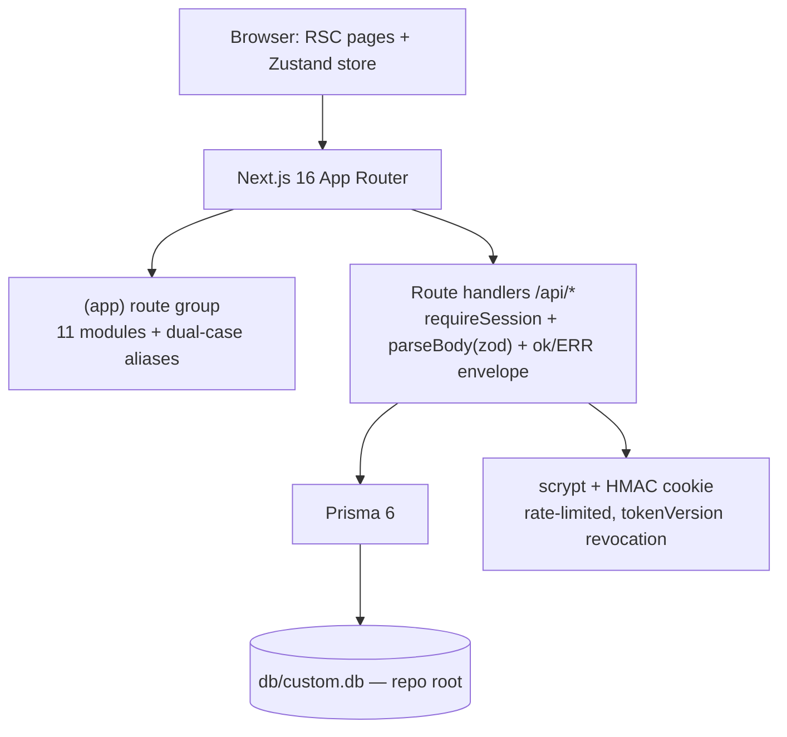

# Wellness Hub

[](https://nextjs.org/)
[](https://react.dev/)
[](https://www.typescriptlang.org/)
[](https://tailwindcss.com/)
[](https://www.prisma.io/)
[](#testing)
[](#license)

A complete, self-hostable **student wellbeing application** — a production-grade
clone of the reference app
[EvolveWell](https://evolve-well-d6cec85d.base44.app/) with an intentional
functional superset. Track exercise, mood, assignments, events and goals in
one indigo-gradient Next.js app that runs entirely on your machine.

## Overview

The reference app is a personal wellness companion for students: a dashboard
with live stats, routine templates, an exercise log, a mood journal, an
assignment tracker, an events calendar, study resources, reminders, a
learning center and a gamified goals/achievements engine. This repo rebuilds
all of it as a single Next.js App Router application with Prisma/SQLite
persistence and hand-rolled scrypt + HMAC cookie auth, then goes further than
the reference: real email-verification and password-reset flows, a live
theming engine (Light/Dark/Auto + 8 color presets), streaks and auto-awarded
badges, per-route SEO metadata, and a full
Vitest + Playwright test battery pinning all of it in place.

## Key Features

| Feature | Description |
|---------|-------------|
| 🏠 Dashboard | Live stat tiles (workouts this week, journal streak, active assignments, upcoming events), quick actions, recent activity |
| 📋 Routine Templates | 11 seeded templates with steps, benefits and pro tips; schedule any into "My Routines" |
| 💪 Exercise Tracker | Log workouts by type/intensity/duration with history and delete |
| 🧘 Mental Health | 5-emoji mood picker, energy slider, tag chips, streak math |
| 📚 Assignments | Priority-tracked assignments with completion and due-date sorting |
| 📅 Events | Month calendar with event dots, upcoming list, create/delete |
| 📖 Study Resources | 8 resource types, 5-star ratings, tag chips, search filter |
| ⏰ Reminders | Type/priority/repeat model with completion and status derivation |
| 🎓 Learning Center | 12 seeded tutorials with category/difficulty filters and search |
| 🏆 Goals & Achievements | Points engine, goal progress logging, 8-badge auto-award catalog |
| 🎨 Profile & Customization | Light/Dark/Auto mode, 8 color presets, font/radius/animation preferences — applied live, synced server-side |
| 🔐 Auth ladder | Signup with hashed OTP verification, forgot/reset password, login rate limiting, session revocation |

## Architecture

| Layer | Technology | Version | Purpose |
|-------|-----------|---------|---------|
| Framework | Next.js (App Router) | 16.4 | Full-stack React: RSC pages + route handlers |
| UI runtime | React | 19 | Server components, `useActionState`-free hand-rolled store |
| Language | TypeScript | 5.9 | Full strict mode; `bun run build` is the type gate |
| Styling | Tailwind CSS | 4.3 | CSS-first `@theme` config (no `tailwind.config.js`) |
| Components | Radix UI primitives | 1.3–2.4 | Dialog, select, label (Radix) + hand-rolled input/tabs/toast — shadcn-style |
| State | Zustand | 5 | Single client store (`src/stores/wellness-store.ts`) |
| ORM | Prisma | 6.19 | Schema + SQLite driver |
| Database | SQLite | — | `db/custom.db` at the repo root, git-ignored |
| Validation | Zod | 4 | Every API body boundary (`parseBody()`) |
| Unit tests | Vitest | 5 | 347 checks / 24 suites |
| E2E tests | Playwright | 1.64 | 63 checks (6 specs + the auth setup project) against the production standalone server |



## File Hierarchy

```
wellness-hub/
├── 📂 src/app/
│   ├── 📂 (app)/            # Auth-guarded route group: 11 module pages
│   │   ├── 📂 Dashboard/    # Capitalized aliases mirroring the reference's hrefs
│   │   └── 📂 dashboard/    # Canonical lowercase folders (re-export aliases)
│   ├── 📂 api/              # 15 route-handler families (auth, CRUD, dashboard, prefs)
│   ├── 📂 login/  signup/  reset-password/
│   └── 📄 globals.css       # Tailwind v4 @theme tokens + dark mode
├── 📂 src/components/
│   ├── 📂 layout/           # app-shell, sidebar, mobile-nav (Radix Sheet drawer), login-card
│   ├── 📂 shared/           # Module pages' shared parts (stat cards, dialogs, calendars)
│   └── 📂 ui/               # The six live primitives (dialog, input, label, select, tabs, toast)
├── 📂 src/lib/              # wellness.ts (streaks/points/badges), auth, api, schemas, db-path, rate-limit
├── 📂 src/stores/           # wellness-store.ts, theme-store.ts (CSS-variable engine)
├── 📂 prisma/schema.prisma  # 15 models (User → owned wellness entities, cascade)
├── 📂 tests/                # Vitest suites + 📂 e2e/ Playwright specs
├── 📂 docs/                 # plans/, screenshots/, deployment + SSH push runbooks
├── 📂 db/                   # SQLite databases (git-ignored)
└── 📄 worklog.md            # Session-by-session engineering log
```

## Quick Start

Requires **Node.js ≥ 20** and **bun ≥ 1.1**.

1. Clone and install:

   ```bash
   git clone https://github.com/nordeim/wellness-hub.git
   cd wellness-hub
   bun install
   ```

2. Configure the environment:

   ```bash
   cp .env.example .env
   # set AUTH_SECRET: openssl rand -hex 32
   ```

3. Create and seed the database:

   ```bash
   bun run db:push    # push prisma/schema.prisma to db/custom.db
   bun run db:seed    # seed 11 templates, 12 tutorials, 8 badges + demo user
   ```

4. Start the dev server:

   ```bash
   bun run dev        # http://localhost:3000
   ```

### Verify Setup

- `curl -s -o /dev/null -w "%{http_code}" http://localhost:3000/login` → `200`
- Log in with the demo account: `sepnetflix2023@outlook.com` / `$Abcd1234`
- The dashboard greets "Welcome Back!" with the four stat tiles.

## Environment Variables

| Variable | Purpose | Notes |
|----------|---------|-------|
| `DATABASE_URL` | SQLite path, resolved against `prisma/schema.prisma` | Default `file:../db/custom.db` → `<repo>/db/custom.db` |
| `NEXT_PUBLIC_SITE_URL` | Canonical origin for SEO metadata, sitemap, manifest | Inlined at build time |
| `AUTH_SECRET` | HMAC session-signing secret | **Required in production** — min 16 chars; boot fails hard without it |
| `WELLNESS_PROXY_HOPS` | Trusted proxy depth for rate-limit IP keying | Unset = 1; `0` = direct; fails closed |
| `WELLNESS_DISABLE_IN_APP_OTP` | Set `1` when a real mail transport exists — hides the OTP from signup responses | Optional |
| `WELLNESS_DISABLE_IN_APP_RESET` | Set `1` when a real mail transport exists — hides the reset link | Optional |

## Testing

```bash
bun run test         # Vitest — 347 checks, 24 suites (node-safe seams)
bun run test:e2e     # Playwright — 63 checks (run `bun run build` first:
                     # boots the PRODUCTION standalone server on an isolated
                     # port with its own scratch db/e2e.db)
bun run lint         # eslint, --max-warnings 0
bun run typecheck    # tsc --noEmit (fast signal; `bun run build` is the gate)
bun run gate         # lint → typecheck → test → build → smoke → e2e
```

The e2e battery covers: the auth ladder (login wall, wrong credentials, OTP
lockout ladder, reset funnel, session revocation), the mobile drawer (open,
navigate, escape, viewport-grow auto-close, scroll-lock), the shell (sidebar
nav, dual-case routes, active state, quick actions, the console-hygiene net —
every module route walked with zero console errors/warnings), the a11y net
(axe-core at WCAG 2.1+2.2 A+AA across every module route, the open mobile
drawer and the login page — zero violations — plus the dark-state walks:
every module route + the drawer in dark mode, the OS-dark-in-light corner,
the dark login and the transient select/toast surfaces, all strict zero —
plus the WH-19 widenings: the dark corners (signup, reset-password and the
404), the light computed-contrast leg (the alpha-card family axe cannot
resolve, both modes) and the auto-mode listener),
and a CRUD cycle through every wellness module including goal completion →
points.

## Design System

The reference deployed a **per-module gradient identity** (2026-10-30,
re-probed live on every page): each module carries its own H1 gradient,
primary-button pair, page-root wash and container width, while the BRAND
family (sidebar wordmark, badge, active pills, mobile/drawer titles) rides
the preset-themeable 135deg `--primary → --secondary` pair.

| Token | Value | Usage |
|-------|-------|-------|
| `--primary` | `#6366f1` (indigo-500) | The brand family: wordmark, badge, active nav pills, drawer titles (135deg gradients) |
| `--secondary` | `#a855f7` (purple-500) | Gradient partner, accents |
| Brand gradient | `bg-gradient-to-br from-primary to-secondary` | Sidebar/mobile/drawer brand + active pills (the preset-re-skinnable family) |
| Module gradients | `PAGE_THEMES` in `src/lib/page-layout.ts` | Per-page H1s, buttons, washes + the routines category map (fixed v3 pairs, not preset-themeable) |
| Page wash | `bg-gradient-to-br from-<m1>-50 via-white to-<m2>-50/30` | Every page root (dark: the neutral token family) |
| Font | `--font-sans` (system stack + Apple/Segoe/Noto emoji) | Whole app — matches the reference's computed stack |

Dark mode rides the `.dark` class token overrides in `globals.css` — and
the class-based `dark:` variant is declared explicitly
(`@custom-variant dark (&:where(.dark, .dark *))`, the Tailwind v4 pin:
without it v4 compiles every `dark:` utility to the `prefers-color-scheme`
media query and the Appearance tab's mode flip never activates them). The
theme store also writes live presets as CSS custom properties on `<html>`
(brand surfaces only — the module pairs are fixed, exactly as the
reference's own preset engine behaves), and mounts at the ROOT layout
(ThemeBoot) so the login family carries the chosen mode too.

## Superset over the Reference

- Email-verification signup ladder + forgot/reset password + login rate
  limiting + session revocation (`tokenVersion`)
- Real Light/Dark/Auto mode + 8 color presets applied live
- Points + streaks + 8-badge auto-award achievements engine
- Robust search/filters on Assignments, Study Resources, Learning
- PWA manifest + per-route OpenGraph/Twitter metadata + `sitemap.xml`
- Accessibility superset: focus rings, aria states, 44px touch targets — pinned by the axe a11y net + the computed-contrast leg (WCAG 2.1+2.2 A+AA, zero violations, light AND dark states, every login-family route)
- Zod validation at every API boundary; bounded readers; per-IP rate limits
- 347 unit + 63 e2e checks pinning the behavior

## Deployment

`bun run build` produces a self-contained `.next/standalone/` artifact
(`bun run start` boots it). Set `AUTH_SECRET`, `NEXT_PUBLIC_SITE_URL` and an
absolute `DATABASE_URL` before building — the details live in
[`docs/DEPLOYMENT.md`](docs/DEPLOYMENT.md).

## Troubleshooting

| Issue | Solution |
|-------|----------|
| `bun run db:push` writes outside the repo | Ensure `DATABASE_URL` stays the relative `file:../db/custom.db` — `src/lib/db-path.ts` resolves it against `prisma/schema.prisma` |
| Production boot refuses to start (`AUTH_SECRET` error) | Generate one: `openssl rand -hex 32`, set it in the environment — the boot gate is intentional |
| Mobile drawer hover styles look "stuck" | Tailwind v4 hover fix is `@custom-variant hover (&:hover)` in `globals.css` — do not remove the session-80 unwrap pin |
| `shadow-sm` looks too heavy | Already re-pinned in `globals.css` (`--shadow-sm: 0 1px 2px 0 rgb(0 0 0 / 0.05)`) — keep the re-pin |
| Dark mode looks half-dark (dark cards, light text) | The class-based dark variant pin is `@custom-variant dark (&:where(.dark, .dark *))` in `globals.css` — without it Tailwind v4 compiles `dark:` utilities to the OS media query and the mode toggle never activates them |

## Contributing

- **TDD flow** (RED → GREEN → REFACTOR): pin a behavior in
  `tests/*.test.ts` first, then implement. E2E specs join the corresponding
  `tests/e2e/*.spec.ts`.
- **Tailwind v4**: CSS-first config — no `tailwind.config.js`; tokens live in
  `@theme` inside `src/app/globals.css`.
- **React 19**: no `forwardRef`; `useEffect` never calls `setState`
  synchronously (an ESLint ERROR here).
- **Main branch only** — no feature branches; pushes go through
  `docs/ssh_git_wrapper_v3.py` (see
  [`docs/how-to-git-push-using-ssh-wrapper_SKILL.md`](docs/how-to-git-push-using-ssh-wrapper_SKILL.md)).

## License

[MIT](LICENSE) © 2026 nordeim
